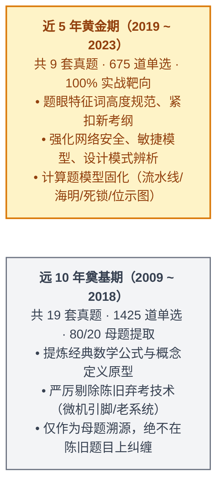

# 2009~2023年软考上午真题15年全景考点精析与冲刺绝杀手册

> 🎯 **战役心智**：软考中级软件设计师【上午科目一：综合知识】（共 75 道单选题，每题 1 分，满分 75 分，及格线恒定 45 分，考试时间 150 分钟）是考察**知识广度、辨析精度与计算速度**的战场！  
> 纵观 2009~2023 历年 15 年共 28 场考试（累计 **2,100 道真题单选**），上午试卷有着极其精密、十几年未曾改变的**“题号与考点强绑定规律”**！  
> 本手册沿用 **“A+B 复合架构”**：以 **方案 A（上午 75 题 12 大考点模块纵切深度击穿）为主体**，深度融合 **近 5 年 9 套卷（675题）高频题眼与公式库**，并对 **远 10 年（1,425题）进行母题提取与脱敏排毒**；文末附赠 **方案 B（75 题题号矩阵速查表 + 考前 50 句保命口诀 + 40 张高频避坑闪卡）**。

---

## 🧭 战略指引：时间段科学划分与上午场“脱敏红线”

> [!CAUTION] **上午冲刺三大“脱敏防坑”红线（避免老题带偏）**：
> 1. **过时软硬件脱敏**：2009~2013 年早期试卷中偶考的“DOS 中断调用、Windows 98/2000/XP 注册表键值细节、老旧硬件芯片 8255/8259 引脚功能”，在现行考试中**已彻底绝迹**！复习老题遇到此类题目，**一律直接跳过，切勿深究**！
> 2. **过时网络技术脱敏**：早期的某些窄带接入技术（如 ISDN、帧中继某些陈旧参数）已被现代光纤、以太网、5G 与云原生架构（LCAP/PaaS/微服务/DevOps）取代。
> 3. **计算题套路脱敏**：早期部分计算题题目冗长，近 5 年计算题题干极其精炼，核心考查**海明码不等式、流水线周期与吞吐率、死锁极值公式、位示图磁盘计算、二叉树空指针域**等标准通式。

---

# 🥊 第一部分：方案 A · 上午 75 题 12 大模块纵切深度击穿

---

## 模块 01：计算机组成与体系结构（题 1 ~ 6，稳定 6 分）

### 1. 细化考查点与 15 年题号映射

* **第 1 题（CPU 核心架构与寄存器）**：
  * **控制器部件**：程序计数器（PC，存放下一条指令地址）、指令寄存器（IR）、指令译码器（ID）、时序发生器。
  * **运算器部件**：算术逻辑单元（ALU）、累加寄存器（AC/ACC）、数据缓冲寄存器（DR）、状态条件寄存器（PSW）。
* **第 2 题（指令集架构与寻址方式）**：
  * **RISC vs CISC 必考对比**：
    * RISC（精简指令集）：指令少、长度固定、硬布线组合逻辑控制（速度极快）、**大量通用寄存器**、仅 Load/Store 能访存。
    * CISC（复杂指令集）：指令多、长度不固定、微程序控制器（微代码ROM）、寄存器少。
  * **寻址速度天梯**：**立即寻址（操作数在指令中） > 寄存器寻址（在寄存器中） > 直接寻址（在内存中） > 间接寻址（在内存中二次寻址）**。
* **第 3 题（存储体系与 Cache 机制）**：
  * **三级存储体系速度与容量**：寄存器 > Cache > 主存 > 辅存（硬盘/光盘）。
  * **Cache 本质**：提高 CPU 访问主存的平均存取速度，**由硬件自动完成映射，对程序员完全透明**！
  * **命中率公式**：平均存取时间 $t_a = h \times t_c + (1 - h) \times t_m$（$h$ 为命中率，$t_c$ 为 Cache 访问时间，$t_m$ 为主存访问时间）。
  * **地址映射方式**：全相联（灵活/查表慢）、直接映射（冲突高/简单）、组相联（折中）。
* **第 4 题（流水线技术核心计算）**：
  * **流水线周期 $\Delta t$**：为各段执行时间中的**最大值**（最长流水段）。
  * **流水线执行时间**：$T = \text{一条指令完整执行时间} + (n - 1) \times \Delta t$。
  * **吞吐率**：$TP = \frac{n}{T}$；**最大吞吐率**：$TP_{\max} = \frac{1}{\Delta t}$。
* **第 5 题（数据的表示与定点/浮点数）**：
  * **码制特性**：原码、反码、补码、移码。**补码与移码中 0 的表示是唯一的**；补码能将减法转加法；补码直观性差。
  * **浮点数加减法运算三步走**：
    1. **对阶**：**小阶向大阶看齐**（小阶尾数右移，阶码增加，低位移出可能丢失精度）；
    2. **尾数求和/差**；
    3. **结果规格化**：使尾数绝对值在 $[0.5, 1)$ 之间，最高数值位为有效位。
* **第 6 题（总线、I/O 控制与校验码）**：
  * **DMA（直接内存存取）本质**：在主存与外设之间开辟高速数据通路，**仅挪用一个“总线周期”，由硬件直接控制传输，CPU 给出的是主存“物理地址”**！
  * **中断向量**：提供的是**中断服务程序的入口地址**。
  * **海明码校验位不等式（必考计算）**：信息位为 $n$ 位，校验位为 $k$ 位，检错纠错满足：$$2^k \ge n + k + 1$$
  * **CRC（循环冗余校验码）**：基于**模 2 除法（异或运算，不借位不进位）**，只能检错不能纠错。

---

## 模块 02：程序设计语言与编译基础（题 7 ~ 9，稳定 3 分）

### 1. 细化考查点与 15 年题号映射

* **第 7 题（编译器各阶段职责划分与错误定性）**：
  * **词法分析**：输入字符流，识别词法单元（Token）；**错误类型：非法字符、标识符拼写错误**。
  * **语法分析**：依据文法生成语法树（推导/归约）；**错误类型：括号不匹配、缺少分号、关键字拼写错误**。
  * **语义分析**：审查静态语义，构建符号表，类型检查；**错误类型：类型不兼容（如浮点数与指针相加）、变量未声明使用、形实参类型不匹配**。
  * **目标代码生成**：生成汇编代码或机器指令，**与具体机器硬件架构强相关**。
  * ⚠️ **易错辨析**：编译程序**只负责将源码翻译为目标代码，绝不执行代码**！死循环、除零错误属于**动态运行期错误**，编译期无法查出！
* **第 8 题（文法、正规式与有限自动机 DFA）**：
  * **正规式等价转换**：掌握 `*`（0到多次）、`+`（1到多次）、`|`（或）的展开；
  * **自动机 DFA 识别字符串**：
    * 判定法则：从**初始状态**出发，沿输入字符弧线转移；
    * 成功标志：遍历完整个字符串后，停留在**终止状态（双圈表示）**！
* **第 9 题（程序语言参数传递与作用域）**：
  * **值调用（传值）**：形参开辟新内存，复制实参副本，**形参改变绝不影响实参**！
  * **引用调用（传址/传引用）**：形参是指向实参的指针或别名，**在函数内修改形参直接同步修改实参**！

---

## 模块 03：操作系统知识（题 10 ~ 15，稳定 6 分）

### 1. 细化考查点与 15 年题号映射

* **第 10 题（进程状态模型与 PV 操作）**：
  * **进程三态与五态转换**：就绪 $\to$ 运行（被调度）；运行 $\to$ 就绪（时间片用完）；运行 $\to$ 阻塞（等待资源/I/O）；阻塞 $\to$ 就绪（I/O完成）。**阻塞态绝不可能直接转入运行态！**
  * **PV 原语本质**：$P(S)$（$S=S-1$，若 $S < 0$ 进程阻塞入等待队列）；$V(S)$（$S=S+1$，若 $S \le 0$ 唤醒一个等待进程）。
* **第 11 题（死锁预防、避免与极值计算）**：
  * **死锁产生的 4 大必要条件**：互斥条件、不剥夺条件、请求和保持条件、循环等待条件。
  * **不发生死锁的系统最小资源数公式（必考）**：系统有 $m$ 个进程，每个进程需要 $w$ 个资源，则**保证系统绝不发生死锁的最小资源总数**为：$$R_{\min} = m \times (w - 1) + 1$$
  * **银行家算法**：属于**死锁避免**技术（在资源分配前探测系统是否存在安全序列）。
* **第 12 题（页式存储管理与地址映射）**：
  * **逻辑地址切分**：页大小为 $2^k$（如 4KB 对应 $2^{12}$，即低 12 位为**页内偏移量**，高位为**逻辑页号**）。
  * **页表查物理地址**：逻辑页号查页表换出**物理块号**，拼上页内偏移量即可秒出物理地址。
* **第 13 题（页面置换算法）**：
  * **常见算法**：最优置换（OPT，理想不可实现）、先进先出（FIFO，**可能产生 Belady 异常，即分配页框增多缺页反而增加**）、最近最少使用（LRU）。
  * **状态位/访问位/修改位三级淘汰法则**：
    1. 状态位必须为 1（在内存）；
    2. 访问位为 0（近期未访问优先淘汰）；
    3. 修改位为 0（未修改无需写回磁盘，开销最小，最优先淘汰）。
* **第 14 题（文件多级索引节点计算）**：
  * 假设盘块大小为 1KB，每个地址项占 4B（一个盘块可放 $1\text{KB}/4\text{B} = 256$ 个物理盘块号）：
    * 直接索引：直接指向物理盘块；
    * 一级间接索引：指向包含 256 个盘块号的索引盘块；
    * 二级间接索引：指向包含 $256 \times 256 = 65,536$ 个盘块号。
* **第 15 题（位示图与磁盘调度算法）**：
  * **位示图存储计算**：每 1 位（bit）表示 1 个物理盘块的空闲状态。字长 32 位表示一个字管 32 个物理块。
  * **磁盘调度算法**：先来先服务（FCFS）、最短寻道时间优先（SSTF，**容易导致边缘磁道进程“饥饿”**）、电梯扫描算法（SCAN，单向移动直到尽头再反向）。

---

## 模块 04：软件工程与项目管理（题 16 ~ 25，稳定 8 ~ 10 分）

### 1. 细化考查点与 15 年题号映射

* **第 16 题（开发过程模型辨析）**：
  * **瀑布模型**：阶段严格串行，文档驱动，**最适合需求明确、稳定的传统项目**。
  * **快速原型模型**：适合**需求模糊、早期不明确**的项目。
  * **螺旋模型**：瀑布 + 原型 + **引入风险分析**，适合庞大、复杂且高风险的项目。
  * **喷泉模型**：专供**面向对象**，特点是**迭代与无间隙**。
  * **敏捷开发模型**：Scrum（Sprint 冲刺）、XP（极限编程：结对编程、测试驱动 TDD、重构、持续集成）。
* **第 17 题（结构化设计内聚与耦合天梯）**：
  * **内聚性（高好）**：功能内聚（最高） > 顺序内聚 > 通信内聚 > 过程内聚 > 时间内聚 > 逻辑内聚 > 偶然内聚（最低/又称病态内聚）。
  * **耦合性（低好）**：无直接耦合（最低） > 数据耦合（最佳低耦合，传简单值） > 标记耦合（传复合数据结构） > 控制耦合（传标志位） > 外部耦合 > 公共耦合（共享全局变量） > 内容耦合（最高/最差）。
* **第 18 题（软件测试原则与用例设计）**：
  * **黑盒测试（看功能）**：等价类划分、边界值分析（最有效找错）、判定表、因果图。
  * **白盒测试（看代码结构）**：语句覆盖（最弱） < 判定覆盖 < 条件覆盖 < 判定/条件覆盖 < 条件组合覆盖 < 路径覆盖。
  * **McCabe 环路复杂度公式（必考）**：$$V(G) = m - n + 2$$（$m$ 为控制流图的有向边数，$n$ 为结点数；或等于**判定节点数 $+ 1$**）。
* **第 19 题（软件维护类型分类）**：
  * **纠错性维护**：修复运行中暴露的 Bug（占比约 20%）。
  * **适应性维护**：适应外部环境变化（如升级 OS、换硬件平台、新政策）。
  * **完善性维护**：增加新功能、提升性能、优化界面（**占比最高，约 50%**）。
  * **预防性维护**：为未来的扩展或重构做准备。
* **第 20 题（项目进度管理 PERT/CPM 计算）**：
  * **关键路径**：从源点到汇点**耗时最长的一条路径**，其长度决定了项目的最短总工期。
  * **总时差（松弛时间）**：不影响总工期的前提下，该活动允许的最大推迟时间。**关键路径上的活动总时差恒为 0**！
* **第 21 题（项目风险管理策略）**：
  * **回避**：修改项目计划彻底消除风险源头；
  * **转移**：买保险、外包给第三方；
  * **减轻**：采取措施降低概率或减少损失；
  * **接受**：自担后果，设立应急预备金。

---

## 模块 05：系统开发与运行维护（题 26 ~ 31，稳定 5 ~ 6 分）

### 1. 细化考查点与 15 年题号映射

* **第 26 题（软件体系结构风格）**：
  * **数据流风格**：批处理序列、管道-过滤器（各构件高内聚、好复用、支持并发，**唯独不能交互**）。
  * **调用/返回风格**：主程序/子程序、面向对象、分层体系结构。
  * **独立构件风格**：进程通信、事件驱动系统。
  * **虚拟机风格**：解释器、基于规则的系统。
  * **仓库风格**：数据库系统、黑板系统。
* **第 27 题（系统可靠性模型计算）**：
  * **串联系统**：只要一个坏，系统就坏。$R = R_1 \times R_2 \times \dots \times R_n$。
  * **并联系统**：全部都坏，系统才坏。$R = 1 - (1 - R_1)(1 - R_2)\dots(1 - R_n)$。
  * **度量指标**：可靠性指标平均无故障时间（MTTF），可维护性指标平均修复时间（MTTR），可用性指标 $A = \frac{\text{MTTF}}{\text{MTTF} + \text{MTTR}}$。

---

## 模块 06：数据库系统技术（题 32 ~ 37，稳定 6 分）

### 1. 细化考查点与 15 年题号映射

* **第 32 题（三级模式与两级映像）**：
  * **三级模式**：外模式（用户视图）、概念模式（全局逻辑结构/表）、内模式（物理存储结构/索引）。
  * **两级独立性**：外模式-概念模式映像提供**逻辑独立性**；概念模式-内模式映像提供**物理独立性**。
* **第 33 题（关系代数运算与查询优化）**：
  * **五种基本运算**：并（$\cup$）、差（$-$）、广义笛卡尔积（$\times$）、投影（$\pi$）、选择（$\sigma$）。
  * **连接运算**：自然连接（相同属性名做等值连接并**自动去重单列**）。
  * **查询优化第一定律**：**选择运算尽早执行（选择下推）**，大幅减少中间数据量。
* **第 34 题（函数依赖、候选码与闭包求解）**：
  * **候选码秒杀规则**：
    1. 只在依赖右侧出现的属性，绝不能出现在候选码中；
    2. 只在左侧出现、或两侧都未出现的属性，**必须包含在候选码中**；
    3. 求闭包 $X^+$，若能推导出全属性 $U$，则 $X$ 为候选码。
* **第 35 题（关系规范化理论范式天梯）**：
  * **1NF**：属性值不可再分（原子性）；
  * **2NF**：消除了非主属性对码的**部分函数依赖**；
  * **3NF**：消除了非主属性对码的**传递函数依赖**；
  * **BCNF**：消除了主属性对码的部分和传递依赖（所有决定因素都包含码）。
* **第 36 题（事务 ACID 与并发控制）**：
  * **事务 ACID 特性**：原子性（Atomicity）、一致性（Consistency）、隔离性（Isolation）、持久性（Durability）。
  * **并发操作三大问题**：丢失更新、读“脏”数据、不可重复读。
  * **封锁协议**：一级封锁（防丢失修改）、二级封锁（防读脏数据）、三级封锁（防不可重复读）。

---

## 模块 07：面向对象技术与 UML（题 38 ~ 45，稳定 8 分）

### 1. 细化考查点与 15 年题号映射

* **第 38 题（面向对象核心概念）**：
  * **类与对象**：类是对象的抽象模具，对象是类的运行态实例。
  * **封装**：隐藏实现细节，暴露公共接口。
  * **继承**：单继承、多继承（共享父类属性与方法）。
  * **多态四形态**：参数多态（泛型）、包含多态（子类重写父类虚方法）、过载多态（重载，同名不同参）、强制多态（隐式类型转换）。
* **第 39 题（UML 图分类与语义场景）**：
  * **静态结构图**：类图（Class）、对象图（Object）、构件图（Component）、部署图（Deployment，**画 3D 立方体节点，表达物理硬件拓扑**）。
  * **动态行为图**：用例图（Use Case，系统功能与参与者）、顺序图（Sequence，**按时间顺序表达对象交互**）、协作/通信图（强调拓扑交互）、状态图（Statechart，**表达对象状态流转**）、活动图（Activity，**表达业务工作流，支持并发分叉汇合**）。
* **第 40~45 题（23 种设计模式意图分类与题眼特征词）**：
  * **创建型（5种，成套造对象）**：
    * `工厂方法 (Factory Method)`：一个抽象工厂派生多个具体工厂，各造一种产品；
    * `抽象工厂 (Abstract Factory)`：制造**一整套产品族**（成套生产）；
    * `单例 (Singleton)`：确保全局唯一实例，提供全局访问点；
    * `原型 (Prototype)`：**克隆复制现有对象**；
    * `生成器 (Builder)`：**分步构建复杂对象**。
  * **结构型（7种，类与对象组装）**：
    * `适配器 (Adapter)`：**转换接口**以解决不兼容；
    * `桥接 (Bridge)`：将**抽象部分与实现部分分离**，使其独立变化；
    * `组合 (Composite)`：**树形结构**，以一致的方式对待整体与部分；
    * `装饰器 (Decorator)`：**动态为对象透明附加新职责**；
    * `外观 (Facade)`：为子系统提供一个**一致的高层门面接口**；
    * `享元 (Flyweight)`：**共享细粒度对象**，极大降低内存开销；
    * `代理 (Proxy)`：为其他对象提供一种**代理以控制对其访问**。
  * **行为型（11种，职责分派与交互）**：
    * `策略 (Strategy)`：**封装一组可互换的算法**；
    * `观察者 (Observer)`：**一对多发布-订阅**，状态变化自动广播；
    * `中介者 (Mediator)`：**用中介对象封装一系列对象交互**，避免网状耦合；
    * `状态 (State)`：**对象内部状态改变时改变其行为**；
    * `备忘录 (Memento)`：**保存快照与恢复**；
    * `命令 (Command)`：**将请求封装为对象**，支持撤销排队。

---

## 模块 08：数据结构与算法基础（题 46 ~ 55，稳定 10 分）

### 1. 细化考查点与 15 年题号映射

* **第 46 题（线性结构与栈队列应用）**：
  * **顺序表 vs 链表**：顺序表随机存取 $O(1)$，插入删除需移动元素 $O(n)$；链表不能随机存取，插入删除修改指针 $O(1)$。
  * **栈与队列**：栈是先进后出（LIFO），常用于括号匹配、表达式求值、递归调用；队列是先进先出（FIFO），常用于层序遍历、排队缓冲区。
* **第 47~48 题（二叉树数学性质与遍历）**：
  * **性质 1**：在任意二叉树中，**度为 0 的叶子结点数 $n_0$ 等于度为 2 的结点数 $n_2 + 1$**，即 $n_0 = n_2 + 1$。
  * **性质 2**：含有 $n$ 个结点的二叉树二叉链表中，**空指针域个数恒为 $n + 1$**（与树的具体形态完全无关！）。
  * **完全二叉树下标性质**：从 1 编号，结点 $i$ 的左孩子为 $2i$，右孩子为 $2i+1$，父节点为 $\lfloor i/2 \rfloor$。
  * **二叉树逆向还原**：**已知中序 + 前序（或后序），必可唯一确定一棵二叉树**（已知前序和后序不能唯一确定）。
* **第 49 题（哈夫曼树构造与前缀编码）**：
  * **构造原理**：每次选当前权值最小的两个结点合并，新结点权值为二者之和，不断重复直到成树。
  * **关键性质**：哈夫曼树中**只有度为 0 和度为 2 的结点，没有度为 1 的结点**（即 $n_1 = 0$）；含 $n$ 个叶子结点的哈夫曼树总结点数为 $2n - 1$。
  * **前缀码判定**：任何一个字符的编码绝不能是另一个字符编码的前缀。
* **第 50 题（图的遍历与拓扑排序）**：
  * **图的遍历**：深度优先（DFS，递归/栈） vs 广度优先（BFS，队列）。
  * **拓扑排序**：针对有向无环图（DAG），每次选入度为 0 的顶点输出并删去其引出的弧，若最终输出顶点数小于总数，说明**图中存在回路（环）**。
* **第 51~55 题（内部排序算法与复杂度大表）**：

| 排序算法 | 平均时间复杂度 | 最好时间复杂度 | 最坏时间复杂度 | 空间复杂度 | 稳定性 | 考场特征与记忆口诀 |
| :--- | :---: | :---: | :---: | :---: | :---: | :--- |
| **直接插入排序** | $O(n^2)$ | $O(n)$ | $O(n^2)$ | $O(1)$ | 稳定 | 基本有序时最快，就地排序空间 $O(1)$ |
| **希尔排序** | $O(n^{1.3})$ | $O(n)$ | $O(n^2)$ | $O(1)$ | **不稳定** | 跨增量跳跃分组插入，不稳定！ |
| **冒泡排序** | $O(n^2)$ | $O(n)$ | $O(n^2)$ | $O(1)$ | 稳定 | 相邻比较交换，每趟确定一个极值 |
| **快速排序** | $O(n \log n)$ | $O(n \log n)$ | $O(n^2)$ | $O(\log n)$ | **不稳定** | 划分基准，递归栈空间，最坏已近有序 |
| **简单选择排序** | $O(n^2)$ | $O(n^2)$ | $O(n^2)$ | $O(1)$ | **不稳定** | 不管初始状态如何，时间恒为 $O(n^2)$ |
| **堆排序** | $O(n \log n)$ | $O(n \log n)$ | $O(n \log n)$ | $O(1)$ | **不稳定** | **时间恒定 $n\log n$，辅助空间恒为 $O(1)$** |
| **二路归并排序** | $O(n \log n)$ | $O(n \log n)$ | $O(n \log n)$ | $O(n)$ | 稳定 | **时间恒定 $n\log n$，需要额外辅助空间 $O(n)$** |

> 💡 **稳定性必背口诀**：**考场“快、选、堆、希”不稳定，其余全稳定！**

---

## 模块 09：计算机网络与信息安全（题 56 ~ 63，稳定 8 分）

### 1. 细化考查点与 15 年题号映射

* **第 56 题（OSI 与 TCP/IP 体系结构映射）**：
  * **表示层专属职责**：**数据语法表示转换、数据压缩解压、数据加解密**。
  * **传输层专属职责**：**自下而上首个提供进程级端到端服务**（TCP 面向连接可靠 / UDP 无连接尽力交付）。
  * **常见协议与默认端口**：DNS（UDP 53）、DHCP（UDP 67/68）、HTTP（TCP 80）、HTTPS（TCP 443）、FTP（TCP 20数据/21控制）、SMTP（TCP 25）、POP3（TCP 110）、SNMP（UDP 161轮询/162告警Trap）。
* **第 57 题（IP 寻址、CIDR 与子网划分）**：
  * **子网掩码计算**：从高位向右借位。主机数公式为 $2^h - 2 \ge N$（$h$ 为主机号位数，减 2 去掉网络地址和广播地址）。
* **第 58~59 题（现代密码学体制）**：
  * **对称加密（私钥加密）**：DES、3DES、AES、RC4。特点：**加解密同一密钥，速度快，适合加密海量明文数据**；缺点：密钥分发难。
  * **非对称加密（公钥加密）**：RSA、ECC。特点：**公钥加密私钥解密，速度慢，适合加密会话密钥或数字签名**。
* **第 60 题（数字签名与数字证书 PKI）**：
  * **数字签名**：发送方用**自己的私钥签名**，接收方用**发送方的公钥验证签名**（保证真实性、防抵赖、防篡改）。
  * **数字证书**：由权威机构 CA 签发。客户端用 **CA 的公钥解密验证证书上的 CA 签名**，以确认网站身份合法性！
* **第 61~63 题（网络安全攻击与防御设备）**：
  * **攻击类型**：SQL 注入（防范靠参数化查询/预编译）、XSS 跨站脚本、ARP 欺骗（局域网网关伪造）。
  * **安全设备职责边界**：
    * **防火墙**：网络层/传输层访问控制（包过滤、状态检测）；
    * **IDS（入侵检测系统）**：**旁路监听，只报警不阻断**；
    * **IPS（入侵防御系统）**：**串联在线部署，能自动实时阻断攻击**；
    * **WAF（Web应用防火墙）**：应用层深度检测，防御 SQL 注入与 XSS。

---

## 模块 10：知识产权与标准化（题 64 ~ 66，稳定 3 分）

### 1. 细化考查点与 15 年题号映射

* **第 64 题（软件著作权客体与归属）**：
  * **保护客体**：保护**计算机软件代码和技术文档的“表达”**，**思想、算法、数学概念绝不受保护**！
  * **职务作品归属**：
    * 属于单位职务作品：主要利用法人物质技术条件，由法人承担责任的开发，**著作权归单位**；
    * 个人作品：业余时间且未利用单位物质技术条件，著作权归个人。
* **第 65 题（著作权继承与保护期）**：
  * **人身权（署名权、修改权、保护作品完整权）**：永久保护，**不可转让不可继承**！
  * **财产权（发表权、使用权、获得报酬权）**：公民为终生及死后 50 年；单位为发表后 50 年，**可转让可继承**。
* **第 66 题（专利权与商标权）**：
  * **专利权**：技术方案结合的算法可申发明专利。原则：**谁先申请谁拥有（先申请原则）**；保护期：发明专利 20 年。
  * **商标权**：有效保护期 10 年，**期满前 12 个月可申请续展**，只要续展可无限延长保护期。

---

## 模块 11：数学与运筹方法（题 67 ~ 70，稳定 4 分）

### 1. 细化考查点与 15 年题号映射

* **第 67 题（线性规划求最值）**：根据约束条件画可行域，代入目标函数求最大值/最小值。
* **第 68 题（决策树与期望收益值）**：计算各分支：$\text{期望值} = \sum (\text{概率} \times \text{收益})$，选期望收益最大的方案。
* **第 69 题（状态转移矩阵 / 动态规划模型）**：两态马尔可夫转移计算稳定概率。
* **第 70 题（图论最小生成树与最短路应用）**：Prim/Kruskal 最小总铺设成本、Dijkstra 最短路径。

---

## 模块 12：专业英语（题 71 ~ 75，固定 5 分）

### 1. 近 5 年命题热点与高频词汇

一段 150~200 词的科技短文，挖空 5 个专业词汇。近 5 年核心主题：
* **2023上**：低代码平台（LCAP / Low-code）、PaaS 云平台、可视化建模（Process Modeling）、组件化与自动化开发。
* **2022下**：面向服务架构（SOA）、Web 服务（Web Services）、分布式计算、无状态特性（Statelessness）。
* **2021下**：信息安全三元组（CIA：Confidentiality 保密性、Integrity 完整性、Availability 可用性）、访问控制与授权。
* **2020下**：云计算架构（IaaS, PaaS, SaaS）、敏捷宣言与敏捷开发（Agile Software Development）、DevOps。

---

# 🚀 第二部分：方案 B · 上午场终极绝杀工具箱

---

## 附录一：【15 年全景 75 题题号与分值分布速查矩阵】

| 题号区间 | 考核知识模块 | 稳定分值 | 冲刺目标分 | 核心秒杀提分心法 |
| :---: | :--- | :---: | :---: | :--- |
| **1 ~ 6** | **计算机组成与体系结构** | **6 分** | **5 ~ 6 分** | 牢记 RISC 大量寄存器、流水线周期公式、海明不等式 $2^k \ge n+k+1$ |
| **7 ~ 9** | **程序设计语言与编译** | **3 分** | **2 ~ 3 分** | 静态语义错误是类型不匹配；DFA 判定看终止状态双圈 |
| **10 ~ 15** | **操作系统知识** | **6 分** | **5 ~ 6 分** | 死锁极值公式 $m(w-1)+1$；状态/访问/修改位淘汰法；SCAN电梯调度 |
| **16 ~ 25** | **软件工程与项目管理** | **10 分** | **8 ~ 9 分** | 瀑布需求明确；McCabe复杂度 $m-n+2$；完善性维护占50%；关键路径最长 |
| **26 ~ 31** | **系统开发与体系结构** | **5 分** | **4 ~ 5 分** | 管道过滤器不能交互；串并联可靠度公式 |
| **32 ~ 37** | **数据库系统技术** | **6 分** | **5 ~ 6 分** | 候选码看左侧闭包；1NF消非原子、2NF消部分、3NF消传递；选择尽早下推 |
| **38 ~ 45** | **面向对象技术与 UML** | **8 分** | **7 ~ 8 分** | 部署图看3D立方体；顺序图看时间序列；23种设计模式特征词秒杀 |
| **46 ~ 55** | **数据结构与算法基础** | **10 分** | **8 ~ 9 分** | 叶子等于双度加1；二叉树空指针 $n+1$；快选堆希不稳定；堆排空间 $O(1)$ |
| **56 ~ 63** | **计算机网络与信息安全** | **8 分** | **6 ~ 7 分** | 表示层加密压缩；CA公钥验证书签名；私钥签名公钥验；IDS旁路IPS串联 |
| **64 ~ 66** | **知识产权与标准化** | **3 分** | **3 分** | 软件著作权保表达不保思想；职务作品归单位；商标期满前12个月续展 |
| **67 ~ 70** | **数学与运筹方法** | **4 分** | **2 ~ 3 分** | 期望收益值公式 $\sum(P \times V)$；线性规划代选项特值验证 |
| **71 ~ 75** | **专业英语** | **5 分** | **3 ~ 4 分** | 抓主谓宾上下文代词，锁定 CIA、Cloud、Agile、Service 核心计算机词库 |
| **总计** | **全卷 75 道单选题** | **75 分** | **60 ~ 65 分** | **及格线 45 分，手握 60+ 分稳操胜券！** |

---

## 附录二：【考前 50 句押韵保命口诀与速查大表】

1. **体系架构**：RISC 精简指令少，硬布线快寄存器多；CISC 复杂微程序，指令变长代码密。
2. **三级存储**：Cache 硬件自动管，程序员透明不用看；命中平均要加权，小阶看齐大阶赶。
3. **流水计算**：流水周期取最大，首条指令执行全；剩余 $n-1$ 乘周期，最大吞吐倒数算。
4. **校验码距**：海明不等 $2^k$ 大，信息加 $k$ 再加一；CRC 模二异或算，只能检错不能纠。
5. **编译分期**：词法管拼写，语法管分号；类型不合是语义，除零死循环运行期。
6. **自动机**：正规展开看星号，状态流转找终点；双圈就是合格态，不入双圈全算废。
7. **参数传递**：传值只传副本走，函数改动外面留；传引就是传别名，函数一改外全变。
8. **死锁极值**：每个进程需求减去一，累加起来再加一；资源满足此极限，系统无论如何不死锁。
9. **页面淘汰**：状态位是一才在，访问位零近期冷；修改位零省写回，三层过滤秒淘汰。
10. **多级索引**：直接索引直接指，一级间接指盘块；盘块大小除四字节，二级就是平方算。
11. **磁盘调度**：SSTF 贪就近，边缘磁道易饥饿；电梯 SCAN 一路走到头，反向回头最公平。
12. **内聚天梯**：偶然逻辑时间内，过程通信顺序排；单一功能是最高，七级内聚记心怀。
13. **耦合天梯**：数据耦合最理想，结构标记紧跟上；若传标志是控制，公共内容最荒唐。
14. **白盒圈度**：McCabe 算环路，有向边减结点加二；判定节点直接加一，一眼秒杀零失误。
15. **维护类型**：修错是纠错，环境变是适应；增加功能是完善，为将来重构是预防。
16. **项目进度**：关键路径耗时最长，决定总工期没商量；关键活动时差零，松弛时间是机动。
17. **结构风格**：管道过滤单向流，并行高内聚好复用；构件之间解耦好，唯独不能搞交互。
18. **关系范式**：属性原子是一范，消除部分是二范；消除传递是三范，决定因素在码上四范进。
19. **关系代数**：自然连接去重列，选择运算尽早做；选择下推省内存，中间结果少很多。
20. **模式映像**：外模概念逻独立，概念内模物独立；数据字典存定义，视图查询不存据。
21. **事务隔离**：一级加写防丢失，二级加读读完放；三级加读事务终，两段加锁可串行。
22. **UML 图谱**：部署图看立方体，顺序图看时间轴；用例图看功能界，状态图看对象生。
23. **创建模式**：工厂方法单产品，抽象工厂产品族；原型克隆复制走，生成器分步构复杂。
24. **结构模式**：适配器解不兼容，桥接抽象实现分；组合树形一致对，外观门面系统轻。
25. **行为模式**：策略算法可互换，观察者发布订阅全；中介封装防网状，备忘录快照随时还。
26. **树的性质**：二叉树求空指针，公式恒定 $n+1$；度为零等于度二加一，满二叉树叶居底。
27. **哈夫曼树**：无度为一哈夫曼，叶子 $n$ 个点 $2n-1$；两两最小合并起，前缀编码绝无歧。
28. **排序稳定**：“快选堆希”不稳定，其余全部都稳定；堆排归并 $n\log n$，堆空就地归并外。
29. **网络分层**：表示层管加解密，压缩解压语法统；传输首个端到端，IP 网际尽力送。
30. **常见端口**：DNS 五十三，HTTP 八十进；HTTPS 四四三，SNMP 轮询一六一。
31. **安全攻防**：私钥签名防抵赖，公钥验签身份实；CA 证书公钥解，对称加解海量明。
32. **安全设备**：防火墙管网络层，IDS 旁路只报警；IPS 串联直阻断，WAF 专防注与 XSS。
33. **法规知识**：著作权保表达不保思想，职务作品归单位；署名修改永久保，财产权利死后五十年。
34. **专利商标**：专利先申先拥有，发明二十年保护；商标十年可续展，期满前十二月办。

---

## 附录三：【考前 40 张高危易错高频闪卡（Anki 级）】

### 模块 01~03：硬件、语言与操作系统（12 张卡）

* 🎴 **闪卡 01 ｜ DMA 物理地址本质**
  * **设问**：DMA 传输时，CPU 给出的是主存什么地址？占用 CPU 哪个周期？
  * **秒杀**：**主存物理地址**；仅周期挪用占用一个**总线周期**，绝非指令周期！
* 🎴 **闪卡 02 ｜ 补码表示初衷与代价**
  * **设问**：计算机采用补码表示定点数的核心初衷与代价分别是什么？
  * **秒杀**：初衷是**将减法转为加法，符号位参与运算**；代价是**与真值对应关系不直观**。
* 🎴 **闪卡 03 ｜ 海明码校验位计算**
  * **设问**：信息位为 8 位时，纠正 1 位错的海明码校验位至少几位？
  * **秒杀**：代入 $2^k \ge 8 + k + 1 \implies$ 当 $k=4$ 时 $16 \ge 13$ 成立，**选 4 位**。
* 🎴 **闪卡 04 ｜ 浮点数加法对阶**
  * **设问**：两个浮点数相加对阶时，阶码如何对齐？尾数如何移动？
  * **秒杀**：**小阶向大阶看齐**！小阶的阶码增大，其尾数向右移。
* 🎴 **闪卡 05 ｜ 静态语义错误定性**
  * **设问**：浮点数变量与指针相加属于哪种编译错误？
  * **秒杀**：属于**静态语义错误**（类型不兼容），绝非语法错误！
* 🎴 **闪卡 06 ｜ 自动机识别字符串**
  * **设问**：有限自动机 DFA 成功识别一个字符串的充要标志是什么？
  * **秒杀**：输入字符读完时，当前状态必须落在**终止状态（双圈节点）**上！
* 🎴 **闪卡 07 ｜ 死锁极值资源计算**
  * **设问**：系统有 5 个进程，每个进程需要 3 个资源，保证绝不死锁的最小资源数？
  * **秒杀**：$R_{\min} = 5 \times (3 - 1) + 1 = 11$ 个。
* 🎴 **闪卡 08 ｜ Belady 异常**
  * **设问**：哪个页面置换算法会出现“分配物理页框增加，缺页次数反而增加”的异常？
  * **秒杀**：**FIFO（先进先出置换算法）**。
* 🎴 **闪卡 09 ｜ 页面淘汰三级过滤**
  * **设问**：页面置换中，同时有访问位（0/1）和修改位（0/1），最先淘汰哪个？
  * **秒杀**：**访问位=0 且 修改位=0** 的页面最先淘汰（近期未用且省去磁盘写回开销）。
* 🎴 **闪卡 10 ｜ 磁盘调度饥饿现象**
  * **设问**：FCFS、SSTF、SCAN 中，哪个算法会引发“饥饿”现象？
  * **秒杀**：**SSTF（最短寻道时间优先）**，因就近贪心导致边缘磁道进程饥饿。
* 🎴 **闪卡 11 ｜ 中断向量本质**
  * **设问**：中断向量表里存放的是什么？
  * **秒杀**：存放的是**中断服务程序的入口地址**。
* 🎴 **闪卡 12 ｜ 控制器核心部件 PC**
  * **设问**：程序计数器 PC 属于控制器还是运算器？存放什么？
  * **秒杀**：属于**控制器**；存放**下一条指令的地址**。

---

### 模块 04~06：软工、系统与数据库（14 张卡）

* 🎴 **闪卡 13 ｜ 需求模糊选什么模型**
  * **设问**：项目早期用户需求模糊、不明确时，首选哪种开发模型？
  * **秒杀**：首选**快速原型模型（Prototyping）**。
* 🎴 **闪卡 14 ｜ 模块内聚最高等级**
  * **设问**：模块所有成分完成单一特定功能，属于哪种内聚？
  * **秒杀**：**功能内聚（Functional Cohesion）**。
* 🎴 **闪卡 15 ｜ 最佳低耦合类型**
  * **设问**：模块间仅通过参数传递简单的数值，属于哪种耦合？
  * **秒杀**：**数据耦合（Data Cohesion）**。
* 🎴 **闪卡 16 ｜ 完善性维护占比**
  * **设问**：为了扩充功能、改善界面、提升性能而进行的维护叫什么？占多大比例？
  * **秒杀**：**完善性维护**；在所有维护类型中**占比最高（约 50%）**。
* 🎴 **闪卡 17 ｜ McCabe 环路复杂度计算**
  * **设问**：流图中有 10 条边，8 个节点，环路复杂度是多少？
  * **秒杀**：$V(G) = m - n + 2 = 10 - 8 + 2 = 4$。
* 🎴 **闪卡 18 ｜ 关键路径时差**
  * **设问**：项目 PERT 网络图中，关键路径上的活动总时差为多少？
  * **秒杀**：**恒为 0**！任何关键活动延误必导致总工期延误。
* 🎴 **闪卡 19 ｜ 管道-过滤器风格死穴**
  * **设问**：管道-过滤器软件体系结构最大的局限性是什么？
  * **秒杀**：**不适合交互式系统**（批处理强，交互弱）。
* 🎴 **闪卡 20 ｜ 两级映像与独立性**
  * **设问**：概念模式-内模式映像提供什么独立性？外模式-概念模式映像呢？
  * **秒杀**：概念-内模提供**物理独立性**；外模-概念提供**逻辑独立性**。
* 🎴 **闪卡 21 ｜ 查询优化第一原则**
  * **设问**：关系代数表达式优化中，核心优化策略是什么？
  * **秒杀**：**选择运算尽早执行（选择下推）**。
* 🎴 **闪卡 22 ｜ 自然连接去重列**
  * **设问**：关系 $R(A, B, C)$ 与 $S(B, C, D)$ 进行自然连接，结果有几列？
  * **秒杀**：**4 列**（属性 $A, B, C, D$，相同属性名 $B, C$ 自动合并去重）。
* 🎴 **闪卡 23 ｜ 2NF 消除什么依赖**
  * **设问**：1NF 消除什么依赖达到 2NF？2NF 消除什么依赖达到 3NF？
  * **秒杀**：消**部分依赖**进 2NF；消**传递依赖**进 3NF。
* 🎴 **闪卡 24 ｜ BCNF 特征**
  * **设问**：BCNF（巴克斯范式）的核心判定特征是什么？
  * **秒杀**：关系模式中**每一个决定因素都必须包含码（候选码）**。
* 🎴 **闪卡 25 ｜ 事务原子性与 UNDO/REDO**
  * **设问**：故障恢复时，未提交的事务如何处理？已提交但未写入磁盘的事务如何处理？
  * **秒杀**：未提交执行 **UNDO（撤销）**；已提交执行 **REDO（重做）**。
* 🎴 **闪卡 26 ｜ 丢失修改用几级封锁**
  * **设问**：防止丢失修改（丢失更新）需要采用哪级封锁协议？
  * **秒杀**：**一级封锁协议**（写数据前必须加 X 排它锁，事务结束释放）。

---

### 模块 07~09：面向对象、数据结构与网络安全（14 张卡）

* 🎴 **闪卡 27 ｜ 部署图识别**
  * **设问**：UML 中画有 3D 立方体节点的图是哪种图？表达什么？
  * **秒杀**：**部署图（Deployment Diagram）**；表达物理硬件节点与运行环境拓扑。
* 🎴 **闪卡 28 ｜ 顺序图核心特征**
  * **设问**：UML 顺序图纵向和横向分别表达什么？
  * **秒杀**：**纵向表达时间轴演进**；横向表达参与交互的对象实例。
* 🎴 **闪卡 29 ｜ 抽象工厂模式特征词**
  * **设问**：题干出现“创建一系列相关或相互依赖的产品族对象”时选用什么模式？
  * **秒杀**：**抽象工厂模式（Abstract Factory）**。
* 🎴 **闪卡 30 ｜ 适配器模式特征词**
  * **设问**：题干出现“将已有类的接口转换成客户期望的另一个接口以解决不兼容”选用什么模式？
  * **秒杀**：**适配器模式（Adapter）**。
* 🎴 **闪卡 31 ｜ 装饰器模式特征词**
  * **设问**：题干出现“动态为对象透明附加额外职责，比生成子类更灵活”选用什么模式？
  * **秒杀**：**装饰器模式（Decorator）**。
* 🎴 **闪卡 32 ｜ 树的空指针域**
  * **设问**：含有 100 个结点的二叉树，其二叉链表中空指针域有几个？
  * **秒杀**：**恒为 $n+1 = 101$ 个**（与树形态无关）。
* 🎴 **闪卡 33 ｜ 叶子与度为 2 结点关系**
  * **设问**：某二叉树中有 5 个度为 2 的结点，则叶子结点有几个？
  * **秒杀**：$n_0 = n_2 + 1 = 5 + 1 = \mathbf{6}$ 个。
* 🎴 **闪卡 34 ｜ 排序稳定性判定**
  * **设问**：快排、简单选择、堆排序、希尔排序稳定吗？
  * **秒杀**：**全都不稳定！** 口诀：“快选堆希不稳定”。
* 🎴 **闪卡 35 ｜ 堆排序空间复杂度**
  * **设问**：大顶堆排序的辅助空间复杂度是多少？
  * **秒杀**：**$O(1)$**（就地排序，仅需常数级暂存空间）。
* 🎴 **闪卡 36 ｜ 表示层加解密**
  * **设问**：OSI 参考模型中，负责数据加密、解密和数据压缩的是哪一层？
  * **秒杀**：**表示层（Presentation Layer）**。
* 🎴 **闪卡 37 ｜ 数字证书验签公钥**
  * **设问**：浏览器验证网站数字证书时，使用的是谁的公钥？
  * **秒杀**：使用 **CA（证书认证机构）的公钥**！
* 🎴 **闪卡 38 ｜ 数字签名密钥使用**
  * **设问**：发送方生成数字签名使用什么密钥？接收方验证签名使用什么密钥？
  * **秒杀**：签名用**发送方的私钥**；验签用**发送方的公钥**。
* 🎴 **闪卡 39 ｜ IDS vs IPS**
  * **设问**：旁路部署只报警不阻断的是什么？串联部署能实时阻断的是什么？
  * **秒杀**：只报警是 **IDS（入侵检测）**；能阻断是 **IPS（入侵防御）**。
* 🎴 **闪卡 40 ｜ 职务作品著作权归属**
  * **设问**：主要利用单位物质技术条件开发，并由单位承担责任的软件，著作权归谁？
  * **秒杀**：**归单位（法人或其他组织）所有**，开发人员仅享有署名权。
