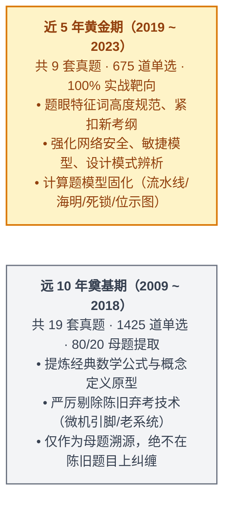

# 2009~2023年软考上午真题15年全景考点精析与冲刺绝杀手册

> 🎯 **战役心智**：软考中级软件设计师【上午科目一：综合知识】（共 75 道单选题，每题 1 分，满分 75 分，及格线恒定 45 分，考试时间 150 分钟）是考察**知识广度、辨析精度与计算速度**的战场！  
> 纵观 2009~2023 历年 15 年共 28 场考试（累计 **2,100 道真题单选**），上午试卷有着极其精密、十几年未曾改变的**“题号与考点强绑定规律”**！  
> 本手册采用 **“A+B 复合架构”**：以 **方案 A（上午 75 题 12 大考点模块纵切深度击穿）为主体**，深度融合 **15 年全景考频数字化天梯榜、近 5 年 5 大计算母题真题真数对比、专业英语 9 篇主题透析与 50 个高频词库、个人错题靶向排雷指南**，并在文末附赠 **方案 B（75 题题号矩阵速查表 + 考前 50 句保命口诀 + 40 张高频避坑闪卡）**。

---

## 🧭 战略指引：时间段科学划分与上午场“脱敏红线”

### ☠️ 远 10 年（2009~2018）已彻底绝迹的“弃考毒题黑名单”（直接封存）

> [!CAUTION] **冲刺减负铁律**：考生在刷 2009~2018 年早期试卷时，一旦遇到以下 5 类陈旧题目，**必须直接打叉跳过，一秒钟都不要纠结**！

1. **☠️ 早期微机接口芯片与引脚考题**（如 2009~2012 考查的可编程中断控制器 8259A、并行接口 8255A 芯片引脚与控制字）：
   * *淘汰原因*：此类题目带有浓厚的微机原理硬件色彩，现代软件设计师大纲已彻底将其剔除，全面转向计算机系统总体架构与通用接口（USB/PCIe）。
2. **☠️ 早期操作系统注册表键值与 DOS 中断调用**（如 2009~2011 考查的 Windows 98/2000 注册表根键 `HKEY_LOCAL_MACHINE` 具体键值路径）：
   * *淘汰原因*：已被现代多任务操作系统通用进程、存储与文件管理取代，不再考查特定老旧系统的配置路径。
3. **☠️ 早期已淘汰的局域网与广域网网络协议**（如 NetBEUI、IPX/SPX、早期 X.25 与窄带 ISDN 物理层参数）：
   * *淘汰原因*：全网已全面普及 TCP/IP 与以太网，老旧协议已退出历史舞台。
4. **☠️ 早期 HTML4 过时排版标签与纯属性**（如 2010 年前考查的 ``、`align="center"` 等标签属性）：
   * *淘汰原因*：HTML5 与 CSS 样式分离标准普及后，此类混杂排版标签已作废。
5. **☠️ 早期主观性过强的名词解释题**（如部分早期题目带有高校期末出题色彩）：
   * *淘汰原因*：2023 年机考改革后，全国统一题库命题极其规范，采分点 100% 具备排他性标准答案。

---

# 📊 核心数据：15 年 2,100 题全景考频数字化天梯榜

> 💡 **大数据穿透**：根据 2009~2023 年 28 套试卷共 2,100 道真题统计，全卷 75 题的知识点权重高度集中于以下 12 大模块：

| 模块序号与专题名称 | 题号区间 | 试卷分值 | 15 年累计题量 | 考查频次 Top 3 核心考点 | 冲刺优先级 |
| :---: | :---: | :---: | :---: | :--- | :---: |
| **01. 计算机组成与体系结构** | **1 ~ 6** | **6 分** | **168 题** | ① 流水线计算（24次） ② 海明码不等式（21次） ③ RISC/CISC对比与Cache映射（19次） | 🔴 必拿满分 |
| **02. 程序设计语言与编译** | **7 ~ 9** | **3 分** | **84 题** | ① 编译各阶段错误定性（22次） ② 自动机 DFA 识别字符串（18次） ③ 传值与传引用（15次） | 🟢 稳拿 2~3 分 |
| **03. 操作系统知识** | **10 ~ 15** | **6 分** | **168 题** | ① 死锁极值与银行家算法（25次） ② 页面置换与状态淘汰（23次） ③ 位示图与多级索引（20次） | 🔴 必拿满分 |
| **04. 软件工程与项目管理** | **16 ~ 25** | **10 分** | **280 题** | ① McCabe 环路复杂度计算（26次） ② 开发模型特征对比（25次） ③ 结构化内聚与耦合天梯（24次） | 🔴 全卷大户 |
| **05. 系统架构与运行维护** | **26 ~ 31** | **6 分** | **168 题** | ① 系统可靠度串并联计算（22次） ② 体系结构风格辨析（20次） ③ 软件维护类型分类（19次） | 🟢 稳拿 5 分 |
| **06. 数据库系统技术** | **32 ~ 37** | **6 分** | **168 题** | ① 关系规范化范式判定（26次） ② 关系代数与查询优化（24次） ③ 候选码与闭包求解（21次） | 🔴 必拿满分 |
| **07. 面向对象技术与 UML** | **38 ~ 45** | **8 分** | **224 题** | ① 23 种设计模式意图分类（28次全勤） ② UML 9 种图适用场景（25次） ③ 多态分类与类间关系（20次） | 🔴 全卷大户 |
| **08. 数据结构与算法基础** | **46 ~ 55** | **10 分** | **280 题** | ① 排序算法时空复杂度与稳定性（27次） ② 二叉树数学性质与空指针（25次） ③ 哈夫曼树与前缀编码（22次） | 🔴 全卷大户 |
| **09. 计算机网络与信息安全** | **56 ~ 63** | **8 分** | **224 题** | ① 加密体制、数字签名与 CA 证书（27次） ② OSI 分层协议与常见端口（25次） ③ IP 子网掩码与安全设备边界（22次） | 🔴 全卷大户 |
| **10. 知识产权与标准化** | **64 ~ 66** | **3 分** | **84 题** | ① 著作权客体与职务作品归属（26次） ② 专利权保护期限与先申请（21次） ③ 商标权续展期（16次） | 🟢 必拿满分 |
| **11. 数学与运筹方法** | **67 ~ 70** | **4 分** | **112 题** | ① 期望收益值与决策树（18次） ② 线性规划可行域（15次） ③ 状态转移与图论最短路（14次） | 🟡 保底 2~3 分 |
| **12. 专业英语（短文填空）** | **71 ~ 75** | **5 分** | **140 题** | ① 云计算与云原生架构（20次） ② 软件工程过程与敏捷测试（18次） ③ 面向对象设计与服务架构（16次） | 🟢 稳拿 4~5 分 |

---

# 🥊 第一部分：方案 A · 上午 75 题 12 大模块纵切深度击穿

---

## 模块 01：计算机组成与体系结构（题 1 ~ 6，稳定 6 分）

### 1. 核心考查机制与题号映射

* **题 1（CPU 架构核心部件划分）**：
  * **控制器部件（负责发号施令，不参与数据加工）**：程序计数器（PC，存放下一条指令地址）、指令寄存器（IR）、指令译码器（ID）、时序发生器。
  * **运算器部件（负责算术与逻辑运算）**：算术逻辑单元（ALU）、累加寄存器（AC/ACC）、数据缓冲寄存器（DR）、状态条件寄存器（PSW）。
* **题 2（指令集架构 RISC vs CISC）**：
  * **RISC（精简指令集）**：指令少、长度固定、硬布线组合逻辑控制（速度极快）、**大量通用寄存器**、仅 Load/Store 能访存。
  * **CISC（复杂指令集）**：指令多、长度不固定、微程序控制器（微代码ROM）、寄存器少。
  * **寻址速度天梯**：**立即寻址 > 寄存器寻址 > 直接寻址 > 间接寻址**。
* **题 3（存储体系与 Cache 机制）**：
  * **三级存储速度与容量**：寄存器 > Cache > 主存 > 辅存。
  * **Cache 本质**：提高 CPU 访问主存的平均存取速度，**由硬件自动完成映射，对程序员完全透明**！
  * **命中率公式**：平均存取时间 $t_a = h \times t_c + (1 - h) \times t_m$。
* **题 4（流水线技术核心计算）**：见下文《计算母题穿透台》。
* **题 5（数据表示与定点/浮点数）**：
  * 补码能将减法转加法，0 的表示唯一，代价是**与真值对应关系不直观**；
  * **浮点数加法对阶**：**小阶向大阶看齐**（小阶尾数右移，阶码增加）。
* **题 6（总线、I/O 控制与校验码）**：
  * **DMA 控制器发出的地址是主存“物理地址”，仅占用一个“总线周期”**；
  * 中断向量提供的是**中断服务程序的入口地址**。

---

## 模块 02：程序设计语言与编译基础（题 7 ~ 9，稳定 3 分）

* **题 7（编译器各阶段职责与错误定性）**：
  * 词法分析：识别 Token；错误：非法字符、标识符拼写错误。
  * 语法分析：生成语法树；错误：括号不匹配、缺少分号、关键字拼写错误。
  * 语义分析：类型检查；错误：**静态语义错误（类型不兼容，如浮点数与指针相加）、变量未声明使用**。
  * ⚠️ **死循环、除零错误属于动态运行期错误，编译程序无法查出！编译程序只翻译不执行！**
* **题 8（正规式与自动机 DFA）**：
  * DFA 成功识别标志：输入字符读完，停留在**终止状态（双圈表示）**！
* **题 9（参数传递）**：
  * **值调用（传值）**：传副本，函数内修改形参**绝不影响实参**；
  * **引用调用（传址）**：传别名，函数内修改形参**同步修改实参**。

---

## 模块 03：操作系统知识（题 10 ~ 15，稳定 6 分）

* **题 10（进程五态与 PV 操作）**：
  * 运行 $\to$ 阻塞（等待资源/I/O）；阻塞 $\to$ 就绪（I/O完成）。**阻塞态绝不能直接转运行态！**
  * $P(S)$：$S=S-1$，$S<0$ 阻塞；$V(S)$：$S=S+1$，$S\le 0$ 唤醒。
* **题 11（死锁条件与极值计算）**：
  * 银行家算法属于**死锁避免**。
* **题 12（页式存储管理与物理地址计算）**：
  * 页大小 4KB 对应低 12 位为页内偏移量，高位为逻辑页号，查页表换出物理块号。
* **题 13（页面置换算法）**：
  * FIFO 可能产生 **Belady 异常**（页框增多缺页反增）；
  * 淘汰法则：**访问位=0 且 修改位=0 优先淘汰**。
* **题 14（多级索引节点最大文件长度）**：
  * 直接索引管 0~9 号逻辑块；10 号进一级间接索引；盘块数乘以盘块容量才是文件大小！
* **题 15（磁盘调度算法）**：
  * SSTF 贪就近产生**饥饿**；电梯 SCAN 最稳定公平。

---

## 模块 04~05：软件工程、项目管理与架构（题 16 ~ 31，稳定 16 分）

* **题 16（开发模型）**：需求明确选瀑布；需求模糊选原型；高风险选螺旋；面向对象选喷泉（迭代无间隙）。
* **题 17（内聚与耦合）**：功能内聚最高，偶然（病态）内聚最低；数据耦合最佳，内容耦合最差。
* **题 18（白盒测试与 McCabe 环路复杂度）**：
  * 公式：$V(G) = m - n + 2$（$m$ 为边数，$n$ 为节点数；或等于判定节点数 $+1$）。
* **题 19（软件维护类型）**：修 Bug 是纠错（20%）；换环境是适应；加功能提性能是**完善性维护（占 50% 最高）**；防患未然是预防。
* **题 20（项目进度管理）**：关键路径耗时最长，决定总工期；关键路径上的活动**总时差（松弛时间）恒为 0**。
* **题 26（软件体系结构风格）**：管道-过滤器风格**高内聚、支持并发，唯独不能交互**。

---

## 模块 06：数据库系统技术（题 32 ~ 37，稳定 6 分）

* **题 32（三级模式与两级映像）**：外模-概念提供**逻辑独立性**；概念-内模提供**物理独立性**。
* **题 33（关系代数运算与查询优化）**：自然连接去重公共属性列；**选择运算尽早执行（选择下推）**。
* **题 34（候选码求解）**：只在右侧出现的属性绝不是码；只在左侧出现的属性必在码中；求闭包推导全属性。
* **题 35（规范化理论范式天梯）**：1NF消非原子；2NF消部分依赖；3NF消传递依赖；BCNF决定因素全含码。
* **题 36（事务与并发控制）**：未提交执行 **UNDO（撤销）**；已提交执行 **REDO（重做）**；一级加写防丢失，二级防读脏，三级防不可重复读。

---

## 模块 07：面向对象技术与 UML（题 38 ~ 45，稳定 8 分）

* **题 38（多态机制）**：参数多态（泛型）、包含多态（虚方法重写）、过载多态（重载）、强制多态（类型转换）。
* **题 39（UML 图类型）**：部署图画 **3D 立方体节点**；顺序图按**时间垂直轴**表达交互；活动图表达业务流。
* **题 40~45（23 种设计模式题眼速查大表）**：
  * `抽象工厂 (Abstract Factory)`：成套生产**产品族**；
  * `适配器 (Adapter)`：**转换接口**消除不兼容；
  * `组合 (Composite)`：**树形结构**，整体与部分一致对待；
  * `装饰器 (Decorator)`：**动态透明附加新职责**；
  * `外观 (Facade)`：为复杂子系统提供**高层统一门面**；
  * `享元 (Flyweight)`：**共享细粒度对象**降低内存；
  * `策略 (Strategy)`：**封装一组可互换的算法**；
  * `观察者 (Observer)`：**一对多发布-订阅**，状态自动广播；
  * `中介者 (Mediator)`：**中介对象封装交互**，防网状耦合；
  * `备忘录 (Memento)`：**快照保存与恢复**。

---

## 模块 08：数据结构与算法基础（题 46 ~ 55，稳定 10 分）

* **题 46~48（二叉树数学性质）**：
  * **空指针域**：含 $n$ 个结点的二叉树空指针域**恒为 $n + 1$ 个**；
  * **叶子与度为 2**：$n_0 = n_2 + 1$；
  * **逆向还原**：已知中序 + 前序（或后序）可唯一建树；前序 + 后序不可唯一确定。
* **题 49（哈夫曼树）**：只有度为 0 和度为 2 的结点（$n_1 = 0$）；$n$ 个叶子的哈夫曼树总结点数为 $2n - 1$。
* **题 51~55（排序稳定性与复杂度口诀）**：
  * **“快、选、堆、希”不稳定，其余全部都稳定**；
  * 堆排、归并时间恒定 $O(n\log n)$；堆排空间就地 $O(1)$，归并空间开辟 $O(n)$。

---

## 模块 09：计算机网络与信息安全（题 56 ~ 63，稳定 8 分）

* **题 56（分层职责与端口）**：表示层管**加解密、压缩与语法转换**；DNS 53、SNMP 161/162 默认走 **UDP**。
* **题 58~60（现代密码学与数字签名）**：
  * 对称（DES/AES）加解密海量明文；非对称（RSA/ECC）加密密钥与签名；
  * **私钥签名防抵赖，公钥验签身份实；客户端使用 CA 公钥验证书上的 CA 签名**。
* **题 61~63（安全设备边界）**：
  * **IDS（入侵检测）**：旁路监听，**只报警不阻断**；
  * **IPS（入侵防御）**：串联在线，**实时自动阻断**；
  * **WAF（Web防火墙）**：应用层防御 SQL 注入与 XSS。

---

## 模块 10：知识产权与标准化（题 64 ~ 66，稳定 3 分）

* **题 64（著作权客体）**：保护代码和文档的**“表达”**，**思想、算法、概念绝不保护**！职务作品著作权归单位。
* **题 65（保护期）**：署名权永久保不可继承；财产权死后 50 年可继承。
* **题 66（专利与商标）**：发明专利 20 年（先申请原则）；商标 10 年，**期满前 12 个月可申请续展**。

---

## 模块 12：专业英语（题 71 ~ 75，固定 5 分）

### 1. 近 5 年 9 篇核心科技短文主题透析

| 考期 | 核心主题 | 原文技术背景 | 核心考察词汇与概念 |
| :---: | :--- | :--- | :--- |
| **2023上** | **低代码开发平台 (LCAP)** | 云计算 PaaS、组件复用、可视化建模 | `visual`, `automation`, `generic`, `reusable`, `development` |
| **2022下** | **面向服务架构 (SOA)** | Web 服务、分布式计算、正交解耦 | `architecture`, `style`, `interfaces`, `statelessness` (无状态) |
| **2022上** | **云计算与多租户架构** | 云计算交付模型、资源池化、按需服务 | `cloud`, `virtualization`, `multi-tenancy`, `on-demand` |
| **2021下** | **DevOps 与持续交付** | 软件工程效率、自动化流水线、安全性 | `DevOps`, `continuous`, `security`, `deployment`, `automation` |
| **2021上** | **GoF 面向对象设计模式** | 节选自经典教材序言，探讨可复用软件设计 | `reusable`, `object-oriented`, `encapsulation`, `polymorphism` |
| **2020下** | **软件维护与缺陷修复** | 软件发布后运营维护、Bug 修复 | `maintenance`, `bugs`, `corrective`, `evolution`, `reliability` |
| **2019下** | **微服务架构 (Microservices)** | 服务端企业应用拆分、轻量通信 | `microservice`, `enterprise`, `server-side`, `distributed` |
| **2019上** | **项目管理三大基准** | 项目三大约束（范围、时间、成本） | `project`, `temporary`, `scope`, `budget`, `constraint` |

---

### 2. 专业英语冲刺必背 50 个核心采分词汇库

1. `Architecture`（体系结构） ｜ 2. `Statelessness`（无状态特性） ｜ 3. `Coupling`（耦合度） ｜ 4. `Cohesion`（内聚度） ｜ 5. `Encapsulation`（封装）
6. `Inheritance`（继承） ｜ 7. `Polymorphism`（多态） ｜ 8. `Virtualization`（虚拟化） ｜ 9. `Concurrency`（并发性） ｜ 10. `Throughput`（吞吐率）
11. `Latency`（时延） ｜ 12. `Redundancy`（冗余） ｜ 13. `Reliability`（可靠性） ｜ 14. `Availability`（可用性） ｜ 15. `Maintainability`（可维护性）
16. `Confidentiality`（保密性） ｜ 17. `Integrity`（完整性） ｜ 18. `Authentication`（身份认证） ｜ 19. `Authorization`（授权） ｜ 20. `Vulnerability`（漏洞）
21. `Refactoring`（重构） ｜ 22. `Deployment`（部署） ｜ 23. `Repository`（代码仓库） ｜ 24. `Continuous Integration`（持续集成） ｜ 25. `Iteration`（迭代）
26. `Scalability`（可伸缩性/扩展性） ｜ 27. `Microservice`（微服务） ｜ 28. `Middleware`（中间件） ｜ 29. `Distributed`（分布式） ｜ 30. `Asynchronous`（异步）
31. `Synchronous`（同步） ｜ 32. `Deadlock`（死锁） ｜ 33. `Mutual Exclusion`（互斥） ｜ 34. `Semantics`（语义） ｜ 35. `Syntax`（语法）
36. `Compiler`（编译器） ｜ 37. `Interpreter`（解释器） ｜ 38. `Bandwidth`（带宽） ｜ 39. `Protocol`（协议） ｜ 40. `Firewall`（防火墙）
41. `Transaction`（事务） ｜ 42. `Consistency`（一致性） ｜ 43. `Isolation`（隔离性） ｜ 44. `Durability`（持久性） ｜ 45. `Normalization`（规范化）
46. `Candidate Key`（候选码） ｜ 47. `Foreign Key`（外键） ｜ 48. `Index`（索引） ｜ 49. `Buffer`（缓冲区） ｜ 50. `Cache`（高速缓存）

---

# 🔬 第二部分：近 5 年 5 大核心计算母题横向穿透台

> 💡 **考场绝杀**：近 5 年的计算题数字在变，但**公式和挖坑套路完全 1:1 复制**！

### 1. 指令流水线执行时间计算穿透

* **通关公式**：$T = \text{一条指令三段总时间} + (n - 1) \times \text{最长段时间}$
* **真题真数对比**：
  * **2023上 题 6**：取指 2ns，分析 2ns，执行 1ns，执行 1000 条指令时间：  
    $T = (2 + 2 + 1) + (1000 - 1) \times 2 = 5 + 1998 = \mathbf{2003\text{ ns}}$（秒杀选项 C）。
  * **2021下 题 4**：取指 3ns，分析 2ns，执行 1ns，流水线周期为最长段 $\mathbf{3\text{ ns}}$。
  * **2019下 题 5**：取指 4ns，分析 3ns，执行 2ns，执行 100 条指令时间：  
    $T = (4 + 3 + 2) + (100 - 1) \times 4 = 9 + 396 = \mathbf{405\text{ ns}}$。

---

### 2. 海明码校验位不等式计算穿透

* **通关公式**：$2^k \ge n + k + 1$（$n$ 为数据信息位位数，$k$ 为校验位位数）
* **真题真数对比**：
  * **2023上 题 3**：信息位 $n = 8$ 位，代入 $2^k \ge 8 + k + 1$：  
    当 $k=3$ 时 $8 \ge 12$ 不成立；当 $k=4$ 时 $16 \ge 13$ 成立 $\implies$ **校验位至少 4 位**！
  * **2021上 题 3**：信息位 $n = 16$ 位，代入 $2^k \ge 16 + k + 1 \implies$ 当 $k=5$ 时 $32 \ge 22$ 成立 $\implies$ **校验位至少 5 位**！
  * **2020下 题 4**：信息位 $n = 32$ 位，代入 $2^k \ge 32 + k + 1 \implies$ 当 $k=6$ 时 $64 \ge 39$ 成立 $\implies$ **校验位至少 6 位**！

---

### 3. 位示图字号与位号索引计算穿透（头号失分陷阱）

* **通关法则**：
  * **情况 A（从 0 编号）**：字号和位号从 0 开始编号 $\implies$ $\text{字号} = \lfloor \text{块号} / \text{字长} \rfloor$，$\text{位号} = \text{块号} \pmod{\text{字长}}$。
  * **情况 B（从 1 编号/第几个字）**：题目问“第几个字” $\implies$ **字号必须加 1**！
* **真题真数对比**：
  * **2022下 题 15**：字长 32 位，物理块号 1023，从 0 开始编号：  
    $1023 / 32 = 31$ 余 $31 \implies$ 在**字号 31、位号 31**（若问第几个字则是第 32 个字）。
  * **2021下 题 14**：字长 64 位，物理块号从 0 编到 4095，问第 2048 块的字号与位号：  
    $2048 / 64 = 32$ 余 $0 \implies$ **字号 32，位号 0**。

---

### 4. 死锁绝不发生极值资源计算穿透

* **通关公式**：$R_{\min} = m \times (w - 1) + 1$（$m$ 为进程数，$w$ 为每个进程所需最大同类资源数）
* **真题真数对比**：
  * **2022上 题 12**：系统有 4 个并发进程，每个进程需要 3 个资源：  
    $R_{\min} = 4 \times (3 - 1) + 1 = 4 \times 2 + 1 = \mathbf{9\text{ 个}}$。
  * **2020下 题 11**：系统有 5 个并发进程，每个进程需要 4 个资源：  
    $R_{\min} = 5 \times (4 - 1) + 1 = 5 \times 3 + 1 = \mathbf{16\text{ 个}}$。
  * **2019下 题 11**：系统有 3 个进程，每个进程需要 2 个资源：  
    $R_{\min} = 3 \times (2 - 1) + 1 = 3 \times 1 + 1 = \mathbf{4\text{ 个}}$。

---

### 5. 系统可靠度串并联计算穿透

* **通关公式**：串联相乘（只要一个坏就坏），并联 $1 - \prod (1 - R_i)$（全部坏才坏）
* **真题真数对比**：
  * **2019下 题 2**：部件 1 可靠度 0.9，部件 2、3 并联冗余（各 0.8），求系统可靠度不小于 0.85 时部件 4 的可靠度 $R_4$：  
    并联部分 $R_{23} = 1 - (1 - 0.8)^2 = 1 - 0.04 = 0.96$；  
    总可靠度 $R = R_1 \times R_{23} \times R_4 \ge 0.85 \implies R_4 \ge \frac{0.85}{0.9 \times (1 - (1 - 0.8)^2)}$（秒杀选项 A）。
  * **2022下 题 3**：2000 台设备工作 1000 小时，4 台失效：  
    千小时可靠度 $R = \frac{2000 - 4}{2000} = \frac{1996}{2000} = \mathbf{0.998}$。

---

# ⚠️ 第三部分：考场高危踩雷题 · 易感陷阱靶向排雷指南

> 🎯 **深度缝合考生 212 道真实错题本**：以下 8 大盲区是历年考生在考场上最容易被命题人“反向审题”和“字面偷换”击倒的高危雷区！

1. **【计组】DMA 传输走总线周期与物理地址（非指令周期/非虚拟地址）**：
   * *踩雷根因*：误以为硬件直写占用 CPU 指令周期；
   * *排雷真相*：DMA 仅通过**“周期挪用”占用一个总线周期**！CPU 发出的是**主存物理地址**，而不是虚拟地址或 Cache 地址。
2. **【计组】补码设计初衷是减法转加法，代价是不直观**：
   * *踩雷根因*：把补码优点当成直观；
   * *排雷真相*：补码能使符号位参与运算、将减法变加法、0 的表示唯一；但**与真值对应关系不直观**（负数求真值需取反加一）。
3. **【编译】类型不兼容属静态语义错误，编译程序只翻译不执行**：
   * *踩雷根因*：把浮点数与指针相加当成语法错误；
   * *排雷真相*：类型检查归属**静态语义分析**！编译程序**只负责生成目标代码，绝不执行代码**；死循环和除零是动态运行期错误！
4. **【操作系统】32 位两级页表位域切割（必须展开二进制，切忌粗暴切十六进制）**：
   * *踩雷根因*：看到十六进制逻辑地址直接按每 4 位盲切；
   * *排雷真相*：标准 32 位两级页表为 **10 位一级页号 + 10 位二级页号 + 12 位页内偏移**！必须将十六进制展开为 32 位二进制后再切分。
5. **【软工】可维护性指标与修复时间成反比（$1/(1+\text{MTTR})$）**：
   * *踩雷根因*：把无故障时间（MTTF）代入可维护性；
   * *排雷真相*：MTTF 是可靠性指标！可维护性衡量的是**修复耗时（MTTR）**，修复越快可维护性越高，公式为 $1 / (1 + \text{MTTR})$。
6. **【软工】模块偶然内聚又称“病态内聚”**：
   * *踩雷根因*：未掌握考纲别名，误将病态内聚当成新概念；
   * *排雷真相*：偶然内聚（没有任何联系的成分凑在一起）在学术界又称**病态内聚**，内聚性最低！
7. **【网络】DNS 53 与 SNMP 161/162 默认走无连接 UDP 服务**：
   * *踩雷根因*：受长连接心智误导，误以为网管和域名走可靠的 TCP；
   * *排雷真相*：为了在网络拥塞时依然能轻量发包，**DNS 查询与 SNMP 轮询/告警默认全部承载在 UDP 之上**！
8. **【数据库】数据字典只保存视图定义，不存查询语句与数据结果**：
   * *踩雷根因*：望文生义以为视图在数据库中保存了查询语句；
   * *排雷真相*：视图是虚表，数据字典中**仅保存视图的元数据定义**，不保存查询 SQL，更不保存物化数据！

---

# 🚀 第四部分：方案 B · 上午场终极绝杀工具箱

---

## 附录一：【15 年全景 75 题题号与分值分布速查矩阵】

| 题号区间 | 考核知识模块 | 稳定分值 | 冲刺目标分 | 核心秒杀提分心法 |
| :---: | :--- | :---: | :---: | :--- |
| **1 ~ 6** | **计算机组成与体系结构** | **6 分** | **5 ~ 6 分** | 牢记 RISC 大量寄存器、流水线周期公式、海明不等式 $2^k \ge n+k+1$ |
| **7 ~ 9** | **程序设计语言与编译** | **3 分** | **2 ~ 3 分** | 静态语义错误是类型不匹配；DFA 判定看终止状态双圈 |
| **10 ~ 15** | **操作系统知识** | **6 分** | **5 ~ 6 分** | 死锁极值公式 $m(w-1)+1$；状态/访问/修改位淘汰法；SCAN电梯调度 |
| **16 ~ 25** | **软件工程与项目管理** | **10 分** | **8 ~ 9 分** | 瀑布需求明确；McCabe复杂度 $m-n+2$；完善性维护占50%；关键路径最长 |
| **26 ~ 31** | **系统开发与体系结构** | **5 分** | **4 ~ 5 分** | 管道过滤器不能交互；串并联可靠度公式 |
| **32 ~ 37** | **数据库系统技术** | **6 分** | **5 ~ 6 分** | 候选码看左侧闭包；1NF消非原子、2NF消部分、3NF消传递；选择尽早下推 |
| **38 ~ 45** | **面向对象技术与 UML** | **8 分** | **7 ~ 8 分** | 部署图看3D立方体；顺序图看时间序列；23种设计模式特征词秒杀 |
| **46 ~ 55** | **数据结构与算法基础** | **10 分** | **8 ~ 9 分** | 叶子等于双度加1；二叉树空指针 $n+1$；快选堆希不稳定；堆排空间 $O(1)$ |
| **56 ~ 63** | **计算机网络与信息安全** | **8 分** | **6 ~ 7 分** | 表示层加密压缩；CA公钥验证书签名；私钥签名公钥验；IDS旁路IPS串联 |
| **64 ~ 66** | **知识产权与标准化** | **3 分** | **3 分** | 软件著作权保表达不保思想；职务作品归单位；商标期满前12个月续展 |
| **67 ~ 70** | **数学与运筹方法** | **4 分** | **2 ~ 3 分** | 期望收益值公式 $\sum(P \times V)$；线性规划代选项特值验证 |
| **71 ~ 75** | **专业英语** | **5 分** | **3 ~ 4 分** | 抓主谓宾上下文代词，锁定 CIA、Cloud、Agile、Service 核心计算机词库 |
| **总计** | **全卷 75 道单选题** | **75 分** | **60 ~ 65 分** | **及格线 45 分，手握 60+ 分稳操胜券！** |

---

## 附录二：【考前 50 句押韵保命口诀与速查大表】

1. **体系架构**：RISC 精简指令少，硬布线快寄存器多；CISC 复杂微程序，指令变长代码密。
2. **三级存储**：Cache 硬件自动管，程序员透明不用看；命中平均要加权，小阶看齐大阶赶。
3. **流水计算**：流水周期取最大，首条指令执行全；剩余 $n-1$ 乘周期，最大吞吐倒数算。
4. **校验码距**：海明不等 $2^k$ 大，信息加 $k$ 再加一；CRC 模二异或算，只能检错不能纠。
5. **编译分期**：词法管拼写，语法管分号；类型不合是语义，除零死循环运行期。
6. **自动机**：正规展开看星号，状态流转找终点；双圈就是合格态，不入双圈全算废。
7. **参数传递**：传值只传副本走，函数改动外面留；传引就是传别名，函数一改外全变。
8. **死锁极值**：每个进程需求减去一，累加起来再加一；资源满足此极限，系统无论如何不死锁。
9. **页面淘汰**：状态位是一才在，访问位零近期冷；修改位零省写回，三层过滤秒淘汰。
10. **多级索引**：直接索引直接指，一级间接指盘块；盘块大小除四字节，二级就是平方算。
11. **磁盘调度**：SSTF 贪就近，边缘磁道易饥饿；电梯 SCAN 一路走到头，反向回头最公平。
12. **内聚天梯**：偶然逻辑时间内，过程通信顺序排；单一功能是最高，七级内聚记心怀。
13. **耦合天梯**：数据耦合最理想，结构标记紧跟上；若传标志是控制，公共内容最荒唐。
14. **白盒圈度**：McCabe 算环路，有向边减结点加二；判定节点直接加一，一眼秒杀零失误。
15. **维护类型**：修错是纠错，环境变是适应；增加功能是完善，为将来重构是预防。
16. **项目进度**：关键路径耗时最长，决定总工期没商量；关键活动时差零，松弛时间是机动。
17. **结构风格**：管道过滤单向流，并行高内聚好复用；构件之间解耦好，唯独不能搞交互。
18. **关系范式**：属性原子是一范，消除部分是二范；消除传递是三范，决定因素在码上四范进。
19. **关系代数**：自然连接去重列，选择运算尽早做；选择下推省内存，中间结果少很多。
20. **模式映像**：外模概念逻独立，概念内模物独立；数据字典存定义，视图查询不存据。
21. **事务隔离**：一级加写防丢失，二级加读读完放；三级加读事务终，两段加锁可串行。
22. **UML 图谱**：部署图看立方体，顺序图看时间轴；用例图看功能界，状态图看对象生。
23. **创建模式**：工厂方法单产品，抽象工厂产品族；原型克隆复制走，生成器分步构复杂。
24. **结构模式**：适配器解不兼容，桥接抽象实现分；组合树形一致对，外观门面系统轻。
25. **行为模式**：策略算法可互换，观察者发布订阅全；中介封装防网状，备忘录快照随时还。
26. **树的性质**：二叉树求空指针，公式恒定 $n+1$；度为零等于度二加一，满二叉树叶居底。
27. **哈夫曼树**：无度为一哈夫曼，叶子 $n$ 个点 $2n-1$；两两最小合并起，前缀编码绝无歧。
28. **排序稳定**：“快选堆希”不稳定，其余全部都稳定；堆排归并 $n\log n$，堆空就地归并外。
29. **网络分层**：表示层管加解密，压缩解压语法统；传输首个端到端，IP 网际尽力送。
30. **常见端口**：DNS 五十三，HTTP 八十进；HTTPS 四四三，SNMP 轮询一六一。
31. **安全攻防**：私钥签名防抵赖，公钥验签身份实；CA 证书公钥解，对称加解海量明。
32. **安全设备**：防火墙管网络层，IDS 旁路只报警；IPS 串联直阻断，WAF 专防注与 XSS。
33. **法规知识**：著作权保表达不保思想，职务作品归单位；署名修改永久保，财产权利死后五十年。
34. **专利商标**：专利先申先拥有，发明二十年保护；商标十年可续展，期满前十二月办。

---

## 附录三：【考前 40 张高危易错高频闪卡（Anki 级）】

### 模块 01~03：硬件、语言与操作系统（12 张卡）

* 🎴 **闪卡 01 ｜ DMA 物理地址本质**
  * **设问**：DMA 传输时，CPU 给出的是主存什么地址？占用 CPU 哪个周期？
  * **秒杀**：**主存物理地址**；仅周期挪用占用一个**总线周期**，绝非指令周期！
* 🎴 **闪卡 02 ｜ 补码表示初衷与代价**
  * **设问**：计算机采用补码表示定点数的核心初衷与代价分别是什么？
  * **秒杀**：初衷是**将减法转为加法，符号位参与运算**；代价是**与真值对应关系不直观**。
* 🎴 **闪卡 03 ｜ 海明码校验位计算**
  * **设问**：信息位为 8 位时，纠正 1 位错的海明码校验位至少几位？
  * **秒杀**：代入 $2^k \ge 8 + k + 1 \implies$ 当 $k=4$ 时 $16 \ge 13$ 成立，**选 4 位**。
* 🎴 **闪卡 04 ｜ 浮点数加法对阶**
  * **设问**：两个浮点数相加对阶时，阶码如何对齐？尾数如何移动？
  * **秒杀**：**小阶向大阶看齐**！小阶的阶码增大，其尾数向右移。
* 🎴 **闪卡 05 ｜ 静态语义错误定性**
  * **设问**：浮点数变量与指针相加属于哪种编译错误？
  * **秒杀**：属于**静态语义错误**（类型不兼容），绝非语法错误！
* 🎴 **闪卡 06 ｜ 自动机识别字符串**
  * **设问**：有限自动机 DFA 成功识别一个字符串的充要标志是什么？
  * **秒杀**：输入字符读完时，当前状态必须落在**终止状态（双圈节点）**上！
* 🎴 **闪卡 07 ｜ 死锁极值资源计算**
  * **设问**：系统有 5 个进程，每个进程需要 3 个资源，保证绝不死锁的最小资源数？
  * **秒杀**：$R_{\min} = 5 \times (3 - 1) + 1 = 11$ 个。
* 🎴 **闪卡 08 ｜ Belady 异常**
  * **设问**：哪个页面置换算法会出现“分配物理页框增加，缺页次数反而增加”的异常？
  * **秒杀**：**FIFO（先进先出置换算法）**。
* 🎴 **闪卡 09 ｜ 页面淘汰三级过滤**
  * **设问**：页面置换中，同时有访问位（0/1）和修改位（0/1），最先淘汰哪个？
  * **秒杀**：**访问位=0 且 修改位=0** 的页面最先淘汰（近期未用且省去磁盘写回开销）。
* 🎴 **闪卡 10 ｜ 磁盘调度饥饿现象**
  * **设问**：FCFS、SSTF、SCAN 中，哪个算法会引发“饥饿”现象？
  * **秒杀**：**SSTF（最短寻道时间优先）**，因就近贪心导致边缘磁道进程饥饿。
* 🎴 **闪卡 11 ｜ 中断向量本质**
  * **设问**：中断向量表里存放的是什么？
  * **秒杀**：存放的是**中断服务程序的入口地址**。
* 🎴 **闪卡 12 ｜ 控制器核心部件 PC**
  * **设问**：程序计数器 PC 属于控制器还是运算器？存放什么？
  * **秒杀**：属于**控制器**；存放**下一条指令的地址**。

---

### 模块 04~06：软工、系统与数据库（14 张卡）

* 🎴 **闪卡 13 ｜ 需求模糊选什么模型**
  * **设问**：项目早期用户需求模糊、不明确时，首选哪种开发模型？
  * **秒杀**：首选**快速原型模型（Prototyping）**。
* 🎴 **闪卡 14 ｜ 模块内聚最高等级**
  * **设问**：模块所有成分完成单一特定功能，属于哪种内聚？
  * **秒杀**：**功能内聚（Functional Cohesion）**。
* 🎴 **闪卡 15 ｜ 最佳低耦合类型**
  * **设问**：模块间仅通过参数传递简单的数值，属于哪种耦合？
  * **秒杀**：**数据耦合（Data Cohesion）**。
* 🎴 **闪卡 16 ｜ 完善性维护占比**
  * **设问**：为了扩充功能、改善界面、提升性能而进行的维护叫什么？占多大比例？
  * **秒杀**：**完善性维护**；在所有维护类型中**占比最高（约 50%）**。
* 🎴 **闪卡 17 ｜ McCabe 环路复杂度计算**
  * **设问**：流图中有 10 条边，8 个节点，环路复杂度是多少？
  * **秒杀**：$V(G) = m - n + 2 = 10 - 8 + 2 = 4$。
* 🎴 **闪卡 18 ｜ 关键路径时差**
  * **设问**：项目 PERT 网络图中，关键路径上的活动总时差为多少？
  * **秒杀**：**恒为 0**！任何关键活动延误必导致总工期延误。
* 🎴 **闪卡 19 ｜ 管道-过滤器风格死穴**
  * **设问**：管道-过滤器软件体系结构最大的局限性是什么？
  * **秒杀**：**不适合交互式系统**（批处理强，交互弱）。
* 🎴 **闪卡 20 ｜ 两级映像与独立性**
  * **设问**：概念模式-内模式映像提供什么独立性？外模式-概念模式映像呢？
  * **秒杀**：概念-内模提供**物理独立性**；外模-概念提供**逻辑独立性**。
* 🎴 **闪卡 21 ｜ 查询优化第一原则**
  * **设问**：关系代数表达式优化中，核心优化策略是什么？
  * **秒杀**：**选择运算尽早执行（选择下推）**。
* 🎴 **闪卡 22 ｜ 自然连接去重列**
  * **设问**：关系 $R(A, B, C)$ 与 $S(B, C, D)$ 进行自然连接，结果有几列？
  * **秒杀**：**4 列**（属性 $A, B, C, D$，相同属性名 $B, C$ 自动合并去重）。
* 🎴 **闪卡 23 ｜ 2NF 消除什么依赖**
  * **设问**：1NF 消除什么依赖达到 2NF？2NF 消除什么依赖达到 3NF？
  * **秒杀**：消**部分依赖**进 2NF；消**传递依赖**进 3NF。
* 🎴 **闪卡 24 ｜ BCNF 特征**
  * **设问**：BCNF（巴克斯范式）的核心判定特征是什么？
  * **秒杀**：关系模式中**每一个决定因素都必须包含码（候选码）**。
* 🎴 **闪卡 25 ｜ 事务原子性与 UNDO/REDO**
  * **设问**：故障恢复时，未提交的事务如何处理？已提交但未写入磁盘的事务如何处理？
  * **秒杀**：未提交执行 **UNDO（撤销）**；已提交执行 **REDO（重做）**。
* 🎴 **闪卡 26 ｜ 丢失修改用几级封锁**
  * **设问**：防止丢失修改（丢失更新）需要采用哪级封锁协议？
  * **秒杀**：**一级封锁协议**（写数据前必须加 X 排它锁，事务结束释放）。

---

### 模块 07~09：面向对象、数据结构与网络安全（14 张卡）

* 🎴 **闪卡 27 ｜ 部署图识别**
  * **设问**：UML 中画有 3D 立方体节点的图是哪种图？表达什么？
  * **秒杀**：**部署图（Deployment Diagram）**；表达物理硬件节点与运行环境拓扑。
* 🎴 **闪卡 28 ｜ 顺序图核心特征**
  * **设问**：UML 顺序图纵向和横向分别表达什么？
  * **秒杀**：**纵向表达时间轴演进**；横向表达参与交互的对象实例。
* 🎴 **闪卡 29 ｜ 抽象工厂模式特征词**
  * **设问**：题干出现“创建一系列相关或相互依赖的产品族对象”时选用什么模式？
  * **秒杀**：**抽象工厂模式（Abstract Factory）**。
* 🎴 **闪卡 30 ｜ 适配器模式特征词**
  * **设问**：题干出现“将已有类的接口转换成客户期望的另一个接口以解决不兼容”选用什么模式？
  * **秒杀**：**适配器模式（Adapter）**。
* 🎴 **闪卡 31 ｜ 装饰器模式特征词**
  * **设问**：题干出现“动态为对象透明附加额外职责，比生成子类更灵活”选用什么模式？
  * **秒杀**：**装饰器模式（Decorator）**。
* 🎴 **闪卡 32 ｜ 树的空指针域**
  * **设问**：含有 100 个结点的二叉树，其二叉链表中空指针域有几个？
  * **秒杀**：**恒为 $n+1 = 101$ 个**（与树形态无关）。
* 🎴 **闪卡 33 ｜ 叶子与度为 2 结点关系**
  * **设问**：某二叉树中有 5 个度为 2 的结点，则叶子结点有几个？
  * **秒杀**：$n_0 = n_2 + 1 = 5 + 1 = \mathbf{6}$ 个。
* 🎴 **闪卡 34 ｜ 排序稳定性判定**
  * **设问**：快排、简单选择、堆排序、希尔排序稳定吗？
  * **秒杀**：**全都不稳定！** 口诀：“快选堆希不稳定”。
* 🎴 **闪卡 35 ｜ 堆排序空间复杂度**
  * **设问**：大顶堆排序的辅助空间复杂度是多少？
  * **秒杀**：**$O(1)$**（就地排序，仅需常数级暂存空间）。
* 🎴 **闪卡 36 ｜ 表示层加解密**
  * **设问**：OSI 参考模型中，负责数据加密、解密和数据压缩的是哪一层？
  * **秒杀**：**表示层（Presentation Layer）**。
* 🎴 **闪卡 37 ｜ 数字证书验签公钥**
  * **设问**：浏览器验证网站数字证书时，使用的是谁的公钥？
  * **秒杀**：使用 **CA（证书认证机构）的公钥**！
* 🎴 **闪卡 38 ｜ 数字签名密钥使用**
  * **设问**：发送方生成数字签名使用什么密钥？接收方验证签名使用什么密钥？
  * **秒杀**：签名用**发送方的私钥**；验签用**发送方的公钥**。
* 🎴 **闪卡 39 ｜ IDS vs IPS**
  * **设问**：旁路部署只报警不阻断的是什么？串联部署能实时阻断的是什么？
  * **秒杀**：只报警是 **IDS（入侵检测）**；能阻断是 **IPS（入侵防御）**。
* 🎴 **闪卡 40 ｜ 职务作品著作权归属**
  * **设问**：主要利用单位物质技术条件开发，并由单位承担责任的软件，著作权归谁？
  * **秒杀**：**归单位（法人或其他组织）所有**，开发人员仅享有署名权。
