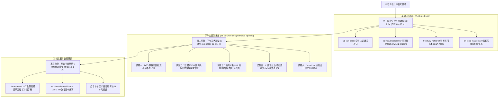

# 🗺️ 中级·软件设计师通关全景作战地图 (Software Designer Map)

> **适用科目**：全国计算机技术与软件专业技术资格（水平）考试 —— **中级 · 软件设计师**  
> **战略原则**：自顶向下、80/20 极致剪枝、底层原理穿透、下午五大题型标准化流水线  
> **及格目标**：上午综合知识 $\ge 55$ 分（45及格） ｜ 下午软件设计 $\ge 55$ 分（45及格），双科单次同过！

---

## 🧭 中级备战三维立体作战航标

---

## 📚 一、 基础核心资源直达跳板（共享内核 `01-shared-core/`）

软件设计师上午场的 75 道单选题，考点 100% 涵盖在公共内核基石中：

| 模块序号与考向 | 考纲分值 | 核心讲义速记 | 考点自测闪卡 | 底层机制专著重点推荐 |
| :--- | :---: | :--- | :--- | :--- |
| **01 计算机组成与体系结构** | 6 分 | [👉 讲义第02讲](../01-shared-core/01-fast-pass/02.计算机组成与结构速记指南.md) | [👉 闪卡 01](../01-shared-core/06-study-notes/01-计算机组成与体系结构-考点闪卡.md) | [海明码距](../01-shared-core/07-topic-mastery/05-海明码距与纠错原理-底层透析.md) / [流水线](../01-shared-core/07-topic-mastery/18-计算机系统各层级周期概念全景解析-底层透析.md) |
| **02 编译原理与语言基础** | 3 分 | [👉 讲义第08讲](../01-shared-core/01-fast-pass/08.程序设计语言基础知识速记指南.md) | [👉 闪卡 02](../01-shared-core/06-study-notes/02-程序设计语言与编译基础-考点闪卡.md) | [静态语义vs语法错误](../01-shared-core/05-error-vault/03-概念模糊点深度辨析与变式.md) |
| **03 操作系统知识** | 6 分 | [👉 讲义第03讲](../01-shared-core/01-fast-pass/03.操作系统知识速记指南.md) | [👉 闪卡 03](../01-shared-core/06-study-notes/03-操作系统知识-考点闪卡.md) | [银行家算法](../01-shared-core/07-topic-mastery/10-银行家算法与死锁避免-底层透析.md) / [多级页表](../01-shared-core/07-topic-mastery/08-多级页表与逻辑地址寻址-底层透析.md) |
| **04 软件工程与项目管理** | 8 分 | [👉 讲义第11讲](../01-shared-core/01-fast-pass/11.软件工程速记指南.md) | [👉 闪卡 04](../01-shared-core/06-study-notes/04-软件工程与项目管理-考点闪卡.md) | [McCabe环路复杂度](../01-shared-core/07-topic-mastery/19-McCabe环路复杂度计算法则与实战-底层透析.md) / [内聚耦合](../01-shared-core/07-topic-mastery/03-模块内聚七大等级-底层透析.md) |
| **05 数据库系统技术** | 6 分 | [👉 讲义第04讲](../01-shared-core/01-fast-pass/04.数据库技术基础速记指南.md) | [👉 闪卡 05](../01-shared-core/06-study-notes/05-数据库系统技术-考点闪卡.md) | [Armstrong公理推导](../01-shared-core/07-topic-mastery/12-Armstrong公理系统与函数依赖推导-底层透析.md) / [设计全生命周期](../01-shared-core/07-topic-mastery/13-数据库设计全生命周期与阶段产出映射-底层透析.md) |
| **06 计算机网络与信息安全** | 8 分 | [👉 讲义第05讲](../01-shared-core/01-fast-pass/05.计算机网络速记指南.md) | [👉 闪卡 06](../01-shared-core/06-study-notes/06-计算机网络与信息安全-考点闪卡.md) | [子网掩码8大黄金值](../01-shared-core/06-study-notes/06-计算机网络与信息安全-考点闪卡.md) / [JWT规范](../01-shared-core/06-study-notes/06-计算机网络与信息安全-考点闪卡.md) |
| **07 数据结构与算法基础** | 10 分 | [👉 讲义第09讲](../01-shared-core/01-fast-pass/09.数据结构速记指南.md) | [👉 闪卡 07](../01-shared-core/06-study-notes/07-数据结构与算法基础-考点闪卡.md) | [主定理公式](../01-shared-core/07-topic-mastery/14-递归式时间复杂度与主定理-底层透析.md) / [全场景排序图谱](../01-shared-core/07-topic-mastery/25-全场景排序算法精髓图解与源码透析-底层透析.md) |
| **08 面向对象与 UML 建模** | 12 分 | [👉 讲义第14讲](../01-shared-core/01-fast-pass/14.面向对象技术速记指南.md) | [👉 闪卡 08](../01-shared-core/06-study-notes/08-面向对象与UML建模-考点闪卡.md) | [23种设计模式全景图](../01-shared-core/02-visual-diagrams/03-设计模式核心图谱与真题命题密码.md) / [UML用例建模](../01-shared-core/07-topic-mastery/16-UML用例图建模与包含扩展关系-底层透析.md) |
| **09 法律法规与标准化** | 3 分 | [👉 讲义第07讲](../01-shared-core/01-fast-pass/07.知识产权与标准化速记指南.md) | [👉 闪卡 09](../01-shared-core/06-study-notes/09-法律法规与标准化-考点闪卡.md) | [商业秘密vs著作权保护期](../01-shared-core/05-error-vault/01-上午综合知识错题集.md#-错题-292知识产权法律法规知识产权法定时间性辨析商业秘密不具有时间性-vs-专利商标著作权具有法定保护期) |

---

## ⚔️ 二、 下午案例五大题型专属破局流水线 (`case-pipeline/`)

下午场总分 75 分，题型极其固定，严格执行**工业级应试标准化流水线**：

1. **[下午案例分析通关总纲与五大题型破题绝杀流水线](case-pipeline/past-exams/00-下午案例分析通关总纲与五大题型破题绝杀流水线.md)**（考前必读方法论）
2. **[下午案例审题与填空坑点排雷](case-pipeline/02-下午案例审题与填空坑点.md)**（采分点避坑清单）
3. **五大核心大题真题题库与解析**：
   - [试题一：数据流图 DFD 补流四步雷达流水线](case-pipeline/02-案例分析/01-试题一-数据流图DFD.md) 🎯（目标：13~15 分满分）
   - [试题二：数据库系统设计 E-R 转换与关系模式补充](case-pipeline/02-案例分析/02-试题二-数据库设计ER.md) 🎯（目标：12~14 分）
   - [试题三：面向对象 UML 建模类图与用例图交叉推导](case-pipeline/02-案例分析/03-试题三-面向对象UML建模.md) 🎯（目标：12~14 分）
   - [试题四：C语言算法设计与递归/动态规划填空](case-pipeline/02-案例分析/04-试题四-C语言算法设计.md) 🎯（目标：9~12 分保底）
   - [试题六：Java 面向对象设计模式代码填空](case-pipeline/02-案例分析/05-试题六-Java面向对象与设计模式.md) 🎯（目标：13~15 分高分）
4. **历年真题全真全景复盘报告（2019~2023）**：
   - 包含 [2023年05月](case-pipeline/past-exams/2023年05月-下午案例分析真题全景复盘与估分报告.md)、[2022年11月](case-pipeline/past-exams/2022年11月-下午案例分析真题全景复盘与估分报告.md)、[2022年05月](case-pipeline/past-exams/2022年05月-下午案例分析真题全景复盘与估分报告.md) 等全套真题复盘。

---

## ⚡ 三、 考前冲刺绝杀手册 (`cheatsheets/`)

考前 1~2 周直接锁定高密度冲刺武器库：

* [01-2009~2023年上午真题15年全景考点精析与冲刺绝杀手册](cheatsheets/01-2009~2023年软考上午真题15年全景考点精析与冲刺绝杀手册.md)（上午75题全景穿透）
* [02-2009~2023年下午真题15年全景考点精析与冲刺绝杀手册](cheatsheets/02-2009~2023年软考下午真题15年全景考点精析与冲刺绝杀手册.md)（下午五大题型全景穿透）
* [03-下午案例分析考场审题避坑与答题规范红线手册](cheatsheets/03-下午案例分析考场审题避坑与答题规范红线手册.md)
* [04-考前冲刺记忆总纲](cheatsheets/04-考前冲刺记忆总纲.md)（临考决战行动总纲与终局自检）
* [05-考前冲刺学科速记册](cheatsheets/05-考前冲刺学科速记册.md)（8大领域全景穿透手册）

---

## 🎯 四、 错题库闭环与考前必扫红名单

* **🎮 纯前端交互刷题站**：[智能离线刷题站 (quiz.html)](../quiz.html) 🔥（支持全量/星标/进宫/随机抽题，零依赖单文件离线即开）
* **全量错题卡母本**：[01-上午综合知识错题集（397张实体卡）](../01-shared-core/05-error-vault/01-上午综合知识错题集.md)
* **自动生成的薄弱画像**：[10-错题看板](../01-shared-core/05-error-vault/10-错题看板.md)
* **考前 24 小时必扫清单**：[11-红名单（所有二进宫及以上高危复错题）](../01-shared-core/05-error-vault/11-红名单.md)
* **极速回想手册**：[13-星标错题精编速记册（179张星标精编题）](../01-shared-core/05-error-vault/13-星标错题精编速记册.md)
