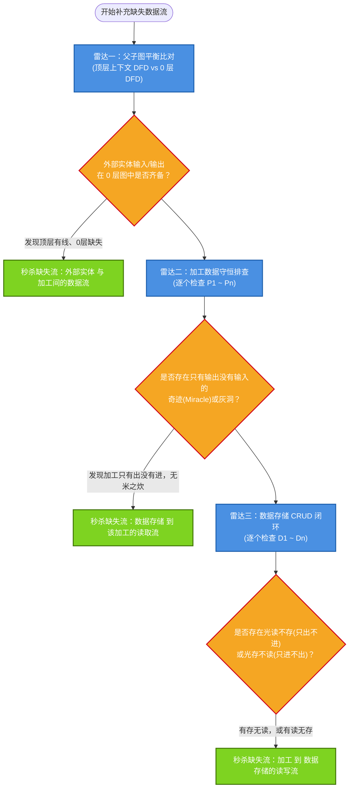

# 00-下午案例分析通关总纲与五大题型破题绝杀流水线

> **🎯 战役心智**：软考下午科目二（软件设计，满分 75 分，及格线 45 分，时间 150 分钟）的本质不是考你手写大段代码，而是考**“现代工程语文阅读理解 + 标准化填空采分”**！  
> 试卷上 **70% 的答案就白纸黑字印在题干的【说明】里**，剩下的 30% 靠**固定死板的题型模板**。  
> 下午题型甚至比高考还要固化（考纲十几年未变）。只要掌握五大题型的破题套路与避坑流水线，保底 **60+ 分高分通关** 是一套百分之百可复制的标准工程！

---

## 🧭 全景战役沙盘：保底 60+ 分得分模型与时间分配

### 1. 三梯队得分模型（及格线 45 分，目标 62~69 分）

| 梯队与题号 | 考核板块 | 分值权重 | 目标保底分 | 核心拿分心法与战术定位 |
| :--- | :--- | :---: | :---: | :--- |
| **第一梯队（基石大题）**<br>试题一、二、六 | **DFD 数据流图**<br>**数据库 E-R 转换**<br>**Java 设计模式** | **45 分**<br>(各 15 分) | **40 ~ 44 分** | **这是通关的生死盘！** 题型全透明、套路全固定。必须近乎拿满分！这三题拿下，离及格（45分）仅差 3~5 分！ |
| **第二梯队（稳压大题）**<br>试题三 | **UML 建模分析** | **15 分** | **12 ~ 14 分** | 找准用例名/类名（名词找类、动词找用例）、包含与扩展箭头方向，白送 12 分。 |
| **第三梯队（防崩大题）**<br>试题四 | **C 语言算法设计** | **15 分** | **8 ~ 11 分** | **绝不恋战，外围包抄！** 策略名称(2分) + 复杂度(2-4分) + 特值手算推导(3-4分)，稳拿 8~10 分即算胜利！ |

### 2. 150 分钟考场精准时间控制表

```mermaid
gantt
    title 软考下午案例分析 150 分钟战役时间轴
    dateFormat  m
    axisFormat %m分
    section 第一梯队 (基石)
    试题一：数据流图 DFD (15分)       :done, a1, 0, 25m
    试题二：数据库 E-R 图 (15分)       :done, a2, 25m, 50m
    section 第二梯队 (稳压)
    试题三：UML 建模分析 (15分)      :done, a3, 50m, 75m
    section 决胜翻盘
    试题六：Java 面向对象 (15分)     :done, a6, 75m, 100m
    section 第三梯队 (外围包抄)
    试题四：C 语言算法 (15分)        :active, a4, 100m, 125m
    section 终局校验
    全卷大检查与答题卡核对 (+2~4分)   :crit, a5, 125m, 150m
```

---

## 🥊 试题一：结构化分析与数据流图 DFD（目标：14~15 分，必拿满分）

> 💡 **考情扫描**：通常含 3~4 道小问。问 1 识别外部实体（E1~E4）；问 2 识别数据存储（D1~D5）；问 3 补全缺失数据流（起点、终点、名称）；问 4 辨析加工细化或 DFD 改错原则（父子平衡/数据守恒）。

### 技巧 1：【主谓宾语法切割法】秒杀外部实体（E1~En）
* **第一性原理**：外部实体**只存在于系统边界之外**，绝不是系统内部的软件模块！通常是“人、硬件设备、外部第三方系统”。
* **秒杀动作**：在题干【说明】中寻找主语和宾语：
  * “**[管理员]** 录入基础数据……” $\implies$ 管理员是外部实体。
  * “接收 **[计量装置/充电桩]** 上报的数据……” $\implies$ 计量装置是外部实体。
  * “向 **[第三方支付平台]** 发送扣费请求……” $\implies$ 第三方平台是外部实体。
* **避坑潜规则**：绝不能写系统内部的加工名字（如“数据处理中心”、“后台管理模块”不是外部实体）。

### 技巧 2：【名词物理存储法】秒杀数据存储（D1~Dn）
* **第一性原理**：数据存储是“名词”，通常对应系统中的数据库表、物理文件、日志或记录。
* **秒杀动作**：题干说明中出现**“……表”、“……文件”、“……记录”、“……清单”、“存储……数据”**的字眼，100% 对应一个 $D$。
* **对号入座**：看谁往里存（写）、谁从里读（查），直接去图里看箭头的输入输出，瞬间锁定 $D_1 \sim D_n$。

### 技巧 3：【补全数据流三大雷达】（彻底歼灭漏题）



1. **父子图平衡（消消乐法）**：拿顶层图（图 1-1）和 0 层图（图 1-2）比对。顶层图外部实体连出的每一根线，在 0 层图里**必须能找到完全一致的线**。顶层图有、0 层图没有的，直接秒杀！
2. **加工输入输出守恒（抓黑洞与奇迹）**：
   * **黑洞（Black Hole）**：一个加工**只有输入线，没有输出线**（光吃不拉），必缺输出流！
   * **奇迹（Miracle / 灰洞）**：一个加工**只有输出线，没有输入线**（凭空捏造数据），或者输入的数据不足以支撑输出，必缺从数据存储读入的数据流！
3. **数据存储读写闭环（CRUD 法）**：
   * 每一个数据存储 $D$ 必须有进有出（既有人写，也有人读）。图上如果某个 $D$ 只有写入箭头，题目说明又提到了“查询/展示/检定”，那必定缺一条**从 $D$ 指向某个加工的读取流**！

> ⚠️ **字面严打铁律**：数据流名称**必须 100% 抠自题干说明中的原文**！题干写“查询和统计条件”，你写“查询条件”或“统计信息”，直接判 0 分！

---

## 🗄️ 试题二：数据库设计与 E-R 转换（目标：14~15 分，必拿满分）

> 💡 **考情扫描**：问 1 补充实体与缺失联系（包含联系类型 1:1, 1:n, m:n）；问 2 补充关系模式的缺失属性并标明主键、外键；问 3 概念简答（规范化范式、需求变更后关系模式调整）。

### 技巧 1：【十字交叉法】秒杀联系类型（1:1, 1:n, m:n）
不要凭空想象两者的关系，必须拆成两个单向问句：
* 问句 1：“1 个部门可以有几个员工？” $\implies$ 多个（$n$）。
* 问句 2：“1 个员工可以属于几个部门？” $\implies$ 1 个（$1$）。
* **合成法则**：$(1:n) \implies$ 部门与员工是 **$1:n$** 联系！
* 再如：“1 个学生可选多门课（$m$），1 门课可被多个学生选（$n$）” $\implies$ **$m:n$** 联系！

### 技巧 2：【关系模式补全三大法定套路】（绝密拿分公式）
题目给出关系模式，让你在横线上补充属性（主键、外键）：
* **套路 1（$1:1$ 联系）**：联系的属性可以放入任意一端，并将另一端的主键借过来作为本端的外键。
* **套路 2（$1:n$ 联系，考频 80%）**：**外键必须归多端！**
  * 例如：部门与员工（$1:n$），员工是多端，员工关系模式里必须加上**“部门编号（外键）”**！
* **套路 3（$m:n$ 联系，考频 100% 必考独立建表）**：
  * 多对多联系**绝不能直接挂在原有实体里，必须单独成立一张全新的关系表**！
  * **新表的主键 = 两个实体的主键合体（复合主键）**！新表的外键 = 分别是两个实体的主键。
  * 例如：学生（学号）与课程（课号）是 $m:n$，“选课”必须独立建表：`选课（学号，课号，成绩）`，主键是 `(学号, 课号)`。

### 技巧 3：【主键与外键采分书写规范】
* 题目要求指出主键、外键时，必须严格按规范作答：
  * 主键标注：明确写出 `主键：员工号`（或者在属性下方画实线下划线）；
  * 外键标注：明确写出 `外键：部门号，外键来自部门关系的主键部门号`。

---

## 📐 试题三：UML 建模分析（目标：12~14 分，稳压大题）

> 💡 **考情扫描**：通常考“用例图 + 类图”，或者偶考“状态机图 / 时序图 / 活动图”。问 1 识别参与者与用例；问 2 识别类名或多重度；问 3 补充类图属性/方法或用例关系。

### 技巧 1：【用例关系绝防颠倒法】（考场最高频翻车点）
UML 用例图的三种核心关系，箭头的虚实和方向必须焊死在脑子里：
* **包含关系 `<<include>>`**：
  * **方向**：**基础用例 $\xrightarrow{<<include>>}$ 被包含用例**（虚线箭头，从总任务指向抽出来的公共动作）。
  * **题眼特征**：“办理业务必须先进行身份验证”。基础用例是“办理业务”，被包含用例是“身份验证”。
* **扩展关系 `<<extend>>`（最容易画反！）**：
  * **方向**：**扩展用例 $\xrightarrow{<<extend>>}$ 基础用例**（虚线箭头，从可选动作指向基础用例！）。
  * **题眼特征**：“在结账时，顾客可以选择使用优惠券”。扩展用例是“使用优惠券”，指向基础用例“结账”。
* **泛化关系（继承）**：
  * **方向**：**子用例 $\longrightarrow$ 父用例**（实线，空心三角形箭头！）。如“微信支付”和“支付宝支付”指向“在线支付”。

### 技巧 2：【类图识别：BCE 三分天下法】
填空题让你补充类图中的类名时，在说明中找名词，并按 BCE 分类：
* **Boundary（边界类）**：界面、窗口、表单、通信接口（如 `LoginForm`、`OrderUI`）；
* **Control（控制类）**：业务控制器、管理器、调度器（如 `OrderManager`、`PayController`）；
* **Entity（实体类）**：客观现实事物、数据库存的对象（如 `User`、`Book`、`Order`）。

### 技巧 3：【多重度判断对侧原则】
* 判断类图连接线两端的数字（$0..1$、$1$、$0..*$、$1..*$）：
  * 问：“1 个公司有几个员工？” $\implies$ 答案是多（$1..*$），这个数字必须写在**靠近“员工类”的那一端**！千万不要写在公司那一端！

---

## ⚡ 试题四：C 语言算法设计与分析（目标：8~11 分，外围包抄策略）

> 💡 **核心定位**：全卷难度天花板。**绝不能死磕代码，必须执行“外围包抄，先拿 8 分”战略！**


### 技巧 1：【算法策略送分判定器】（第 1 问 2 分必拿）
* **动态规划（DP）**：代码里出现二维数组（如 `dp[i][j]`、`c[i][w]`），有双重循环，取 `max(...)` 或 `min(...)` $\implies$ **动态规划法**。
* **分治法**：递归调用自身两次（如 `merge_sort(..., low, mid)` 和 `merge_sort(..., mid+1, high)`），中间有个 `mid` $\implies$ **分治法**。
* **贪心法**：先对数组进行排序（`qsort`），然后单层循环从头挑到尾，选局部最优 $\implies$ **贪心法**。
* **回溯法**：递归调用自身，下面紧跟着“恢复现场/重置标志位”（如 `visited[i] = 0`） $\implies$ **回溯法**。

### 技巧 2：【代码填空的“特值探针与上下文镜像法”】
* **对称性原则**：看已经写好的兄弟分支。比如 `if (a > b) max = a; else` 后面肯定是 `max = b;`。
* **类型探针法**：看当前这一行是在给什么变量赋值。如果左边是 `int`，右边绝不可能调一个返回 `void` 的函数。
* **循环边界特值代入法**：如果填空在 `for (i = ?; i < ?; i++)`：
  * 代入 $n=1$ 或 $n=2$ 的极简情况，在草稿纸上手算一次循环变量应该是从 0 还是 1 开始，偏移量是 `i` 还是 `i-1`。

> ⚠️ **考场止损铁律**：算法题耗时**严格控制在 25 分钟以内**。代码填空实在看不懂的空，随便填一个上下文中反复出现的变量名（绝不留空！），立刻转战 Java！

---

## ☕ 试题六：Java 面向对象程序设计（目标：14~15 分，翻盘决胜点）

> 💡 **核心定位**：全卷性价比最高的大题！**100% 选试题六（Java），绝对不要碰试题五（C++）！**  
> 因为 Java 语法规范纯净，没有指针、没有多重继承、没有复杂的析构拷贝，填空套路 100% 程式化！

### 技巧 1：【填空位置六大条件反射】（通杀 23 种设计模式）

1. **接口与抽象类继承关（送分空 1）**：
   * 后面跟着 `interface` $\implies$ 前面填 **`implements`**；
   * 后面跟着普通类或 `abstract class` $\implies$ 前面填 **`extends`**。
2. **多态对象持有关（组合结构）**：
   * 在装饰模式、桥接模式、状态模式中，类内部必须声明一个顶层接口/抽象类的引用：
   * 观察上下文找接口名，例如：`private Strategy strategy;` 或 `protected Component component;`。
3. **父类构造调用关**：
   * 子类构造函数的第一行，必填 **`super(...);`**（看父类构造函数要传什么参数，原样传进去）。
4. **多态方法委托调用关（核心业务空）**：
   * 模式的核心就是“把活委托给持有的对象干”：
   * 策略模式：`strategy.doOperation(...)` 或 `strategy.algorithm(...)`；
   * 观察者模式：`observer.update(...)`；
   * 命令模式：`command.execute()`；
   * 状态模式：`state.handle(this)`。
5. **工厂创建对象关**：
   * 工厂方法最后一步必定是实例化具体产品：`return new ConcreteProduct();`。
6. **单例模式标准套件**：
   * 构造函数私有化：`private Singleton() {}`；
   * 静态获取实例：`return instance;` 或 `new Singleton();`。

### 技巧 2：【上下文克隆法】（无需理解业务也能填对）
题目通常会写好一个具体子类（如 `Circle`），然后让你填另一个具体子类（如 `Rectangle`）。
* **操作**：把已经写好的 `Circle` 里的代码**1:1 原样照抄**到 `Rectangle` 中，只需把里面的“Circle”替换成“Rectangle”即可！这是命题人最经典的填空布局。

---

## 🏆 终极避坑锦囊（考前最后 10 秒默念）

1. **题干说明是亲娘**：下午题绝不考天马行空的想象力，答案的 70% 都是题干词汇的原样搬运！
2. **字迹工整第一位**：主观题是人工阅卷，卷面整洁、序号清晰，阅卷老师心情好可能多给 2~3 分同情分！
3. **遇到难题莫恋战**：算法不会填直接猜变量名跳过，把充裕的时间留给 Java 和 DFD，稳拿 60+ 分轻舟已过万重山！
