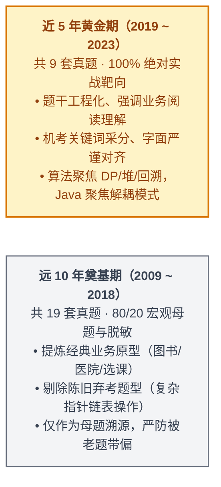
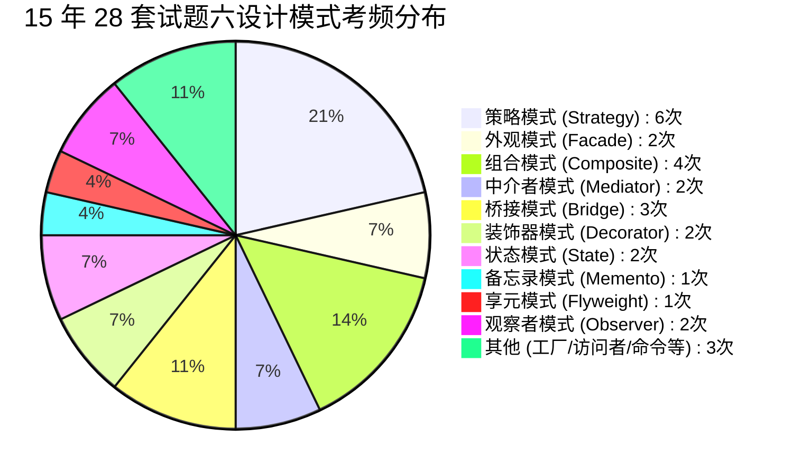

# 2009~2023年软考下午真题15年全景考点精析与冲刺绝杀手册

> 🎯 **战役心智**：软考中级软件设计师【下午科目二：软件设计】（满分 75 分，及格线 45 分）是能否拿证的决战盘！  
> 纵观 2009~2023 历年 15 年共 28 场考试（140 道大题），下午题有着极其固化的**“十年一贯制”命题规律**。  
> 本手册采用 **“A+B 复合架构”**：以 **方案 A（五大题型专项击穿与采分词库）为主体**，在文末附赠 **方案 B（15 年 28 卷全景速查大表 + 考前 30 张高密度避坑闪卡）**。

---

## 🧭 战略指引：时间段科学划分与复习“脱敏红线”

为了在冲刺阶段把有限的时间用在刀刃上，坚决执行**“时间段科学分流”**：

> [!CAUTION] **冲刺阶段三大“脱敏防坑”铁律（避免老题误导）**：
> 1. **算法题脱敏**：2009~2015 年偶考的“纯 C 语言长链表/指针模拟/图的邻接表手写代码”等冷门数据结构操作，在近 5 年已**完全被标准的“算法策略（DP/贪心/回溯/分治）+ 状态转移方程填空 + 手算推导”取代**。复习时遇到早期复杂的指针运算代码，**直接跳过，切勿死扣**！
> 2. **设计模式脱敏**：早期（如 2009~2012）偶尔考查的纯单例模式、简单工厂等简单代码，近 5 年已基本退出历史舞台。现在 **100% 考察具备复杂类间交互、委托调用与解耦的结构型与行为型模式**（如策略、外观、中介者、享元、备忘录、组合）！
> 3. **文字题脱敏**：早期部分真题简答题问法较为主观，近 5 年（特别是机考化后）设问极其规范，采分点 100% 围绕题干说明原词展开。

---

# 🥊 第一部分：方案 A · 五大题型专项纵切深度击穿

---

## 专题一：试题一 · 数据流图 DFD（15 分必拿满分）

### 1. 15 年命题全景与业务母题分类

从 2009 到 2023 年，28 道 DFD 试题的业务场景虽千变万化，但在本质上完全收敛为三大业务流母题：

| 业务母题分类 | 典型真题案例 | 核心特征与数据流动机制 | 考场易错点 |
| :--- | :--- | :--- | :--- |
| **母题 A：物联网与工业实时监控流** | • **2022下**：充电桩计量检定 • **2021下**：智慧农业平台 • **2021上**：无人值守停车系统 • **2020下**：智能缺陷检测系统 | • 外部实体通常包含**传感器、硬件设备、监控终端**； • 强调高频心跳、实时采样、异常报警； • 加工与加工之间存在**实时直连流水线**。 | 容易误把硬件设备漏掉，或将加工间的实时直连流误写为经过存储回读。 |
| **母题 B：商业订单与在线交易流** | • **2022上**：外卖订餐系统 • **2021上**：蔬菜团购网站 • **2019下**：二手车物流系统 • **2016下**：信用卡积分商城 | • 外部实体包含**商家、客户、第三方支付/物流**； • 强调订单生成、状态流转、结算对账； • 存在多张订单、账户、交易日志等存储。 | 容易丢失向第三方支付/物流的外部交互流。 |
| **母题 C：综合管理与工单审批流** | • **2023上**：农事管理服务平台 • **2019上**：学生跟踪系统 • **2017下**：在线选课系统 • **2015下**：物业管理系统 | • 外部实体以**系统管理员、业务人员、普通用户**为主； • 强调权限配置、信息维护、综合查询与统计分析； • 存储以基础档案、历史记录为主。 | 容易忽略**“统计查询展示时对存储的历史回读流”**。 |

---

### 2. 细化考点与问答套路拆解（近 5 年黄金标准）

#### 【问题 1】外部实体 E1~En 识别（通常 4 分）
* **命题人套路**：给出顶层或 0 层图，挖空 3~4 个实体。
* **满分秒杀法（主谓宾语法切割）**：
  1. 外部实体只存在于系统边界之外（**人、外部硬件设备、第三方软件系统**），绝不是系统内的功能模块；
  2. 顺着题干说明抠主谓宾：“**[管理员]** 录入标准” $\implies$ 管理员；“接收 **[计量装置]** 上报数据” $\implies$ 计量装置；“向 **[第三方支付]** 发送请求” $\implies$ 第三方服务。
* **避坑红线**：严禁把系统内的加工名称当实体（如“数据处理中心”不是实体）。

#### 【问题 2】数据存储 D1~Dn 名称（通常 3~5 分）
* **官方命题死指令**：**“使用说明中的词语，给出数据存储 D1~Dn 的名称”**。
* **采分第一铁律**：**说明原文字面抄，说明无表不加表！**
  * 原文写“基础信息”，就写 `基础信息`，绝不自造 `基础信息表`；
  * 原文写“检定记录”，就写 `检定记录`，绝不自造 `检定记录文件`；
  * 原文写“心跳数据”，就写 `心跳数据`，绝不多写 `心跳数据信息`。
* **近 5 年官方第一顺位标答对照库**：
  * 2022下：`充电监测及计量数据`、`基础数据`、`计量装置心跳数据`、`充电误差数据`、`检定记录`
  * 2021下：`农作物数据`、`环境数据`、`销售数据`、`操作日志`
  * 2020下：`模型文件`、`产品检测信息`、`基础信息`
  * 2019上：`学生记录`、`请假记录`、`课程表`

#### 【问题 3】补充缺失数据流及其起止（通常 4~5 分）
* **审题第一步（看分定流数）**：**4分必补4条，5分必补5条**！严防惯性漏写。
* **三级雷达地毯式排查法**：
  1. **雷达一：父子平衡消消乐**：比对顶层上下文图与 0 层图，顶层有的外部交互线，0 层图中若缺失，直接秒杀！
  2. **雷达二：加工奇迹零输入排查**：巡检每个加工，**只有输出箭头、没有输入箭头的加工属于“奇迹（Miracle）”**，必定缺失来自数据存储的读取流或外部输入流。
  3. **雷达三：统计展示回读流排查（高频翻车点）**：凡是题干说明写着“根据条件**展示/查询/统计**历史分析结果”，该加工**必须从对应的数据存储中读回数据**！
* **答题标准化格式**：必须严格写明：`起点：XX，终点：YY，数据流名称：ZZ`。

#### 【问题 4】综合问答与改错（通常 2~3 分）
近 5 年常见三种微调变式：
* **变式 A：数据流组成表达**：如 2022下“充电监测与计量数据”的组成，从说明中提取原子项：`电压、电流、电能`。
* **变式 B：伪代码/加工逻辑描述**：如 2020下缺陷检测，采用结构化语言描述，**切记设置布尔标志位，严防 break 后控制流穿透覆写状态**。
* **变式 C：DFD 语法错误辨析**：考查三大病态加工术语——**黑洞（Black Hole，只有进没有出）**、**奇迹（Miracle，只有出没有进）**、**灰洞（Gray Hole，输入不足以产生输出）**。

---

## 专题二：试题二 · 数据库系统设计（15 分稳拿 13~14 分）

### 1. 15 年命题全景与业务母题

数据库大题以**“E-R 图模型构建 + 关系模式转换与规范化”**为核心，近 15 年业务场景覆盖：
* 供应链与采购管理（2023上 零件采购、2021下 汽车维修）
* 营销与商业运营（2022下 专卖店业务、2021上 蔬菜团购、2019下 技能培训）
* 医疗与民生政务（2022上 疫苗接种、2019上 创业孵化、2017上 房屋中介）

---

### 2. 细化考点与秒杀绝技

#### 【问题 1】实体联系及联系类型（通常 4~6 分）
* **基数判定（1:1, 1:n, m:n）**：
  * **1 : 1（一对一）**：专卖店 1 对 1 店长；部门 1 对 1 经理。
  * **1 : n（一对多）**：分公司 1 对多 专卖店；专卖店 1 对多 职员。
  * **m : n（多对多）**：学生 多对多 课程；订单 多对多 商品；蔬菜 多对多 团购客户。
* **特殊联系判定**：
  * **超类-子类特殊化联系**：如“职员”是超类，“店长”是子类，店长属于特殊的职员，构成 1:1 或泛化联系。
  * **三元联系判定**：三个实体共同参与一个联系（如“医生-患者-疫苗”之间的接种联系），**联系属性必须挂在联系本身上**（如“接种日期”挂在接种联系上，漏写即扣分）。

#### 【问题 2】关系模式属性补空与主外键（通常 6~8 分）
* **模式补空绝杀法——“说明划线做减法”**：
  1. 翻到题干说明对应实体的段落；
  2. 将说明中白纸黑字列出的属性，与试卷上模式已有的属性逐一划线消消乐；
  3. **空几个空，说明里就刚好剩几个属性词**！直接照搬填入，绝不凭空脑补（如 2022下专卖店模式漏填说明明文注明的“店长”）。
* **外键归宿三大铁律**：
  * **1 : n 联系**：**外键必须并入 n 端（多端）**！
  * **m : n 联系**：**必须独立建表**！新表主键为两端实体主键构成的组合主键（联合主键）。
  * **外键命名原则**：**外键字段名必须 100% 对齐本关系模式声明的属性名**，本表叫“店长”就必须写“店长”，绝不能泛写为“职员”或“职员号”。

#### 【问题 3】弱实体、规范化与范式异常（通常 3~5 分）
* **弱实体（依赖实体）**：如“职员家属”、“紧急联系人”，离开主实体无法独立存在。**必须将主实体的主键带入弱实体模式中作为外键**！
* **未规范化四大异常**：
  1. **数据冗余**（大量重复存储）；
  2. **插入异常**（想插的数据插不进去）；
  3. **删除异常**（删一条关联数据导致有用信息丢失）；
  4. **修改异常**（改一处漏改其他处导致数据不一致）。
* **范式分解**：从 1NF 消除部分函数依赖达到 2NF，消除传递函数依赖达到 3NF。

---

## 专题三：试题三 · 面向对象与 UML 建模（15 分稳拿 12~14 分）

### 1. 15 年命题图型分布与演进

* **用例图（Use Case Diagram）+ 类图（Class Diagram）**：占全卷 **85%** 以上绝对统治地位！
* **偶考图型**：顺序图（Sequence Diagram，如 2013上、2018上）、状态图（Statechart Diagram，如 2014上、2017下）、活动图（Activity Diagram）。
* **近 5 年核心演变趋势**：**类图与经典设计模式深度融合**！类图不再是干瘪的业务实体，而是直接呈现设计模式的骨架（如 2022下结合外观与中介者模式、2021下结合享元模式、2021上结合组合模式）。

---

### 2. 细化考点与秒杀绝技

#### 【考点 1】用例图填空与用例关系判定
* **用例命名铁律**：**必须是动宾短语**（如 `显示温度`、`线上抓药`、`核对处方`），绝不能写成名词或角色名！
* **考场查重第一步**：动笔前先扫一遍图中已画出的用例椭圆，**待填空的用例绝不可能与已有用例重名**！
* **三大关系方向辨析**：
  * `<<include>>`（包含关系）：基础用例 $\to$ 公共子用例（提取公共行为，必定执行）；
  * `<<extend>>`（扩展关系）：扩展子用例 $\to$ 基础用例（附加条件分支，箭头指向被扩展的基础用例）；
  * `泛化关系`（三角空心箭头）：子用例 $\to$ 父用例（如华氏度显示、摄氏度显示泛化为温度显示）。

#### 【考点 2】类图填空——已知实体锚点定位法
* **严禁盲猜类名**：类图一处错，极易导致连环错位血崩。
* **锚点定位流水线**：
  1. **抓已知锚点**：寻找图里已经标注的类（如对话框界面、业务处理核心类）；
  2. **顺藤摸瓜看连线**：
     * **继承/泛化（三角空心箭头）**：寻找共同父类；
     * **聚合/组合（空心/实心菱形）**：判断“整体与部分”；
     * **依赖（虚线箭头）**：临时参数传递；
  3. **面向对象本质**：类图表达的是内存中的对象引用指针，**严禁在关联类中画蛇添足加上数据库“外键ID”**！

---

## 专题四：试题四 · C 语言算法设计与分析（15 分保底 10~12 分）

### 1. 15 年算法频次与策略天梯

| 算法核心策略 | 15 年真题出现频次 | 典型算法与真题案例 | 冲刺复习权重 |
| :--- | :---: | :--- | :---: |
| **动态规划（DP）** | **11 次 (39.3%)** | • 0-1 背包（2019下） • 矩阵链乘（2022上、2017下） • 编辑距离（2021下） • 凸多边形最优剖分（2021上） • 最长公共子序列 LCS（2013上、2015下） • 钢条切割（2018上） | 🔴 **必考核心（权重 50%）** |
| **贪心与排序算法** | **8 次 (28.6%)** | • 大顶堆排序（2022下、2010下） • 希尔排序（2020下） • 归并排序（2014上） • 装箱问题（2012下） | 🔴 **必考核心（权重 25%）** |
| **回溯法与搜索** | **5 次 (17.8%)** | • N 皇后问题（2019上、2015上） • 迷宫求解与子集和问题（2011下、2009下） | 🟡 **重点关注（权重 15%）** |
| **分治法与图算法** | **4 次 (14.3%)** | • 假币称重（2017上） • 拓扑排序（2010上） • 模式匹配 KMP（2016下） | 🟢 **常识掌握（权重 10%）** |

---

### 2. 外围包抄必拿分绝招（不上算法天台）

> 💡 **考场心智**：即使你完全看不懂代码填空，**算法题也能稳拿 7~9 分**！

1. **【拿稳 2 分】识别算法设计策略**：
   * 题干看到“最优子结构、重叠子问题、填表格 memo” $\implies$ **动态规划法（Dynamic Programming）**；
   * 题干看到“每步贪心选择、局部最优” $\implies$ **贪心法（Greedy）**；
   * 题干看到“试探、剪枝、回退、递归尝试” $\implies$ **回溯法（Backtracking）**；
   * 题干看到“原问题分解为子问题、递归求解合并” $\implies$ **分治法（Divide and Conquer）**。
2. **【拿稳 2~4 分】时间与空间复杂度速查**：
   * 堆排序：时间恒为 $O(n \log n)$，辅助空间恒为 $O(1)$；
   * 快速排序：平均时间 $O(n \log n)$，最坏 $O(n^2)$，空间递归栈 $O(\log n) \sim O(n)$；
   * 矩阵链乘 / 凸多边形剖分：时间 $O(n^3)$，空间表格 $O(n^2)$；
   * LCS / 0-1 背包 / 编辑距离：时间 $O(n \times m)$ 或 $O(n \times W)$，空间 $O(n \times m)$。
3. **【拿稳 3~4 分】特值手算追踪推导**：
   * 堆排序建堆与第 1 趟下沉序列；
   * 审题连带设问：题干若问“给出建堆结果，并给出第一趟排序结果”，**必须两问都答，切莫漏答后半问**！
4. **【代码填空两大核心死穴】**：
   * **死穴 A：下沉比较看暂存区！**（如 2022下大顶堆，根节点已存入 `R[0]`，循环比较恒为 `R[0] < R[j]`，绝不可写已被覆盖的 `R[i] < R[j]`）；
   * **死穴 B：区间 DP 循环边界必须闭合取等！**（如矩阵链乘阶段循环 `r <= N` 绝不能漏等号）。

---

## 专题五：试题六 · Java 面向对象设计模式（15 分必拿满分）

### 1. 15 年设计模式命题热力榜

近 15 年 28 场考试中，Java 试题考查的设计模式频次分布极其鲜明：

> [!IMPORTANT] **近 5 年核心命题规律**：
> 几乎被 **策略模式（Strategy）、外观模式（Facade）、组合模式（Composite）、中介者模式（Mediator）、享元模式（Flyweight）、备忘录模式（Memento）** 完全垄断！

---

### 2. 细化考点与必中填空套路

#### 套路 1：接口与抽象类方法声明
* 题干定义接口 `interface Strategy`，空缺处挖空方法声明：
  * **必带全套语法**：必须包含返回值类型、方法名、形参列表并**以分号结尾**！
  * 例：`public abstract void doPrint(Interval val);` 或 `public void update();`

#### 套路 2：多态实例化与接口引用
* 父类/接口引用指向子类实现对象：
  * `Strategy st = new ConcreteStrategy();`
  * `Subject sub = new ConcreteSubject();`

#### 套路 3：委托调用与 `this` 传参机制（高频考点）
* **中介者模式（Mediator）**：同事类调用中介者分发时，必须将自身引用传给中介者：`this.mediator.buy(money, this);`
* **策略模式（Strategy）**：环境类调用策略打印时，传自身数据：`ptr.doPrint(this);`
* **组合模式（Composite）**：容器类添加子构件：`children.add(component);`

#### 套路 4：单词拼写 100% 对齐题干
* 严禁凭模糊记忆手默专有名词！类名、方法名逐字母在题干源码中核对（如 `Flyweight`、`Facade`、`Memento`、`Observer`）。

---

# 🚀 第二部分：方案 B · 终极绝杀工具箱

---

## 附录一：【15 年全景速查总表】（2009~2023 28 套试卷一览）

| 考期 | 优先级 | 试题一 DFD 业务场景 | 试题二 数据库业务 | 试题三 UML 核心模式/图 | 试题四 算法名称与策略 | 试题六 Java 设计模式 |
| :---: | :---: | :--- | :--- | :--- | :--- | :--- |
| **2023上** | 🔴 必刷 | 农事管理服务平台 | 汽车零件采购系统 | 数字图书馆类图 | 图的邻接表遍历 | **策略模式 (Strategy)** |
| **2022下** | 🔴 必刷 | 充电桩计量检定 | 专卖店业务管理 | 温控中介者/策略模式 | **大顶堆排序 (Heapify)** | **外观模式 (Facade)** |
| **2022上** | 🔴 必刷 | 外卖订餐系统 | 疫苗接种管理 | 地址簿类与用例图 | **矩阵链乘 (动态规划)** | **备忘录模式 (Memento)** |
| **2021下** | 🔴 必刷 | 智慧农业平台 | 汽车维修管理 | 吃金币游戏类图 | **DNA编辑距离 (动态规划)**| **享元模式 (Flyweight)** |
| **2021上** | 🔴 必刷 | 无人值守停车系统 | 社区蔬菜团购 | 线上抓药 APP 用例类图 | **凸多边形剖分 (动态规划)**| **组合模式 (Composite)** |
| **2020下** | 🔴 必刷 | 智能缺陷检测系统 | 集团职员信息平台 | 房产信息管理系统 | **希尔排序 (Shell Sort)** | **中介者模式 (Mediator)**|
| **2019下** | 🔴 必刷 | 二手车物流系统 | 新员工培训系统 | 牙科诊所管理系统 | **0-1 背包问题 (动态规划)**| **观察者模式 (Observer)**|
| **2019上** | 🔴 必刷 | 学生跟踪系统 | 创业孵化基地 | 图书销售系统 | **N 皇后问题 (回溯法)** | **策略模式 (Strategy)** |
| **2018下** | 🟢 选刷 | 汽车租赁系统 | 仓储货物调配 | 医疗监护系统 | RNA二级结构 (动态规划) | 状态模式 (State) |
| **2018上** | 🟢 选刷 | 车辆监控平台 | 餐饮连锁订餐 | 网上书店顺序图 | 钢条切割 (动态规划) | 策略模式 (Strategy) |
| **2017下** | 🟢 选刷 | 在线选课系统 | 供应链物料跟踪 | 自动售货机状态图 | 矩阵链乘 (动态规划) | 桥接模式 (Bridge) |
| **2017上** | 🟢 选刷 | 房屋中介信息系统 | 健身房会员管理 | 交通信号灯控制 | 假币称重 (分治法) | 策略模式 (Strategy) |
| **2016下** | 🟢 选刷 | 信用卡积分商城 | 会员消费积分 | 电子政务公文流转 | 串匹配 (KMP 算法) | 装饰器模式 (Decorator) |
| **2016上** | 🟢 选刷 | 智慧旅游导航 | 汽车客运售票 | 协同办公审批流 | 电路布线 (动态规划) | 适配器模式 (Adapter) |
| **2015下** | 🟢 选刷 | 物业管理系统 | 电商仓库入库 | 航空订票系统 | 最长公共子序列 (DP) | 策略模式 (Strategy) |
| **2015上** | 🟢 选刷 | 快递派送系统 | 医院门诊收费 | 智能家电控制 | N 皇后问题 (回溯法) | 访问者模式 (Visitor) |
| **2014下** | 🟢 选刷 | 仓库库存预警 | 酒店客房预订 | 银行业务排队 | 最长递增子序列 (DP) | 命令模式 (Command) |
| **2014上** | 🟢 选刷 | 驾校学员考试 | 电子商城订单 | 打印机状态机 | 归并排序 (分治法) | 观察者模式 (Observer) |
| **2013下** | 🟢 选刷 | 城市公交调度 | 考勤打卡管理 | 移动营业厅办理 | 矩阵连乘 (动态规划) | 桥接模式 (Bridge) |
| **2013上** | 🟢 选刷 | 餐饮点餐结算 | 档案借阅流转 | 网上支付顺序图 | 最长公共子序列 (DP) | 策略模式 (Strategy) |
| **2012下** | 🟢 选刷 | 实验室设备管理 | 销售提成计算 | 邮件客户端过滤 | 装箱问题 (贪心算法) | 工厂方法 (Factory Method)|
| **2012上** | 🟢 选刷 | 报刊订阅系统 | 生产流水线排程 | 门禁安全系统 | 双机作业调度 (DP/搜索) | 装饰器模式 (Decorator) |
| **2011下** | 🟢 选刷 | 网上求职招聘 | 教师工作量统计 | 咖啡机控制 | 迷宫寻路 (回溯法) | 状态模式 (State) |
| **2011上** | 🟢 选刷 | 会员积分抽奖 | 车辆年审检测 | 电子商务购物车 | 计数排序 (Counting Sort)| 组合模式 (Composite) |
| **2010下** | 🟢 选刷 | 仓库物资进出库 | 销售业绩核算 | 绘图软件图形库 | 大顶堆调整算法 | 组合模式 (Composite) |
| **2010上** | 🟢 选刷 | 医院就诊挂号 | 汽车加油站计费 | 游戏角色技能体系 | 有向图拓扑排序 | 策略模式 (Strategy) |
| **2009下** | 🟢 选刷 | 房屋租售服务 | 设备报修流程 | 航空乘务排班 | 任务分配 (回溯法) | 组合模式 (Composite) |
| **2009上** | 🟢 选刷 | 进销存管理系统 | 客户关系管理 | 图形渲染引擎 | 矩阵乘法 | 桥接模式 (Bridge) |

---

## 附录二：【考前 30 张高密度避坑闪卡（Anki 级）】

### 试题一：DFD 数据流图（6 张卡）

* 🎴 **卡片 01 ｜ 数据存储命名红线**
  * **设问**：数据存储末尾是否需要自动加“表”或“文件”？
  * **秒杀动作**：**坚决不加！** 说明原文写啥就写啥（说明叫“基础信息”，就写 `基础信息`）。加后缀零加分，却有极高概率因违反“使用说明中的词语”被扣分！
* 🎴 **卡片 02 ｜ 缺失数据流漏审分值**
  * **设问**：缺失数据流题通常补几条流？
  * **秒杀动作**：**看分定流数！** 4分答4条，5分必答5条！若少一条，优先排查零输入加工和历史展示回读流！
* 🎴 **卡片 03 ｜ 统计展示回读流遗漏**
  * **设问**：说明中提到“根据条件展示/查询历史统计数据”，数据流如何走？
  * **秒杀动作**：**必有从数据存储读回数据的流！** 起点为对应存储，终点为展示加工。
* 🎴 **卡片 04 ｜ 加工奇迹（Miracle）判定**
  * **设问**：图中某个加工只有输出箭头，没有任何输入箭头，说明了什么？
  * **秒杀动作**：这是典型**加工奇迹**！无米之炊，必漏掉了从存储读取或外部实体输入的支撑数据流。
* 🎴 **卡片 05 ｜ 伪代码控制流穿透**
  * **设问**：书写 DFD 加工伪代码时，循环检测到不合格并 break 后应注意什么？
  * **秒杀动作**：**严防穿透！** 必须用布尔标志位控制，绝不能在跳出循环后无条件顺序执行“设置产品为合格”。
* 🎴 **卡片 06 ｜ 外部实体与系统模块混淆**
  * **设问**：系统内部的“数据分析中心”、“后台管理模块”能写为外部实体吗？
  * **秒杀动作**：**绝不能！** 外部实体只能是系统边界之外的人、硬件设备或第三方外联系统。

---

### 试题二：数据库设计（6 张卡）

* 🎴 **卡片 07 ｜ 关系模式属性补空方法**
  * **设问**：如何保证模式填空中的属性一个不漏？
  * **秒杀动作**：**说明清单做减法！** 将说明中该实体的属性与试卷已知字段逐一划线消消乐，空几个就刚好剩几个词。
* 🎴 **卡片 08 ｜ 外键字段名命名规范**
  * **设问**：专卖店关系模式中负责人的外键写“职员”或“职员号”给分吗？
  * **秒杀动作**：**不给分！** 外键字段名必须 100% 对齐本关系模式正式声明的属性名（模式叫“店长”就必须写“店长”）。
* 🎴 **卡片 09 ｜ 1:n 联系外键归宿**
  * **设问**：1对多联系中，外键应该并入哪一端？
  * **秒杀动作**：**外键必须并入 n 端（多端）！** 绝不可在 1 端记录多个外键。
* 🎴 **卡片 10 ｜ m:n 联系转换规则**
  * **设问**：多对多联系在关系模式中如何实现？
  * **秒杀动作**：**必须独立建表！** 新表主键为两端实体主键构成的组合主键。
* 🎴 **卡片 11 ｜ 弱实体主外键处理**
  * **设问**：“职员家属”、“紧急联系人”等弱实体关系模式必须包含什么？
  * **秒杀动作**：**必须引入主实体的主键作为外键！** 与弱实体自身属性共同构成主键或外键约束。
* 🎴 **卡片 12 ｜ 未规范化四大异常**
  * **设问**：未规范化关系模式存在的四大异常是哪四种？
  * **秒杀动作**：**数据冗余、插入异常、删除异常、修改异常**（八字口诀必背）。

---

### 试题三：UML 建模分析（6 张卡）

* 🎴 **卡片 13 ｜ 用例命名语法规范**
  * **设问**：用例名称能写成名词“温度”或角色名吗？
  * **秒杀动作**：**绝不能！** 用例必须是动宾短语（如 `显示温度`、`录入病历`）。
* 🎴 **卡片 14 ｜ 用例图考场查重**
  * **设问**：填写 U1~Un 时最容易犯的低级错误是什么？
  * **秒杀动作**：**误填图中已有的用例！** 动笔前先把图里已画出的用例划掉，待填空绝不重名。
* 🎴 **卡片 15 ｜ 用例包含 vs 扩展方向**
  * **设问**：`<<include>>` 与 `<<extend>>` 箭头方向怎么指？
  * **秒杀动作**：包含（基础 $\to$ 公共子用例，提取公共必定执行）；扩展（扩展子用例 $\to$ 基础用例，条件触发被扩展）。
* 🎴 **卡片 16 ｜ 类图已知实体锚点法**
  * **设问**：类图待填空类很多时如何破局？
  * **秒杀动作**：**已知实体作锚点！** 顺着已知类（如主对话框、主控类）的关联、继承、聚合连线顺藤摸瓜，严禁盲猜。
* 🎴 **卡片 17 ｜ 类图关联类属性边界**
  * **设问**：类图中的关联类需要添加数据库外键 ID 吗？
  * **秒杀动作**：**坚决不加！** 类图表达对象内存引用指针，天然持有两端对象，绝不设外键字段。
* 🎴 **卡片 18 ｜ 泛化与继承符号**
  * **设问**：UML 中三角空心箭头和带箭头的虚线分别代表什么？
  * **秒杀动作**：三角实线 $\implies$ 泛化/继承；三角虚线 $\implies$ 接口实现。

---

### 试题四：C 语言算法设计（6 张卡）

* 🎴 **卡片 19 ｜ 算法策略四选一特征词**
  * **设问**：如何一眼识别 DP、贪心、回溯与分治？
  * **秒杀动作**：最优子结构+表格存储 $\implies$ **DP**；局部最优选择 $\implies$ **贪心**；试探剪枝回退 $\implies$ **回溯**；子问题独立合并 $\implies$ **分治**。
* 🎴 **卡片 20 ｜ 大顶堆下沉比较语句**
  * **设问**：堆调整 Heapify 循环中为什么是 `R[0] < R[j]` 而不是 `R[i] < R[j]`？
  * **秒杀动作**：**下沉比较看暂存区！** `R[i]` 在循环内已被孩子节点覆盖，比较主体恒为存入暂存区的根节点 `R[0]`（或 `temp`）。
* 🎴 **卡片 21 ｜ 区间动态规划循环上界**
  * **设问**：矩阵链乘等区间 DP 长度循环 `for(r = 2; r ... N; r++)` 条件怎么写？
  * **秒杀动作**：**闭区间必须取等！** `r <= N`，漏掉等号直接扣 2 分。
* 🎴 **卡片 22 ｜ 排序算法时空复杂度天梯**
  * **设问**：堆排序、希尔排序、归并排序的复杂度口诀是什么？
  * **秒杀动作**：**堆归恒定 $n\log n$，堆空就地 $O(1)$，归并外开 $O(n)$，希尔跨步不稳定！**
* 🎴 **卡片 23 ｜ 手算追踪设问连带答**
  * **设问**：题干问“给出最终序列并给出第一趟结果”易犯什么错？
  * **秒杀动作**：**漏答第二问！** 必须分行、标清序号逐问作答。
* 🎴 **卡片 24 ｜ 0-1 背包与部分背包区分**
  * **设问**：0-1 背包可以用贪心法求解吗？
  * **秒杀动作**：**不能！** 0-1 背包不可分割，贪心通常得不到最优解，必须用 DP；只有物品可任意切分的部分背包才用贪心。

---

### 试题六：Java 面向对象设计模式（6 张卡）

* 🎴 **卡片 25 ｜ 接口方法声明语法全套**
  * **设问**：在 `interface Strategy` 内部填空抽象方法声明需要注意什么？
  * **秒杀动作**：**返回值类型、形参列表、分号一个不漏！** 例：`public void update(Subject s);`
* 🎴 **卡片 26 ｜ 中介者与观察者 `this` 传参**
  * **设问**：同事类委托中介者分发请求时参数填什么？
  * **秒杀动作**：**必须传入 `this`！** 让中介者知道是谁发起的请求：`mediator.buy(money, this);`
* 🎴 **卡片 27 ｜ 单词拼写逐字母核对**
  * **设问**：类名如 `Flyweight`、`Facade`、`Memento` 怎么写防手滑？
  * **秒杀动作**：**100% 抄题干源码！** 逐字母对照题干出现的英文字符，绝不凭模糊记忆盲敲。
* 🎴 **卡片 28 ｜ 访问权限符号映射**
  * **设问**：UML 类图中 `+`、`#`、`-` 分别对应 Java 哪个关键字？
  * **秒杀动作**：`+` $\implies$ `public`；`#` $\implies$ `protected`；`-` $\implies$ `private`。
* 🎴 **卡片 29 ｜ 策略模式标准调用模板**
  * **设问**：环境类 Context 执行策略算法的核心语句是什么？
  * **秒杀动作**：多态委托调用：`strategy.algorithmInterface();` 或 `strategy.doPrint(this);`
* 🎴 **卡片 30 ｜ 多态引用声明与初始化**
  * **设问**：工厂方法或外观模式中如何创建具体对象？
  * **秒杀动作**：**父类/接口引用指向子类实例**：`Strategy st = new ConcreteStrategy();` 或 `Facade f = new Facade();`
