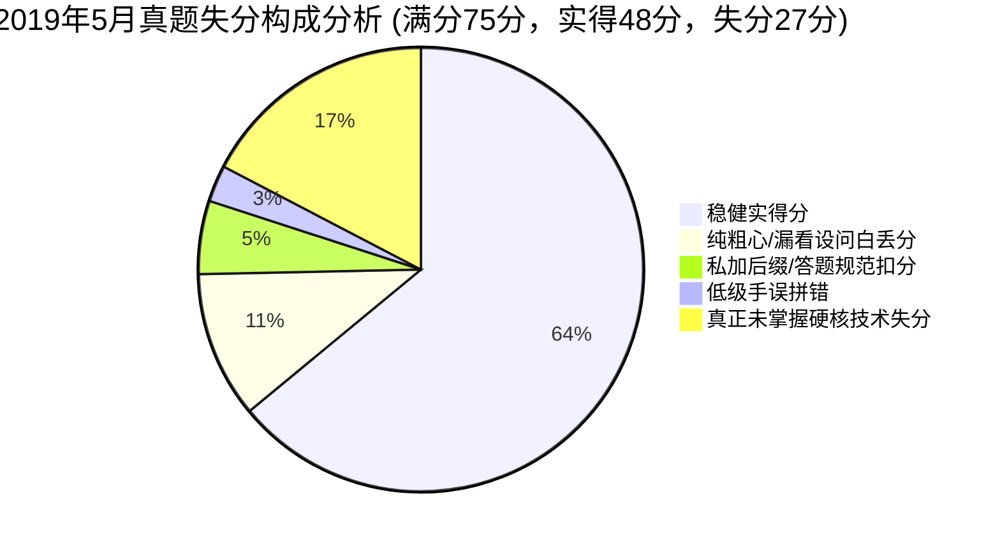

# 2019年05月 软件设计师下午案例分析真题全景复盘与估分报告

> 🎯 **考试定位**：全国计算机技术与软件专业技术资格（水平）考试 —— 软件设计师【下午科目二：软件设计】  
> ⏱ **考试时长**：150 分钟（14:00 ~ 16:30） ｜ **满分基准**：75 分 ｜ **及格线恒定**：**45 分**（卷面得分率 60%）  
> 📌 **选做机制**：试题一至试题四为必答题（各 15 分），试题五（C++）与试题六（Java）二选一（15 分，固定选试题六 Java）

---

## 📊 一、全卷成绩总览：【45.5 ~ 50.5 分】（基准预估：48.0 分 🎉 压线及格）

| 试题编号与考核专题 | 卷面满分 | 严苛保守估分 | **稳健基准估分** | 宽松乐观估分 | 及格状态 / 实战表现定性 |
| :--- | :---: | :---: | :---: | :---: | :--- |
| **试题一：数据流图 DFD（学生跟踪系统）** | 15 分 | 6.5 分 | **8.0 分** | 9.5 分 | 🟡 刚过半数，存储私加“文件”严重扣分 |
| **试题二：数据库设计（创业孵化基地）** | 15 分 | 8.0 分 | **8.5 分** | 9.0 分 | 🟡 刚好及格，连带设问惨烈漏答 6 分 |
| **试题三：UML 建模分析（图书销售系统）** | 15 分 | 12.0 分 | **12.5 分** | 13.0 分 | 🟢 **高分拿盘**，角色/类图基本功极其扎实 |
| **试题四：C 语言算法设计（N 皇后回溯法）** | 15 分 | 7.0 分 | **7.0 分** | 7.0 分 | 🔴 略逊及格，外围拿满但代码填空失分较多 |
| **试题六：Java 面向对象（汽车刹车策略模式）** | 15 分 | 12.0 分 | **12.0 分** | 12.0 分 | 🟢 **高分拿盘**，策略模式熟练度高达 80% |
| **【下午全卷总分】** | **75 分** | **45.5 分** | **48.0 分** | **50.5 分** | **🎉 成功跨过及格线（45分），实现压线通关！** |

---

## 📝 二、五大题型逐题深度复盘与失分账本

### 1. 试题一：数据流图 DFD（学生跟踪系统）—— 实得 8.0 / 15 分
* **【问题1】外部实体 E1~E5 识别（5分）**：**实得 4 分**
  - ✔ `E2: 学校管理人员`、`E3: 班主任`、`E4: 家长`、`E5: 医护机构（健康服务系统）` 命中，得 4 分。
  - ❌ `E1` 误写为“学生卡传感器”（丢 1 分）：将数据采集硬件介质混淆为业务主体人，应为 `学生`。
* **【问题2】数据存储 D1~D4 识别（4分）**：**实得 1 分（严苛 0 分 / 宽松 2 分）**
  - 💥 **全卷最惨烈非技术扣分点**：考生作答为“学生状态文件、学生信息文件、校园场所文件、课表信息文件”，**全员私自附加“文件”二字**！
  - 软考采分铁律：题干明确要求“使用说明中的词语”，说明原文为“学生状态信息、学生信息、校园场所、课表”，死卡字面采分极易被判 0 分。
* **【问题3】补充缺失数据流（3分）**：**实得 2 分**
  - ✔ 命中 2 条：`D4 -> P3 课表信息`、`D3 -> P3 校园场所`（得 2 分）。
  - ❌ 丢 1 分：`D2 -> P6 学生信息` 箭头方向与业务逻辑搞反（应为 P6 注册完成后写入存储：`P6 -> D2 注册信息`）。
* **【问题4】数据流组成数据字典（3分）**：**实得 1 分**
  - ❌ 丢 2 分：“学生状态”缺少主键（学生卡ID/学号）；“学生信息”脑补了无关的“性别”，漏了说明强调的“班主任”。
* 🔗 **错题深度复盘索引**：[案例错题 03：2019年5月试题一（学生跟踪系统）](../05-error-vault/02-下午案例审题与填空坑点.md#case-2019-05-q1)

---

### 2. 试题二：数据库设计（创业孵化基地）—— 实得 8.5 / 15 分
* **【问题1】联系类型判断与补充 E-R 图（5分）**：**实得 4.5~5 分（满分全拿！）**
  - ✔ 员工与创业公司联系 `1 : *` 判断准确；
  - ✔ 项目三元联系判定 `员工 1，创业公司 1，投资方 *`（即 $1:1:*$）完全正确！展现了优秀的三元联系十字交叉推导能力。
* **【问题2】关系模式填空 (a)(b) 与完整性约束（4分）**：**实得 2 分**
  - ✔ (a) 所属公司代码、(b) 投资方编号 填对，得 2 分；
  - 💥 **非技术性漏题（白丢 2 分）**：题干后半句要求**“及完整性约束关系”**，考生视线漏看，主键外键送分问交了白卷！
* **【问题3】投资额与时间属性挂载（6分）**：**实得 2 分**
  - ✔ (1) 正确回答“不需要”新实体，拿 2 分；
  - 💥 **非技术性漏题（白丢 4 分）**：第 (2) 问“连线到菱形框‘项目’并修改项目关系模式”整段漏看，再次交白卷！
* 🔗 **错题深度复盘索引**：[案例错题 01：2019年5月试题二（创业孵化基地）](../05-error-vault/02-下午案例审题与填空坑点.md#case-2019-05-q2)

---

### 3. 试题三：UML 建模分析（图书销售系统）—— 实得 12.5 / 15 分（🌟高分压舱石）
* **【问题1】参与者 A1~A3 与用例 U1~U3 匹配（6分）**：**实得 6 分（满分！）**
  - ✔ A1(采购人员)、A2(仓库管理员)、A3(派送人员) 全部正确；
  - ✔ U1(注册)、U2(打印订单)、U3(购买书籍) 凭借对 `<<extend>>` 关系的精准识别全对！
* **【问题2】用例 U3（购买书籍）用例描述（6分）**：**实得 3.5 分**
  - ❌ 丢 2.5 分：将带有 `<<extend>>` 扩展关系的“可选择打印订单”误写进基本事件流；备选事件流漏了“库存为0无法查询”；基本流第一步漏了“顾客登录系统”。
* **【问题3】初始类图 C1~C3 映射（3分）**：**实得 3 分（满分！）**
  - ✔ C1(Customer)、C2(Order)、C3(Book) 全部命中！
* 🔗 **错题深度复盘索引**：[案例错题 01：图书销售系统（用例图识别与规范）](../05-error-vault/02-下午案例审题与填空坑点.md#case-2019-05-q3)

---

### 4. 试题四：C 语言算法设计（N 皇后问题回溯法）—— 实得 7.0 / 15 分
* **【问题1】代码填空 (1) ~ (4)（8分，每空2分）**：**实得 2 分**
  - ✔ 空(2) 函数出口返回 `1` 命中，得 2 分；
  - ❌ 丢 6 分：
    - 空(1) `queue[i] == j`：数组名拼写手误为 queue，且行列混淆（应为 `queen[i] == queen[j]`）；
    - 空(3) `Place(i)`：行号与循环列号搞混（应传入当前检查的行号 `Place(j)`）；
    - 空(4) `j++`：递归步进误写为局部变量自增（应为递归调用 `Nqueen(j+1)`）。
* **【问题2】算法策略判定（3分）**：**实得 3 分（满分！）**
  - ✔ 策略名称填入“回溯法”，稳拿 3 分！
* **【问题3】4 皇后解手算推导（4分，每空2分）**：**实得 2 分**
  - ✔ 答出“2 种”，得 2 分；
  - 💥 **非技术性漏题（白丢 2 分）**：漏看后半句“(7) 分别为...”，漏写了手算摆放序列 `2413，3142`。
* 🔗 **错题与专题索引**：
  - [案例错题 01：2019年5月试题四（N 皇后问题回溯法）](../05-error-vault/02-下午案例审题与填空坑点.md#case-2019-05-q4)
  - [专题 21：N 皇后问题回溯算法与递归解空间底层透析](../07-topic-mastery/21-N皇后问题回溯算法与递归解空间-底层透析.md)

---

### 5. 试题六：Java 面向对象设计（汽车刹车策略模式）—— 实得 12.0 / 15 分（🌟高分压舱石）
* **【代码填空】(1) ~ (5)（15分，每空3分）**：**实得 12 分**
  - ✔ 空(1) `void stop()` 接口原型声明命中（3分）；
  - ❌ 空(2) 填了 `Car` 错失 3 分（将策略接口引用类型混淆为上下文自身，应为策略接口 `BrakeBehavior`）；
  - ✔ 空(3) `this.wheel.stop()` 多态委托调用命中（3分）；
  - ✔ 空(4) `this.wheel = behavior` 构造注入成员变量赋值命中（3分）；
  - ✔ 空(5) `brake()` 客户端业务高层调用命中（3分）。
* 🔗 **错题深度复盘索引**：[案例错题 01：2019年5月试题六（汽车刹车策略模式）](../05-error-vault/02-下午案例审题与填空坑点.md#case-2019-05-q6)

---

## 💥 三、专项审计：“白丢 15 ~ 17 分”非技术性失误清单

本次模考虽然以 **48.0 分** 跨过 45 分生死线，但数据审计表明：**你白白送掉了整整 15 ~ 17 分的非技术性送分题！**



### 1. 视网膜盲区：连带设问漏答（白丢 8 分！）
* **试题二 问题2**：漏看了“及完整性约束关系” $\implies$ **白送 2 分**
* **试题二 问题3**：只答了“不需要”，漏看了“(2) 请连线并修改关系模式” $\implies$ **白送 4 分**
* **试题四 问题3**：只答了“2种”，漏看了“(7) 分别为...” $\implies$ **白送 2 分**
* 💡 **小计**：单单因为“不看题干后半句话”，在已经能拿满分的情况下，**纯白送了 8 分巨款**！

### 2. 画蛇添足：答题规范私造词汇（白丢 3 ~ 4 分！）
* **试题一 问题2**：数据存储全部私自加了“文件”二字（学生状态文件、学生信息文件...），脱离原文术语 $\implies$ **扣除 2 ~ 3 分**
* **试题一 问题1**：外部实体把主体“学生”写成了硬件介质“学生卡传感器” $\implies$ **扣除 1 分**

### 3. 变量拼写手误与概念混淆（白丢 5 分！）
* **试题四 空(1)**：把题干给定的数组名 `queen` 拼成了数据结构 `queue` $\implies$ **白送 2 分**
* **试题六 空(2)**：把策略接口引用类型写成了自身类名 `Car` $\implies$ **白送 3 分**

---

## 🎯 四、考场高分避坑处方：如何将 48 分稳定兑现为 63+ 分？

> 💡 **核心结论**：你的真实专业水准（面向对象 24.5/30、E-R 三元联系满分、算法外围满分）完全处于 **60 ~ 63 分** 的优秀梯队。你与 60+ 分之间，差的不是技术，而是**考场作战防空规范**！

### 处方 1：草稿纸“连带设问强制拆解打勾法”（彻底消灭漏题 8 分）
* **考场动作**：只要题目出现“**及**”、“**并**”、“**说明...以及...**”等连词，立刻在草稿纸上拆写清单，每答完一个打一个勾：
  ```text
  [ ] 填空 a
  [ ] 填空 b
  [ ] 主键完整性约束
  [ ] 外键完整性约束
  [ ] (1) 是否需要新实体
  [ ] (2) 连线说明与重写关系模式
  [ ] (6) 摆放种数
  [ ] (7) 摆放具体序列
  ```
* **铁律**：草稿纸上的勾没打满，绝对不准换下一题！

### 处方 2：字面原样拷贝“零添油加醋”法则（捞回存储 3 分）
* **考场动作**：试题一（DFD）的所有名称，必须用鼠标/试卷在题干说明中找到完全一致的原句。
* **铁律**：原文没有“表”、“文件”、“库”，一个字都不许加！原文写“学生信息”，答案就只能是“学生信息”！

### 处方 3：试题四“外围包抄 + 25分钟止损铁律”（稳拿 9~11 分）
* **第一步（先拿外围 5~7 分）**：进题先秒杀算法策略名称（2~3分），再动手推导特值小规模用例（3~4分）。外围拿满，底气在手；
* **第二步（探针填空）**：看循环边界、对称分支、函数签名；填空变量名必须回看题干定义的变量拼写，严禁手滑；
* **第三步（控时止损）**：试题四做题时间卡死在 20~25 分钟以内。遇到推不出的空直接写一个相关变量，绝不留空，迅速转战试题六 Java 拿大分！

### 处方 4：试题六“类图菱形 = 组合成员变量”条件反射（稳拿 15 分满分）
* **考场动作**：只要看到 Context 类组合了策略接口（菱形箭头连向接口），Context 内部定义的受保护变量类型，**100% 就是该接口类型**！
* 绝不会持有自己自身，记住这一定式，直接秒杀类名填空。

---

## 🏆 五、复盘总评与结语

* **当前实战位阶**：**48.0 分（安全压线及格）**
* **潜在实力位阶**：**63.0 分（全卷无忧高分）**
* **一句话定调**：
  > **面向对象底盘极稳，E-R 三元联系推导极准；消灭粗心漏看与画蛇添足，下午科目二必拿高分！**
