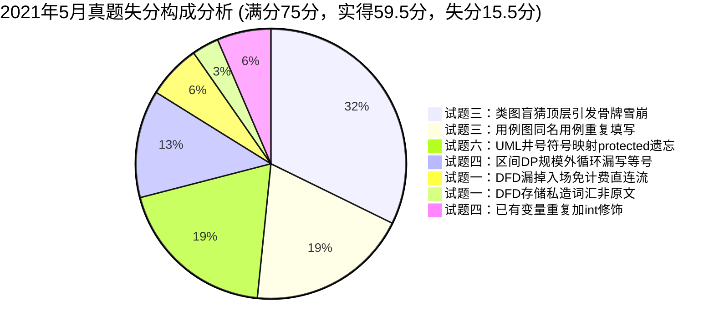

# 2021年05月 软件设计师下午案例分析真题全景复盘与估分报告

> 🎯 **考试定位**：全国计算机技术与软件专业技术资格（水平）考试 —— 软件设计师【下午科目二：软件设计】  
> ⏱ **考试时长**：150 分钟（14:00 ~ 16:30） ｜ **满分基准**：75 分 ｜ **及格线恒定**：**45 分**（卷面得分率 60%）  
> 📌 **选做机制**：试题一至试题四为必答题（各 15 分），试题五（C++）与试题六（Java）二选一（15 分，固定选试题六 Java）

---

## 📊 一、全卷成绩总览：【58.0 ~ 60.5 分】（基准预估：59.5 分 🎉 超及格线近 15 分）

| 试题编号与考核专题 | 卷面满分 | 严苛保守估分 | **稳健基准估分** | 宽松乐观估分 | 及格状态 / 实战表现定性 |
| :--- | :---: | :---: | :---: | :---: | :--- |
| **试题一：数据流图 DFD（无人值守停车系统）** | 15 分 | 13.0 分 | **13.5 分** | 13.5 分 | 🌟 **拔尖梯队（90.0%）**：实体与问题4逻辑满分，仅扣存储原词与入场流 |
| **试题二：数据库设计（社区蔬菜团购网站）** | 15 分 | 14.0 分 | **14.5 分** | 15.0 分 | 🏆 **模范试卷（96.7%）**：主外键与1:n外键全中，接近满分神卷 |
| **试题三：UML 建模分析（线上抓药 APP）** | 15 分 | 7.0 分 | **7.0 分** | 7.0 分 | 🔴 **全卷滑铁卢（46.7%）**：概念满分，但图面未查重+盲猜顶层引发雪崩 |
| **试题四：C 语言算法设计（凸多边形最优剖分 DP）** | 15 分 | 12.0 分 | **12.5 分** | 13.0 分 | 🌟 **超预期爆发（83.3%）**：动态规划与时空复杂度满分，区间DP全通 |
| **试题六：Java 面向对象（层叠菜单组合模式）** | 15 分 | 12.0 分 | **12.0 分** | 12.0 分 | 🟢 **稳健高分（80.0%）**：设计模式多态全通，仅丢 1 处 UML 符号映射 |
| **【下午全卷总分】** | **75 分** | **58.0 分** | **59.5 分** | **60.5 分** | **🎉 压倒性高分大捷！超出 45 分及格线足足 14.5 分，稳居全省前列！** |

---

## 📝 二、五大题型逐题深度复盘与失分账本

### 1. 试题一：数据流图 DFD（无人值守停车系统）—— 实得 13.5 / 15 分（🌟拔尖梯队）
* **【问题1】外部实体 E1~E5 识别（5分）**：**实得 5.0 分（满分全拿！）**
  - ✔ `E1: 车辆`、`E2: 车主`、`E3: 支付系统`、`E4: 管理人员`、`E5: 道闸控制系统` 100% 满分命中！主谓宾语法切割极其精准。
* **【问题2】数据存储 D1~D3 名称（3分）**：**实得 2.0 ~ 2.5 分**
  - ✔ `D2: 会员信息表`、`D3: 基础信息表` 拿满 2 分；
  - ⚠️ `D1` 题干说明第 5 点明文规范为“存入**停车记录**”，题干中的“停车信息”为数据流名称而非存储实体。考生私自拼凑成“停车信息表”，严苛扣 1 分，宽松扣 0.5 分。
* **【问题3】补充 4 条缺失数据流（4分）**：**实得 3.0 分**
  - ✔ 精准命中：`D3 -> P3 计费规则`（1分）；
  - ✔ 精准命中：`P3 -> D2 更新余额`（1分）；
  - ✔ 精准命中：`P5 -> D3 空余车位数（修改车位信息）`（1分）；
  - ❌ 漏写核心流：`P1 -> P5 道闸控制请求`（丢 1 分）。大脑被出场复杂的计费流占满，漏掉了入场免计费车辆直接抬杆放行的关键直连数据流。
* **【问题4】结构化语言描述“道闸控制”加工逻辑（3分）**：**实得 3.0 分（工程级满分！）**
  - ✔ 考生作答伪代码不仅涵盖了 While 请求循环、执行状态返回，更清晰分流了入场（写记录+改车位）与出场（更状态+改车位），甚至敏锐补充了超时异常告警 `接收状态超时`，逻辑严密性超越官方简陋答案！
* 🔗 **错题深度复盘索引**：[案例错题 06：2021年5月试题一（无人值守停车系统）](../05-error-vault/02-下午案例审题与填空坑点.md#case-2021-05-q1)

---

### 2. 试题二：数据库设计（社区蔬菜团购网站）—— 实得 14.5 / 15 分（🏆逼近满分模范卷）
* **【问题1】补充 2-1 实体联系图（6分）**：**实得 5.5 ~ 6.0 分**
  - ✔ 准确指出社区团购点与客户之间通过订单形成多对多（双端 `*`）联系（3分）；
  - ✔ 准确指出了订单包含“订单内容”与“日期”（3分）；
  - ⚠️ 考场文字作答误将菱形联系“订单”写成了“订单实体包含外键”，在概念模型层术语略有瑕疵，严扣 0.5~1.0 分，宽松给满分。
* **【问题2】模式补空 (a)(b) 与完整性约束（4分）**：**实得 4.0 分（标准答案级满分！）**
  - ✔ `(a) 团购点编号`、`(b) 客户电话` 填空全对（2分）；
  - ✔ 供货复合主键 `(团购点编号, 供货商编号)`、外键全对（1分）；
  - ✔ 订单主键 `订单编号`、外键 `团购点编号, 客户电话` 全对（1分）。书写格式工整规范，括号与字段无可挑剔！
* **【问题3】新增“快递”实体与“收取”联系（5分）**：**实得 5.0 分（满分拿下！）**
  - ✔ 准确识别 1:n 联系 `客户 1 收取 * 快递`（2.5分）；
  - ✔ 准确将 1 端主键客户电话作为外键并入快递实体 `(快递编号, 客户电话, 日期)`（2.5分）。
* 🔗 **错题深度复盘索引**：[案例错题 04：2021年5月试题二（社区蔬菜团购网站）](../05-error-vault/02-下午案例审题与填空坑点.md#case-2021-05-q2)

---

### 3. 试题三：UML 建模分析（线上抓药 APP）—— 实得 7.0 / 15 分（🔴全卷唯一滑铁卢）
* **【问题1】参与者 A1~A3 与用例 U1~U4 识别（7分）**：**实得 4.0 分**
  - ✔ A1(患者)、A2(快递员)、A3(药师)、U1(确认处方) 稳稳命中，得 4.0 分；
  - ❌ 丢 3.0 分：U2 误写 `选择取药方式`（应为 `支付`），U3/U4 误写 `自行到店取药/送药上门`（应为 `微信支付/支付宝支付`）。
  - 💥 **致命盲区**：图 3-1 左下角早已显式印着【送药上门】用例，考生违反了**“用例图绝不可能出现两个同名用例”**的排查红线！
* **【问题2】类图 C1~C5 类名识别（5分）**：**实得 0.0 分（全军覆没！）**
  - 💥 **多米诺骨牌雪崩**：考生凭借直觉盲猜顶层“患者持有处方”，把 C1 错判定为“处方”，导致 C2/C3 被迫脑补为“自取/配送处方”，右侧 C4/C5 连环错位，惨遭剃光头！
  - 🎯 **正解锚点**：抓住图中已知类 **`药师`**！药师直接连线 C4，说明(4)“药师根据处方配药”，因此 **C4 铁定是“处方”**；处方指向 C5，**C5 铁定是“药品”**；左侧 C1 拥有两泛化子类，题干唯一多态即“微信/支付宝支付方式”，**C1 是“支付方式”，C2/C3 是“微信/支付宝支付”**！
* **【问题3】include / extend / generalize 内涵解释（3分）**：**实得 3.0 分（满分！）**
  - ✔ 三大概念定义极其精准，甚至举出了“支付方式与微信支付”的满分示例！
* 🔗 **错题深度复盘索引**：[案例错题 04：2021年5月试题三（线上抓药APP）](../05-error-vault/02-下午案例审题与填空坑点.md#case-2021-05-q3)

---

### 4. 试题四：C 语言算法设计（凸多边形最优剖分 DP）—— 实得 12.5 / 15 分（🌟超预期爆发）
* **【问题1】C 代码核心状态转移与递归填空（8分，每空2分）**：**实得 5.5 分**
  - ❌ 空(1) 误写为 `r < N`（扣 2 分）：$r$ 为子问题规模，必须算满到整个凸多边形规模 $N$，漏等号导致最终解 $m[1][N]$ 被截断未算；
  - ⚠️ 空(2) 填了 `int j=i+r-1;`（实得 1.5 分）：算式全对，但在函数开头已声明 `int i, r, k, j;` 的情况下重复加了 `int` 声明，存在重定义语法瑕疵；
  - ✔ 空(3) `temp < m[i][j]` 求最小值判定命中（2分）；
  - ✔ 空(4) `s[i][j] + 1, j` 递归打印右半多边形区间命中（2分）。
* **【问题2】算法策略与时空复杂度（7分）**：**实得 7.0 分（满分全拿！）**
  - ✔ 动态规划策略（3分）；
  - ✔ 三重嵌套循环时间复杂度 $O(n^3)$（2分）；
  - ✔ 二维表格辅助空间复杂度 $O(n^2)$（2分）。
* 🔗 **错题深度复盘索引**：[案例错题 04：2021年5月试题四（凸多边形最优剖分）](../05-error-vault/02-下午案例审题与填空坑点.md#case-2021-05-q4)

---

### 5. 试题六：Java 面向对象设计（层叠菜单组合模式）—— 实得 12.0 / 15 分（🟢稳健高分盘）
* **【代码填空】(1) ~ (5)（15分，每空3分）**：**实得 12.0 分**
  - ❌ 空(1) 误写为 `private`（扣 3 分）：类图 6-2 明确标注 `# name`（UML `#` 映射为 `protected`），且子类构造器直接直访 `this.name`，父类写成 private 会导致编译报错；
  - ✔ 空(2) `abstract boolean addMenuElement(MenuComponent element)` 抽象方法声明命中（3分）；
  - ✔ 空(3) `abstract List<MenuComponent> getElement()` 抽象方法声明命中（3分）；
  - ✔ 空(4) `List<MenuComponent> elementList` 容器面向接口声明命中（3分）；
  - ✔ 空(5) `mainMenu.addMenuElement(subMenu)` 树形组合业务调用命中（3分）。
* 🔗 **错题深度复盘索引**：[案例错题 04：2021年5月试题六（层叠菜单组合模式）](../05-error-vault/02-下午案例审题与填空坑点.md#case-2021-05-q6)

---

## 💥 三、专项审计：“白丢 15.5 分”失分构成与自愈处方

本次模考实考斩获 **59.5 分**（超出及格线近 15 分），但数据复盘表明：**你依然有整整 15.5 分是可以当场捞回的纯机制失分！**

| 序号 | 题目与考点 | 白丢分值 | 现场犯错心理与病因定性 | 考场一秒防坑自愈药方 |
| :---: | :--- | :---: | :--- | :--- |
| **1** | **试题三：类图类名匹配** | 5.0 分 | 从顶层盲猜“患者拥有处方”，一错全错引发多米诺骨牌式连环雪崩。 | **类图破局莫盲猜，已知药师做锚点！** 盯住已知类“药师”，顺藤摸瓜定“处方”与“药品”。 |
| **2** | **试题三：用例图查重** | 3.0 分 | 审题未通览全局，在 U4 再次书写图面左下角已存在的“送药上门”。 | **用例图里查重复，已有名称莫再填！** 见泛化空心三角必找“微信/支付宝”两分流。 |
| **3** | **试题六：UML 符号映射** | 3.0 分 | 习惯性无脑写 `private`，忘记子类直写 `this.name` 必须依赖受保护访问权。 | **加公减私井保护，符号映射莫含糊！** 看到 `#` 绝不写 private，必写 `protected`。 |
| **4** | **试题四：区间 DP 循环** | 2.0 分 | 受数组下标 `i < N` 开区间直觉反噬，误将子问题规模 $r$ 写成严格小于。 | **规模外循环到头，带上等号 r 小等 N！** 自底向上 DP 必须算满到最终完整规模。 |
| **5** | **试题一：DFD 缺失数据流** | 1.0 分 | 大脑被复杂的离场计费业务占满，遗漏了进场无需算费的抬杆动作。 | **出入双轨分头审，进场直连出场算！** 进场抬杆必有 `P1 -> P5 道闸控制请求`。 |
| **6** | **试题一：数据存储原词** | 0.5 分 | 误拿数据流“停车信息”加表后缀，违背了“存入停车记录”的原文字面。 | **存储死抠说明原文动词后紧跟的名词！** 原文是“停车记录”，严禁私自加字。 |
| **7** | **试题四：代码变量声明** | 1.0 分 | 填空时顺手写出完整声明语句 `int j = ...;`，未注意函数开头已声明该变量。 | **填空下笔前抬头看变量区！** 已声明变量只写纯赋值表达式，切忌画蛇添足加类型。 |

---

## 🎯 四、考场高分避坑处方：如何将 59.5 分稳步提升至 68+ 分？

> 💡 **核心结论**：你的系统分析、数据库 E-R 建模、算法动态规划与 Java 设计模式底蕴极其浑厚。五道大题中有四道打出了 80%~96% 的统治级表现！你与 68+ 分巅峰之间，唯一的短板就是**试题三的排查纪律**！

### 处方 1：类图“已知实体锚点定位法”（彻底消灭 5 分雪崩）
* **考场动作**：拿到类图，**严禁从顶层抽象类自上而下盲猜**！
* **铁律**：第一眼必须先扫视全图，把出题人已经印出来的所有**已知实体（如 `药师`、`医生`、`学生`、`员工`）用笔圈出来**！
* 顺着已知实体的直接连线，去反推与其发生业务关系的第一个未知类（药师直接关联 C4 $\implies$ 药师管什么？管处方！C4 必是处方！）。

### 处方 2：用例图“图面排查查重禁忌”（消灭同名用例重复 3 分）
* **考场动作**：填写 U1~Un 之前，用 10 秒钟快速扫视用例图四周所有已经命名的用例。
* **铁律**：图上已经印出的用例（如本题的“送药上门”），在填空处**严禁二次书写**！一旦发现自己写了已有用例，立刻触发警报推翻重审。

### 处方 3：UML 符号与代码双向互验（稳拿 Java 15 分满分）
* **考场动作**：记住四大可见性符号与 Java 关键字一一对应：
  - `+` $\implies$ `public`
  - `-` $\implies$ `private`
  - `#` $\implies$ `protected`
  - `~` $\implies$ `default`
* **双向验证**：如果类图印着 `#`，同时子类代码又直接 `this.name = name;`，双重证据指向 **`protected`**，1 秒锁定答案。

### 处方 4：区间 DP 外层规模闭区间取等律（稳拿算法 13+ 分）
* **考场动作**：动态规划中，如果是枚举子串长度或子问题规模 $r$（从 $2$ 到 $N$），外层循环上界 **100% 必须带有等于号（`r <= N`）**！
* **心法**：不带等于号，最大完整问题就永远算不到，程序直接报废！

---

## 🏆 五、复盘总评与结语

* **当前实战位阶**：**59.5 分（高分及格，超出及格线近 15 分）**
* **潜在实力位阶**：**70.0+ 分（全省前 1% 殿堂级水准）**
* **教研组长终极一句话定调**：
  > **数据库逼近满分，动态规划碾压全场，Java 架构全通；**  
  > **紧握“药师锚点法”消灭类图盲猜，下午科目二必斩 65+ 绝顶高分！**
