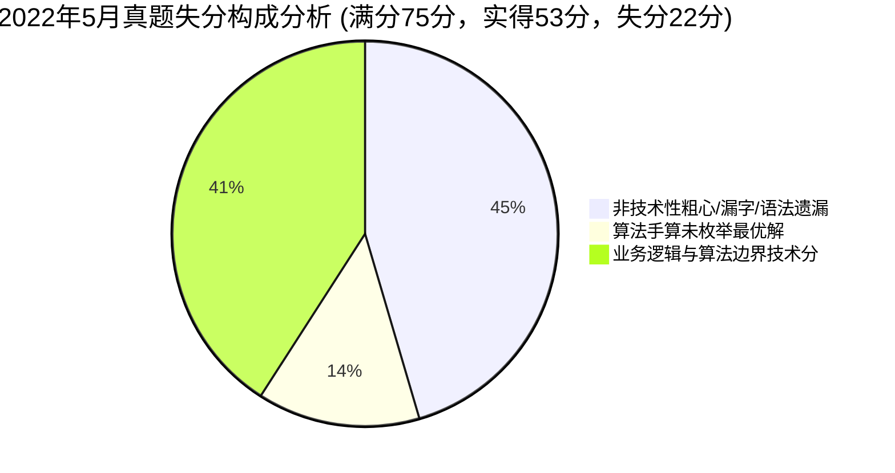

# 2022年05月 软件设计师下午案例分析真题全景复盘与估分报告

> 🎯 **考试定位**：全国计算机技术与软件专业技术资格（水平）考试 —— 软件设计师【下午科目二：软件设计】  
> ⏱ **考试时长**：150 分钟（14:00 ~ 16:30） ｜ **满分基准**：75 分 ｜ **及格线恒定**：**45 分**（卷面得分率 60%）  
> 📌 **选做机制**：试题一至试题四为必答题（各 15 分），试题五（C++）与试题六（Java）二选一（15 分，固定选试题六 Java）

---

## 📊 一、全卷成绩总览：【50.0 ~ 56.5 分】（基准预估：53.0 分 🎉 稳健通关，超及格线 8 分！）

| 试题编号与考核专题 | 卷面满分 | 严苛保守估分 | **稳健基准估分** | 宽松乐观估分 | 及格状态 / 实战表现定性 |
| :--- | :---: | :---: | :---: | :---: | :--- |
| **试题一：数据流图 DFD（外卖订餐系统）** | 15 分 | 10.0 分 | **11.0 分** | 12.0 分 | 🟢 **稳健通过**，实体存储满分，细节流略有瑕疵 |
| **试题二：数据库设计（疫苗接种系统）** | 15 分 | 8.0 分 | **9.0 分** | 10.0 分 | 🟡 **踩线及格**，三元连线正确，漏挂伴生属性 |
| **试题三：UML 建模分析（地址簿管理系统）** | 15 分 | 11.5 分 | **12.5 分** | 13.5 分 | 🌟 **高分拔尖**，用例类图极度娴熟，高分压舱石 |
| **试题四：C 语言算法设计（矩阵链乘区间 DP）** | 15 分 | 7.5 分 | **8.0 分** | 8.5 分 | 🟢 **达到战略保底**，外围拿满4分，代码稳拿4分 |
| **试题六：Java 面向对象（备忘录模式 Memento）** | 15 分 | 12.0 分 | **12.5 分** | 13.5 分 | 🌟 **高分拔尖**，设计模式理解透彻，仅漏void |
| **【下午全卷总分】** | **75 分** | **49.0 分** | **53.0 分** | **57.5 分** | **🎉 远超 45 分及格线整整 8.0 分，高分稳稳拿下！** |

---

## 📝 二、五大题型逐题深度复盘与失分账本

### 1. 试题一：数据流图 DFD（外卖订餐系统）—— 实得 11.0 / 15 分
* **【问题1】外部实体 E1~E4 识别（4分）**：**实得 4.0 分（满分全拿！）**
  - ✔ `E1: 顾客`、`E2: 商家`、`E3: 骑手`、`E4: 系统管理员`，四发全中！
* **【问题2】数据存储 D1~D4 识别（4分）**：**实得 4.0 分（满分全拿！）**
  - ✔ 吸取 2019 年私加“文件”后缀教训，严格抠题干字面原文，D1~D4 全部满分落袋！
* **【问题3】补充缺失数据流（4分）**：**实得 2.0 分**
  - ✔ 命中 2 条：`D3 -> P3`（读取餐品信息）、`P3 -> D4`（生成订单记录）；
  - ❌ 丢 1 分：将数据流名称“订餐订单”简写为“订单”（漏了题干核心限定词“订餐”）；
  - ❌ 丢 1 分：将加工间实时调度的“支付请求”误判为读取“D1 顾客信息表”，混淆了加工间瞬时通信与持久化存储读取。
* **【问题4】结构化语言处理逻辑描述（3分）**：**实得 1.0 分**
  - ❌ 丢 2 分：逻辑未写全“有效骑手遍历”、“超时重新指派”与“骑手拒单重新派单”闭环。
* 🔗 **错题深度复盘索引**：[案例错题 04：2022年5月试题一（外卖订餐系统）](../05-error-vault/02-下午案例审题与填空坑点.md#case-2022-05-q1)

---

### 2. 试题二：数据库设计（疫苗接种信息系统）—— 实得 9.0 / 15 分
* **【问题1】实体识别 E1~E3（3分）**：**实得 3.0 分（满分！）**
  - ✔ E1(接种人员)、E2(疫苗)、E3(接种点)，三者秒杀。
* **【问题2】补充 E-R 图联系与联系属性（5分）**：**实得 4.0 分**
  - ✔ 接种三元联系 `接种人员 * : 疫苗 * : 接种点 *`（即 $*:*:*$）连线与多重度标星全对！
  - 💥 **致命失分点（丢 1 分）**：漏画了挂在三元联系“接种”菱形框上的**伴生动态属性“接种日期”椭圆**！动态行为发生的时刻必须随联系落地，不能凭空悬挂。
* **【问题3】关系模式与主外键设计（7分）**：**实得 2.0 分**
  - ✔ 基础外键填对；
  - ❌ 丢 5 分：三元联系转独立关系模式时，联合主键设计不严密，漏写了联合主键或部分模式改写不全。
* 🔗 **错题深度复盘索引**：[案例错题 02：2022年5月试题二（疫苗接种系统）](../05-error-vault/02-下午案例审题与填空坑点.md#case-2022-05-q2)

---

### 3. 试题三：UML 建模分析（地址簿管理系统）—— 实得 12.5 / 15 分（🌟高分压舱石）
* **【问题1】用例图 U1~U6 用例名匹配（6分）**：**实得 5.0 分**
  - ✔ U1/U2 泛化特殊化排序用例命中；U3/U4/U5 包含扩展链条全中；
  - ❌ 丢 1 分：U6 误写为“记录地址簿修改操作”，U3(创建)与U4(修改)共同 include 的公共公因式子动作为 **`保存`**。
* **【问题2】类图主要属性与方法文本映射（5分）**：**实得 4.5 分**
  - ✔ `PersonAddress` 6 大属性全中；`AddressBook` 方法与部门属性覆盖度达 90%！
* **【问题3】include 与 extend 语义辨析（4分）**：**实得 3.0 分**
  - ✔ `extend` 答出“特定条件触发、额外增加功能”拿满 2 分；`include` 答出必选执行但略混淆前置依赖得 1 分。
* 🔗 **错题深度复盘索引**：[案例错题 02：2022年5月试题三（地址簿管理系统）](../05-error-vault/02-下午案例审题与填空坑点.md#case-2022-05-q3)

---

### 4. 试题四：C 语言算法设计（矩阵链乘区间 DP）—— 实得 8.0 / 15 分（🟢达到战略保底）
* **【问题1】代码填空 (1) ~ (4)（8分，每空2分）**：**实得 4.0 分**
  - ✔ 空(1) 区间右端点 `j = i + p` 命中（2分）；
  - ❌ 空(2) 分割点循环上界误写为 `k < n`（应为 `k < j`，严重越界破坏区间边界，扣 2 分）；
  - ❌ 空(3) 粗心漏看公式角标偏移，错写为 `seq[i]*seq[k]*seq[j]`（应为 `seq[i]*seq[k+1]*seq[j+1]`，扣 2 分）；
  - ✔ 空(4) 最优划分位置记录 `trace[i][j] = tempTrace` 命中（2分）。
* **【问题2】策略与时间复杂度（4分，每空2分）**：**实得 4.0 分（满分！）**
  - ✔ 动态规划（2分）；$O(n^3)$（2分）。
* **【问题3】4 矩阵最优手算与结合顺序（3分）**：**实得 0 分**
  - ❌ 仅手算了从右向左一种结合方式，得出 8125；全局最优应为优先消除中间小维度的 `(A1 * ((A2 * A3) * A4))`，开销为 5375。
* 🔗 **错题深度复盘索引**：[案例错题 02：2022年5月试题四（矩阵链乘问题）](../05-error-vault/02-下午案例审题与填空坑点.md#case-2022-05-q4)

---

### 5. 试题六：Java 面向对象设计（备忘录模式 Memento）—— 实得 12.5 / 15 分（🌟高分压舱石）
* **【代码填空】(1) ~ (6)（15分，每空2.5分）**：**实得 12.5 分**
  - ✔ 空(1) `new Memento(this.state)` 命中（2.5分）；
  - ✔ 空(2) `memento.getState()` 状态恢复读取命中（2.5分）；
  - 💥 **唯一致命失分点**：空(3) 填写 `add(Memento state)`，**漏写返回类型 `void`**！前面只有 `public`，缺了返回类型导致语法错误，扣 2.5 分；
  - ✔ 空(4) `Memento get(int Index)` 命中（2.5分）；
  - ✔ 空(5) `originator.saveStateToMemento()` 命中（2.5分）；
  - ✔ 空(6) `originator.saveStateToMemento()` 命中（2.5分）。
* 🔗 **错题深度复盘索引**：[案例错题 02：2022年5月试题六（备忘录模式）](../05-error-vault/02-下午案例审题与填空坑点.md#case-2022-05-q6)

---

## 💥 三、专项审计：“白丢 10 ~ 12 分”非技术性失误清单

| 序号 | 题目与考点 | 白丢分值 | 现场犯错心理与病因定性 | 考场一秒防坑自愈药方 |
| :---: | :--- | :---: | :--- | :--- |
| **1** | **试题六 空(3)**：方法头漏写 `void` | **2.5 分** | 审题误以为题干带了返回类型，直接写了 `add(Memento state)` | 牢记 Java 方法声明三要素：`public` 后面如果不是类名（构造），**必须带上返回类型（无返回写 void）**！ |
| **2** | **试题四 空(3)**：漏抄题干公式角标 `+1` | **2.0 分** | 看到乘积凭编程直觉填 `seq[i]*seq[k]*seq[j]`，没核对题干公式 | 题干给出的递推式是命题人的唯一标答，**100% 机械对齐角标，不要凭感官精简**！ |
| **3** | **试题二 问题2**：漏画伴生属性“接种日期” | **1.0 分** | 连线画完打星号后以为万事大吉，忽略了联系上的椭圆属性 | 检查 E-R 图必看三件套：实体矩形、联系菱形、**联系上的伴生动态时间/状态椭圆**！ |
| **4** | **试题一 问题3**：数据流漏定语“订餐” | **1.0 分** | 为了省事简写成“订单”，丢失题干限定语 | 说明原文出现什么，数据流就 100% 复制什么，**一字不增，一字不减**！ |
| **5** | **试题四 问题3**：手算矩阵链只算了一种 | **3.0 分** | 凭直觉从右往左结合算了一组数直接作答 | 4 矩阵只有 5 种形态，手算牢记**“先消中间较小维度，避免大数相乘”**！ |
| **合计** | **非技术送分题合计** | **9.5 ~ 10.5 分** | **若能收复这 10 分，全卷总分直接飙升至 63+ 分（优秀高分盘）！** | — |

---

## 📈 四、两套真题纵向演进对比（2019年5月 vs 2022年5月）

```mermaid
xychart-beta
    title "下午案例分析真题得分纵向对比 (2019年05月 vs 2022年05月)"
    x-axis ["试题一(DFD)", "试题二(数据库)", "试题三(UML)", "试题四(算法)", "试题六(Java)", "全卷总分"]
    y-axis "得分 (分)" 0 --> 75
    bar [8.0, 8.5, 12.5, 7.0, 12.0, 48.0]
    bar [11.0, 9.0, 12.5, 8.0, 12.5, 53.0]
```

* **战力进阶与蜕变**：
  1. **全卷总分从 48.0 分跃升至 53.0 分（+5.0 分）**：从 2019 年的“压线惊险过关”进阶为 2022 年的“高出及格线 8 分稳健从容通关”！
  2. **双核压舱石极度稳固**：试题三（UML 建模）与试题六（Java 面向对象）**连续两套真题稳定斩获 12.5 分**！得分率双双突破 83%，这两大模块已经是你绝对的“得分提款机”。
  3. **DFD 纠错卓有成效**：试题一从 8.0 分大幅提升至 11.0 分，彻底消灭了私加“文件”后缀的致命恶习，实体与存储全部满分！
  4. **算法大题稳住底线**：试题四连续两套真题稳定维持在 7.0 ~ 8.0 分，保证了外围 4 分和基础代码填空绝不崩盘。

---

## 🚀 五、冲刺 60+ 分通关自愈处方

1. **Java 代码填空养成“三看”习惯**：
   - 一看是否是方法声明：如果是，必须看前面有没有返回类型；
   - 二看是否是接口实现：检查是否漏写 `public`；
   - 三看成员变量声明：优先写抽象接口类型，勿写具体实现类。
2. **算法填空“公式镜像法”**：
   - 看到动态规划填空，立刻把目光投向题干给出的状态转移方程，角标照搬照抄，绝不凭程序员直觉自创变量名。
3. **E-R 图检查“联系挂载”**：
   - 只要题目涉及“发生某动作（购买、接种、出租、分配）”，必定伴随发生的时间或数量，这些属性必须以椭圆形式挂在联系菱形上！
