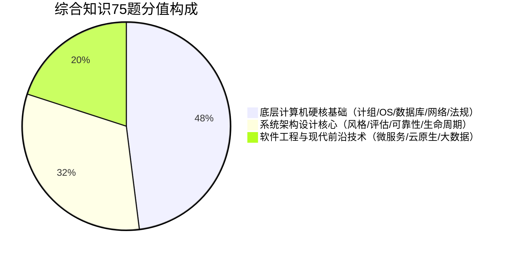
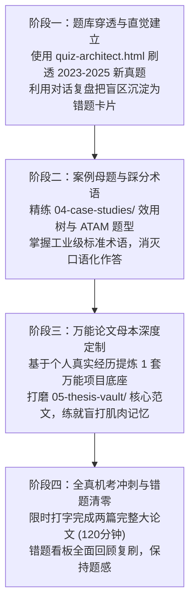

# 🏛️ 高级·系统架构设计师备考实践与考情分析白皮书 (2026+ 全真机考版)

> **定位**：软考高级系统架构设计师（System Architect）全局索引、考情穿透与备考极简战略指引  
> **命题源头**：清华大学出版社《系统架构设计师教程（第2版）》（全国软考办编，2022年11月版，2023年正式实施）  
> **合格底线**：**三科单次同过 $\ge 45$ 分**（综合知识 45 / 案例分析 45 / 论文 45），单科不过全盘归零

---

## 一、 考情分析与机考新生态透视（2023～2026 命题大趋势）

### 1. 时代分水岭：第二版新教材与全面计算机化机考
* **第一版（老考纲）彻底失效**：2023 年之前以 2009 版教材为主，充斥着 CORBA、DCOM、EJB 等早被工业界淘汰的技术，网盘里的旧视频大多停留在该阶段，**切勿被陈旧资料误导**。
* **第二版（现行考纲）重塑命题版图**：全面对接现代主流架构工程：
  * **云原生（Cloud Native）**：容器化（Docker/K8s）、服务网格（Service Mesh/Istio）、无服务器（Serverless/FaaS）；
  * **微服务架构治理**：DDD 领域驱动设计、Spring Cloud / Dubbo、分布式配置中心、全链路压测与链路追踪；
  * **大数据与现代数据架构**：Lambda / Kappa 架构、流批一体、数据湖、湖仓一体架构；
  * **嵌入式与边缘计算**：IoT 边端协同架构、实时操作系统微内核架构；
  * **架构安全工程**：零信任架构（Zero Trust）、DevSecOps 安全左移。
* **机考时代（机考系统纯键盘输入）**：
  * 案例分析与论文写作全部由**手写改为纯打字**；
  * 论文输入框支持实时字数统计（严格限制 2000 ～ 2500 字，低于 2000 字直接扣大分，超过 2500 字无法提交）；
  * 杜绝手写字迹潦草劣势，但对**打字速度（$\ge 35$ 字/分）**与**脑中即时组织提纲的能力**提出更高要求。

### 2. 考试科目与分值结构一览表

| 科目代码与名称 | 考试时间 | 题型与量级 | 考核核心本质 | 考场通过策略 |
| :--- | :--- | :--- | :--- | :--- |
| **科目一：综合知识** | 上午 150 分钟 | 75 道单选题 (75分) | 考察知识广度：共享计算机底层基础 + 架构专属理论 | 靠共享内核保底 35 分，架构风格与评估拿 20 分，目标 $\ge 55$ 分 |
| **科目二：案例分析** | 下午 90 分钟 | 5 选 3 简答大题 (75分) | 考察方案设计与架构权衡（Trade-off） | 必答题（质量属性效用树+ATAM）拿 20+ 分，选做题踩点答题 |
| **科目三：实战论文** | 下午 120 分钟 | 4 选 1 打字 2500 字 (75分) | 考察工程真实落地深度与架构师把控力 | 考前筑堤：**1套真实项目母本 + 5个技术论点插槽**，绝不临场现编 |

---

## 二、 备战第一性原理：三科攻坚核心抓手

### 1. 科目一【综合知识】：借力打力，精准出击
架构师综合知识由 **两大版块** 构成：

* **策略**：
  * **共享底座直接降维打击**：计算机组成、操作系统、数据库基础、网络与安全、法律法规共约 **35~40 分**，与中级完全重合。直接复用我们的共享内核讲义与闪卡，无需重复看书。
  * **架构核心靶向攻坚**：五大类 12 种架构风格特征、ABSD 阶段产出、ATAM/CBAM 评估步骤、六大质量属性刺激-响应模型，反复通过 `quiz-architect.html` 刷题固化。

### 2. 科目二【案例分析】：死守效用树，规范踩点
案例分析往往让考生失分于“能看懂题目，但写出来全是口头大白话，命不中阅卷标准踩分点”。
* **破局抓手**：
  * **试题一（质量属性效用树 + ATAM 评估，通常为必答题，25分）**：必须做到满分追求！熟记六大质量属性的关键词（性能看延迟/吞吐，可用性看心跳/冗余/故障恢复，安全性看鉴权/加密/审计，可修改性看解耦/信息隐藏）；牢记敏感点、权衡点、非风险点的官方标准判据。
  * **选答题（25分 × 2）**：优先选择 **分布式系统改造（缓存穿透/击穿/雪崩、读写分离、消息队列削峰）** 或 **微服务拆分（DDD）**，这类题目具备标准工业套路，踩点明确。

### 3. 科目三【实战论文】：考前筑堤，拒绝现编
论文是 80% 考生的滑铁卢。阅卷专家平均只花 **1.5 ~ 2 分钟** 扫完一篇 2500 字论文，考官看重的是：
1. **真实度（有具体的指标、技术选型权衡）**：拒绝纸上谈兵和虚构项目；
2. **结构规范度（金字塔逻辑）**：摘要交代背景、角色与成效，正文三段式展开，结尾反思缺陷；
3. **点题紧密度**：第一小问、第二小问的大纲设问是否在正文中设立明确的小标题一一对应。
* **核心解决方案**：
  * 考前量身定制并固化一个属于你自己的**真实业务项目母本**（例如：某大型电商中台、智慧供应链调度系统、企业级微服务风控中台）；
  * 将项目背景、QPS/TPS 并发量、数据量、你的架构师角色定位提前打磨定稿并背熟；
  * 无论现场考微服务、高可用容灾、云原生容器化、还是架构评估，直接用**该母本作为底座，灵活插入对应技术论点**！

---

## 三、 备战阶段规划与极简行动飞轮（拒绝臃肿形式主义）

按照奥卡姆剃刀原则，抛弃打卡表和冗长计划，聚焦于**四阶段行动飞轮**：

---

## 四、 本地 Monorepo 体系全局导航索引

整个本地知识库已经完成体系化模块分割，所有资源一触即达：

### 🛠️ 1. 离线交互工具与全网开源索引
* [quiz-architect.html](../quiz-architect.html)：**1822 题离线纯前端架构师专属刷题站**（含 1297 题全量官方真题 + 模拟卷，支持 LaTeX 公式排版、错题本与答题卡）。
* [00-系统架构设计师全网开源资源与视频课件索引.md](00-系统架构设计师全网开源资源与视频课件索引.md)：**全网开源大库与 B站/网盘 视频教程精选索引**（含 xiaomabenten、maxwell-git、希赛王勇、软考野人等）。
* [scripts/generate_architect_quiz_app.py](../scripts/generate_architect_quiz_app.py)：题库构建脚本，支持随时更新重新编译。

### 📚 2. 架构师核心专属知识库 (`03-system-architect/`)
* **体系结构风格**：
  * [01-软件架构风格五大谱系全景决策图解与真题密码.md](01-architecture-styles/01-软件架构风格五大谱系全景决策图解与真题密码.md)
  * [02-ABSD基于体系结构的软件开发全生命周期方法论.md](01-architecture-styles/02-ABSD基于体系结构的软件开发全生命周期方法论.md)
* **质量属性与架构评估**：
  * [01-六大质量属性场景六要素速查卡与命题陷阱.md](02-quality-attributes/01-六大质量属性场景六要素速查卡与命题陷阱.md)
  * [02-ATAM架构权衡分析法与效用树实战全景心法.md](02-quality-attributes/02-ATAM架构权衡分析法与效用树实战全景心法.md)
* **分布式系统架构实战**：
  * [01-大型高并发电商中台微服务拆分与DDD实战方案.md](03-distributed-solutions/01-大型高并发电商中台微服务拆分与DDD实战方案.md)
  * [02-分布式事务与高并发缓存强弱一致性攻防指南.md](03-distributed-solutions/02-分布式事务与高并发缓存强弱一致性攻防指南.md)
  * [03-金融级同城双活与高可用系统容灾架构实战.md](03-distributed-solutions/03-金融级同城双活与高可用系统容灾架构实战.md)
* **案例分析（下午 I）**：
  * [01-系统架构下午案例分析通用破局三段论.md](04-case-studies/01-系统架构下午案例分析通用破局三段论.md)
  * [02-质量属性效用树分析真题实战演练.md](04-case-studies/02-质量属性效用树分析真题实战演练.md)
* **论文实战工程（下午 II）**：
  * [00-系统架构师2500字论文机考通关指南与评分铁律.md](05-thesis-vault/00-系统架构师2500字论文机考通关指南与评分铁律.md)
  * [01-万能项目母本-某大型新零售交易中台与智能风控平台.md](05-thesis-vault/01-万能项目母本-某大型新零售交易中台与智能风控平台.md)
  * [02-高分范文模板-论微服务架构及其应用.md](05-thesis-vault/02-高分范文模板-论微服务架构及其应用.md)
  * [03-高分范文模板-论软件系统架构评估及其应用.md](05-thesis-vault/03-高分范文模板-论软件系统架构评估及其应用.md)
  * [04-高分范文模板-论高可靠性与高可用系统架构设计.md](05-thesis-vault/04-高分范文模板-论高可靠性与高可用系统架构设计.md)

### 🧩 3. 共享内核基础支撑库 (`01-shared-core/`)
系统架构师上午综合知识中有 50% 来源于此底座，直接借力：
* [02.计算机组成与结构速记指南.md](../01-shared-core/01-fast-pass/02.计算机组成与结构速记指南.md)
* [03.操作系统知识速记指南.md](../01-shared-core/01-fast-pass/03.操作系统知识速记指南.md)
* [04.数据库技术基础速记指南.md](../01-shared-core/01-fast-pass/04.数据库技术基础速记指南.md)
* [05.计算机网络速记指南.md](../01-shared-core/01-fast-pass/05.计算机网络速记指南.md)
* [07.知识产权与标准化速记指南.md](../01-shared-core/01-fast-pass/07.知识产权与标准化速记指南.md)
* [14.面向对象技术速记指南.md](../01-shared-core/01-fast-pass/14.面向对象技术速记指南.md)

---

> **结语与行动承诺**：  
> 备考高级架构师不是一场比拼谁收集网盘资料更多的“资料收集战”，而是一场**以真题为镜、以第一性原理为锤的“认知提纯战”**。  
> 遇到任何模糊题目或案例，随时在对话中抛出，我们一起将其拆解并沉淀为你的专属心智认知！
