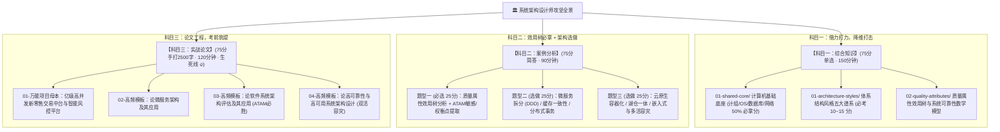

# 🏛️ 高级·系统架构设计师通关全景作战地图 (System Architect Map)

> **适用科目**：全国计算机技术与软件专业技术资格（水平）考试 —— **高级 · 系统架构设计师**  
> **战略定位**：从微观实现代码（How to implement）升维至**宏观技术选型与架构权衡（Why to choose & Trade-off）**  
> **及格铁律**：**三科单次同过 $\ge 45$ 分**（综合知识 45 / 案例分析 45 / 论文 45），任何一科 44 分全盘重来！

---

## 🧭 系统架构设计师三科协同作战模型

---

## 📚 一、 基础核心资源直达跳板（共享内核 `01-shared-core/`）

系统架构师综合知识中，有 **45%~50%** 的分值直接考查计算机科学底层硬核基础，与中级完全重叠：

| 模块序号与专题 | 高级考查侧重点 | 核心讲义速记 | 考点自测闪卡 | 推荐底层专著 |
| :--- | :--- | :--- | :--- | :--- |
| **01 计算机组成与体系结构** | Flynn分类法、流水线吞吐率、Cache映射与淘汰、可靠度串并联数学模型 | [👉 讲义第02讲](../01-shared-core/01-fast-pass/02.计算机组成与结构速记指南.md) | [👉 闪卡 01](../01-shared-core/06-study-notes/01-计算机组成与体系结构-考点闪卡.md) | [流水线周期全景](../01-shared-core/07-topic-mastery/18-计算机系统各层级周期概念全景解析-底层透析.md) / [存储机理](../01-shared-core/07-topic-mastery/17-ROM-RAM与Flash存储体系演进与核心机理-底层透析.md) |
| **03 操作系统知识** | 前趋图PV操作、死锁预防与银行家算法、多级页表逻辑地址切割、磁盘调度SSTF | [👉 讲义第03讲](../01-shared-core/01-fast-pass/03.操作系统知识速记指南.md) | [👉 闪卡 03](../01-shared-core/06-study-notes/03-操作系统知识-考点闪卡.md) | [银行家算法矩阵](../01-shared-core/07-topic-mastery/10-银行家算法与死锁避免-底层透析.md) / [多级页表寻址](../01-shared-core/07-topic-mastery/08-多级页表与逻辑地址寻址-底层透析.md) |
| **05 数据库系统技术** | 范式判定（1NF~BCNF）、事务ACID、两段锁协议、并发死锁、分布式事务 | [👉 讲义第04讲](../01-shared-core/01-fast-pass/04.数据库技术基础速记指南.md) | [👉 闪卡 05](../01-shared-core/06-study-notes/05-数据库系统技术-考点闪卡.md) | [Armstrong公理推导](../01-shared-core/07-topic-mastery/12-Armstrong公理系统与函数依赖推导-底层透析.md) / [设计全生命周期](../01-shared-core/07-topic-mastery/13-数据库设计全生命周期与阶段产出映射-底层透析.md) |
| **06 计算机网络与信息安全** | OSI与TCP/IP模型、数字证书PKI、对称/非对称混合加密、网络攻防（SYN Flood/XSS）、JWT | [👉 讲义第05讲](../01-shared-core/01-fast-pass/05.计算机网络速记指南.md) | [👉 闪卡 06](../01-shared-core/06-study-notes/06-计算机网络与信息安全-考点闪卡.md) | [子网掩码8大黄金值](../01-shared-core/06-study-notes/06-计算机网络与信息安全-考点闪卡.md) / [JWT三段式](../01-shared-core/06-study-notes/06-计算机网络与信息安全-考点闪卡.md) |
| **08 面向对象与 UML 建模** | GoF 23种设计模式意图与类图结构、UML 9大图考场判据、面向对象生命周期 | [👉 讲义第14讲](../01-shared-core/01-fast-pass/14.面向对象技术速记指南.md) | [👉 闪卡 08](../01-shared-core/06-study-notes/08-面向对象与UML建模-考点闪卡.md) | [设计模式核心图谱](../01-shared-core/02-visual-diagrams/03-设计模式核心图谱与真题命题密码.md) / [面向对象建模](../01-shared-core/07-topic-mastery/01-面向对象建模与UML核心语义-底层透析.md) |
| **09 法律法规与标准化** | 知识产权时间性/地域性、软件著作权合理使用与归属、专利申请独占性、商业秘密 | [👉 讲义第07讲](../01-shared-core/01-fast-pass/07.知识产权与标准化速记指南.md) | [👉 闪卡 09](../01-shared-core/06-study-notes/09-法律法规与标准化-考点闪卡.md) | [错题 292 商业秘密](../01-shared-core/05-error-vault/01-上午综合知识错题集.md#-错题-292知识产权法律法规知识产权法定时间性辨析商业秘密不具有时间性-vs-专利商标著作权具有法定保护期) |

---

## 🏛️ 二、 高级架构师核心专属弹药库

### 1. 软件架构风格谱系库 (`01-architecture-styles/`)
* [01-软件架构风格五大谱系全景决策图解与真题密码](01-architecture-styles/01-软件架构风格五大谱系全景决策图解与真题密码.md)  
  *涵盖数据流（批处理/管道-过滤器）、调用/返回（主程序/面向对象/分层）、独立构件（进程通信/事件驱动）、虚拟机（解释器/规则系统）、仓库（数据库/黑板系统）五大谱系 12 小类特征表与命题陷阱！*
* [02-ABSD基于体系结构的软件开发全生命周期方法论](01-architecture-styles/02-ABSD基于体系结构的软件开发全生命周期方法论.md)  
  *架构需求、架构设计、架构文档化、架构复审、架构实现、架构演化六大阶段的核心产出与评审标准。*

---

### 2. 软件质量属性与评估沙盒 (`02-quality-attributes/`)
* [01-六大质量属性场景六要素速查卡与命题陷阱](02-quality-attributes/01-六大质量属性场景六要素速查卡与命题陷阱.md)  
  *深入性能、可用性、安全性、可修改性、易用性、可变性。掌握标准六要素公式：`刺激源 -> 刺激 -> 环境 -> 制品 -> 响应 -> 响应度量`！*
* [02-ATAM架构权衡分析法与效用树实战全景心法](02-quality-attributes/02-ATAM架构权衡分析法与效用树实战全景心法.md)  
  *下午案例第一大题（25 分必选题）保底心法！透析敏感点（Sensitivity Point）、权衡点（Trade-off Point）、风险点与非风险点。*

---

### 3. 分布式中台实战解决方案库 (`03-distributed-solutions/`)
* [01-大型高并发电商中台微服务拆分与DDD实战方案](03-distributed-solutions/01-大型高并发电商中台微服务拆分与DDD实战方案.md)  
  *战略设计（限界上下文/统一语言）+ 战术设计（聚合根/实体/值对象/领域事件）。*
* [02-分布式事务与高并发缓存强弱一致性攻防指南](03-distributed-solutions/02-分布式事务与高并发缓存强弱一致性攻防指南.md)  
  *Cache-Aside、Canal 监听 Binlog 最终一致性；强一致性 2PC/3PC 与柔性事务 TCC/SAGA/本地消息表实战对比。*
* [03-金融级同城双活与高可用系统容灾架构实战](03-distributed-solutions/03-金融级同城双活与高可用系统容灾架构实战.md)  
  *单元化架构设计、流量路由、数据双向同步、脑裂预防及 RTO/RPO 极限控制。*

---

### 4. 下午案例分析大题破局库 (`04-case-studies/`)
* [01-系统架构下午案例分析通用破局三段论](04-case-studies/01-系统架构下午案例分析通用破局三段论.md)（标准化采分答题格式）
* [02-质量属性效用树分析真题实战演练](04-case-studies/02-质量属性效用树分析真题实战演练.md)（真题案例原貌精解）

---

### 5. 论文工程核心要塞 (`05-thesis-vault/` —— 架构师生死线 🔥)
* [00-系统架构师2500字论文机考通关指南与评分铁律](05-thesis-vault/00-系统架构师2500字论文机考通关指南与评分铁律.md)  
  *120 分钟打字时间配比策略、四段式结构配比、严禁触碰的 5 大扣分雷区。*
* [01-万能项目母本：某大型新零售交易中台与智能风控平台](05-thesis-vault/01-万能项目母本-某大型新零售交易中台与智能风控平台.md)  
  *投资 1,800 万、周期 14 个月、支撑 12 万 QPS 峰值。完美融合高并发削峰、分布式事务、微服务拆分与动态规则引擎。*
* [02-高分范文模板：论微服务架构及其应用](05-thesis-vault/02-高分范文模板-论微服务架构及其应用.md)
* [03-高分范文模板：论软件系统架构评估及其应用](05-thesis-vault/03-高分范文模板-论软件系统架构评估及其应用.md)
* [04-高分范文模板：论高可靠性与高可用系统架构设计](05-thesis-vault/04-高分范文模板-论高可靠性与高可用系统架构设计.md)

---

## 🎯 三、 错题库联动与高危红区扫盘

* **通用底层错题集（397张卡片）**：[01-上午综合知识错题集](../01-shared-core/05-error-vault/01-上午综合知识错题集.md)  
  *优先攻坚模块 01（体系结构）、模块 03（操作系统）、模块 05（数据库）与模块 06（网络安全）！*
* **考前必扫红名单**：[11-红名单（所有二进宫及以上高危复错题）](../01-shared-core/05-error-vault/11-红名单.md)
* **星标速记册**：[13-星标错题精编速记册（179张星标精编题）](../01-shared-core/05-error-vault/13-星标错题精编速记册.md)
