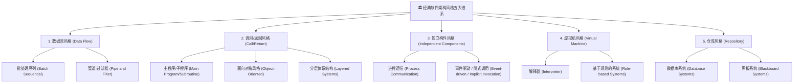

# 01-软件架构风格五大谱系全景决策图解与真题密码

> **战略权重**：★★★★★（上午综合知识必考 4~6 分 ｜ 下午案例分析大题核心选型依据）  
> **核心本质**：软件架构风格（Architectural Style）是描述某一特定应用领域中系统组织方式的**惯用模式（Idiomatic Pattern）**，定义了一组构件（Component）和连接件（Connector）以及它们组合的约束条件。

---

## 一、 软件架构风格五大谱系全景决斗矩阵

### 五大谱系 12 小类特征与命题陷阱速查表

| 谱系分类 | 具体风格名称 | 核心运作机理 | 题干特征词 / 典型应用场景 | 命题陷阱与避坑红线 |
| :--- | :--- | :--- | :--- | :--- |
| **数据流风格** | **批处理序列** *(Batch Sequential)* | 每一步必须**整体处理完**，前一步输出作为下一步的完整输入；**无并发性、延迟高** | 传统批处理、整批数据报表生成、离线结算 | 易与管道-过滤器混淆！批处理必须“整体传批”，构件间不能并发交互 |
| **数据流风格** | **管道-过滤器** *(Pipe and Filter)* | 数据以**数据流（Stream）**形式在管道中流动，过滤器增量处理并输出；**支持并发推进** | UNIX Shell 管道命令（`cat \| grep \| sort`）、编译器词法语法流、音视频流式编解码 | 过滤器相互独立，不共享全局状态；不适合强交互式系统 |
| **调用/返回风格** | **主程序/子程序** | 传统的显式过程调用；自顶向下分解，控制权随调用链单向传递 | 结构化编程（C语言函数调用、Cobol批处理） | 单线程显式调用，高耦合，难以并发扩展 |
| **调用/返回风格** | **面向对象** *(Object-Oriented)* | 封装数据和操作（状态与行为捆绑）；通过**显式对象方法调用**进行交互 | 企业级 Java/C++ 面向对象系统、领域模型封装 | 对象必须知道对方的身份（标识/引用），修改对象接口会引发连锁反应 |
| **调用/返回风格** | **分层体系结构** *(Layered)* | 将系统组织为一个层次结构；**每层只向相邻下层索取服务，向相邻上层提供接口** | OSI 七层网络模型、经典三层架构（表示层/业务逻辑层/数据访问层） | 严禁跨层调用；性能开销大（层层传包），不是所有系统都适合分层 |
| **独立构件风格** | **进程通信** | 构件以独立进程运行，通过消息传递（RPC、Socket、REST API）同步/异步通信 | 微服务系统通信、分布式计算集群 | 依赖网络通信可靠性，存在网络延迟与序列化开销 |
| **独立构件风格** | **事件驱动 / 隐式调用** *(Event-driven)* | 构件不直接调用过程，而是**触发或广播一个或多个事件**；其他构件注册感兴趣的事件并回调执行 | GUI 窗口按钮点击、消息队列（Kafka/RabbitMQ 发布-订阅）、调试器断点机制 | **构件不知道谁在响应自己**（解耦极强）；但**无法控制事件被处理的顺序与时间** |
| **虚拟机风格** | **解释器** *(Interpreter)* | 包含一个解释引擎、一个存储待解释代码的内存区、以及记录状态的抽象机；逐行翻译执行 | JVM（Java虚拟机）、Python解释器、低代码自定义脚本引擎 | 执行效率较低，但具备极高的**灵活性与平台跨越性** |
| **虚拟机风格** | **基于规则的系统** *(Rule-based)* | 包含知识库（IF-THEN规则）、推理机（匹配/执行循环）和工作内存（事实） | 专家系统、**金融反欺诈风控规则引擎**、医保审核系统 | 规则过多时推理容易出现死锁或冲突，需要冲突消解策略 |
| **仓库风格** | **数据库系统** | 以**中心数据结构（数据库）**为核心，多个独立客户程序访问并修改该中心数据 | 传统 ERP 系统、选课系统、MIS 管理信息系统 | 依赖共享数据库，数据库若发生故障则全网瘫痪；不易扩展为分布式 |
| **仓库风格** | **黑板系统** *(Blackboard)* | 由**黑板（全局共享数据区）**、**知识源（独立专业专家构件）**和**控制机制（调度器）**三部分组成 | **语音识别、图像分析、雷达信号追踪、不确定性推理** | **考场绝杀题眼**：凡是题干提到“语音识别”、“不确定性问题求解”、“专家协作”，闭眼选黑板系统！ |

---

## 二、 考场高频命题密码与秒杀决斗矩阵

### 决斗 1：【管道-过滤器】 vs 【批处理序列】
* **本质差异**：
  * **管道-过滤器**：增量数据流，**边读边写，流水线并行**。前一个过滤器产出一个字，后一个过滤器立即处理，吞吐率高。
  * **批处理序列**：全量数据块，**上一级必须全部吐出写到磁盘，下一级才能启动**。前后构件串行等待。
* **考场题眼**：题干出现“流式传输、实时增量变换” $\implies$ 管道-过滤器；题干出现“必须收集完全部数据后整体处理” $\implies$ 批处理序列。

### 决斗 2：【面向对象风格】 vs 【事件驱动风格（隐式调用）】
* **本质差异**：
  * **面向对象**：**显式调用（Explicit Invocation）**。对象 A 必须持有对象 B 的引用 `b.doSomething()`，A 知道 B 的存在。
  * **事件驱动**：**隐式调用（Implicit Invocation）**。对象 A 只管对外发布事件 `publish(Event)`，A 完全不知道是谁在监听（甚至可能没人监听，也可能有 10 个监听者）。
* **考场题眼**：题干出现“解耦、发布-订阅、GUI事件响应、无法保证执行顺序” $\implies$ 事件驱动风格。

### 决斗 3：【黑板系统】的三大金刚组成
任何黑板系统必须包含以下三要素（下午案例大题常出填空）：
1. **黑板（Blackboard）**：共享的数据存储中心，保存当前的解状态；
2. **知识源（Knowledge Sources）**：各自独立的专业领域算法/模块，监听黑板并在条件满足时修改黑板；
3. **控制机制（Control Shell）**：中央控制器，负责评估当前状态并调度哪个知识源优先运行。

---

## 三、 考场避坑口诀（Memory Pegs）

> **五大风格定江山，题眼抓准秒过关：**  
> **数据流过管道动，增量流水非批处理；**  
> **面向对象显式调，事件驱动隐式叫；**  
> **解释规则虚拟机，跨端灵活效率低；**  
> **语音识别与雷达，黑板专家解不确定！**
