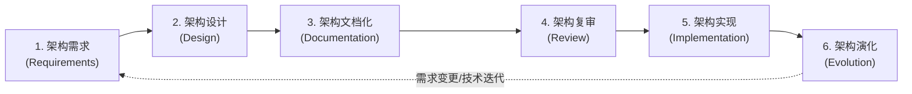
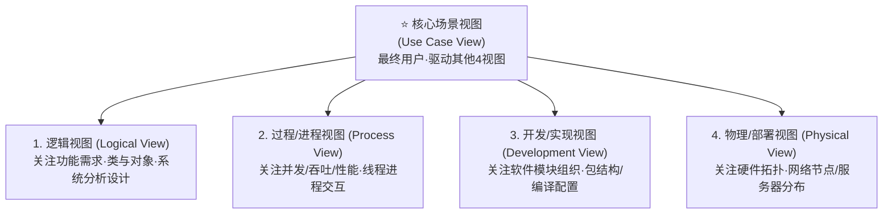

# 02-ABSD基于体系结构的软件开发全生命周期方法论

> **战略权重**：★★★★☆（上午单选题常客 2~3 分 ｜ 架构演进与全生命周期方法论母本）  
> **核心定义**：ABSD（Architecture-Based Software Development，基于体系结构的软件开发）是一种**以业务、质量和商业需求为驱动，以软件架构为中心**的系统化开发方法。

---

## 一、 ABSD 六大生命周期阶段模型

ABSD 方法强调架构不是一次性设计完的，而是一个循环迭代、螺旋上升的过程，分为 **六大阶段**：

### 六大阶段核心职责与考场采分点

| 阶段名称 | 核心目标与工作内容 | 关键产出物 / 交付件 | 考场高频设坑点 |
| :--- | :--- | :--- | :--- |
| **1. 架构需求** | 获取并定义系统的商业需求和质量目标；使用**质量属性效用树（Utility Tree）**与架构用例（Architectural Use Cases）捕获非功能性需求 | 质量属性效用树、架构需求规格说明书 | 架构需求**重点关注质量属性和商业目标**，绝非纯功能罗列！ |
| **2. 架构设计** | 选择适合的**软件架构风格**；划分系统构件与连接件；将需求映射到架构构件；设计接口与交互协议 | 体系结构设计说明书、构件接口规范 | 架构设计是逐步精化的过程，先宏观风格后微观构件 |
| **3. 架构文档化** | 编写规范的架构描述文档；满足不同利益相关者（Stakeholders）对系统理解的诉求 | 完整的软件体系结构文档（SAD）、4+1视图模型 | **文档必须具有完整性与一致性**；严禁代码改了文档不改 |
| **4. 架构复审** | 组织外部专家和利益相关方对架构进行正式审查与评估（如采用 **ATAM/SAAM** 评估法）；识别潜在架构风险与敏感权衡点 | 架构评估报告、风险与敏感点清单 | **复审在编码实现之前进行**！目的是及早发现架构缺陷，避免后期返工代价失控 |
| **5. 架构实现** | 依据架构文档指导开发团队进行具体构件编码、组装与单元/集成测试；确保实现不偏离架构约束 | 可运行的软件构件、系统可执行程序 | 架构师在实现阶段必须进行架构合规性检查（Architecture Conformance） |
| **6. 架构演化** | 响应用户新业务需求、软硬件运行环境变迁或技术升级；对已有架构进行受控的调整、重构和扩展 | 架构演化记录、重构方案 | 演化必须在严格配置管理与变更控制下进行，防架构腐化（Architecture Erosion） |

---

## 二、 架构视角：4+1 视图模型（Kruchten 4+1 View Model）

在架构文档化阶段，最经典的方法是统一建模语言之父 Philippe Kruchten 提出的 **4+1 视图模型**：

### 4+1 视图对应受众与 UML 映射表格（必背题眼）

| 视图名称 | 关注的核心矛盾与目标 | 核心利益相关者（面向谁） | 对应 UML 图元表达 |
| :--- | :--- | :--- | :--- |
| **场景视图 (4+1的核心)** | 系统核心关键用例，**驱动并验证其他 4 个视图的设计** | 最终用户、系统分析师、架构师 | **用例图 (Use Case Diagram)** |
| **逻辑视图** | 系统的功能逻辑组织、领域模型、概念抽象 | 最终用户、开发人员、业务专家 | **类图 (Class)、对象图 (Object)、包图** |
| **进程/过程视图** | 系统的并发性、多线程、异步机制、性能与吞吐率 | 系统集成人员、性能优化工程师 | **状态图、活动图、时序图 (Sequence)** |
| **开发/实现视图** | 源代码物理组织、开发环境、依赖包结构、编译单元 | 程序员、配置管理员、DevOps 工程师 | **构件图 (Component)、包图** |
| **物理/部署视图** | 软硬件物理映射、服务器拓扑、网络环境、高可用双活节点 | 系统工程师、网络管理员、运维人员 | **部署图 (Deployment Diagram)** |

---

## 三、 考场避坑口诀（Memory Pegs）

> **ABSD 六步走，需求设计文档留；**  
> **编码之前必复审，实现演化跟后头！**  
> **4+1 视图记心间，用例驱动在中间：**  
> **逻辑看类开发包，进程看序物理布！**
