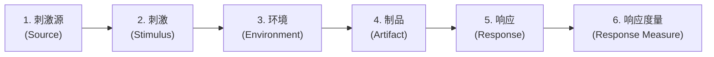
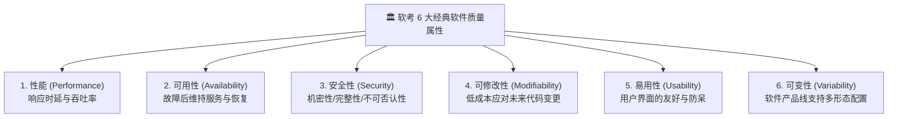

# 01-六大质量属性场景六要素速查卡与命题陷阱

> **战略权重**：★★★★★（上午综合知识必考 3~5 分 ｜ 下午案例分析大题第 1 题必考 20~25 分）  
> **核心心智**：在系统架构师的视野中，**功能需求（Functional Requirements）是廉价的，质量属性（Quality Attributes）才是决定系统生死存亡与架构选型的核心决定因子**。

---

## 一、 质量属性场景的“标准六要素”（The Six Elements of QA Scenario）

无论在上午选择题还是下午案例题，任何一个完整的质量属性场景描述**必须且只能由以下 6 个要素构成**：

### 六要素标准定义与案例实战拆解

| 场景要素 | 标准学术定义 | 案例实战示例（高并发秒杀场景） | 考场答题踩分技巧 |
| :--- | :--- | :--- | :--- |
| **1. 刺激源 (Source)** | 生成刺激的实体（人、外部系统、定时器等） | **大量外部用户、黑产爬虫** | 指明“谁”发起的（内部还是外部） |
| **2. 刺激 (Stimulus)** | 到达系统并需要被处理的事件（并发请求、断电、入侵等） | **短时间内涌入 100,000 QPS 支付请求** | 具体的事件行为动作 |
| **3. 环境 (Environment)** | 刺激发生时系统所处的状态或条件 | **双十一促销高峰期，系统处于满负荷状态** | 正常运行/过载运行/降级模式/故障恢复中 |
| **4. 制品 (Artifact)** | 系统中受到刺激影响的那个具体子系统或模块 | **订单微服务集群、支付网关、MySQL 数据库** | 系统中的哪部分在抗压 |
| **5. 响应 (Response)** | 系统在刺激到达后所采取的动作或处理策略 | **限流降级，将超额请求排队至 Kafka，并返回排队页面** | 架构采取的具体技术防线 |
| **6. 响应度量 (Measure)** | 对响应结果进行的可量化评估指标（必须带数字！） | **核心支付请求 99.9% 在 200ms 内响应，丢单率为 0** | **必含具体数字/百分比/时间单位**！无数据判 0 分！ |

---

## 二、 6 大核心质量属性战术（Tactics）决斗矩阵

### 六大属性战术选择与考场判定题眼

| 质量属性 | 核心关注的矛盾 | 常见架构战术（Architectural Tactics） | 典型真题题眼描述 |
| :--- | :--- | :--- | :--- |
| **性能** *(Performance)* | **时间问题**：计算速度、网络时延、并发吞吐量 | 增加计算资源、并发处理、**引入 Redis 缓存**、减少计算开销、请求排队、数据压缩 | “在 500ms 内返回搜索结果”、“系统支撑 10 万并发”、“采用缓存减少 DB 访问” |
| **可用性** *(Availability)* | **故障问题**：系统在发生软硬件故障时能否正常运转 | 心跳检测（Heartbeat）、**双机热备（Active/Standby）**、冗余部署、故障转移（Failover）、降级（Fallback） | “服务器宕机后 10 秒内自动切换备机”、“年停机时间不超过 5 分钟 (99.99%)” |
| **安全性** *(Security)* | **攻防问题**：防范非法入侵、数据窃听与篡改 | 身份鉴权认证（RBAC/JWT）、**数字签名防篡改**、非对称加密传输（HTTPS）、审计日志、白名单 | “验证用户的数字证书”、“传输过程采用 AES/RSA 加密”、“记录所有操作审计日志” |
| **可修改性** *(Modifiability)* | **变化成本**：未来新增功能或修改时需耗费多少人天 | **高内聚低耦合**、设计模式解耦、配置文件外置、微服务拆分、发布-订阅模式 | “未来增加新支付渠道时无需修改核心订单逻辑”、“修改一个模块不影响其他模块” |
| **易用性** *(Usability)* | **用户操作**：用户学习成本低、减少误操作 | 支持撤销（Undo）、提供用户帮助、规范化输入提示、自适应屏幕布局 | “用户误删数据后可在 30 秒内一键撤销恢复”、“新员工培训时间不超过 2 小时” |
| **可变性** *(Variability)* | **产品形态**：一套代码支持不同客户或不同部署形态 | 特性开关（Feature Toggle）、插件化架构（Plugin）、动态加载、宏定义条件编译 | “支持面向不同医院客户定制不同的病历字段与计费规则，通过配置一键生效” |

---

## 三、 考场绝命易混陷阱剖析

### 陷阱 1：【可用性】 vs 【可靠性】 vs 【安全性】
* **可用性 (Availability)**：强调**“能用”**。就算坏了，由于有备用机（冗余）或能极速重启恢复（MTTR 极短），用户感觉不到挂掉。公式：$\text{Availability} = \frac{\text{MTTF}}{\text{MTTF} + \text{MTTR}}$。
* **可靠性 (Reliability)**：强调**“不出错、不坏”**。在规定的时间内持续正确运行的能力（MTTF 极长）。
* **安全性 (Security)**：强调**“防坏人”**。防止机密泄露、防止数据篡改。

### 陷阱 2：【性能】 vs 【可用性】中的“负载均衡”
* 如果题目说：*“引入 Nginx 负载均衡将请求分发到 4 台服务器，使单机 CPU 占用率从 90% 降到 30%，平均响应时间缩短到 100ms”* $\implies$ **考的是性能**！
* 如果题目说：*“引入 Nginx 负载均衡结合健康检查，当一台应用服务器死机时自动将流量剔除并切换到健康节点”* $\implies$ **考的是可用性（故障转移）**！

---

## 四、 考场避坑口诀（Memory Pegs）

> **场景六要素记心窝，刺激源头引发波；**  
> **所处环境制品受，响应采取具体招；**  
> **度量必须带数字，无量指标不得分！**  
> **性能算时可用冗，安全加解修解耦！**
