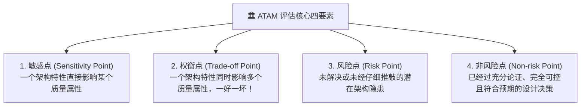
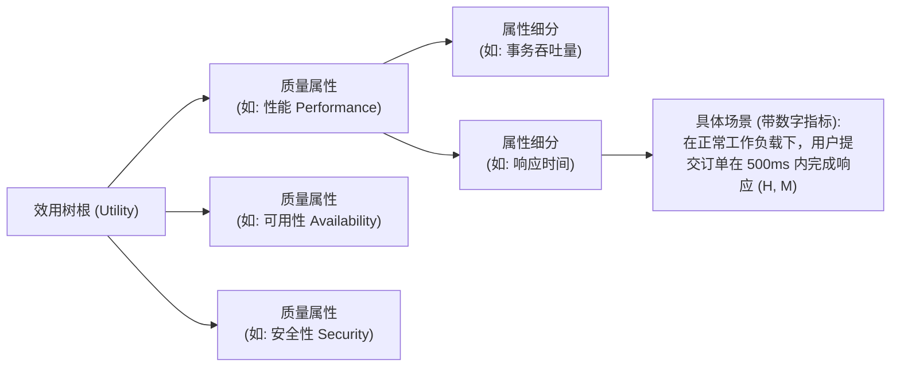

# 02-ATAM架构权衡分析法与效用树实战全景心法

> **战略权重**：★★★★★（**下午案例分析大题第 1 题必考 20~25 分** ｜ 架构师三大核心评估工具之首）  
> **核心定义**：ATAM（Architecture Tradeoff Analysis Method，架构权衡分析法）是由 SEI（美国卡内基梅隆大学软件工程研究所）提出的一种系统化软件架构评估方法。其核心目标不是验证架构“对不对”，而是**在多个相互冲突的质量属性之间进行评估、权衡（Trade-off）与风险排查**。

---

## 一、 ATAM 核心四概念（案例分析填空必考！）

### 四大要素判定表与考场标准模板

| 核心要素 | 学术定义 | 考场金牌判断法 | 经典工程案例（真题高频原题） |
| :--- | :--- | :--- | :--- |
| **敏感点** *(Sensitivity Point)* | 是指**为了实现某种特定的质量属性，一个或多个构件所具有的特性**。改变它，该质量属性会发生剧烈变化。 | **“单向强绑定”**：修改架构特性 X，直接导致质量属性 Y 变好或变差。只牵扯 **1 个质量属性**。 | • “将对称加密算法从 DES 更换为 AES-256，显著提升了系统的**安全性**。” • “在数据库前增加 Redis 缓存集群，显著提升了系统的**性能**（响应时间）。” |
| **权衡点** *(Trade-off Point)* | 是指**影响多个质量属性的架构特性，并对多个属性产生不同方向的影响（促成互斥）**。 | **“双向矛盾体”**：修改架构特性 X，使**质量属性 A 提升，但同时使质量属性 B 下降**！ | • “对所有网络传输报文进行 2048 位国密算法加密：虽然显著提升了**安全性**，但极大地增加了 CPU 计算耗时，导致系统**性能（响应时间）下降**。” • “系统从单体拆分为 20 个微服务：提升了**可修改性**和独立扩展性，但引入了网络通信开销和分布式事务，降低了**性能**和**可用性**。” |
| **风险点** *(Risk Point)* | 是指架构中**潜在的、可能导致系统无法满足质量需求或在未来产生灾难性后果的薄弱环节**（尚未被完全消除）。 | 问自己：“这会不会埋下定时炸弹？”凡是**没有备份、单点故障、缺乏一致性保障、没有降级预案**的，全是风险点。 | • “系统采用单台 MySQL 数据库承载全部订单写入，**存在单点故障风险（SPOF）**，一旦宕机全网瘫痪。” • “采用两阶段提交协议（2PC）处理跨库事务，在协调者宕机时**存在资源长周期锁定甚至事务悬挂的风险**。” |
| **非风险点** *(Non-risk Point)* | 是指架构设计中**符合最佳实践、风险已知且完全受控、能够明确支撑业务目标的设计决定**。 | 经过深思熟虑、有成熟方案支撑、不会带来副作用的明智之举。 | • “引入成熟的 Nginx 反向代理配合双机 Keepalived 实现高可用虚拟 IP 漂移，是系统的非风险点。” • “在系统中使用统一的 Log4j2 异步日志框架输出日志，符合行业标准。” |

---

## 二、 质量属性效用树（Utility Tree）实战构建法

效用树是 ATAM 评估法在需求阶段的**核心交付物**。它将高层抽象的质量属性，分解为具体的、可落地的质量属性场景，并按照 **重要度（Importance）** 和 **难易度/风险度（Difficulty）** 进行优先级评定：

### 效用树叶子节点的优先级标注法则（(H/M/L, H/M/L)）
每个叶子场景右下角标注一个二元组：`(重要度, 难易度)`：
- **第一个字母：对系统架构的重要程度**（High 高 / Medium 中 / Low 低）；
- **第二个字母：实现该架构特性的技术难度或风险**（High 高 / Medium 中 / Low 低）。
- **考场重点**：`(H, H)`（既极度重要、技术难度又极高）的场景，是 **ATAM 评估中最先被讨论、最核心的架构评审点**！

---

## 三、 下午案例分析大题答题规范模板（保底 20 分）

### 典型真题提问：
*“请根据题干描述，指出架构方案中的 2 个敏感点、2 个权衡点，并简要说明理由。”*

### 阅卷老师最喜欢的满分书写格式：
> **1. 敏感点分析：**  
> - **敏感点 1**：引入 Redis 缓存集群。  
>   *理由*：该设计直接提升了系统的**【性能】**（将数据库查询吞吐量提升至 5 万 QPS），是针对性能质量属性的敏感点。  
> - **敏感点 2**：对用户敏感数据采用 RSA 非对称加密与数字签名。  
>   *理由*：该设计直接保障了系统的**【安全性】**（防篡改与防信息泄露），是针对安全质量属性的敏感点。  
>  
> **2. 权衡点分析：**  
> - **权衡点 1**：对所有微服务接口调用强制开启 HTTPS 传输与双向证书认证。  
>   *理由*：该设计提升了系统的**【安全性】**，但反复的 SSL 握手与加解密计算消耗了大量 CPU 资源，导致系统**【性能】**（响应时延与吞吐率）下降，是安全与性能之间的权衡点。  
> - **权衡点 2**：采用跨机房三副本冗余强一致性数据同步方案。  
>   *理由*：该设计极大提升了数据的**【可用性】**与容灾能力，但跨机房网络 RTT 增加了事务提交时延，降低了系统**【性能】**，是可用性与性能之间的权衡点。

---

## 四、 考场避坑口诀（Memory Pegs）

> **单向影响敏感点，双向互斥权衡间；**  
> **单点故障称风险，稳妥受控非风险！**  
> **效用树上判高低，高高（H,H）场景先复审；**  
> **答题必须写理由，一升一降分立现！**
