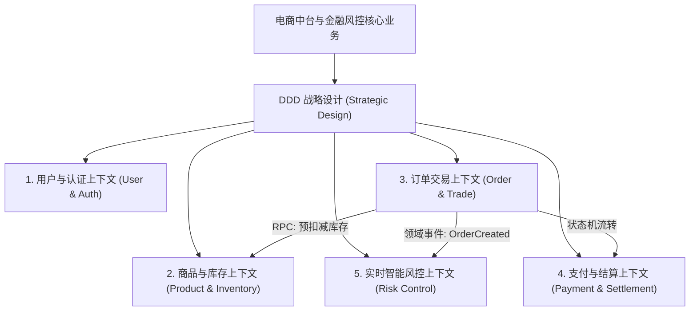
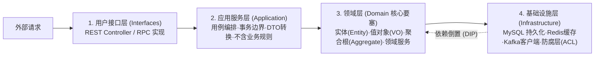
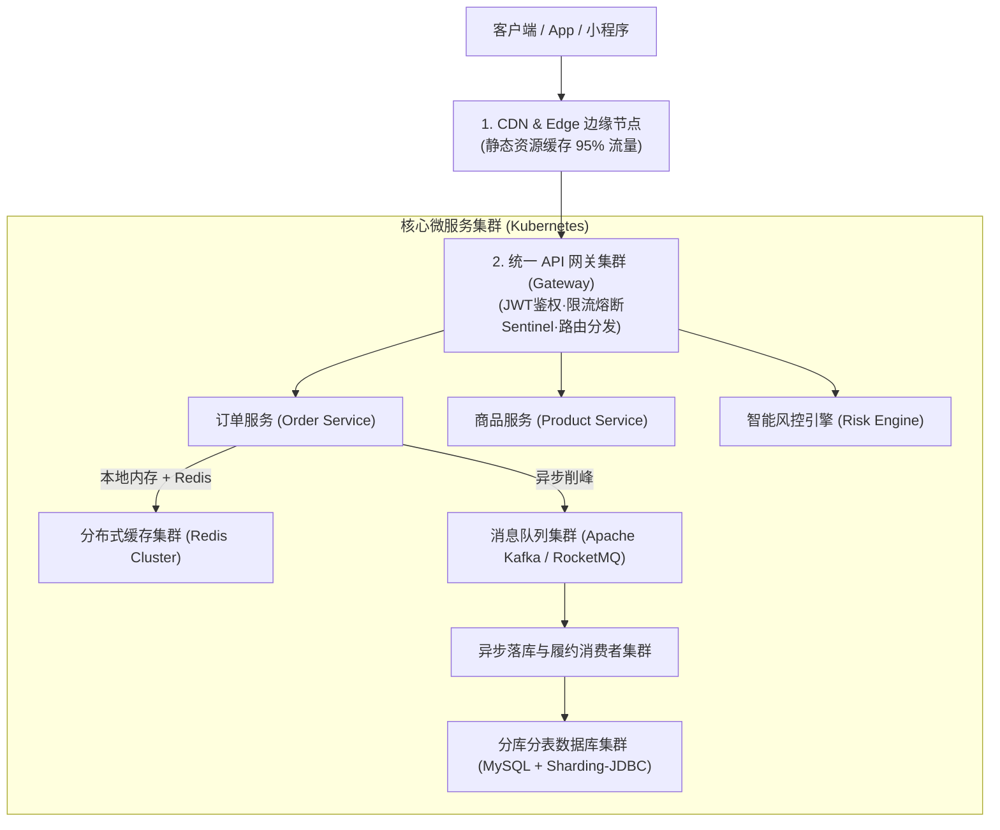

# 01-大型高并发电商中台微服务拆分与DDD实战方案

> **战略权重**：★★★★★（案例分析选做题高频 25 分 ｜ 架构师论文核心业务与技术实践底座）  
> **核心痛点**：单体系统向微服务演进时，最常犯的错误是**“按技术分层横切（如Controller/Service/DAO各成服务）”**或**“凭直觉按页面拆分”**，导致分布式单体（Distributed Monolith）、跨服务网状依赖与数据库频繁死锁。  
> **破局之道**：运用 **DDD（Domain-Driven Design，领域驱动设计）** 的战略设计划定限界上下文（Bounded Context），指导微服务高内聚低耦合拆分。

---

## 一、 DDD 战略设计与微服务边界划分

### 微服务拆分五大军规（论文与案例金牌论据）

1. **高内聚低耦合与单一职责（Single Responsibility）**：一个微服务只负责一个核心业务领域（例如：订单服务只管订单生命周期状态流转，绝对不直接改写库存表或发起扣款）。
2. **限界上下文即服务边界（Bounded Context as Service Boundary）**：同一概念在不同上下文中含义不同。例如：*“商品”* 在商品上下文中包含图文详情、类目规格（SPU/SKU）；但在物流上下文中它仅表现为重量、体积与防震要求。切忌建立所谓“全局通用的超级大实体”。
3. **闭包原则（Common Closure Principle, CCP）**：一起因同一个业务原因而修改的类和模块，必须打包在同一个微服务内。
4. **数据库独占原则（Database per Service）**：**每个微服务必须拥有独立的物理或逻辑数据库**！绝对严禁跨服务直接进行 SQL 联表查询（`JOIN`）。跨服务数据交互必须通过暴露的标准 API（gRPC/REST）或领域事件异步消费完成。
5. **分级自治与故障隔离（Bulkhead 舱壁隔离）**：核心链路（如下单、支付、实时风控）与非核心链路（如评论、积分、推荐）在容器资源、连接池和线程池层面彻底物理隔离，防止非核心系统抖动拖垮核心链路。

---

## 二、 DDD 战术设计：微服务内部四层架构

在单个微服务内部，采用经典的 **洋葱/六边形分层架构（Onion Architecture）**，使核心业务逻辑不依赖任何外部框架或数据库：

### 核心战术概念与考场秒杀口诀

| DDD 战术概念 | 本质定义 | 案例实操 | 避坑要点 |
| :--- | :--- | :--- | :--- |
| **聚合根 (Aggregate Root)** | 一组具有内在生命周期一致性的实体的**唯一对外门户** | `Order`（订单）是聚合根，内部包含多个 `OrderItem`（订单明细） | 外部对象**只能通过聚合根修改内部子实体**；外部绝对不能直接越权修改 `OrderItem`！ |
| **实体 (Entity)** | 拥有**全局唯一标识（ID）**，且具有连续生命周期的对象 | `User` 用户、`Order` 订单 | 只要 ID 相同，即使属性改变也是同一个实体 |
| **值对象 (Value Object)** | 没有唯一标识，仅由其**属性值**决定的不可变对象（Immutable） | `Address`（省市区街道）、`Money`（金额+币种） | 属性一旦创建不可修改，修改必须创建新对象 |
| **领域事件 (Domain Event)** | 领域中发生的**具有业务意义的重要事实**（过去式） | `OrderCreatedEvent`（订单已创建）、`PaymentSuccessEvent` | 驱动跨服务异步解耦，实现最终一致性的核心抓手 |
| **防腐层 (ACL, Anti-Corruption Layer)** | 适配并转换外部老旧系统数据格式的隔离转换层 | 在新电商系统与老旧 ERP 财务接口之间建立 Adapter | 防止外部系统的脏数据模型侵入当前核心领域 |

---

## 三、 高并发交易中台架构拓扑图

针对 **12 万 QPS 峰值洪峰**，系统采用分层多级过滤架构：

---

## 四、 架构师考场金牌防坑口诀

> **战略划分看边界，一个上下文一微服务；**  
> **数据库严禁共享库，跨域绝不写连表！**  
> **聚合根是唯一门，修改明细找主干；**  
> **领域事件解千愁，异步最终保一致！**
