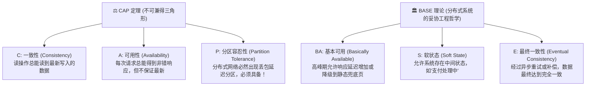
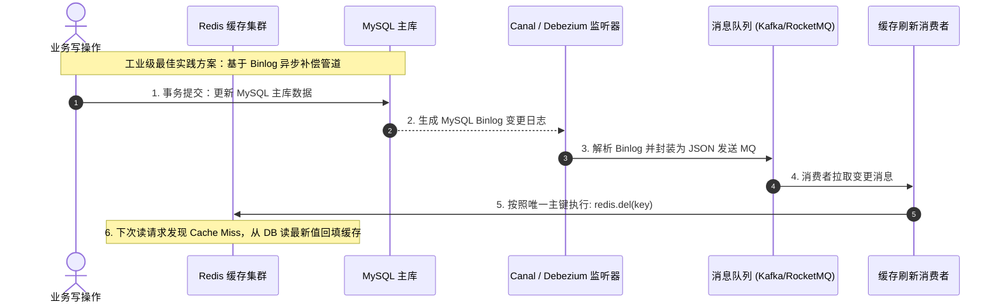

# 02-分布式事务与高并发缓存强弱一致性攻防指南

> **战略权重**：★★★★★（高级案例必考选做题 25 分 ｜ 高级论文核心技术深度论证点）  
> **矛盾核心**：在单体单库时代，依靠本地数据库 ACID 特性（Undo/Redo Log、行级锁）即可轻松解决一致性；而在微服务与分库分表环境下，**CAP 定理与 BASE 理论**成为了架构设计的最高宪法。

---

## 一、 CAP 定理与 BASE 理论架构铁律

> 💡 **架构师核心判断**：在分布式系统网络通信不可靠的物理事实下，**P（分区容忍性）是必选项**。因此系统只能在 **CP（保强一致性，牺牲可用性，如 ZooKeeper/Raft）** 与 **AP（保高可用，牺牲强一致性，换取最终一致性，如 Dynamo/Eureka/多数电商微服务）** 之间做权衡！

---

## 二、 分布式事务五大流派决斗与选型矩阵

在跨微服务（跨库）下单扣款场景中，五大主流方案的技术权衡与适用边界：

| 方案名称 | 核心运作机理 | 一致性级别 | 性能开销 / 吞吐率 | 核心缺陷与致命伤 | 最佳应用场景 |
| :--- | :--- | :--- | :--- | :--- | :--- |
| **2PC (两阶段提交)** | 协调者发起 Prepare 预提交，所有参与者加锁并反馈 OK；协调者再发起 Commit | **强一致性 (CP)** | 极低（长周期阻塞锁资源） | **协调者单点故障**；脑裂；事务长周期锁表导致死锁 | 传统金融跨行资金强转账、物理节点极少的同机房环境 |
| **3PC (三阶段提交)** | 增加 CanCommit 预询阶段，引入超时机制自动提交 | 较强一致性 | 低（增加一次网络往返 RTT） | 网络分区时仍可能导致数据不一致；实现极度复杂 | 工业界极少直接裸用 3PC |
| **TCC (补偿型事务)** | 业务层拆为 **Try（预留资源）**、**Confirm（确认执行）**、**Cancel（释放回滚）** | **最终一致性** | 高（无数据库锁阻塞，业务级隔离） | **业务侵入性极强**；必须手写防悬挂、空回滚和幂等代码 | **核心资金转账、跨系统余额扣减与冻结** |
| **SAGA (长事务补偿)** | 将长事务拆为一系列本地事务 $T_1, T_2 \dots T_n$，每个事务配对一个补偿动作 $C_1, C_2 \dots C_n$；失败时反向依次执行补偿 | **最终一致性** | 高（并发执行，吞吐率大） | 缺乏数据隔离性（脏读风险）；无法应对不可逆动作（如已发货无法回滚） | **跨企业业务流转、长周期审批流、老旧系统集成** |
| **本地消息表 + MQ 事务消息** *(推荐 ⭐)* | 业务操作与本地消息在同一个本地事务中入库；MQ 或后台任务可靠投递消息，下游**幂等消费**完成最终状态一致 | **最终一致性 (AP)** | **极高（完全异步解耦，天生抗并发）** | 下游消费存在秒级或分钟级延迟；必须保证**消费端绝对幂等（Idempotent）** | **电商订单创建、优惠券发放、积分累加、物流派单** |

---

## 三、 高并发读写：缓存与数据库双写一致性攻防

在每秒 10 万次读请求的高并发系统中，数据库前必然挂载 Redis 缓存集群。但“先更数据库还是先清缓存”存在巨大的数据不一致陷阱：

### 为什么“延时双删”不是万能药？
* **传统延时双删套路**：`先删缓存 -> 写数据库 -> 线程 sleep 500ms -> 再次删缓存`。
* **致命弊端**：
  1. `sleep` 时间难以精确把控（主从复制延迟在高峰期从 100ms 飙升至 2 秒时直接失效）；
  2. 同步阻塞应用线程，吞吐量断崖式下跌；
  3. 第二次删除若网络丢包失败，数据直接永久脏读！
* **架构师标准答案（论文必胜论据）**：  
  采用**“直接更新数据库 + 基于 Canal / Debezium 异步监听 MySQL Binlog + MQ 顺序投递 + 幂等删除缓存（带指数退避重试）”**，彻底将业务代码与缓存一致性维护解耦，实现毫秒级最终一致性！

---

## 四、 考场避坑口诀（Memory Pegs）

> **CAP 不可三全顾，分区存在选其一；**  
> **2PC 阻塞锁太重，金融核算可用它；**  
> **TCC 显式写补偿，业务侵入代价大；**  
> **异步解耦消息表，幂等消费吞吐高；**  
> **缓存防脏删为上，Binlog 异步最稳当！**
