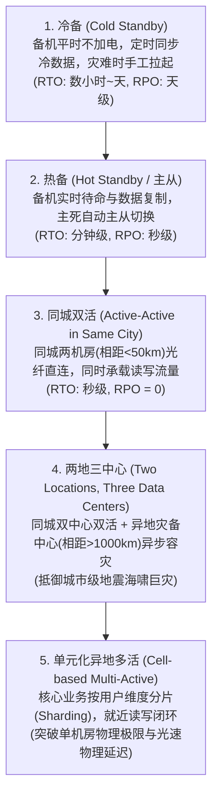
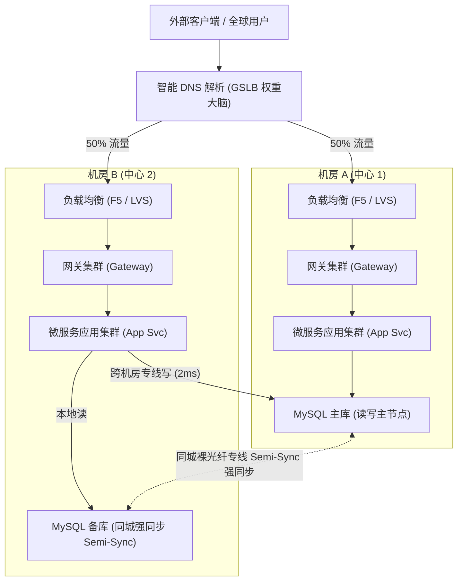

# 03-金融级同城双活与高可用系统容灾架构实战

> **战略权重**：★★★★★（高级案例大题高频 25 分 ｜ 架构师论文“高可用/高可靠性”必备核心方案）  
> **核心指标**：评价灾备与高可用系统的两大金牌国际标准：
> - **RPO（Recovery Point Objective，恢复点目标）**：发生灾难后，**允许丢失的最大数据量（时间跨度）**。金融级要求 $\text{RPO} = 0$（零数据丢失）！
> - **RTO（Recovery Time Objective，恢复时间目标）**：发生灾难后，**系统从中断到恢复对外服务的最长时间**。金融级要求 $\text{RTO} < 30 \text{秒}$！

---

## 一、 容灾架构进化阶梯（从冷备到异地多活）

---

## 二、 同城双活（Active-Active）核心拓扑与流量调度

在同城双中心（机房 A 与机房 B，光纤专线往返延迟 $< 2\text{ms}$）实现双活的核心架构：

### 同城双活三大工程挑战与破局之道

1. **写冲突与数据脑裂（Split-Brain）**：
   - *问题*：如果两个机房同时允许任意写同一张数据表，网络专线一旦抖动中断，两边各自修改同一行记录，将产生灾难性的不可逆数据覆盖冲突。
   - *解法*：**单主写 + 单元化 Sharding 路由**。对有强一致性要求的核心账户表，强制由主中心承接写操作；或按照 `UserId % 2` 严格划分责任归属中心，机房 A 负责偶数用户读写，机房 B 负责奇数用户读写，各行其道，互不干扰！
2. **跨机房 RPC 放大调用与光速延迟（RPC Amplification）**：
   - *问题*：用户一次前端点击，后端微服务如果产生 10 次跨机房 RPC 交互，累加延迟直接超过 50ms。
   - *解法*：**就近调用与链路闭环（Zone-Affinity Routing）**。微服务注册中心（Nacos/Consul）配置机房元数据标签，请求优先在同一机房内部链路闭环，严禁跨机房串联跳跃。
3. **心跳检测误判与自动选主（Quorum 仲裁机制）**：
   - *问题*：机房 A 与机房 B 之间的心跳专线单向断开，机房 B 以为机房 A 死了，擅自将从库升为主库，导致双主写。
   - *解法*：**引入独立的第三方仲裁节点（Third-party Witness / ZooKeeper Quorum）**，必须由获得超过半数投票赞成的中心才能执行主从故障切换（Failover）。

---

## 三、 两地三中心（Two Locations, Three Data Centers）架构标准

国家金融与政务行业核心系统的最高容灾标准：
- **同城中心 1（生产中心）** 与 **同城中心 2（同城容灾中心）**：相距 $30 \sim 50 \text{公里}$，同步复制数据，做到 $\text{RPO} = 0$，防机房断电、火灾、光缆被挖断。
- **异地中心 3（异地灾备中心）**：相距 $1000 \text{公里以上}$（如北京-深圳），异步复制数据，防御特大区域性地震、洪水与战争，防灭顶之灾。

---

## 四、 考场避坑口诀（Memory Pegs）

> **灾备衡量看两标，RPO 数据 RTO 时；**  
> **金融双活同城建，光纤延迟两毫秒；**  
> **单元分片避冲突，就近路由消延迟；**  
> **第三方设仲裁点，两地三中心最保险！**
