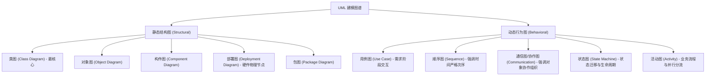
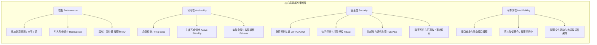

# 15大高频案例分析专题精粹笔记

> **来源说明**：本篇基于系统架构设计师通关高分学员实战精炼笔记（`15案例专题.md`）系统化扩充重构，剔除冗余干扰，精准覆盖下午案例分析科目四大核心出题领域的高频题型、踩分关键词与答题套路。  
> **配套联动**：
> - 案例答题通用方法论：[01-系统架构下午案例分析通用破局三段论.md](01-系统架构下午案例分析通用破局三段论.md)
> - 质量属性效用树实操：[02-质量属性效用树分析真题实战演练.md](02-质量属性效用树分析真题实战演练.md)

---

## 目录索引

- [专题一：软件工程与建模（必考基础）](#专题一软件工程与建模必考基础)
  - [1. 数据流图 (DFD) 答题必备套路](#1-数据流图-dfd-答题必备套路)
  - [2. UML 结构图与行为图全景速记](#2-uml-结构图与行为图全景速记)
  - [3. UML 六大核心关系与强弱对比](#3-uml-六大核心关系与强弱对比)
  - [4. 面向对象分析与设计三类核心类](#4-面向对象分析与设计三类核心类)
- [专题二：软件架构风格与质量属性评估（核心主干）](#专题二软件架构风格与质量属性评估核心主干)
  - [1. 经典五大架构风格快速辨析表](#1-经典五大架构风格快速辨析表)
  - [2. 架构评估四大核心概念（踩分金句）](#2-架构评估四大核心概念踩分金句)
  - [3. 四大核心质量属性与典型架构策略](#3-四大核心质量属性与典型架构策略)
- [专题三：Web 与高并发分布式系统架构（应用大题）](#专题三web-与高并发分布式系统架构应用大题)
  - [1. 负载均衡选型梯队](#1-负载均衡选型梯队)
  - [2. 分布式 Session 共享三大机制](#2-分布式-session-共享三大机制)
  - [3. Redis 高频命题踩分点全解](#3-redis-高频命题踩分点全解)
- [专题四：数据库系统设计与性能调优（高频实战）](#专题四数据库系统设计与性能调优高频实战)
  - [1. 视图 (View) 的四大核心价值](#1-视图-view-的四大核心价值)
  - [2. 规范化 vs 反规范化深度决策](#2-规范化-vs-反规范化深度决策)
  - [3. 读写分离与主从复制核心拓扑](#3-读写分离与主从复制核心拓扑)
- [专题五：系统可靠性与安全性（保底考点）](#专题五系统可靠性与安全性保底考点)
  - [1. 可靠性设计四大黄金法则](#1-可靠性设计四大黄金法则)
  - [2. 系统安全性关键设计实践](#2-系统安全性关键设计实践)

---

## 专题一：软件工程与建模（必考基础）

### 1. 数据流图 (DFD) 答题必备套路

在下午案例题中，若出现 DFD 填空，考点 100% 集中在以下四项修正与补充：

| 考查方向 | 常见答题套路与题干排查方法 |
| :--- | :--- |
| **补充实体 (External Entity)** | 检查题干中出现的外部用户、第三方系统、外部硬件设备，排查顶层图是否遗漏。 |
| **补充数据存储 (Data Store)** | 检查业务流程中需要持久化落盘的信息（如“订单表”、“用户信息库”、“日志文件”）。 |
| **补充缺失数据流 (Data Flow)** | **语法黑洞排查**：黑洞（只有输入无输出）、奇迹（只有输出无输入）、灰洞（输出不足以由输入产生）；**题干比对**：对照文字描述逐句划出“发送/提供/查询”。 |
| **补充加工名 (Process)** | 必须是**动宾短语**（如“校验用户权限”、“计算折扣价格”、“生成结算清单”），严禁使用单一名词。 |

### 2. UML 结构图与行为图全景速记

### 3. UML 六大核心关系与强弱对比

关系由弱到强排序：
$$\text{依赖 (Dependency)} < \text{关联 (Association)} < \text{聚合 (Aggregation)} < \text{组合 (Composition)} < \text{泛化 (Generalization)} \approx \text{实现 (Realization)}$$

- **依赖 (Dependency, 虚线箭头 $\dashrightarrow$)**：临时使用关系。A 类方法参数中传入了 B 类的对象，无长期关联。
- **关联 (Association, 实线箭头 $\longrightarrow$)**：结构性长期持有。A 类包含 B 类的成员变量。
- **聚合 (Aggregation, 空心菱形 $\diamondsuit-$)**：**部分与整体生命周期不同**。如：汽车与轮胎（拆下轮胎，轮胎依然存在）。
- **组合 (Composition, 实心菱形 $\blacklozenge-$)**：**部分与整体同生共死**。如：公司与部门、人与心脏（整体销毁，部分随之销毁）。
- **泛化 (Generalization, 空心三角形 $\triangle-$)**：继承关系（子类继承父类）。
- **实现 (Realization, 虚线空心三角形 $-\!\!-\!\vartriangle$)**：接口与实现类关系。

### 4. 面向对象分析与设计三类核心类

- **实体类 (Entity Object)**：映射领域核心数据结构，生命周期长，用于在存储介质中持久保存（如：`User`, `Order`, `Product`）。
- **控制类 (Control Object)**：充当业务逻辑与活动执行的中介，封装算法用例流，不包含界面和存储细节（如：`OrderWorkflowController`, `PaymentProcessor`）。
- **边界类 (Boundary Object)**：封装系统外部与内部的交互边界（如用户操作界面、RESTful API 控制器、打印机驱动接口、第三方支付网关适配器）。

---

## 专题二：软件架构风格与质量属性评估（核心主干）

### 1. 经典五大架构风格快速辨析表

| 架构风格谱系 | 代表子风格 | 核心运行机制 | 典型真题应用场景 |
| :--- | :--- | :--- | :--- |
| **数据流风格** | **批处理 (Batch)** | 步骤顺序执行，处理的是**大批完整的离线数据集**，前后阶段无交互 | 传统财务月末结账、报表离线批量计算 |
| | **管道-过滤器 (P&F)** | 每个构件是一个过滤器，数据以流形式顺序经过管道传输，支持并发增量处理 | 图像/音视频逐帧渲染管线、编译器词法语法分析 |
| **调用/返回风格** | **主程序/子程序** | 单线程过程式嵌套调用，通过全局/形参传递控制权 | 早期 C 语言结构化程序设计 |
| | **面向对象 (OO)** | 数据抽象与封装，通过显式消息传递与接口多态协同 | 经典企业中后台业务服务模块 |
| | **分层结构 (Layered)** | 每层只依赖下层，对上层提供服务，支持关注点分离 | 表现层-业务逻辑层-数据访问层 (三层架构) |
| **独立构件风格** | **进程通信** | 各进程通过 IPC、Socket 等管道显式通信 | 早期 Unix 系统服务进程 |
| | **事件驱动 (隐式调用)** | 构件发布事件，不指定由谁处理；由事件分发器触发注册的监听者回调 | GUI 视窗鼠标键盘事件响应、断点回调、解耦异步事件总线 |
| **虚拟机风格** | **解释器 (Interpreter)** | 包含程序执行引擎与自定义语法状态机，解释执行自定义脚本 | 自定义复杂业务规则引擎、工业机器人指令解析 |
| | **基于规则系统** | 知识库 + 事实库 + 推理机，用于复杂规则推理 | 医疗诊断专家系统、复杂金融欺诈反洗钱判断 |
| **仓库风格** | **数据库系统** | 以共享的集中存储中心为核心，各被动业务模块对其进行 CRUD | 经典 ERP 业务管理系统 |
| | **黑板系统 (Blackboard)** | 包含**黑板（全局数据）**、**知识源（独立专家模块）**与**控制控制器** | 语音识别、模式识别、雷达信号多专家融合推理 |

### 2. 架构评估四大核心概念（踩分金句）

针对 ATAM (Architecture Tradeoff Analysis Method) 或 SAAM 评估大题，必须直接背诵并默写以下四概念标准定义：

- **敏感点 (Sensitivity Point)**：
  > “为了实现某种特定的质量属性，一个或多个构件所具有的特性。若该特性发生微小变化，将对该质量属性产生极其显著的影响。”  
  > *例：数据库连接池大小是系统吞吐量与并发性能的敏感点。*
- **权衡点 (Tradeoff Point)**：
  > “影响多个质量属性的架构特性，它是多个质量属性之间的折中与妥协。”  
  > *例：对网络传输报文进行高强度加密：显著提升了「安全性」，但因编解码开销显著降低了「响应性能」，属于典型的权衡点。*
- **风险点 (Risk Point)**：
  > “架构设计中潜在的、可能导致系统无法达到预期质量属性要求的决策或弱点。”  
  > *例：核心支付链路依赖单节点 Redis 实例，存在单点故障风险。*
- **非风险点 (Non-risk Point)**：
  > “已被充分证明可靠、对实现系统质量属性有把握的成熟架构决策。”  
  > *例：在静态页面资源访问中引入阿里云 CDN 分发，已是验证成熟的成熟技术方案。*

### 3. 四大核心质量属性与典型架构策略

---

## 专题三：Web 与高并发分布式系统架构（应用大题）

### 1. 负载均衡选型梯队

- **硬件负载均衡**：F5 BIG-IP、A10（吞吐量巨大、成本高昂、高稳定性，置于机房最外层）；
- **四层负载均衡 (传输层 TCP/UDP)**：LVS (Linux Virtual Server)、HAProxy（只解析 IP 和端口，转发吞吐高）；
- **七层负载均衡 (应用层 HTTP/HTTPS)**：Nginx、OpenResty、Traefik（可基于 URL 路径、Header、Cookie 进行智能反向代理与路由分发）。

### 2. 分布式 Session 共享三大机制

1. **客户端 Cookie 携带 Token/Session**：
   - 做法：将用户信息加密生成 JWT/Token 存放于客户端 Cookie 或 LocalStorage 中，服务端无状态校验；
   - 优缺点：服务端无需维护 Session 状态，水平扩容极佳；但 Token 占用带宽，且主动吊销注销难度较大。
2. **服务器之间 Session 广播同步 (Session Replication)**：
   - 做法：Tomcat 集群组播同步 Session 变更；
   - 优缺点：各节点数据完整；但节点数超 4~5 台后，网络广播流量风暴消耗巨大，现已极少在大规模集群中使用。
3. **基于分布式缓存的集中式 Session (推荐首选)**：
   - 做法：所有 Web 节点将 Session 数据读写统一委托给集中式 Redis 集群，配合分布式 Key 过期管理；
   - 优缺点：架构解耦彻底，支持任意弹性缩扩容，是当前互联网与大型企业架构的主流标准方案。

### 3. Redis 高频命题踩分点全解

#### ① 缓存三大灾难机理与应对策略

| 灾难类型 | 发生机理 | 经典解决对策（标准踩分要点） |
| :--- | :--- | :--- |
| **缓存穿透 (Penetration)** | 查询一个**数据库中根本不存在的数据**，缓存永远不命中，导致海量恶意请求直击底层数据库。 | 1. **布隆过滤器 (Bloom Filter)** 提前拦截过滤； 2. 对空查询结果设置较短过期时间的**缓存空值 (Empty Object)**； 3. 强化接口入参的基础格式合法性校验。 |
| **缓存击穿 (Breakdown)** | 某个**极度高频访问的热点 Key** 在某一瞬时刚好**过期失效**，海量并发请求同时涌入数据库重构缓存。 | 1. 对该热点 Key 设置**永不过期**或逻辑过期后台异步刷新； 2. 在查询 DB 重新加载时使用**互斥互锁 (分布式互斥锁 / Mutex)**，仅允许单个线程回源构建缓存。 |
| **缓存雪崩 (Avalanche)** | 大量 Key 在**同一时间集中过期**，或 **Redis 节点整体宕机故障**，导致全量请求洪峰瞬间压垮数据库。 | 1. 在 Key 过期时间基准上增加一段**随机离散值 (TTL Jitter)**； 2. 搭建高可用哨兵或 Cluster 集群，配置持久化与故障自愈； 3. 引入多级缓存架构（本地进程缓存 Guava/Caffeine + 分布式 Redis）。 |

#### ② Redis 数据分片方案

- **客户端分片 (Client-side Sharding)**：客户端通过一致性哈希直接计算目标节点并连接；
- **代理中间件分片 (Twemproxy / Codis)**：前端请求访问统一代理，由代理节点负责路由与分片转发；
- **服务端集群分片 (Redis Cluster)**：官方天然支持 16384 个槽位 (Hash Slots)，各主节点分管不同区间槽位，支持 MOVED 重定向。

---

## 专题四：数据库系统设计与性能调优（高频实战）

### 1. 视图 (View) 的四大核心价值

1. **简化用户查询操作**：将多表联查、聚合统计封装为虚表，前端或业务开发人员无需编写冗长 SQL；
2. **增强数据安全性**：基于列权限进行细粒度隔离，对敏感字段（如密码哈希、身份证号、薪资）不予暴露；
3. **提供逻辑数据独立性**：当底层物理表发生字段拆分或重构时，只需调整视图定义，上层业务接口无需变更；
4. **统一多维度呈现**：可根据不同部门与业务角色的诉求，针对同一基础数据源构建不同维度的定制化报表视图。

### 2. 规范化 vs 反规范化深度决策

在关系型数据库设计中，通常遵循第三范式 (3NF) 消除插入/删除/更新异常，但在 OLAP 或读多写少的极高并发场景下，需审慎采用反规范化：

| 评估维度 | 规范化设计 (3NF/BCNF) | 反规范化设计 (Denormalization) |
| :--- | :--- | :--- |
| **核心思想** | 一件事在一处记录，完全消除冗余 | 用空间换时间，以冗余容忍换取高读取吞吐 |
| **核心优势** | 彻底消除数据冗余，杜绝更新/删除异常，维护一致性成本极低 | 减少甚至彻底消除多表高开销的 `JOIN` 关联操作，极大提升读取速度 |
| **核心缺陷** | 大表多表关联在海量并发下消耗大量 CPU/内存，导致查询变慢 | 增加存储占用，写操作（增删改）需级联维护多个冗余副本，易引发数据不一致风险 |
| **反规范化常用手段** | - | 1. **增加冗余列**（直接将部门名称字段冗余在员工表）； 2. **增加派生统计列**（如在订单主表增加 `total_amount`）； 3. **重新组表**（将频繁同时读取的主子表合并）； 4. **垂直分割/水平分割**（冷热字段隔离、分库分表）。 |

### 3. 读写分离与主从复制核心拓扑

- **拓扑结构**：配置一主一从或一主多从。写操作（Insert/Update/Delete）强制走 Master 主库，读操作（Select）通过负载均衡算法分流至 Slave 从库；
- **主从同步延迟对策**：
  - 核心强一致业务（如支付完成后立即查询订单状态）**强制走主库读取**；
  - 写入操作后在缓存中打标（短时间内带有更新标记的用户读操作定向到主库）；
  - 使用支持半同步复制 (Semi-sync Replication) 或金融级分布式数据库（如 OceanBase、TiDB）实现 Raft/Paxos 多数派强一致同步。

---

## 专题五：系统可靠性与安全性（保底考点）

### 1. 可靠性设计四大黄金法则

1. **避错技术 (Fault Avoidance)**：在软件工程全生命周期通过严格的需求评审、静态代码分析、形式化验证与完备测试尽量减少代码缺陷；
2. **检错技术 (Fault Detection)**：在系统运行期通过心跳探测 (Heartbeat)、自检校验和 (Checksum)、超时机制 (Timeout) 快速发现故障；
3. **容错技术 (Fault Tolerance)**：
   - **双机热备 (Active-Standby)** 与 **双机双活 (Active-Active)**；
   - **N 版本程序设计 (N-Version Programming)**：由不同团队独立用不同技术栈编写同一功能的 N 个版本，运行时表决器 (Voter) 采取多数表决机制选出结果；
   - **恢复块方法 (Recovery Block)**：主块执行发生错误时，回滚到之前设立的检查点 (Checkpoint)，执行后备块程序；
4. **系统降级与熔断 (Fallback & Circuit Breaking)**：在下游非核心依赖服务瘫痪时，触发熔断器切断调用链，返回友好降级托底数据，保护核心链路可用性。

### 2. 系统安全性关键设计实践

- **认证鉴权**：OAuth2.0 / OpenID Connect + RBAC (基于角色的访问控制) 权限模型；
- **传输安全**：全站强制 HTTPS/TLS 1.3，接口增加签名校验 (`sign = MD5(params + secret + timestamp)`)，防御篡改与中间人攻击；
- **防重放攻击**：客户端请求携带随机流水号 `Nonce` 与严格时间戳 `Timestamp`，服务端使用 Redis `SETNX` 记录并在短时间内去重；
- **存储加密**：敏感数据使用 AES-256 / 国密 SM4 对称加密，用户密码必须使用带盐哈希 (Salted Hash, 如 Argon2 / BCrypt / PBKDF2)；
- **审计追踪**：全链路日志埋点记录操作人、源 IP、操作动作、变更前后快照，确保安全事件可追溯、可审计。
