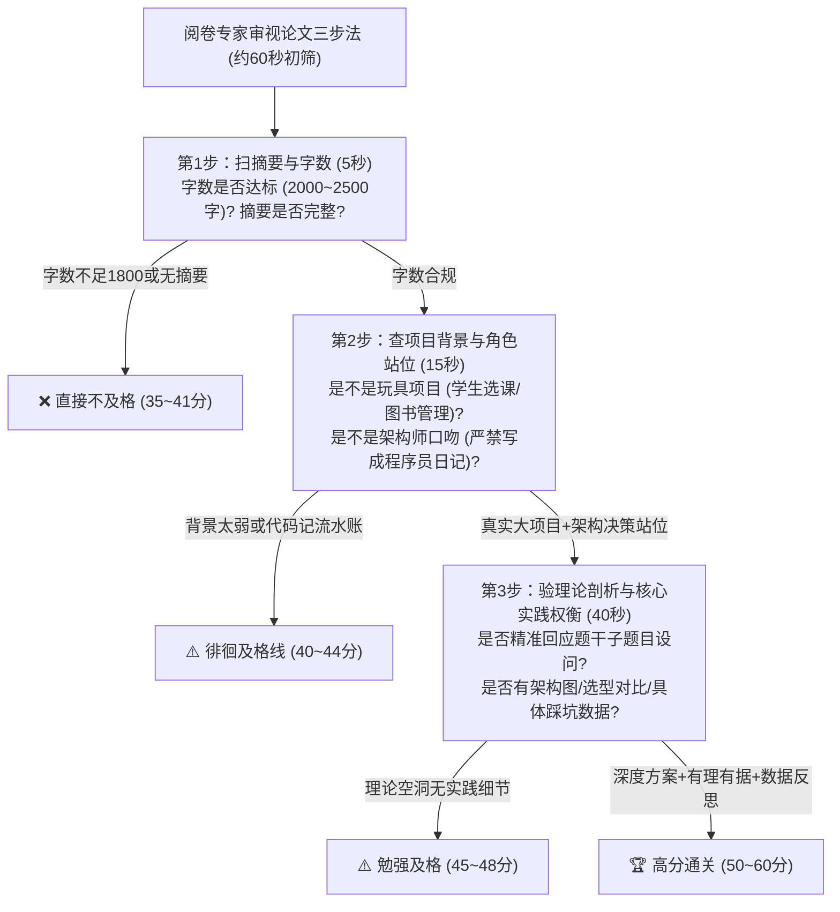

# 00-系统架构师2500字论文机考通关指南与评分铁律

> **战略权重**：★★★★★（**高级通过率最大瓶颈 · 刷掉 60%+ 考生** ｜ 120 分钟手打 2200~2500 字）  
> **核心心智**：软考架构论文**绝不是文学创作，也不是学术散文，而是一篇严谨的工程实战述职答辩报告**！阅卷专家是全国高校教授或企业资深总工，他们寻找的是一个**“真正在大中型项目中担任过架构师、面临过矛盾取舍、踩过坑并成功解决问题”**的成熟工程指挥官。

---

## 一、 阅卷专家打分心智模型与五大扣分死穴



### 五大必死扣分雷区（考前绝对红线）

1. **字数不足 1800 字**：直接打入四类卷（40 分以下不及格）。机考输入框有字数统计，**黄金安全区间为 2200 ~ 2500 字**。
2. **项目背景极其微小（玩具项目）**：写“某大学图书馆管理系统”、“个人博客系统”、“小区物业管理系统”，投资几万元、几个月——架构师连用武之地都没有，何谈高可用高并发？直接不及格！
3. **角色错位（写成程序员或项目经理）**：通篇都在写“我每天写了几百行代码、怎么配置Tomcat参数”或者“我每天催促张三李四按时交工”，未体现架构选型、技术权衡（Trade-off）、标准制定与架构评审。
4. **跑题或遗漏题干子设问（致命盲区）**：试卷题目通常包含 2~3 个明确的小设问（例如：“① 简述微服务核心特征；② 详细论述你的微服务拆分原则；③ 说明引入微服务后的成效与不足”）。如果通篇只写自己的项目，不回应理论设问，每漏一个小问直接扣 5~8 分！
5. **通篇泛泛而谈，无具体技术栈与数据支撑**：通篇大话空话（“我们采用了先进的技术提升了性能”），没有具体的中间件选型（Kafka/Redis/Sentinel/Canal）、没有具体参数对比、没有时延和 QPS 的具体数字。

---

## 二、 120 分钟机考极限时间配比操盘手

在机考界面下，120 分钟手敲 2300 字，手指和大脑必须处于高度机械化协调状态：

| 时间段 | 耗时 | 阶段任务 | 产出字数 | 核心动作与纪律 |
| :---: | :---: | :--- | :---: | :--- |
| **0 ~ 10 分钟** | 10 min | **审题选卷 + 列提纲草稿** | 0 字 | 仔细审视 4 道题，选择自己准备最充分的题目；在草稿纸上速写“四个小标题 + 回应题干设问点” |
| **10 ~ 25 分钟** | 15 min | **敲入项目摘要 (Abstract)** | 约 300 字 | 默写背熟的项目万能摘要：项目背景、投资额、工期、本人架构师角色、核心架构方案与最终成效 |
| **25 ~ 40 分钟** | 15 min | **正文第 1 部分：项目背景详解** | 约 450 字 | 交代集团业务痛点、老旧单体瓶颈、高并发/金融级可靠性指标诉求 |
| **40 ~ 65 分钟** | 25 min | **正文第 2 部分：核心理论深度阐述** | 约 550 字 | **针对题干设问一**进行理论框架阐述（如架构风格、ATAM效用树、微服务特征、CAP定理） |
| **65 ~ 105 分钟** | 40 min | **正文第 3 部分：架构设计实践（核心主战场）** | 约 1000 字 | **针对题干设问二**，分 2~3 个带粗体的小标题展开实战：方案 A vs 方案 B 权衡对比、踩坑攻防、详细落地细节 |
| **105 ~ 115 分钟** | 10 min | **正文第 4 部分：成效与不足反思** | 约 300 字 | 实事求是给出指标数据（性能提升、丢单清零），并指出 1~2 个待改进的边缘不足与未来演化方向 |
| **115 ~ 120 分钟** | 5 min | **通读全文 + 错别字与字数检查** | 检查 | 确保字数在 2200~2500 字区间，检查关键英文缩写（Kafka/Redis/Nacos）拼写无误 |

---

## 三、 高分论文标准四大结构框架

一套标准的架构师论文正文结构必须具备清晰的层次：

```markdown
# 论文题目：论XXXX架构及其在大型系统中的应用

## 摘要（约 300 字）
本文以我于 2024 年参与主持研发的《某大型全国性新零售交易中台与智能风控平台》为例...

## 一、 项目背景与系统架构痛点（约 450 字）
交代业务背景、并发规模、吞吐要求以及为何必须实施架构重构...

## 二、 XXX 核心理论与架构方法论（约 550 字）
紧扣题干设问，精准阐明相关理论定义、核心机制、优缺点与适用边界...

## 三、 基于 XXX 的架构设计实践与权衡（约 1000 字 · 核心采分点）
1. 实践分支一：...（技术选型对抗与权衡）
2. 实践分支二：...（核心痛点攻坚与防线设计）
3. 实践分支三：...（高可用与容灾保障）

## 四、 实施成效与未来反思（约 300 字）
经过一年平稳运行，各项业务指标显著提升...客观反思系统仍存在的边缘瓶颈及下一步演化规划。
```

---

## 四、 考场避坑口诀（Memory Pegs）

> **题目选定提纲列，字数必须两千二；**  
> **真实大厂千万级，架构决策辩护忙；**  
> **子问紧扣小标题，方案对比显权衡；**  
> **成效数据亮出来，反思留白显真章！**
