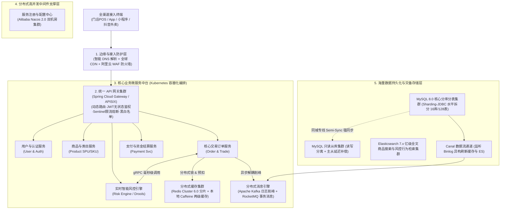

# 01-万能项目母本：某大型新零售交易中台与智能风控平台

> **战略权重**：★★★★★★（**全套论文工程的唯一物理真实母本 · 考前必须彻底背熟**）  
> **设计心智**：融合**“大型高并发电商零售平台（方向 1）”**与**“企业级业务中台与金融级智能风控系统（方向 2）”**，参数详实、痛点清晰、架构自洽，能够无缝套入微服务、ATAM评估、高可用容灾、云原生、大数据等任何架构师论文命题！

---

## 一、 项目核心元数据全景卡（考场随时提取）

* **项目全称**：《某大型全国性新零售全渠道交易中台与智能风控系统》（简称“新零售云中台”）
* **项目投资总额**：人民币 **1,850 万元**
* **建设与研发周期**：**14 个月**（2024 年 1 月立项，2024 年 10 月全量上线，稳定试运行至今）
* **研发团队规模**：核心架构组 5 人，业务微服务开发 35 人，前端/移动端 15 人，测试与运维 12 人
* **本人担任角色**：**项目技术负责人 / 首席系统架构师（System Architect & Tech Lead）**
* **业务体量与工程指标**：
  - 连接全国 **5,200+ 家线下智慧门店** POS 终端，服务线上 **2,800 万注册会员**（日均活跃用户 DAU 达 220 万）；
  - 支持全渠道订单统一接入（自营 App、微信小程序、美团/饿了么外卖、抖音本地生活）；
  - **并发峰值指标**：应对双十一大促和限时秒杀，系统瞬时峰值达到 **120,000 QPS（每秒请求数）** 与 **15,000 TPS（每秒订单成交量）**；
  - **可用性指标**：达到电信/金融级 **99.99%**（全年非计划停机时间小于 52 分钟），支持**同城双中心双活容灾（RPO = 0，RTO < 30 秒）**。

---

## 二、 核心业务痛点与架构演进动因（论文引言与背景段落底稿）

在启动该项目前，集团沿用了一套运行了 6 年的传统 **单体集中式架构（Monolithic Architecture）**，在全渠道业务快速扩张下面临四大致命瓶颈：

1. **单点性能瓶颈与瞬时雪崩**：核心交易与库存使用同一套大型集中式 Oracle/MySQL 数据库，缺乏有效的读写分离与分库分表。在促销大促期间，瞬时 10 万级并发请求直接压垮数据库连接池，多次发生全网服务“雪崩”不可用。
2. **代码高度耦合与交付周期冗长**：订单、商品、营销、结算和会员逻辑全部杂糅在同一工程中，代码量超 80 万行。修改一个微小的营销折扣规则，需要将整个单体工程重新编译、全量回归测试并停服部署，平均交付周期长达 4 周，严重拖累集团业务扩展。
3. **黑产刷单与高危资金损失风险**：由于缺乏统一实时的风控拦截网，恶意羊毛党和黑产脚本在大促期间利用漏洞批量刷单盗取优惠券，单次大促造成集团直接营销资金损失达数百万元；且跨门店退款操作中因网络延迟存在重复退款与假冒凭据风险。
4. **缺乏弹性扩展与高可用容灾**：单机房部署模式存在巨大的单点故障隐患（SPOF），一旦遭遇市政施工挖断光缆或机房供电故障，将导致全渠道线下门店无法结账收银，造成极其恶劣的社会影响与品牌声誉损失。

---

## 三、 系统总体技术架构拓扑

作为系统架构师，我主导了系统由单体向**高内聚低耦合的云原生微服务中台与分布式风控系统**的全面演进：

---

## 四、 架构师三大核心攻坚战术与落地细节

### 1. 基于 DDD 的高内聚微服务拆分与边界界定
- 摒弃盲目分拆，采用 **DDD 战略设计划定 5 大核心限界上下文（Bounded Context）**：
  - 用户中心、商品中心、交易中心、支付中心、风控中心；
- 实施 **Database per Service 物理隔离**，各微服务拥有独立数据库，彻底根除跨服务 SQL `JOIN`；
- 建立服务间调用标准：**内部核心同步交互采用 gRPC / Dubbo 3.0**，跨域业务状态流转统一通过 **RocketMQ 领域事件异步驱动**。

### 2. 面对 12 万 QPS 的分层多级过滤与高并发削峰
- **静态资源与读请求前置拦截**：静态资源全部推至 CDN 节点，常规商品读请求由“本地 Caffeine 缓存（L1）+ Redis 分片集群（L2）”两级缓存承接，拦截了 98% 的数据库读流量；
- **库存预扣与秒杀排队网**：利用 Redis Lua 脚本原子性执行库存预扣减与防超卖校验；校验通过后将订单创建任务写入 Kafka 消息队列进行平滑“削峰填谷”，后台消费线程池匀速批量写入 MySQL 分库分表，将数据库写入峰值平稳压制在 8,000 TPS 安全水位以内。
- **双写一致性保障**：采用“业务更新 MySQL + Canal 监听 Binlog 变更 + 异步投递 MQ 延时删除 Redis”闭环，实现了缓存与数据库毫秒级最终一致性。

### 3. 金融级分布式事务与实时智能风控双防线
- **资金交易分布式事务选型**：针对账户余额划扣等强一致场景，采用 **TCC 补偿型事务模型（Try-Confirm-Cancel）**，手写防悬挂与幂等控制；针对订单创建与优惠券、积分核销等长链路业务，采用 **RocketMQ 本地事务消息机制** 实现异步最终一致性，兼顾了高并发与数据可靠性；
- **智能动态风控引擎**：引入基于 **Drools 规则引擎与 Flink 实时流式计算** 的双重风控网络。系统在 30 毫秒内对用户的下单设备指纹、地理位置跃迁、IP 频次及历史行为序列进行实时评分，对高危黑产请求实时拦截或弹窗进行人脸核身，大促期间拦截黑产刷单超过 350 万次。

---

## 五、 项目实施成效与数据验收（论文收尾段落底稿）

经过 14 个月的系统化工程研发与严格的全链路压测，该新零售交易中台与智能风控平台于 2024 年 10 月成功上线投产，历经当年的双十一与年货节大促实战检验：

1. **核心业务性能跨越式提升**：全渠道订单创建平均时延由原单体系统的 1,450 毫秒大幅压缩至 **180 毫秒**；系统成功支撑了 **12 万 QPS 瞬时峰值洪峰**，且无任何宕机中断发生。
2. **资金与风险隐患全面清零**：智能风控引擎上线后，大促期间营销作弊率下降 **99.2%**，拦截恶意刷单为集团挽回直接营销资金超 1,200 万元；订单资金流水核对准确率达到 **100%**。
3. **高可用容灾与团队效能飞跃**：系统成功落地同城双中心双活架构，容灾演练中模拟单机房断电，系统在 **18 秒内自动完成健康节点流量剔除与主从切换（RPO = 0，RTO < 20s）**；微服务解耦后，集团新业务交付周期由过去的 4 周大幅缩短至 **5 个工作日**。
4. **不足与未来反思**：由于微服务拆分后跨服务调用链路较长，在偶发网络抖动时微服务排查定位耗时较长；未来计划进一步引入 OpenTelemetry 分布式全链路追踪与 eBPF 无侵入监控，推动系统向智能化 AIOps 自愈架构演进。
