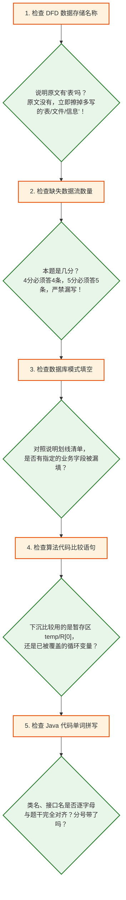

# 下午案例分析考场审题避坑与答题规范红线手册

> 🎯 **手册定位**：本手册基于历年软考真题官方红宝书（《试题分析与解答》）命题与机考阅卷标准，深度结合考生在 2019~2022 年全套下午案例真题实战模考中的**真实失分账本与高频翻车点**提炼而成。
> 考前必读！全卷 5 道大题，字字直击得分要害，彻底杜绝“会做却白丢分”的考场惨剧。

---

## 🧭 全景速览：下午案例“五大死穴”避坑决斗表

| 题号与专题 | 核心失分死穴 | 历史真实惨烈教训 | 考场一秒防坑绝对铁律 |
| :---: | :--- | :--- | :--- |
| **试题一<br>数据流图 DFD** | 1. 数据存储擅自加“表/文件/信息”后缀<br>2. 审题惯性漏看分值（漏补数据流）<br>3. 统计展示遗漏从存储的回读流<br>4. 加工伪代码控制流穿透覆写状态 | • 2020.11: 私加“模型信息表/检测信息表”<br>• 2022.11: 多带“信息”后缀；漏 P3 回读 D4 误差流<br>• 2020.11: 5分漏补第5条流；伪代码 break 后覆盖合格 | **【原文字面抄，说明无表不加表】**<br>• 题干写啥就写啥，零添加零删减！<br>• 几分就补几条流；有统计展示必有存储回读！<br>• 伪代码必须设布尔标志位，杜绝穿透！ |
| **试题二<br>数据库设计** | 1. 关系模式属性补空漏看说明明文<br>2. 外键字段名未严格对齐本表属性定义<br>3. 弱实体漏引主表主键作为外键<br>4. 审题不全漏答连带设问 | • 2022.11: 专卖店模式漏写“店长”属性<br>• 2022.11: 外键将“店长”泛写为“职员”<br>• 2022.05: 三元联系漏写“接种日期”<br>• 2019.05: 漏答“完整性约束”整问 | **【模式补空消消乐，外键字段扣本表】**<br>• 说明清单与已知属性逐一划线划掉！<br>• 外键字段名必须 100% 采自本表定义的属性！<br>• 弱实体必带 1 端主键；一问多答必逐个消灭！ |
| **试题三<br>UML 建模** | 1. 用例图查重盲区（写已画出的用例）<br>2. 类图盲猜类名导致连环雪崩错位<br>3. 关联类自作主张加外键 ID | • 2021.05: 用例重复填写已存在节点<br>• 2021.05: 泛化骨牌雪崩错位丢 4 分<br>• 2020.11: 关联类 AgentList 误加外键字段 | **【已知实体作锚点，用例查重看图中】**<br>• 答题前先划掉图中已画出的用例！<br>• 顺着已知类（如实体/对话框）找关系，严禁盲猜！<br>• 类图是对象引用，绝不设数据库外键 ID！ |
| **试题四<br>C 算法设计** | 1. 暂存区比较陷阱（误比已被覆盖的变量）<br>2. 循环上界漏等号（闭区间越界）<br>3. 手算追踪设问只答一半（漏第二问） | • 2022.11: 堆调整误写 `R[i] < R[j]`（应比暂存区 `R[0]`）<br>• 2022.05: 矩阵链乘漏等号 `r <= N`<br>• 2019.05: 手算摆法漏答第 2 种情况 | **【下沉比较看暂存，循环上界扣闭合】**<br>• 原变量已在循环中被覆盖，比较恒看暂存区！<br>• 动态规划长度循环必取等；手算设问连带查！ |
| **试题六<br>Java 设计模式** | 1. 核心类名/模式单词手滑拼错<br>2. 接口方法声明漏写返回值或类型<br>3. 中介者/观察者委托调用漏传 `this` | • 2021.11: 享元 Flyweight 字母拼错血亏 2.5 分<br>• 2022.05: 备忘录声明漏写返回值类型<br>• 2020.11: 同事类委托中介者漏传 `this` | **【单词抄原码，接口必全套，委托传 this】**<br>• 类名方法名逐字母核对题干，拒绝盲敲！<br>• 接口方法必须声明类型与形参全套！<br>• 同事类解耦向中介者汇报必传 `this`！ |

---

## 📌 专题一：试题一（DFD 数据流图）深度避坑指南

### 1. 数据存储（D1~Dn）命名四大绝对铁律

> [!IMPORTANT] **官方红线指令**：
> 试题一问题 2 题干 100% 明确要求：**“使用说明中的词语，给出图中的数据存储 D1~Dn 的名称”**。

* **铁律 1：说明原文字面抄，说明无表不加表！**
  * 题干说明写“基础信息”，答案就写 `基础信息`，**坚决不写** `基础信息表`、`基础信息文件`；
  * 题干说明写“检定记录”，答案就写 `检定记录`，**坚决不写** `检定记录文件`；
  * 题干说明写“心跳数据”，答案就写 `心跳数据`，**坚决不加** `心跳数据信息`！
  * **评分机制**：说明原词是官方标准答案的**唯一第一顺位**！括号中的“（或XX文件）”只是阅卷组的后置容错库，私加后缀不仅零加分，严格阅卷系统或年轻阅卷老师甚至可能按“违背使用说明词语”判定扣分！
* **铁律 2：题干原文自带“表/文件”时，必须老老实实带上！**
  * 若说明明确写道：“系统将用户信息记录在**用户表**中”，则必须写 `用户表`。一切以说明原文为唯一法典。
* **铁律 3：核心定语绝不可省略！**
  * 题干写“订餐订单”，绝不能偷懒简写为 `订单`；题干写“充电误差数据”，绝不能缩写为 `误差`。
* **铁律 4：DFD 是逻辑模型，切勿带入数据库物理思维！**
  * 数据存储在 DFD 阶段代表“静态数据集合（时间上的停顿）”，可能是内存、文件或队列，过早物理化加“表”在系统分析理论上也是不严谨的。

---

### 2. 补全缺失数据流三大雷达与分值警觉

* **警觉 1：先看分值定流数（杜绝惯性漏写）！**
  * 历年真题大多是 4 分补 4 条流，但遇上 **5 分题必须警觉要补 5 条流**（如 2020年11月智能检测）！必须在答题纸上标清 1~5，少写一条直接白丢 1 分。
* **警觉 2：三大雷达地毯式排查法**：
  1. **雷达一（父子平衡消消乐）**：将顶层图外部实体连线与 0 层图逐一对比。顶层有的 0 层没有，秒杀外部实体流！
  2. **雷达二（加工奇迹零输入排查）**：巡检每一个加工。**只有输出没有输入的加工叫“奇迹（Miracle）”**，无米之炊，必有从存储或其它加工流入的数据！
  3. **雷达三（统计展示必有存储回读流）**：**【高频翻车点】** 凡是说明中提到“根据条件**展示/查询/统计**历史结果”，该加工之前虽然把数据存入了存储，但在展示环节**必须从该存储读回数据**（如 2022.11 试题一 P3 必须从 D4 读回充电误差信息）！
* **警觉 3：加工伪代码控制流严防穿透（Fall-through Bug）**：
  * 在书写结构化语言/伪代码时，若内层循环检测到不合格并 `break`，跳出后**切忌直接顺序执行“设置产品为合格”**！
  * **自愈模板**：使用布尔标志位，或显式 `IF-ELSE`：
    ```text
    isPass = true;
    WHILE (获取图像) DO
        IF (图像不合格) THEN
            isPass = false;
            记录不合格类型与型号;
            BREAK;
        ENDIF
    ENDDO
    IF (isPass) THEN 设置产品为合格; ENDIF
    ```

---

## 📌 专题二：试题二（数据库设计）深度避坑指南

### 1. 模式属性补空——“说明划线减法法”
* **翻车病根**：只凭肉眼看关系模式，凭生活常识脑补属性，漏看题干说明白纸黑字的专门规定。
* **保命动作**：
  1. 打开题干说明对应段落，将说明中提到的本实体属性清单逐一用笔划线；
  2. 与试卷已给出的模式属性逐个对照（消消乐）；
  3. **空几个，就刚好剩几个词**！直接把剩下的词搬入括号，杜绝漏填（如 2022.11 专卖店模式中说明(2)明确注明的“店长”）。

---

### 2. 外键字段名——“100% 对齐本表属性定义”
* **翻车病根**：受现实口语影响写泛称（如将专卖店负责人的外键写成“职员”或“职员号”，将主管外键写成“主管号”）。
* **保命铁律**：
  * 外键也是本表的一个属性！其名称**必须严格来自本表（或所参照表主键）正式定义的属性名**；
  * 如果专卖店关系模式定义的属性是 `（专卖店号，分公司编号，店长）`，那么外键字段名必须写 `店长`，绝不能擅自写成 `职员` 或 `职员号`！

---

### 3. 联系类型与弱实体主外键处理
* **1 : 1 联系**：外键放在任意一端均可，但优先放在“实体产生较晚”或“查询更频繁”的一端；
* **1 : n 联系**：**外键必须并入 n 端（多端）**！绝不可在 1 端加多端外键；
* **m : n 联系**：**必须独立建表**！新表的主键为两端实体主键构成的组合主键（联合主键）；
* **弱实体（依赖实体）**：如“职员的紧急联系人”、“员工家属”，必须将主实体的主键（如职员号）带入弱实体关系中作为外键，共同构成主键或作为外键约束。

---

## 📌 专题三：试题三（UML 建模分析）深度避坑指南

### 1. 用例图——动宾规范与图中查重
* **用例命名必须是【动宾短语】**：如 `显示温度`、`录入病历`、`核验身份`。切忌写成名词（如“温度”）或角色类名；
* **考场查重第一步**：审题时，先在草稿纸上扫一遍图 3-1 中**已经画出的用例椭圆**。题干待填空 U1~Un 绝不可能与已画出的用例重复！切忌闭眼把已有的用例再填一遍。
* **包含 vs 扩展方向**：
  * `<<include>>`：基础用例 $\to$ 公共子用例（提取公共逻辑，无它不行，必定执行）；
  * `<<extend>>`：扩展子用例 $\to$ 基础用例（额外附加功能，有条件触发，箭头指向被扩展的基础用例）。

---

### 2. 类图——已知实体锚点法定乾坤
* **严禁盲猜类名**：类图一处填错往往引发多米诺骨牌式连环扣分。
* **锚点定位法**：
  1. 寻找图中已经明确给出的“已知类”（如系统核心对话框、基础控制类、已标注的业务实体）；
  2. 顺着关联、聚合（菱形）或继承（三角箭头）等连线，在题干说明中锁定与其直接交互的类；
  3. **类图是面向对象模型**：类与类之间通过对象引用指针协作，**千万不要在关联类中画蛇添足加上数据库“外键ID”**！

---

## 📌 专题四：试题四（C 语言算法设计）深度避坑指南

### 1. 循环内原变量覆盖陷阱——比较恒看暂存区！
* **致命翻车场景（如堆调整 Heapify）**：
  * 算法开始时，根节点元素已被存入暂存区：`temp = R[i]` 或 `R[0] = R[i]`；
  * 在沿孩子节点下沉的循环内部，父节点的值已经被较大的孩子覆盖：`R[i] = R[j]`；
  * **比较判断语句**：下一轮下沉比较时，待比较的对象依然是那个最初要下沉的根节点！因此**必须与暂存区比较**（`R[0] < R[j]` 或 `temp < R[j]`），若误写成 `R[i] < R[j]`，此时的 `R[i]` 早已被上一轮改写，逻辑彻底崩溃！

---

### 2. 动态规划与循环边界严核
* **区间 DP 循环上界**：阶段长度或右端点循环，务必注意闭区间上界是否需要取等（如 `r <= N` 绝不能漏掉 `=`）；
* **数组下标从 0 还是从 1 开始**：审读算法开头定义的输入规模。若从 1 到 n，循环必为 `1` 到 `<= n`；若从 0 到 n-1，终止条件为 `< n`；
* **手算设问连带答**：题干若出现“给出最终建堆结果，并给出第一趟排序后的序列”，必须分行清晰作答，切莫只答前半问！

---

## 📌 专题五：试题六（Java 面向对象程序设计）深度避坑指南

### 1. 单词拼写逐字母比对（零手滑）
* 软考代码填空是按字面严格评分。
* **类名、接口名、模式专有名词**（如 `Flyweight`、`Mediator`、`Memento`、`Observer`、`Strategy`）必须 100% 在题干代码上下文或试卷说明中找到对应单词，**逐字母核对一遍**，严禁凭模糊记忆手默！

---

### 2. 语法细节与模式调用模板
* **接口与抽象方法全套语法**：
  * 接口中方法声明必须有返回值类型、方法名、参数列表并以分号结尾：`public void update(Subject s);`
* **UML 符号映射访问权限**：
  * `+` $\implies$ `public`
  * `#` $\implies$ `protected`
  * `-` $\implies$ `private`
* **中介者模式与观察者模式的 `this` 传参机制**：
  * 同事类调用中介者进行分发时，中介者需要知道是“哪个同事”发起的请求，必须将自身作为参数回传：`this.mediator.buy(money, this);`
  * 观察者通知中介时同理，牢记 `this` 关键字代表当前对象实例。

---

## 🏁 考场五步终局自检法（交卷前 10 分钟）



> **🔥 终极信仰**：  
> **试卷上的每一分，命题人都已经在题干说明里明码标价！**  
> **不自作主张、不节外生枝、一字不差照抄说明，45 分及格线弹指可破，70+ 分信手拈来！**
