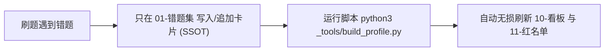

# 00-个人薄弱考点画像与自我迭代指南（复习决策中枢）

> **第一性原理与核心定位**：
> 本文档是你在冲刺阶段的**战略决策导航看板**，不是错题卡片的第二份拷贝。
> 错题的细节、原题题干、推导与解析 **100% 以 [01-上午综合知识错题集.md](01-上午综合知识错题集.md) 为单一可信源（SSOT）**；
> 本导航中枢只提供**“今天学什么、考前看什么、为什么错、下一步干什么”**的高维决策。

---

## 1. 核心导航跳板（各司其职）

| 导航模块 | 核心作用与使用场景 | 文件直达链接 |
| :-- | :-- | :-- |
| 📊 **全科错题看板** | 宏观掌握 9 大模块健康度、客观复错率排序、进宫最深考点 | [👉 10-错题看板.md](10-错题看板.md) |
| 🚨 **考前 24 小时红名单** | 仅收录二进宫及以上（复错 ≥2 次）的高危必背清单（共 53 题） | [👉 11-红名单.md](11-红名单.md) |
| ⭐ **星标待确认清单** | AI 早期自主标星但实际只错 1 次的待审题（由你最终拍板保留或降级） | [👉 12-星标待确认清单.md](12-星标待确认清单.md) |
| 🧠 **7 大失分心智模式** | 提炼第一性原理行为陷阱（对立倒装、车间错位、局部贪心等） | [👉 20-失分模式与命题陷阱.md](20-失分模式与命题陷阱.md) |
| 📦 **全量错题卡母库 (SSOT)** | 392 张原子错题卡与考场 15 秒秒杀解析 | [👉 01-上午综合知识错题集.md](01-上午综合知识错题集.md) |
| 🗄️ **旧版画像历史归档** | 2026-10-23 瘦身前 250KB 历史详版归档（保留全部历史轨迹） | [👉 _archive/ 历史归档](_archive/00-个人薄弱考点画像与自我迭代指南_2026-10-23归档.md) |

---

## 2. 当前阶段靶向攻坚优先梯队（根据复错率客观排序）

根据最新运行的看板数据，全科复错率前三的高危重灾区为：

1. 🔴 **第 1 优先级：模块 05 数据库系统（复错率 23% / 35 题 8 次进宫）**
   - **攻坚重心**：关系规范化理论（传递与冗余函数依赖双重判定 #114）、E-R 模式向关系模式转换三大铁律（#105）、候选码闭包求解孤儿属性必选（#99）。
   - **必扫考点**：[10-错题看板.md](10-错题看板.md#模块看板按复错率降序优先攻坚靠前模块)
2. 🔴 **第 2 优先级：模块 08 面向对象与 UML（复错率 20% / 40 题 8 次进宫）**
   - **攻坚重心**：类间关系语义辨析（临时使用=依赖 vs 长期持有=关联 #124）、经典设计模式意图映射（智能家居动作封装=命令模式 Command #132）、领域类模型边界与继承本质（#39、#40）。
3. 🔴 **第 3 优先级：模块 03 操作系统知识（复错率 19% / 42 题 8 次进宫）**
   - **攻坚重心**：银行家算法试探分配安全性探测（#91）、磁盘调度算法饥饿特性（SSTF 贪心饥饿 vs SCAN/CSCAN #126）、多级页表二进制位域切割（#85）。

---

## 3. 极简维护流水线（告别手工粘贴与体积失控）

* **录题铁律**：日常整理错题时，**只需且必须只修改 `01-上午综合知识错题集.md`**，绝对禁止再向画像文档手工粘贴长篇大论；
* **刷新命令**：在仓库根目录执行 `python3 05-error-vault/_tools/build_profile.py`，0.1 秒自动生成最新看板与红名单；
* **星标原则**：最终决策权在你手中。用户确认保留的题目永久写入 `_tools/star-registry.json`，脚本永远不自动降级。
