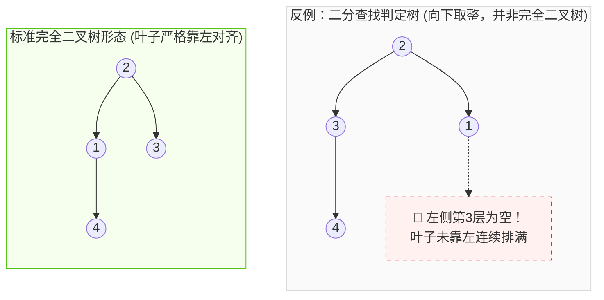

# 20. 二叉树核心形态与二分查找判定树：底层透析

## 一、一语道破 (The Essence)

在软考数据结构与算法体系中，各种带有特定前缀修饰的“二叉树”，本质上是**为了解决特定的工程矛盾而在树的几何形态或代数属性上施加的“特权约束”**。

在历年真题中，考生最常栽跟头、最容易产生认知断层的问题是：  
> **“二分查找每次都对半分，为什么它的判定树一定是【平衡二叉树】，而不一定是【完全二叉树】？”**

本专题从第一性原理出发，彻底拆解二分查找判定树的数学机制，并对考纲中全部高频树结构进行地毯式横向透析。

---

## 二、核心痛点破解：二分查找判定树的数学本质

### 1. 为什么它一定是【平衡二叉树（AVL）】？
* **二分查找切分机制**：每次均取中点元素 $\text{mid} = \lfloor (low + high) / 2 \rfloor$（或向上取整）。
* **左右节点数守恒**：对于任意一个待查区间 $[low, high]$，被中间元素划分为左半子序列与右半子序列后，左右两边的元素个数**要么完全相等，要么只相差 1 个元素**。
* **高度差绝对值 $\le 1$**：根据二叉树高度与节点数的关系，节点数相差不超过 1 的两棵子树，其高度 $h_L$ 与 $h_R$ 必然满足：
  $$\left| h_L - h_R \right| \le 1$$
* **学术定义闭环**：平衡二叉树（AVL 树）的严格定义就是**“任意节点的左右子树高度之差绝对值不超过 1（平衡因子 $\text{BF} \in \{-1, 0, 1\}$）”**。因此，无论怎么切分、无论向上还是向下取整，**折半查找判定树百分之百是平衡二叉树**！

---

### 2. 为什么它不一定是【完全二叉树】？（考场最深陷阱）

#### ① 完全二叉树的苛刻几何定义
1. 叶子节点只能出现在**最下两层**；
2. **最下一层的叶子节点必须严格从左往右连续靠拢排布，中间绝不能有任何空缺（断档）**。

#### ② 反例论证（4 元素向下取整切分）
设有序序列包含 4 个元素：$[1, 2, 3, 4]$。若算法采用向下取整 $\text{mid} = \lfloor (low + high) / 2 \rfloor$：
* 第 1 步：取 $\text{mid} = \lfloor (1 + 4) / 2 \rfloor = 2$，根节点为 **2**；
* 第 2 步：左子树为 $[1]$，直接作为根节点 2 的左孩子（位于第 2 层）；
* 第 3 步：右子树为 $[3, 4]$，取 $\text{mid} = \lfloor (3 + 4) / 2 \rfloor = 3$，节点 3 作为根节点 2 的右孩子（位于第 2 层）；元素 4 挂在节点 3 的右孩子（位于第 3 层）。

#### ③ 形态直观对比图

* **案发现场剖析**：
  * 在这棵二分判定树中，第 3 层的唯一样本（节点 4）挂在了右子树底下！
  * 左子树的第 3 层完全是空的（断档）！
  * 最下层的节点**未能做到从左至右紧密排满**，违反了完全二叉树的铁律；
  * 但检查左右子树高度：左子树高度为 1，右子树高度为 2，高度差 $|1 - 2| = 1 \le 1$！**依然是一棵标准的平衡二叉树**！

---

## 三、软考六大高频“树”全景概念辨析矩阵

| 树结构名称 | 核心几何 / 代数特征 | 典型查找复杂度 | 考场秒杀题眼 / 特征词 | 软考常见出题陷阱 |
| :--- | :--- | :---: | :--- | :--- |
| **平衡二叉树 (AVL)** | 任一节点**左、右子树高度差绝对值 $\le 1$**；平衡因子只能是 **$-1, 0, 1$** | **$O(\log n)$**（严格稳定） | **二分查找判定树**、高度平衡、四种旋转（LL/RR/LR/RL） | 误以为二分查找判定树是完全二叉树 |
| **完全二叉树** | 仅最下层可不满，且最下层叶子**从左往右紧密连续靠拢**，中间无空缺 | $O(\log n)$ | **堆排序底层数组映射**、下标 $2i$ 与 $2i+1$ 校验、连续数组存储 | 只要最下层缺了左边的坑位，立刻被开除 |
| **满二叉树** | 深度为 $k$ 且节点数达到**理论最大值 $2^k - 1$**；每一层都全满 | $O(\log n)$ | 每层全满、除叶子外度全为 2、最完美对称 | 把完全二叉树误认作满二叉树 |
| **二叉排序树 (BST)** | **左子树所有值 < 根节点值 < 右子树所有值** | 最优 $O(\log n)$ 最差 **$O(n)$**（退化成链表） | **中序遍历序列严格升序（递增）**、动态插入与检索 | 插入有序序列时退化为单支树，失去对数效率 |
| **最优二叉树 (哈夫曼树)** | **带权路径长度（WPL）达到最小**；权值越大的叶子距离根越近 | 不用于查找，用于压缩编码 | **无度为 1 的节点（$n_1=0$）**、哈夫曼编码、贪心构造 | 形状通常严重倾斜，**绝不是平衡二叉树** |
| **最小生成树 (MST)** | ⚠️ **它根本不是二叉树！它是图的连通子图！** 包含所有 $n$ 个顶点，边数恒为 $n-1$，边权和最小 | — | **Prim 算法（选点/稠密图）**、**Kruskal 算法（选边/稀疏图）** | 题干考二叉树时作为偷换概念的送分干扰项 |

---

## 四、深层辨析与易混盲区决斗 (The Breakdown)

### 1. 最优二叉树（哈夫曼树） vs 平衡二叉树
* **哈夫曼树（最优二叉树）**：
  * **目的**：用于**数据压缩与变长前缀编码**（高频字符短码，低频字符长码）；
  * **形态**：为了追求带权路径长度最小，高权值节点会迅速向根节点收拢，导致树形态往往**严重倾斜不对称**；且**绝无度为 1 的单支节点（$n_1=0$）**；
  * **结论**：哈夫曼树绝非平衡二叉树。
* **平衡二叉树**：
  * **目的**：用于**动态数据检索与快速排序**，防止深度失控；
  * **形态**：强制要求左右平衡，可以存在度为 1 的节点。

### 2. 二叉排序树 (BST) vs 平衡二叉树 (AVL)
* **BST 是基础（逻辑上有序）**：只要满足“左小右大”就是 BST。但如果将已排序数据 `[1, 2, 3, 4, 5]` 依次插入 BST，它会退化为一条**单链表（深度为 $n$）**，查找效率跌入 $O(n)$。
* **AVL 是加固（物理上平衡）**：AVL 是“高度受限的 BST”。它在每次动态插入或删除时，通过 LL、RR、LR、RL 四种旋转维持高度差 $\le 1$，强行保证树的高度为 $O(\log n)$，确保查找性能永不衰退。

### 3. 为什么“最小生成树”是送分级偷换概念项？
* 许多跨考考生看到带有“树”字就容易犹豫不决。
* **最小生成树（Minimum Spanning Tree）是图论概念**：
  * 其主体是**带权无向连通网**；
  * 一个节点可以有任意多个分支（度不受 2 的限制）；
  * 核心是用最小代价把所有城市（顶点）用光纤（边）连通起来，与二叉树检索体系分属两个完全不同的世界！

---

## 五、考场秒杀口诀与避坑记忆桩

> 🚀 **【二叉树核心形态秒杀口诀】**  
> **二分判定必平衡，左右高度差一准；**  
> **完全二叉靠左齐，中间断空就除名；**  
> **排序中序必递增，哈夫曼是权最短；**  
> **最小生成属于图，别把李逵当李鬼！**

---

## 六、真题考点溯源

* **真题映射**：2022 年上半年系统集成/软件设计师上午试题第 58 题（二分查找判定树的形态符合平衡二叉树特点）。
* **对应母本**：[01-fast-pass/09.数据结构速记指南.md](file:///Users/krystal/Documents/个人资料/软件设计师/软件设计师通关速记指南/01-fast-pass/09.数据结构速记指南.md)
