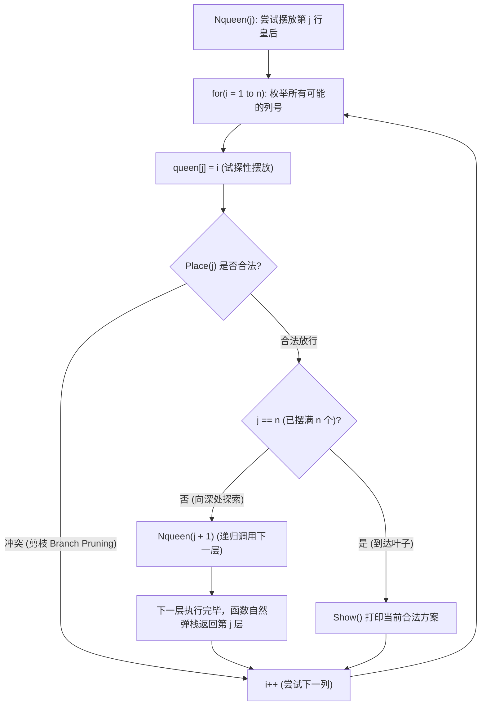

# 21. N 皇后问题回溯算法与递归解空间：底层透析

## 一、一语道破 (The Essence)

在软考算法设计（下午试题四）与数据结构体系中，**N 皇后问题是“回溯法（Backtracking）与隐式树搜索”的皇冠级母本题**。

它的核心矛盾在于：在 $n^n$ 的庞大穷举搜索空间中，如何利用**剪枝函数（Pruning / Bounding Function）**在萌芽阶段砍掉无效路径，利用自底向上的递归调用栈实现自动回退，从而高效遍历解空间树。

历年真题中，考生在面对这道经典大题时往往存在四大深水区困惑：
1. **数据结构的“降维”原理**：为什么 $n \times n$ 的二维棋盘只需要一个一维数组 `queen[n+1]` 即可解决？
2. **冲突判定的“代数统合”**：同一列、主对角线、副对角线冲突，为什么能被两句极简表达式 `queen[i] == queen[j]` 与 `abs(queen[i] - queen[j]) == (j - i)` 无死角囊括？
3. **回溯机制的“隐式动力学”**：代码中明明没有显式的撤销清理操作，回溯到底在哪里发生？
4. **四皇后解的“镜像对称”**：考场上如何在 15 秒内手算推导 4 皇后的全量解 `2413` 与 `3142`？

---

## 二、数据结构的“降维打击”：一维数组的映射美感

### 1. 传统二维数组 vs 一维数组对比

如果直接在二维棋盘 `board[n][n]` 上操作，空间复杂度为 $O(n^2)$，且每摆放一个皇后都需要纵横斜向四方扫描，耗时且极难书写。

本算法采用了一维数组 `queen[n+1]` 进行降维映射：

| 数组维度 | 空间几何意义 | 天然带来的算法优势 |
| :--- | :--- | :--- |
| **数组下标 $j$** | **棋盘行号**（第 $j$ 行皇后，取值 $1 \sim n$） | 每一个下标只能存储一个数值，**天然保证了每一行有且仅有一个皇后**（彻底消灭了同行冲突）！ |
| **数组数值 `queen[j]`** | **棋盘列号**（落在第几列，取值 $1 \sim n$） | 算法只需校验两个皇后是否**同列**或**同斜线**。空间复杂度从 $O(n^2)$ 骤降至 $O(n)$。 |

---

## 三、冲突检验的几何与代数第一性原理（Place 函数）

### 1. 同列冲突：代数恒等
若第 $i$ 行的皇后与第 $j$ 行的皇后位于同一列，则两者的列坐标必然相等：
$$\text{queen}[i] = \text{queen}[j]$$

### 2. 斜线冲突：笛卡尔坐标系的斜率统合
在平面直角坐标系中，任意两点 $(x_1, y_1)$ 与 $(x_2, y_2)$ 处于同一条 45° 或 135° 斜线上的充要条件是**连线斜率绝对值为 1**：
$$\left| \frac{y_2 - y_1}{x_2 - x_1} \right| = 1 \iff \left| y_2 - y_1 \right| = \left| x_2 - x_1 \right|$$

映射到 N 皇后棋盘中：
- 横坐标为行号 $i$ 和 $j$（因为遍历是 $i < j$，所以行差为正数 $j - i$）；
- 纵坐标为列号 $\text{queen}[i]$ 和 $\text{queen}[j]$（列差绝对值为 $|\text{queen}[i] - \text{queen}[j]|$）；
- 因此，斜线冲突的充要条件被统一简化为：
$$\left| \text{queen}[i] - \text{queen}[j] \right| = j - i$$

> 💡 **几何统一之美**：无论主对角线（向右上倾斜，列差与行差同号）还是副对角线（向左上倾斜，列差与行差异号），取绝对值后均完美契合该公式，一网打尽！

```text
    列 1   列 2   列 3   列 4
行 1 [   ] [ Q1 ] [   ] [   ]  <-- queen[1] = 2
行 2 [   ] [   ] [   ] [ Q2 ]  <-- queen[2] = 4
     行差 = 2 - 1 = 1
     列差 = |4 - 2| = 2 != 1  ==> 无斜线冲突！
```

---

## 四、回溯的微观动力学：隐式栈与自然弹栈

### 1. 递归回溯的生命周期流转图



### 2. 为什么代码里没有“撤销/弹出”语句？回溯发生在哪里？
很多考生疑惑：为什么代码里没有 `queen[j] = 0` 这种“清理现场”的撤销语句？
- **秘密在于 C 语言函数调用栈（Call Stack）的 LIFO 特性与 `for` 循环的覆盖赋值**：
  1. 当第 $j+1$ 层的所有列试探完毕（无论找到解还是无解走投无路），`Nqueen(j+1)` 函数执行结束，调用栈自动弹出（Stack Unwinding），程序控制权自然交还给上一层第 $j$ 行的 `for` 循环；
  2. 此时，第 $j$ 行的循环变量进入下一次迭代 `i++`；
  3. 新的一轮 `queen[j] = i + 1` 会**直接在物理内存中覆盖掉旧值**，无须任何显式清理！

---

## 五、完整 C 代码工程与命题挖空全息透视

```c
#include <stdio.h>
#include <stdlib.h>  /* 提供 abs() 绝对值函数 */

#define n 4          /* 棋盘规模：4x4 棋盘 */

int queen[n + 1];    /* queen[j] 记录第 j 行皇后的列号 */

/* 打印输出一种可行摆放方案 */
void Show() {
    int i;
    printf("(");
    for (i = 1; i <= n; i++) {
        printf("%d", queen[i]);
    }
    printf(")\n");
}

/* 检验第 j 行皇后的摆放是否与前面已摆放的 1 ~ j-1 个皇后发生冲突 */
int Place(int j) {
    int i;
    for (i = 1; i < j; i++) {
        /* 
         * 【空缺 1 靶向】：queen[i] == queen[j]
         * 前半段判定“同列冲突”，后半段判定“斜线冲突”
         */
        if ( queen[i] == queen[j] || abs(queen[i] - queen[j]) == (j - i) ) {
            return 0;  /* 发生冲突，不可放置，直接剪枝 */
        }
    }
    /* 【空缺 2 靶向】：1。遍历前 j-1 个皇后均无冲突，判定合法放行 */
    return 1;
}

/* 回溯递归核心：摆放第 j 行及后续皇后 */
void Nqueen(int j) {
    int i;
    for (i = 1; i <= n; i++) {
        queen[j] = i;       /* 尝试放在第 i 列 */
        
        /* 【空缺 3 靶向】：Place(j)。形参传行号 j，检验当前行摆放 */
        if ( Place(j) ) {
            if (j == n) {
                Show();     /* 达到终止边界，输出解 */
            } else {
                /* 【空缺 4 靶向】：Nqueen(j + 1)。递归深入下一行，切忌写 j++ */
                Nqueen(j + 1);
            }
        }
    }
}

int main() {
    Nqueen(1);  /* 从第 1 行启动 */
    return 0;
}
```

---

## 六、四皇后（n=4）极速手算推导与镜像对称定理

### 1. 考场手算步进追踪（为什么只有 2 种解？）
面对 $4 \times 4$ 棋盘：
- **尝试第 1 行放在第 1 列（queen[1]=1）**：
  - 第 2 行只能试 3 或 4；
    - 若放 3：第 3 行无处可放（1, 2, 3, 4 全冲突）；
    - 若放 4：第 3 行只能放 2，第 4 行无处可放（全冲突）；
  - $\implies$ **第 1 行放第 1 列无解！**
- **尝试第 1 行放在第 2 列（queen[1]=2）**：
  - 第 2 行只能放第 4 列（queen[2]=4）；
  - 第 3 行只能放第 1 列（queen[3]=1）；
  - 第 4 行只能放第 3 列（queen[4]=3）；
  - $\implies$ **命中第 1 组解：`(2, 4, 1, 3)`（简写 `2413`）！**

### 2. 镜像对称定理（$n+1 - x$ 极速推导法）
棋盘关于垂直中轴线是严格几何对称的。  
对于任意可行解序列 $(c_1, c_2, \dots, c_n)$，其关于中轴线的镜像必然也是可行解，变换公式为：
$$c'_k = (n + 1) - c_k$$

将解 1 的每个列号带入镜像公式：
- 第 1 行：$5 - 2 = 3$
- 第 2 行：$5 - 4 = 1$
- 第 3 行：$5 - 1 = 4$
- 第 4 行：$5 - 3 = 2$
$\implies$ **秒得第 2 组解：`(3, 1, 4, 2)`（简写 `3142`）！**

在考场上手算 N 皇后时，只要算出前半部分的一个解，利用镜像公式在 3 秒内直接翻转写出另一个解，免去重复穷举的巨大认知消耗！

---

## 七、考场 10 秒必背口诀与防坑记忆桩

> **变量拼写抠代码，queen 写 queue 判死刑；**  
> **斜线行差对列差，同列必是 queen 对 queen；**  
> **检验行号传参 j，递归深入 j 加 1；**  
> **四皇后是对称俩：二四一三、三一四二！**
