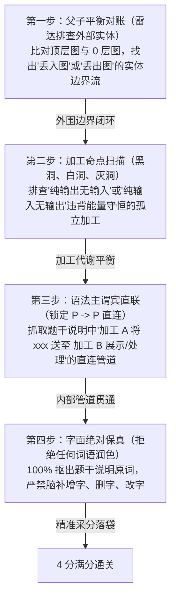

# 🧠 专题 22：DFD 数据流图补流四步雷达流水线与加工直连判定——底层透析

## 一、 一语道破 (The Essence)

下午试题一（数据流图 DFD，15 分）中，**【补充缺失数据流及其起终点】（4~5 分）**是全卷区分度最高、最容易“看似都懂、实则丢一半分”的关卡。

考生在这一问失分的最深层病灶，在于**“现代软件工程 CRUD 架构思维反噬”**：
* **程序员直觉（现代物理架构）**：数据产生后必须先执行 `INSERT/UPDATE` 写入数据库，前端或展示模块再执行 `SELECT` 读取渲染。因此，大量考生直觉地写出 `存储 -> 加工` 的数据回读流。
* **软考 DFD 本质（结构化分析逻辑流）**：诞生于 1970 年代的 DeMarco 结构化分析法描述的是**逻辑业务管道（Logical Pipeline）**，而非物理存储中转。加工计算产生的结果在逻辑上是**主动推送**给下游展示或后续加工的，存储只是其副产品。

```
【致命认知鸿沟】
考生脑补 (CRUD 物理时序)： 加工 A ──(写入)──> [ 数据存储 D ] ──(查询)──> 加工 B
标答逻辑 (DFD 逻辑流管道)： 加工 A ──────────────────────────────> 加工 B (展示/处理)
                               └──(副本落地)──> [ 数据存储 D ]
```

**本专题的第一性原理使命**：彻底拔除 CRUD 脑补病灶，建立“父子平衡 $\to$ 加工奇点 $\to$ 管道推拉 $\to$ 原文保真”的四步机械化排查雷达，确保考场 4 分稳操胜券。

---

## 二、 概念串联与全景雷达流水线 (The Big Picture)

DFD 补流不是靠灵感猜谜，而是基于严格的**“数据能量守恒”**与**“说明句法映射”**。

考场遇到【补充缺失数据流】，按照以下四步顺序**机械化地毯式排查**，绝不漏一条、绝不主观臆造：



### DFD 数据流合规基准矩阵

在动笔之前，必须死守 DFD 图元的合法连线约束：

| 起点 \ 终点 | 加工 (P) | 数据存储 (D) | 外部实体 (E) | 判定规则 |
| :--- | :---: | :---: | :---: | :--- |
| **加工 (P)** | ✅ 合法 (`P -> P`) | ✅ 合法 (`P -> D` 写入) | ✅ 合法 (`P -> E` 输出) | 加工是数据加工与中转的核心中枢 |
| **数据存储 (D)** | ✅ 合法 (`D -> P` 读取) | ❌ **非法** (`D -> D`) | ❌ **非法** (`D -> E`) | 存储是静止的，必须经由加工操作 |
| **外部实体 (E)** | ✅ 合法 (`E -> P` 输入) | ❌ **非法** (`E -> D`) | ❌ **非法** (`E -> E`) | 实体不能直接读写系统内部存储 |

> [!CAUTION]
> **绝对禁区**：只要答案里出现 `E -> D`、`D -> E`、`D -> D`、`E -> E`，阅卷老师直接判 0 分，绝无任何商量余地！

---

## 三、 深层透析与病灶根治 (The Breakdown)

---

### 🔪 命题铁律 1：加工直连流 ($P \to P$) vs 数据库中转 ($P \to D \to P$)

#### 1. 现象与典型翻车现场
* **题干描述**：“*对实时监测信息进行数据处理，将分析结果进行可视化并进行存储；将预测信息进行可视化和存储。*”
* **考生作答**：
  * 起点：`D3 统计分析结果`，终点：`P5 可视化展示`，数据流：`分析结果`
  * 起点：`D4 预测信息`，终点：`P5 可视化展示`，数据流：`预测信息`
* **官方标准答案与阅卷尺度**：
  * **权威标答（双轨兼容）**：
    * 起点：`D3（或 P3）`，终点：`P5`，数据流：`分析结果`
    * 起点：`D4（或 P3）`，终点：`P5`，数据流：`预测信息`
  * **结论**：官方答案**同时认可从存储落盘读取回读（`D3/D4 -> P5`）与加工间直连管道（`P3 -> P5`）**，两者均计满分！扣分高危点在于：原词叫“分析结果”，若擅自多写成“统计分析结果”容易被关键字匹配判偏。

#### 2. 底层逻辑与推拉模型辨析

在结构化数据流图中，数据流具有**即时传递性（Stream）**。
* **推模型（Push，加工直连）**：
  加工 $P_3$ 作为“生产者”，处理完数据后直接推送给下游消费者（加工 $P_5$ 进行展示），同时备份一份入库 $D$。
* **拉模型（Pull，存储读取）**：
  下游加工 $P_5$ 既然负责“展示统计分析结果和预测信息”，从已存储好的数据存储 $D_3$、$D_4$ 中读取数据进行可视化展示，在架构上完全自洽。
* **阅卷启示**：由于题干未严苛限制是实时推送还是读取已存数据，官方在制定标准答案时对起点 `P3` 与 `D3/D4` 实行**双轨容错全给分**！

---

### 🔪 命题铁律 2：题干说明语法映射——外部实体“交互请求流”的隐蔽性

#### 1. 视网膜盲区：为什么父子图是平衡的，却依然缺流？
* **真题拓扑事实**：
  * 顶层图（图 1-1）中，$E_2$（农业专家）向系统有一条输入流——**【规则】**；
  * 0 层图（图 1-2）中，左上角 $E_2$ 指向 $P_1$（信息维护）也正是——**【规则】**；
  * 系统向 $E_2$ 的输出在顶层图是【统计分析数据/预测信息】，0 层图 $P_5 \to E_2$ 也是【统计分析结果/预测信息】。
  * **结论：单看图纸上的进出箭头，父子图在数量上是完全平衡的！顶层图压根没有画“请求”！**

#### 2. 破局真理：雷达二【说明文本语法消消乐】
那么官方标答里的 `E2 -> P5 请求` 到底从何而来？
**它来自于题干【说明 5】的显式文本条件！**
> “5. 可视化。实时向农业人员展示监测信息；实时给农业专家展示统计分析结果和预测信息**或根据农业专家请求进行展示**。”

* **推导**：
  * 句子中出现了条件触发：“**根据农业专家请求进行展示**”；
  * 动作主体是 $E_2$（农业专家），受体是 $P_5$（可视化展示）；
  * 扫描 0 层图上的 $P_5$：输入端只有 $P_2$ 送来的实时监测信息，**完全缺失了农业专家的“请求”输入**！
  * 命题人在画顶层图时偷懒省略了粗粒度的“请求”，但在 0 层图的详细业务中却要求补全这一条交互！
  * 🎯 **锁定采分点**：`起点 E2，终点 P5，数据流：请求`！

---

### 🔪 命题铁律 3：加工奇点扫描——能量守恒与黑洞/白洞/灰洞

加工（Process）是数据流动与转换的引擎，必须严格遵守**数据代谢守恒**：

```
         [ 正常加工 ]                 [ 黑洞加工 (Black Hole) ]
   输入流 ──────> ( P ) ──────> 输出流             输入流 ──────> ( P ) (只有进没有出)
   
    [ 白洞/奇迹加工 (Miracle) ]               [ 灰洞加工 (Gray Hole) ]
          ( P ) ──────> 输出流             输入流: A, B ──────> ( P ) ──────> 输出流: A, B, C
    (无中生有/纯输出无输入)                         (输出的 C 在输入中毫无来源)
```

1. **白洞/奇迹加工（Miracle Processing）**：
   * **特征**：某个圆圈**只有流出箭头，没有任何流入箭头**。
   * **推导**：加工不可能凭空创造数据。若图中某个加工无输入，说明它必定遗漏了**“启动它的控制流”**、**“计算所依据的规则表”**或**“原始待处理数据”**。
   * **真题对照**：2021年11月 $P_4$（监控）只有流出的报警通知，输入全空！题干说明(4)指出“根据监控处理规则判断异常”，规则存在 $D_1$ 中，故必补：`D1 -> P4`。
2. **黑洞加工（Black Hole Processing）**：
   * **特征**：某个圆圈**只有流入箭头，没有任何流出箭头**。
   * **推导**：数据只进不出，变成死数据，违背系统价值。必须排查该加工处理后的结果输出给了哪个下游。
3. **灰洞加工（Gray Hole Processing）**：
   * **特征**：输入的数据不足以支撑输出的数据（入不敷出）。
   * **真题对照**：$P_5$（可视化展示）输出给专家漂亮的图表，但自己输入端没有任何数据输入，巧妇难为无米之炊，必从 $P_3$ 拉取数据。

---

### 🔪 命题铁律 4：原文字面保真铁律——严禁程序员的“词语修饰癖”

许多考生具备扎实的工程素养，答题时喜欢用“规范的术语”去润色题目中的词汇，这是致命扣分点！

| 考生自创润色词 | 题干说明原词 | 判分判定 | 扣分原由剖析 |
| :--- | :--- | :---: | :--- |
| `统计分析结果` | **分析结果** | ⚠️ 扣分边缘 | 擅自加了“统计”前缀，阅卷采分点按关键字匹配易被判偏 |
| `监控处理规则` | **监测规则** | ⚠️ 视卷而定 | 说明中若统一定义为“监测规则”，不可私自替换成说明(4)的分词 |
| `智能预测信息` | **预测信息** | ❌ 判偏 | 擅自加上“智能”等修饰性修饰词 |
| `查询分析图表请求`| **请求** | ❌ 判偏 | 顶层图明明标注为“请求”，不可私自拉长为长句 |

> [!TIP]
> **原文字面提取操作规程**：
> 1. 打开题干说明，找到描述该数据流的那句话；
> 2. 圈出句子中的**主干宾语名词**；
> 3. **一字不增、一字不减、一字不改**，直接抄入答题卡！

---

## 四、 考场实战沙盘推演 (Case Walkthrough)

以 **2021年11月软件设计师试题一【智慧农业平台】问题3** 为标本，演示 30 秒机械化秒杀全过程：

### 1. 现场审题线索矩阵

* **图 1-1（顶层图）**：
  * $E_1$（传感器）：输出 `采集数据` 到系统。
  * $E_2$（农业专家）：输入 `请求` 到系统；系统输出 `监测与预测信息展示` 到 $E_2$。
* **图 1-2（0 层图已有状态）**：
  * 加工：$P_1$（数据采集）、$P_2$（数据存储）、$P_3$（数据处理）、$P_4$（监控）、$P_5$（可视化展示）。
  * 存储：$D_1$（监控规则表）、$D_2$（监测信息表）、$D_3$（统计分析表）、$D_4$（预测信息表）。
* **设问**：*补充图 1-2 中缺失的数据流及其起点和终点（4 分）。*

### 2. 四步雷达流水线实战操作

* **雷达 1：父子平衡对账（用时 10 秒）**
  * 检阅 $E_1$：$E_1 \to P_1$ 已存在，平衡。
  * 检阅 $E_2$：顶层图有 $E_2 \to \text{系统}$ 的【请求】流。
  * 扫描 0 层图：$E_2$ 没有任何指向系统的箭头！
  * 对照说明(5)：“*根据农业专家的**请求**进行展示*”。
  * 🎯 **命中缺失流 1**：`起点：E2，终点：P5，数据流：请求`（1 分落袋）。
* **雷达 2：加工奇点扫描（用时 8 秒）**
  * 观察 $P_4$（监控）：只有向外射出的报警箭头，**输入完全为 0（白洞/奇迹加工）**！
  * 对照说明(4)：“*根据**监控处理规则**进行监控……*”，规则存放在 $D_1$。
  * 🎯 **命中缺失流 2**：`起点：D1，终点：P4，数据流：监测规则（或监控处理规则）`（1 分落袋）。
* **雷达 3：语法主谓宾直联（用时 12 秒）**
  * 观察 $P_5$（可视化展示）：只有输出给 $E_2$ 的展示流，自己没有任何展示的内容（灰洞加工）。
  * 精读说明(3)找谁生产了展示内容：
    * 句子 A：“*对实时监测信息进行数据处理……将**分析结果**进行可视化并进行存储*”
      $\to$ 主语 $P_3$，动作“进行可视化”（送 $P_5$），动作“进行存储”（送 $D_3$，图中已有）。
      🎯 **命中缺失流 3**：`起点：P3，终点：P5，数据流：分析结果`（1 分落袋）。
    * 句子 B：“*……将**预测信息**进行可视化和存储*”
      $\to$ 主语 $P_3$，动作“进行可视化”（送 $P_5$），动作“进行存储”（送 $D_4$，图中已有）。
      🎯 **命中缺失流 4**：`起点：P3，终点：P5，数据流：预测信息`（1 分落袋）。

**全过程用时 30 秒，4 条流全部精准命中，4 分稳拿满分！**

---

## 五、 考场避坑决斗矩阵与答题规范模板

### 1. 典型设坑场景与破局动作决斗表

| 设坑场景 | 考生易踩错坑 | 破局动作与正确判定 |
| :--- | :--- | :--- |
| **加工计算并展示** | 误以为必须先入库，从存储拉流到展示加工 | 判定为 $P \to P$ 直连流，一路去展示，一路去存储落盘 |
| **外部专家/用户发起操作** | 漏掉顶层图的“查询/控制/登录”控制流 | 父子平衡排查，凡是顶层图有进、0 层图无进的实体，必连到处理该请求的加工 |
| **加工只有产出无消耗** | 忽略加工无输入，盲目寻找其他深奥逻辑 | 奇迹加工必有输入，顺着说明找该加工依据什么规则、处理谁送来的数据 |
| **数据字典/存储命名** | 答题时自行附加“文件”、“数据库”、“表” | 100% 照抄说明原文；原文叫“用户信息”，绝不写“用户信息表” |

### 2. 考场答题标准书写格式模板

在下午答题纸上书写时，务必保持**三段式结构（起点、终点、数据流名称）**，清晰工整：

```text
【试题一 问题 X 标准作答模板】
(1) 起点：E2（或农业专家），终点：P5（或可视化展示），数据流：请求
(2) 起点：D1（或监控规则表），终点：P4（或监控），数据流：监测规则
(3) 起点：P3（或数据处理），终点：P5（或可视化展示），数据流：分析结果
(4) 起点：P3（或数据处理），终点：P5（或可视化展示），数据流：预测信息
```

---

## 六、 极速小抄与通关口诀 (Memory Pegs)

### 1. 考场绝杀四句口诀

> **父子对账查实体，谁漏箭头补给谁；**  
> **圆圈没进是奇迹，黑洞必拉数据流；**  
> **产生数据去展示，加工直连别走库；**  
> **名称全从原文抄，增字减字要丢分！**

### 2. 考前三秒急救检查清单
1. 你的答案里是否存在 `D -> D`、`E -> D`、`D -> E` 的非法流？（有则立刻撕掉重写！）
2. 你的数据流起点和终点是不是都带上了编号与中文名（如 `P3（数据处理）`）？
3. 数据流的名字是不是跟题干说明一模一样，有没有手抖多加字？
4. 顶层图中的每一个外部实体，在 0 层图里是否都至少有一条进和一条出的连线？
