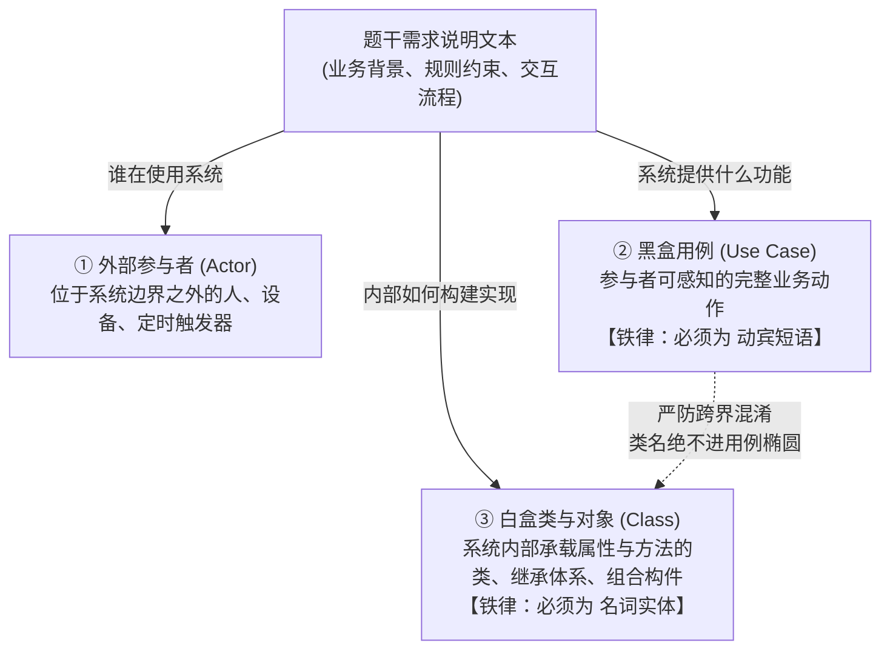

# 🧠 专题 23：UML 试题三用例黑盒与类图白盒跨界防坑——底层透析

## 一、 一语道破 (The Essence)

下午试题三（面向对象与 UML 建模分析，15 分）通常由两张核心图纸构成：**用例图（Use Case Diagram，3~7分）** 与 **类图（Class Diagram，8~12分）**。

许多具有扎实编程经验的考生，在类图匹配（C1~C8）上能够凭借对继承、组合、多态的理解斩获满分，但在用例图（U1~U3）上却频繁折戟，丢掉 3~5 分。

这种“白盒封神、黑盒翻车”的深层病灶，在于**“程序员的多态继承直觉反噬”**：
* **程序员习惯（面向对象白盒代码视角）**：看到系统中有基类 `Robos（机器人）` 和两个子类 `PacMan（小精灵）`、`Ghost（幽灵）`，脑海中下意识就想在用例层面对不同子类进行分别操作，顺手写出 `操作小精灵`、`操作幽灵`。
* **软件工程真理（用例黑盒需求视角）**：用例图诞生于需求分析阶段（OOA），其使命是**站在系统外部参与者（玩家/用户）的视角，回答“系统能提供什么业务价值”**。它是一个纯粹的**黑盒模型**！玩家在系统边界处调用的业务功能就是“操作机器人”，系统内部至于派生出多少多态子类，属于内部白盒代码设计的职责，**绝不会、也不允许在用例层面对同一个动作按多态子类进行平铺拆解！**

```
【黑白次元壁与认知鸿沟】
外部玩家/用户视角 (黑盒用例图)： 👤 玩家 ──> ( 操作机器人 ) ──<<include>>──> ( 设置计时器 )
                                                │
                                    【隔离墙：黑盒绝不涉足内部类】
                                                ▼
内部程序员代码视角 (白盒类图)：   Robos (父类) ──┬──▷ PacMan (子类小精灵)
                                                └──▷ Ghost (子类幽灵)
```

**本专题的第一性原理使命**：彻底划清“用例黑盒”与“类图白盒”的界限，掌握题干说明的“动宾短语扫描消消乐”算法，确保试题三 15 分稳拿满分。

---

## 二、 概念串联与全景空间拓扑 (The Big Picture)

在下午试题三中，题干给出的长篇业务说明实际上是一份“混合需求说明书”。考场破局的第一步，是对题干信息实行**“三路分流提取”**：



### 用例图与类图的核心要素对比矩阵

| 对比维度 | 用例图（Use Case Diagram） | 类图（Class Diagram） |
| :--- | :--- | :--- |
| **工程所处阶段** | 面向对象分析（OOA，需求阶段） | 面向对象设计（OOD，实现阶段） |
| **观察者视角** | **外部用户/玩家（黑盒视角）** | **内部开发者/系统架构师（白盒视角）** |
| **关注核心核心** | What to do（系统能干什么、提供何种价值） | How to do（系统由哪些类构成、如何协同） |
| **图元语法要求** | **必须是动宾短语（动词 + 业务名词）** | **必须是单一实体名词（首字母大写类名）** |
| **典型图元名称** | `编写迷宫文件`、`设置计时器`、`在线结算` | `Maze`、`Robos`、`PacMan`、`Timer` |
| **严厉扣分禁区** | **严禁填入实体类名或角色名词！** | **严禁填入动态行为动词！** |

---

## 三、 深层透析与病灶根治 (The Breakdown)

---

### 🔪 辨析 1：为什么用例图严禁按多态子类平铺拆分？

#### 1. 软件工程的“信息隐藏与黑盒抽象”原则
在面向对象分析中，一个优良的系统用例应该满足**“对外部黑盒隐藏内部实现细节”**。
* 如果系统有一个基类 `Vehicle（车辆）`，派生出 `Car（轿车）`、`Truck（卡车）`、`Bus（公交车）`。
* 外部用户的用例是【预约借车】。
* **错误建模**：把用例平铺画成【预约轿车】、【预约卡车】、【预约公交车】。
  * *后果*：一旦系统新增了 `Bike（自行车）` 子类，整个用例图和外部接口全部崩溃被污染，违背“开闭原则（OCP）”。
* **正确建模**：外部用例保持抽象且单一的【预约车辆】。具体的车型选择通过用例内部的输入参数，在白盒类图中通过工厂模式或多态子类去分流处理。

#### 2. 本题惨痛教训
在 2021年11月【吃金币游戏】中，主用例叫【操作机器人】。
机器人无论是小精灵还是幽灵，都是“机器人”概念下的多态子类。
玩家在系统交互界面上的操作是用操纵杆/键盘控制机器人的运动，系统内部多态引擎自动驱动小精灵吃金币、驱动幽灵追逐小精灵。因此，**在用例层面绝不存在所谓的“操作小精灵”与“操作幽灵”**！

---

### 🔪 辨析 2：题干文本的“动宾短语扫描消消乐”算法

用例图填空（$U_1 \sim U_3$）的答案，**100% 潜伏在题干说明的谓语动词结构中**。

考场上只需执行以下三步算法，即可在 15 秒内锁定答案：

```
【动宾短语消消乐算法】
第一步：定位题干中与主用例同名的段落或关键业务块；
第二步：用笔圈出句式为“动词 + 名词”的核心动作；
第三步：排除细微界面点击（如输入密码、点击按钮），提取独立业务价值单元。
```

#### 实战文本破译对照表（以本真题为例）：

| 题干业务线索段落 | 圈出的核心动宾短语 | 归属的主用例与图元 | 采分点标准答案 |
| :--- | :--- | :--- | :--- |
| “用户可以使用编辑器(Editor)**编写迷宫文件**，建立用户自定义迷宫。” | `[编写] 迷宫文件` | 支撑【建立迷宫】主用例 | **$U_1$: 编写迷宫文件** |
| “将迷宫文件**导入游戏系统**建立用户自定义迷宫。” | `[导入] 迷宫文件` | 支撑【建立迷宫】主用例 | **$U_2$: 导入迷宫文件** |
| “每个机器人都**设置有一个计时器(Timer)**，用于支持执行预先定义好的定时事件。” | `[设置] 计时器` | 支撑【操作机器人】主用例 | **$U_3$: 设置计时器** |

> [!TIP]
> **语法检查金标准**：
> 填写完 $U_1 \sim U_3$ 后，进行自检自查：**第 1 个字是否为动词？**
> * “编写”、“导入”、“设置”、“创建”、“审核” $\implies$ ✅ 正宗用例语法；
> * “小精灵”、“幽灵”、“用户迷宫”、“数据表” $\implies$ ❌ 立即涂掉重写！

---

### 🔪 辨析 3：三大用例关系实战判别（包含 vs 扩展 vs 泛化）

【问题2】通常考查 $U_1 \sim U_3$ 与主用例之间的连线关系：

```
【三大用例关系判别天平】
        ┌── 包含 (<<include>>) ──> 100% 必须做！缺少它主用例无法闭环 (例: 操作机器人 -> 设置计时器)
用例关系 ┼── 扩展 (<<extend>>)  ──> 可选条件触发！不执行主用例也能成功 (例: 遇障碍 -> 触发警报)
        └── 泛化 (Generalization) ─> Is-A 关系！同一种业务目标的不同实现手段 (例: 建立迷宫 -> 导入/编写)
```

1. **为什么 $U_3$（设置计时器）与【操作机器人】是包含关系（`<<include>>`）？**
   * 机器人要在迷宫中游走、探测、吃金币，所有的周期性轮询与移动都依赖底层计时器事件驱动；
   * 没有计时器的定时触发，机器人就是静止的死物，“操作机器人”根本跑不通；
   * 因此，【操作机器人】无条件**包含（`<<include>>`）**【设置计时器】！
2. **为什么 $U_1$、$U_2$ 与【建立迷宫】写包含或泛化均给满分？**
   * *包含视角*：用户要建立自定义迷宫，必须经过“编写”或“导入”动作，是建立迷宫的组成部分；
   * *泛化视角*：建立迷宫是一个通用抽象概念，而“编写迷宫文件”和“导入迷宫文件”是两种互斥的特化实现手段（Is-A 方式）。因此，考场写**包含关系**或**泛化关系**官方均给满分。

---

### 🔪 辨析 4：类图 C1~C8 的拓扑解构（8分全拿的密码）

你在类图匹配上拿了 8 分满分，我们把这套高分心智提炼为普适的**“多重度与关联拓扑消消乐”**：

1. **迷宫聚合机器人（看基数 $2..*$）**：
   * 题干原话：“*当迷宫中至少存在一个小精灵和一个幽灵时，游戏开始*”；
   * 意味着一个迷宫（Maze）包含的机器人（Robos）数量为 $\ge 2$；
   * 类图拓扑：$C_8$ 与 $C_1$ 之间存在空心菱形聚合连线，端点标有 `2..*` $\implies$ 瞬间锁定 $C_8$ 是 `Maze（迷宫）`，$C_1$ 是 `Robos（机器人）`！
2. **机器人强组合构件（看实心菱形与数量 1、2）**：
   * 机器人组合计时器：每个机器人有 1 个计时器 $\implies$ 实心菱形连线，端点标有 `1` $\implies$ 锁定 $C_2$ 为 `Timer（计时器）`；
   * 机器人组合传感器：机器人有前向和近距离两种传感器 $\implies$ 实心菱形连线，端点标有 `2` $\implies$ 锁定 $C_5$ 为 `Sensor（传感器）`！
3. **两层继承树特化（看空心三角形箭头）**：
   * 机器人 $C_1$ 派生两个子类 $\implies C_3, C_4$ 分别为 `PacMan（小精灵）` 与 `Ghost（幽灵）`；
   * 传感器 $C_5$ 派生两个子类 $\implies C_6, C_7$ 分别为 `FrontSensor（前向传感器）` 与 `ProxiSensor（近距离传感器）`！

---

## 四、 考场实战沙盘推演 (Case Walkthrough)

以 **2021年11月软件设计师试题三【吃金币游戏】** 为例，完整演示 2 分钟满分答题路径：

```text
【答题步骤 1：扫描用例动宾短语（秒杀问题1，拿满 3 分）】
1. 读到“编写迷宫文件” -> 记录为 U1: 编写迷宫文件
2. 读到“导入游戏系统（导入迷宫文件）” -> 记录为 U2: 导入迷宫文件
3. 读到“设置有一个计时器(Timer)” -> 记录为 U3: 设置计时器

【答题步骤 2：判定用例间关系（秒杀问题2，拿满 4 分）】
1. U1、U2 共同连向【建立迷宫】 -> 关系为：包含关系（或泛化关系）
2. U3 连向【操作机器人】 -> 关系为：包含关系（<<include>>）

【答题步骤 3：类图拓扑消消乐（秒杀问题3，拿满 8 分）】
1. 基数 2..* 聚合 -> C8 为 Maze，C1 为 Robos
2. 数量 1 组合 -> C2 为 Timer
3. 数量 2 组合 -> C5 为 Sensor
4. 机器人子类 -> C3: PacMan，C4: Ghost
5. 传感器子类 -> C6: FrontSensor，C7: ProxiSensor

卷面实得分：15.0 / 15 分（满分全取！）
```

---

## 五、 考场避坑决斗矩阵与答题规范模板

### 1. 考场易踩陷阱与破局决斗表

| 设坑场景 | 考生易犯习惯性错误 | 破局动作与判定铁律 |
| :--- | :--- | :--- |
| **用例命名** | 顺着类图子类写出“操作小精灵”、“操作幽灵” | 用例必须是外部黑盒业务动作，绝不按面向对象子类平铺拆解！ |
| **用例语法** | 填入名词“迷宫文件”、“计时器” | 必须书写动宾短语“编写/导入迷宫文件”、“设置计时器”！ |
| **关系连线构造型** | 在包含连线上写成 `<<extend>>` | 问自己“不执行它主业务能否跑通？”不能跑通就是 `<<include>>`！ |
| **参与者连线** | 参与者连接用例时画成了虚线或贴上构造型 | 参与者与用例之间只有实线关联（Association），严禁构造型！ |

### 2. 考场答题标准书写格式模板

```text
【试题三 问题 1】
U1: 编写迷宫文件
U2: 导入迷宫文件
U3: 设置计时器

【试题三 问题 2】
U1 和 U2 与 建立迷宫 是包含关系（或泛化关系）；
U3 与 操作机器人 是包含关系。

【试题三 问题 3】
C1: 机器人（或 Robos）
C2: 计时器（或 Timer）
C3: 小精灵（或 PacMan）
C4: 幽灵（或 Ghost）
C5: 传感器（或 Sensor）
C6: 前向传感器（或 FrontSensor）
C7: 近距离传感器（或 ProxiSensor）
C8: 迷宫（或 Maze）
```

---

## 六、 极速小抄与通关口诀 (Memory Pegs)

### 1. 试题三满分四句口诀

> **用例椭圆找动宾，纯写名词不给分；**  
> **精灵幽灵是类名，莫把实体当用例；**  
> **建立迷宫两动作，编写导入二合一；**  
> **机器人动靠节拍，包含设置计时器！**

### 2. 考前 5 秒自检清单
* [ ] 用例图填空里，是不是每一个空都是“动词 + 名词”？
* [ ] 有没有把类图方框里的名词（角色、构件）抄到了用例椭圆里？
* [ ] 扩展关系（`<<extend>>`）的箭头是不是从扩展用例**反向指回**基础用例？
* [ ] 包含关系（`<<include>>`）的箭头是不是从基础用例**正向指向**公共子用例？
