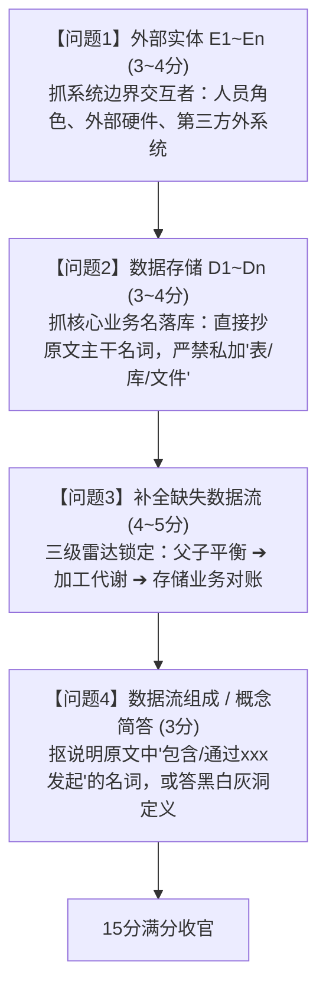
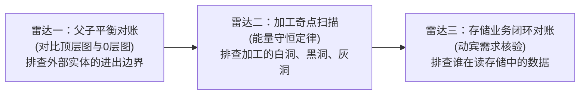

# 🧠 专题 24：DFD 数据流图实战全景心法与避坑宝典——底层透析

## 一、 一语道破 (The Essence)

全国软考软件设计师下午试卷的**【试题一：数据流图 DFD】（15分）**是全科性价比最高、规律性最强、最应该冲击**14~15分满分**的第一大题。

然而，许多考生在面对**“补全缺失数据流”**与**“数据存储判定”**时，常常陷入以下两大致命认知误区：
1. **机械死板教条**：听说加工有“黑洞”，便把数据存储也生搬硬套成“绝对不能只进不出”，看到只有写入的存储就盲目瞎连线，结果掉入臆造错流的陷阱（如把合法沉淀的底层表强行连向查询模块）；
2. **现代 CRUD 编码思维反噬**：脱离题干【说明】原文的业务动作，凭个人日常编码直觉进行“脑补推导”，导致漏掉原文明确指定的计划回读流，或者自造了原文未提及的冗余流。

> [!IMPORTANT]
> **DFD 的第一性原理与黄金法则**：
> * **DFD 是逻辑数据管道（Logical Pipeline），不是物理数据库流图**；
> * **存储是否缺失读出流，唯一合法的法官是【说明原文的动宾需求】，而不是图上的箭头数量**；
> * **黑洞/白洞是线索探测器（帮助缩小嫌疑范围），原文对账才是最终判决书（确认采分点）**。

---

## 二、 DFD 四大核心设问破局流水线 (The Big Picture)

试题一的 15 分考题高度固化为 4 个固定设问，掌握以下流水线即可实现模块化秒杀：



### 1. 外部实体 E 识别法则（看边界、看流向）
* **定义**：位于系统边界之外，向系统提供输入或接收系统输出的人员、组织、外部设备或第三方软件系统。
* **排查绝技**：
  * **主语定位法**：阅读说明开头段落，圈出所有**“与系统发生交互的涉众”**；
  * **输入输出对账法**：对照顶层图（图 1-1），找准每个 $E$ 输入了什么单据、接收了什么报表；
  * **防坑红线**：严禁把系统内部的“加工”或“内部存储”当外部实体；严禁把“物理介质（如刷卡机、传感器）”与“业务主体（如持卡人、外部设备）”混淆。

### 2. 数据存储 D 识别法则（死抠原文字面）
* **定义**：系统内部需要长期保存或中转的数据集合。
* **排查绝技**：
  * 寻找说明中带有**“记录……”、“存储……”、“维护……信息”、“归档……”**的名词短语；
  * **原文字面保真铁律**：题干叫“农事过程”，答题纸就写“农事过程”或“农事过程表”，**绝对不要自己发挥**写成“种植过程清单”或“农事数据库”。

---

## 三、 深度透析：缺失数据流识别的三大雷达与双轨模型 (The Breakdown)

这是试题一的核心失分靶区。如何做到 4 条流一条不漏、一条不错？必须建立系统化的排查雷达。

### 🧭 补流排查三大雷达系统



#### 1. 雷达一：父子图平衡对账（排查外部实体缺失流）
* **原理**：顶层图（Context Diagram）与 0 层图必须保持**输入流和输出流在数量与名称上的平衡**。
* **操作**：
  * 拿出铅笔，看顶层图中实体 $E_i$ 有几条线进出系统；
  * 转头看 0 层图，该实体 $E_i$ 是否有完全相同的连线指向某个加工；
  * **常见漏点**：顶层图有 $E \to \text{系统}$ 的“查询条件/请求/登录”，但在 0 层图上命题人故意把这根线漏连到对应的加工上！

#### 2. 雷达二：加工奇点扫描（排查加工内部代谢失衡）
加工（圆圈/圆角矩形）是数据转换器，必须符合**能量代谢守恒**：
* **白洞/奇迹加工（Miracle）**：只有流出箭头，没有流入箭头 $\implies$ **必缺输入流**（巧妇难为无米之炊，它根据什么产生的输出？必从存储或上游拉数据）；
* **黑洞加工（Black Hole）**：只有流入箭头，没有流出箭头 $\implies$ **必缺输出流**（处理完的数据必须送给下游或落盘）；
* **灰洞加工（Gray Hole）**：输入的数据不足以生成输出的数据 $\implies$ **必缺计算所需的补充数据流**。

---

### 🔬 核心思辨：数据存储可以“只进不出”吗？（黑洞理论辨析）

> [!CAUTION]
> **学术真相澄清**：  
> 严格意义上的“黑洞（Black Hole）”在经典软件工程中**仅指代【加工】**，而不指代数据存储！所谓的“存储黑洞”是培训界的教学比喻。

#### 1. 数据存储在 DFD 中完全可以合法地“只存不取”！
在特定层次的 DFD 图或当前业务边界内，以下情况数据存储只有输入是完全合理且合法的：
* **归档表与日志表（Audit Log / Archive）**：系统正常业务只负责往里打流水，不进行在线读取；
* **基础信息沉淀库（如 2023年5月真题中的 D1 人员表）**：当前系统只负责把平台租户、农户信息录入落盘。**由于本图未设计“登录认证”或“人员统计”加工，在当前图的视野内，D1 没有任何出流连向其他加工是完全合规的！**

#### 2. 那么，凭什么断定有的存储漏了出流（如 D3 过程、D4 活动）？
答案绝不是“因为它们只有进没有出”，而是因为**【题干说明明文规定了某些加工必须使用它们的数据】**：

```text
【真题 2023-05 判别对照镜】
  存储 D1 (人员) ──(说明无任何加工要读人员名单)──> 无读出流合法，不补流！(写 D1->P5 判 0 分)
  存储 D3 (过程) ──(说明明确要求 P3 发提醒、P5 比对)──> 必须补出流：D3->P3 (计划), D3->P5 (过程)
  存储 D4 (活动) ──(说明明确要求 P4 算消耗、P5 比对)──> 必须补出流：D4->P4 (消耗), D4->P5 (活动)
```

**【终极法则】**：
* **看到存储“只进不出” $\implies$ 仅作为【预警信号】，提醒你高度怀疑它可能被命题人擦掉了线；**
* **去读说明原文 $\implies$ 只有当原文出现“根据该存储的数据进行计算/比对/生成/发送”时，才真正下笔连线！**

---

### 🔄 数据流动的两大经典工程模型（推模型 vs 拉模型）

考场上补全数据流，流向主要分为以下两类：

#### 模型 A：拉模型（Pull，存储读取与比对）
下游加工在执行查询、统计、比对业务时，从数据存储中主动拉取数据：
* **特征词**：“*对 A 与 B 进行比对*”、“*根据历史记录统计……*”；
* **图元连线**：`数据存储 D -> 加工 P`；
* **典型真题**：$P_5$（信息服务）比对农事活动与过程 $\implies$ `D3 -> P5 农事过程`，`D4 -> P5 农事活动`。

#### 模型 B：回读驱动模型（Read-to-Trigger，计划/规则定时触发）
加工自身产生输出需要依赖先前已经持久化存储的“阈值”、“计划”或“规则”：
* **特征词**：“*在设定时间发送提醒*”、“*超期未完成发送警告*”、“*根据监控规则判定异常*”；
* **图元连线**：`数据存储 D -> 加工 P`（回读给负责该业务的加工自身）；
* **典型真题**：$P_3$（种植管理）要发定时农事提醒与逾期警告，必须读出事先存好的实施计划 $\implies$ `D3 -> P3 实施计划`。

#### 模型 C：推模型（Push，加工间直连 $P \to P$）
上游加工处理产生的数据，一边落盘备份，一边直接实时推送给下游加工展示或进一步处理：
* **特征词**：“*将分析结果进行可视化展示并进行存储*”；
* **图元连线**：`加工 P_上游 -> 加工 P_下游`（同时存在 `P_上游 -> 数据存储 D`）；
* **官方阅卷共识**：若下游展示，标答通常**同时认可 `P_上游 -> P_下游` 与 `D -> P_下游` 双轨给分**！

---

## 四、 考场命题陷阱与避坑红线 (Common Pitfalls)

### 1. 四大连线物理绝对禁区（出现直接判 0 分）
根据 DFD 语法规范，数据流动必须有加工的参与：
* ❌ **实体到实体 (`E -> E`)**：系统管不着外部实体之间的私下交互；
* ❌ **实体到存储 (`E -> D` 或 `D -> E`)**：外部实体绝不能越过应用程序直接裸读裸写数据库；
* ❌ **存储到存储 (`D -> D`)**：数据存储是静止的，不能自己把数据倒给另一个存储，必须经由加工搬运。

### 2. 臆造非必要数据流（主观推理过度）
* **翻车案例**：2023年5月很多考生写 `D1(人员) -> P5(信息服务) 人员`；
* **致命根因**：觉得“查询系统怎么能没有人员信息呢？”，凭直觉脑补业务；
* **防坑红线**：**凡是题干【说明】中没有出现动词对应关系的，一概不连线！**

### 3. 数据流名称擅自润色修饰
* **翻车案例**：原文写“投入品实际消耗”，考生写“化肥农药消耗量”；原文写“实施计划”，考生写“定时提醒规则表”；
* **防坑红线**：软考阅卷采用关键字比对采分。**必须 100% 抠出题干原词，字面保真！**

---

## 五、 双标本真题全景推演对比 (Case Walkthrough)

### 标本 1：2023年05月【农事管理服务平台】（存储业务对账经典）
* **设问**：补充图 1-2 中 4 条缺失数据流及起止。
* **破局动作**：
  1. **扫存储异常**：发现 $D_3$（农事过程）和 $D_4$（农事活动）全为单向写入，高度可疑；
  2. **读说明(4)**：“农户在农事活动中设定投入品的实际消耗” $\to P_4$ 输出使用情况需以此为依据 $\implies$ `D4 -> P4 投入品实际消耗`；
  3. **读说明(5)**：“对相关地块农事活动实施情况（如与农事过程比对）进行筛选统计” $\to P_5$ 必须同时拿到活动打卡和过程计划 $\implies$ `D4 -> P5 农事活动`，`D3 -> P5 农事过程`；
  4. **读说明(3)**：“系统会在设定时间向农户进行农事提醒，对逾期未实施活动向租户发出逾期警告” $\to P_3$ 依据预设时间表触发通知 $\implies$ `D3 -> P3 实施计划`。
* **验证 D1**：说明中没有任何功能要查全员清单，确认 $D_1$ 纯落库无需补线。4 分稳稳全拿！

### 标本 2：2021年11月【智慧农业平台】（父子平衡与奇迹加工经典）
* **设问**：补充图 1-2 中 4 条缺失数据流及起止。
* **破局动作**：
  1. **父子图对账**：顶层图有农业专家 $E_2 \to \text{系统}$ 的【请求】流，0 层图中 $E_2$ 没有任何进系统连线，对照说明(5)“根据专家请求展示” $\implies$ `E2 -> P5 请求`；
  2. **扫加工奇点**：$P_4$（监控）只有流出的报警信息，输入完全为 0（奇迹加工），对照说明(4)“根据监控规则进行监控” $\implies$ `D1(监控规则) -> P4 监测规则`；
  3. **读说明主谓宾**：说明(3)“将分析结果进行可视化并存储；将预测信息进行可视化和存储” $\implies$ 产生者 $P_3$ 直送展示端 $P_5$：`P3 -> P5 分析结果`，`P3 -> P5 预测信息`。4 分瞬间秒杀！

---

## 六、 极速小抄与通关口诀 (Memory Pegs)

### 1. DFD 补流 15 秒秒杀心诀

> **实体对账查边界，顶层有进零层接；**  
> **圆圈没进是奇迹，只进不出看仔细；**  
> **存储预警看动宾，说明有查才拉线；**  
> **产生数据去展示，加工直连一路送；**  
> **流名抠准原文字，增字改字丢大分！**

### 2. 考场三秒答卷交卷检查表
- [ ] 起终点格式是否标准（严格书写为 `起点：XXX，终点：YYY，数据流：ZZZ`）？
- [ ] 检查所有连线，是否存在非法连接（`E-E`、`E-D`、`D-D`）？
- [ ] 补出的数据流名称，在题干说明中能否找到一模一样的原词？
- [ ] 是否在同一对起点终点上写了重复的数据流？
