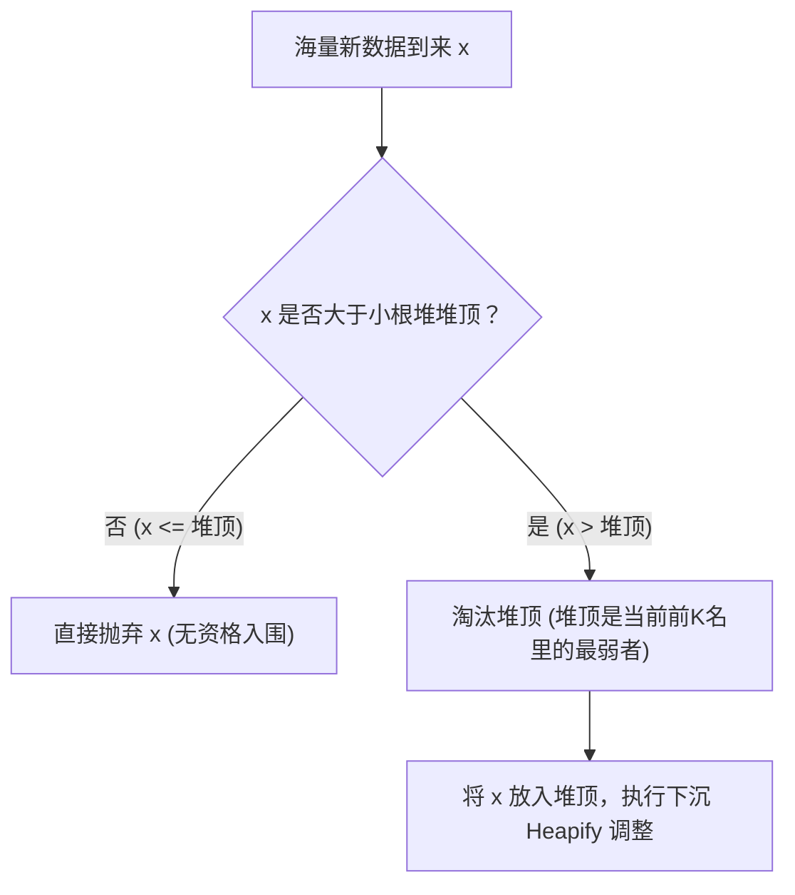
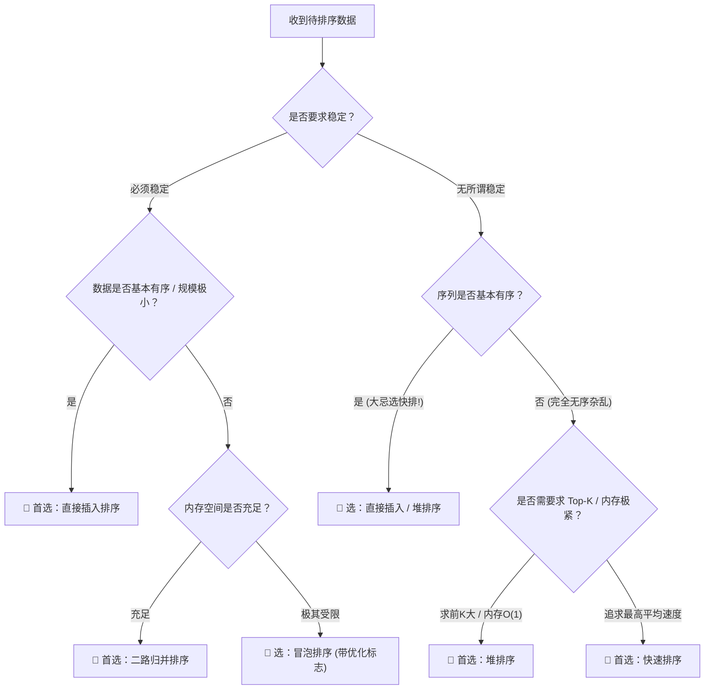

# 25. 全场景排序算法精髓图解与源码透析：底层透析

## 一、一语道破 (The Essence)

在软考（软件设计师、系统架构设计师、软件评测师）数据结构与算法体系中，“排序”不仅是上午场每年必考 1~2 题（通常位于第 55~65 题）的客观送分大户，更是下午场试题四（算法设计与分析）中出现分治、递归、堆化填空的核心母本。

很多考生在面对排序题时，往往陷入“死记硬背大表，做题全凭感觉”的困境：
* 一旦题干微调为“**若待排序序列已基本有序，应选哪种算法？**”，有人错选快速排序，有人犹豫冒泡；
* 一旦考到“**比较次数与初始状态完全无关的是？**”，瞬间分不清简单选择与冒泡的区别；
* 一旦考到“**为什么堆排序建堆的时间复杂度是 $O(n)$ 而非 $O(n \log n)$？**”，更是一脸茫然；
* 在下午代码填空大题中，面对 `j < n - 1 - i`、`low < high`、`heapify` 的边界与参数，频频越界失分。

**第一性原理剖析**：
1. **比较类排序的信息论物理极限**：任意基于两两关键字比较的排序算法，其所有可能的排列组合状态共有 $n!$ 种。其决策判定二叉树的叶子节点数至少为 $n!$，因此树的最低高度为 $\lceil \log_2(n!) \rceil = \Omega(n \log n)$。任何比较排序在最坏情况下的时间复杂度下界就是 **$O(n \log n)$**。唯有非比较类排序（如基数排序）才能突破该下界。
2. **算法设计的四大核心博弈**：
   * **时间 vs 空间**：归并用 $O(n)$ 额外空间换取严苛的 $O(n \log n)$ 与稳定性；快排用递归调用栈 $O(\log n)$ 换取极高内部常数运行速度；堆排则在 $O(1)$ 常数空间内完成 $O(n \log n)$。
   * **全局调控 vs 相邻拘泥**：冒泡和直接插入每次只能消灭 1 个相邻逆序对；而希尔跨步分组、快排左右基准对撞、堆排父子跨层调整，每次比较都能消灭多个逆序对，实现性能跃迁。
   * **自适应性（Adaptive）分化**：面对“基本有序”序列，直接插入算法因内层“看一眼即过”飞升至 $O(n)$ 王者；快速排序若基准选取不当则退化为单支树，暴跌至 $O(n^2)$ 深渊！

---

## 二、宏观战局：软考内部排序时空复杂度与稳定性终极全景大表

以下为软考考纲全收录的 9 大内部排序算法全景大表。此表是上午场综合知识选择题的“最高法院法典”：

| 算法类别 | 排序算法名称 | 最好时间复杂度 | 平均时间复杂度 | 最坏时间复杂度 | 空间复杂度 | 稳定性 | 比较次数与初态无关？ | 移动次数与初态无关？ | 趟数与初态无关？ |
| :--- | :--- | :---: | :---: | :---: | :---: | :---: | :---: | :---: | :---: |
| **插入类** | **直接插入排序** | $\mathbf{O(n)}$ | $O(n^2)$ | $O(n^2)$ | $O(1)$ | **稳定** | 否（越有序比越少） | 否（越有序挪越少） | 否 |
| | **折半插入排序** | $O(n \log n)$ | $O(n^2)$ | $O(n^2)$ | $O(1)$ | **稳定** | **是**（折半比判定树固化） | 否（移动仍为 $O(n^2)$）| 否 |
| | **希尔排序** | $O(n)$ | $O(n^{1.3})$ | $O(n^2)$ | $O(1)$ | ❌ **不稳定** | 否 | 否 | 否 |
| **交换类** | **冒泡排序（优化）** | $\mathbf{O(n)}$ | $O(n^2)$ | $O(n^2)$ | $O(1)$ | **稳定** | 否（有标志位可提前退）| 否 | 否（可提前退出）|
| | **快速排序** | $O(n \log n)$ | $\mathbf{O(n \log n)}$ | $\mathbf{O(n^2)}$ | $\mathbf{O(\log n)}$ | ❌ **不稳定** | 否 | 否 | 否 |
| **选择类** | **简单选择排序** | $O(n^2)$ | $O(n^2)$ | $O(n^2)$ | $O(1)$ | ❌ **不稳定** | **是！恒定 $\frac{n(n-1)}{2}$** | 否 | **是！恒定 $n-1$ 趟** |
| | **堆排序** | $O(n \log n)$ | $\mathbf{O(n \log n)}$ | $O(n \log n)$ | $O(1)$ | ❌ **不稳定** | 否 | 否 | **是！恒定 $n-1$ 趟** |
| **归并类** | **二路归并排序** | $O(n \log n)$ | $\mathbf{O(n \log n)}$ | $O(n \log n)$ | $\mathbf{O(n)}$ | **稳定** | 否 | 否 | **是！恒定 $\lceil \log_2 n \rceil$ 趟** |
| **分配类** | **基数排序** | $O(d(n+r))$ | $O(d(n+r))$ | $O(d(n+r))$ | $O(r)$ | **稳定** | **是（无直接比对）** | **是（每轮必按桶收）** | **是！恒定 $d$ 趟** |

> 💡 **符号释义**：$n$ 为待排序元素总数；$d$ 为关键字位数（如百位数 $d=3$）；$r$ 为基数/桶数（如十进制 $r=10$）。

---

### 考场必杀·四大特征分类阵营（真题高频死穴）

#### 1. 稳定性阵营（考场口诀：“考研软考记心中，插冒归基是稳定的，选希快堆不稳定！”）
* **【稳定算法（4个）】**：**直接插入、折半插入、冒泡排序、二路归并、基数排序**。
  * **稳定的工业意义**：如果两个元素关键字相等（$K_i = K_j$ 且 $i < j$），排序后其相对先后顺序绝对不发生颠倒。对于多重属性排序（如先按年龄排，再按成绩排）至关重要。
* **【不稳定算法（4个）】**：**简单选择、希尔排序、快速排序、堆排序**（简称“**快些选一堆**”）。
  * **不稳定成因**：凡是发生**“跨越多个位置的大距离长调或跳跃交换”**，必将摧毁相等元素的原始相对位置！

#### 2. “与初始序列状态完全无关”的高考雷达
* **【比较次数与初始状态完全无关】**：
  * **简单选择排序**：不管初始序列是正序、逆序还是乱序，每一趟都必须在无序区从头扫描到尾找出最小值，总比较次数雷打不动为 $\frac{n(n-1)}{2}$ 次！
  * **折半插入排序**：查找插入位置的折半比较次数完全由判定树高度确定，与元素大小分布无关（但移动次数依然与初态强相关）。
  * **基数排序**：根本不进行两两关键字之间的大小比较。
* **【移动/交换次数与初始状态完全无关】**：
  * **基数排序**：每一趟都必须严格把所有元素分配进桶中再按序收集。
* **【排序总趟数与初始状态完全无关】**：
  * **简单选择排序**（固定 $n-1$ 趟）、**堆排序**（固定 $n-1$ 趟下沉）、**归并排序**（固定 $\lceil \log_2 n \rceil$ 趟归并）、**基数排序**（固定 $d$ 趟分配收集）。
  * 相比之下：冒泡可因标志位 1 趟提前退出；快排递归树深度受初态剧烈影响；插入排序遇到就位直接跳过。

#### 3. “初始序列基本有序（正序）”时的极端分化表现
* **【飞升为神·直接插入排序与冒泡排序（优化版）】**：
  * 直接插入：内层扫描看一眼前驱就位，循环秒退，不搬砖，时间复杂度直达 **$O(n)$**（最强王者）！
  * 冒泡排序：第 1 趟无任何元素交换，触发 `break` 提前下班，时间复杂度同样为 **$O(n)$**。
* **【跌落深渊·快速排序（若端点选为基准）】**：
  * 每次只能划分出一个长度为 0 和一个长度为 $n-1$ 的子序列；
  * 递归树从平衡二叉树恶化为单支链表树（树高由 $\log_2 n$ 恶化为 $n$）；
  * 空间复杂度从 $O(\log n)$ 恶化至 $O(n)$，时间复杂度从 $O(n \log n)$ **暴跌至最坏的 $O(n^2)$**！

---

## 三、四大门类九大排序算法深度击破（四位一体剖析）

---

### 第一门类：插入类排序

核心物理思想：**“将待排序元素逐一插入到前面已经排好的有序子序列中的合适位置。”**

---

#### 1. 直接插入排序（Straight Insertion Sort）

##### ① 第一性原理与生活比喻
就像打扑克摸牌理牌：右手摸进一张新牌，左手是已经从小到大排好的牌堆。将新牌从右向左逐张与手中的牌比较，比新牌大的牌全部向右挪动一格腾出空档，一旦遇到比新牌小或相等的牌，立刻把新牌插入该位置。

##### ② 核心操作像素级 ASCII 动态图解
待排数组：`[ 3 , 1 , 4 , 2 ]`

```text
初始状态：
[ 3 ] | 1 , 4 , 2        （默认第1个元素3自成有序区，分割线后为无序区）
 有序 | 无序区

第 1 趟（摸到 1）：
• 临时备份 key = 1；
• 1 与 3 比较，1 < 3，元素 3 右移一格： [ 3 , 3 , 4 , 2 ]
• 指针触及数组最左边界，将 1 填入空位：
[ 1 , 3 ] | 4 , 2

第 2 趟（摸到 4）：
• 临时备份 key = 4；
• 4 与 3 比较，4 > 3！触发就地安放机制，无需任何移动！
[ 1 , 3 , 4 ] | 2

第 3 趟（摸到 2）：
• 临时备份 key = 2；
• 2 与 4 比：2 < 4，4 右移； 2 与 3 比：2 < 3，3 右移；
• 2 与 1 比：2 > 1，停止后移，在 1 的后一位安放 2：
[ 1 , 2 , 3 , 4 ] （全员有序，收工！）
```

##### ③ 标准软考级 C 语言源码（行级精细注解）

```c
#include <stdio.h>

/**
 * 直接插入排序
 * @param arr 待排数组
 * @param n   数组长度
 */
void insertionSort(int arr[], int n) {
    // 【外层循环 i】：遍历所有待插入的无序元素
    // 物理意义：arr[0] 默认是有序子集，所以从第 2 个元素（下标 i = 1）开始摸牌
    // 边界条件：i 从 1 遍历到 n - 1，共摸牌 n - 1 次
    for (int i = 1; i < n; i++) {
        int key = arr[i]; // 将当前摸到的新牌存入临时变量（腾出坑位）
        int j = i - 1;    // j 从有序区的最右端（前驱）开始向前回溯扫描

        // 【内层循环 j】：在有序区中寻找插入位置并腾挪空间
        // 1. 边界 j >= 0：防止指针向左穿透数组边界
        // 2. 判断 arr[j] > key：只要已排序元素比新牌大，就必须后移
        //    【稳定性关键防线】：此处必须用严格大于 ">"，不能用 ">="！
        //    遇到相等元素停止后移，新牌插在其后，从而严格保证排序稳定性！
        while (j >= 0 && arr[j] > key) {
            arr[j + 1] = arr[j]; // 将大的元素向后移一位
            j--;                 // 指针继续向左探测
        }

        // 退出循环时，j 停在第一个 <= key 的元素下标上
        // 因此插入位置正是该元素的右邻居 j + 1
        arr[j + 1] = key;
    }
}
```

##### ④ 考场专属避坑点
* **最优情况 $O(n)$**：当原数组已正序时，每次进入内层 `while` 条件立刻为假，外层执行 $n-1$ 次，每次比较 1 次、移动 0 次，总时间复杂度呈线性 $O(n)$！
* **最适场景**：数据量较小（$n < 50$）或数据**基本有序**时，是天下无敌的第一选择。

---

#### 2. 折半插入排序（Binary Insertion Sort）

##### ① 第一性原理与生活比喻
在直接插入排序中，“找插入位置”和“移动元素”是揉在一起逐步进行的。  
折半插入进行逻辑解耦：**既然左侧子序列本来就已经是绝对有序的，为什么还要像傻子一样从右往左一个个顺序查找？直接上“二分查找（折半查找）”快速锁定落脚点！**

##### ② 核心操作像素级 ASCII 动态图解
有序区：`[ 10 , 20 , 30 , 40 , 50 ]`，新摸到元素 `25`。

```text
第 1 步：二分定位插入点
low = 0 (元素10), high = 4 (元素50)
mid = (0 + 4) / 2 = 2 (元素30)
25 < 30，插入点必在左半区，调整 high = mid - 1 = 1。

low = 0 (元素10), high = 1 (元素20)
mid = (0 + 1) / 2 = 0 (元素10)
25 > 10，插入点必在右半区，调整 low = mid + 1 = 1。

low = 1, high = 1
mid = 1 (元素20)
25 > 20，调整 low = mid + 1 = 2。
此时 low > high，二分查找结束！【落脚点铁律：最终插入位置必定是 low】！

第 2 步：集中一次性后移
将下标从 2 到 4 的元素（30, 40, 50）整体右移一位，将 25 填入下标 2。
```

##### ③ 标准软考级 C 语言源码（行级精细注解）

```c
void binaryInsertionSort(int arr[], int n) {
    for (int i = 1; i < n; i++) {
        int key = arr[i];
        int low = 0, high = i - 1; // 二分查找区间限定在有序区 [0, i-1]

        // 核心第 1 步：二分查找寻找插入位置
        while (low <= high) {
            int mid = low + (high - low) / 2; // 防溢出的中点写法
            if (arr[mid] > key) {
                high = mid - 1; // 目标落在左半区间
            } else {
                // 【稳定性关键防线】：arr[mid] <= key 时往右侧收拢，保证相同元素的先后顺序
                low = mid + 1;
            }
        }
        // 查找结束时，low 即为目标插入位置

        // 核心第 2 步：批量后移腾出位置
        for (int j = i - 1; j >= low; j--) {
            arr[j + 1] = arr[j];
        }
        arr[low] = key; // 插入元素
    }
}
```

##### ④ 考场专属避坑点
* 💥 **出题人最爱挖的陷阱**：“折半插入排序由于采用了二分查找，其时间复杂度降低到了 $O(n \log n)$ 吗？”  
  **大错特错！** 比较次数确实从 $O(n^2)$ 骤降至 $O(n \log n)$，但是**元素的移动次数丝毫没有减少**（依然需要后移腾位，最差仍要移动 $O(n^2)$ 次）！所以其**总时间复杂度依然是坚不可摧的 $O(n^2)$**！

---

#### 3. 希尔排序（Shell Sort / 缩小增量排序）

##### ① 第一性原理与生活比喻
直接插入排序最大的软肋在于：**每次只能与相邻的前驱比较，每移动一次只能跨越一个身位，消灭一个逆序对。** 如果最小的数不幸落在大数组的最末端，它必须经历漫长的 $n-1$ 次逐格挪移才能挪到首位。  
**希尔的破局思路——隔空跳跃分组**：先选取一个较大的步长（增量 $d$），将数组隔空分成多个互不相交的子序列，在子序列内部分别执行直接插入排序；随后逐步缩小步长 $d$，直到步长 $d=1$。**先宏观粗调，再微观精调**，彻底打破 $O(n^2)$ 的束缚！

##### ② 核心操作像素级 ASCII 动态图解
待排数组 8 个数：`[ 49 , 38 , 65 , 97 , 76 , 13 , 27 , 49* ]`

```text
第 1 趟：取增量 d1 = 8 / 2 = 4（相隔 4 个身位的归为一组，共 4 组）
组1：49 ----------------> 76          （排好后：49, 76）
组2：     38 --------------> 13       （排好后：13, 38）
组3：          65 --------------> 27  （排好后：27, 65）
组4：               97 -------------> 49*（排好后：49*, 97）
本趟结果：[ 49 , 13 , 27 , 49* , 76 , 38 , 65 , 97 ]（大量极小值被迅速推向前列！）

第 2 趟：取增量 d2 = 4 / 2 = 2（相隔 2 个身位的归为一组，共 2 组）
组1：49 ------> 27 ------> 76 ------> 65
组2：     13 ------> 49* ------> 38 ------> 97
本趟结果：[ 27 , 13 , 49 , 38 , 65 , 49* , 76 , 97 ]（整体已经高度基本有序！）

第 3 趟：取增量 d3 = 2 / 2 = 1（全员直接插入排序）
因为前两趟已经完成了宏观布局，此时直接插入排序几乎“看一眼即过”，极速收工！
```

##### ③ 标准软考级 C 语言源码（行级精细注解）

```c
void shellSort(int arr[], int n) {
    // 【最外层循环】：增量 d 的收敛迭代
    // 采用希尔建议的折半增量序列：d = n/2, d = d/2, ..., 直至 d = 1
    for (int d = n / 2; d > 0; d /= 2) {
        
        // 【中层循环 i】：遍历从第 d 个元素开始的所有待排元素
        // 为什么从 d 开始？因为每个子序列的前半段默认自成子有序区
        for (int i = d; i < n; i++) {
            int key = arr[i];
            int j = i - d; // 指向同一子序列中的前驱（步长为 d）

            // 【最内层循环 j】：在步长为 d 的子序列内进行插入
            while (j >= 0 && arr[j] > key) {
                arr[j + d] = arr[j]; // 元素跨步长 d 后移
                j -= d;              // 跨步向左探测前驱
            }
            arr[j + d] = key;        // 归位
        }
    }
}
```

##### ④ 考场专属避坑点
* **为什么希尔排序不稳定？**  
  两个相等的元素若不幸被分配到了不同的增量分组中，在各自的分组内进行独立交换后，其全局的前后相对次序极易被彻底颠倒！如上述图解中的 `49` 和 `49*`。
* **时间复杂度**：平均大约在 $O(n^{1.3})$，最好为 $O(n)$，最差情况取决于增量序列（希尔原始折半增量最坏仍可达 $O(n^2)$）。

---

### 第二门类：交换类排序

核心物理思想：**“根据序列中两个元素关键字的比较结果，对换这两个元素在序列中的物理位置。”**

---

#### 4. 冒泡排序（Bubble Sort，含优化标志位）

##### ① 第一性原理与生活比喻
物理学中“轻气泡向上漂浮，重石头向下沉底”。从左往右依次两两比较相邻元素，若逆序则交换；一趟下来，全队最大的“巨石”必然被挤兑并沉底到数组的最右端。

##### ② 核心操作像素级 ASCII 动态图解
待排数组：`[ 5 , 2 , 4 , 1 ]`

```text
第 1 趟：目标将最大值 5 推到最右侧
比较 (5,2)：5 > 2，交换  --> [ 2 , 5 , 4 , 1 ]
比较 (5,4)：5 > 4，交换  --> [ 2 , 4 , 5 , 1 ]
比较 (5,1)：5 > 1，交换  --> [ 2 , 4 , 1 , 5 ] （最大数 5 就位到下标 3！）

第 2 趟：在未排序区 [2, 4, 1] 中推最大值
比较 (2,4)：2 <= 4，不换 --> [ 2 , 4 , 1 , 5 ]
比较 (4,1)：4 > 1，交换  --> [ 2 , 1 , 4 , 5 ] （次大数 4 就位到下标 2！）

第 3 趟：在未排序区 [2, 1] 中推最大值
比较 (2,1)：2 > 1，交换  --> [ 1 , 2 , 4 , 5 ] （就位到下标 1，剩下首位 1 自动就位！）
```

##### ③ 标准软考级 C 语言源码（行级精细注解）

```c
#include <stdbool.h>

void bubbleSort(int arr[], int n) {
    // 【外层循环 i】：控制冒泡总趟数
    // 物理意义：右侧已经就位了 i 个最大值；n 个数排好 n-1 个，剩下 1 个必然就位
    for (int i = 0; i < n - 1; i++) {
        bool swapped = false; // 核心：每趟开始前初始化交换标志为 false

        // 【内层循环 j】：执行本趟从左至右的相邻两两比较
        // 边界解析：
        // 1. "- 1"：必须留出 1 位给 arr[j+1]，防止数组越界！
        // 2. "- i"：右端已有 i 个大元素在之前各趟沉底就位，无需重复比较做无用功！
        for (int j = 0; j < n - 1 - i; j++) {
            if (arr[j] > arr[j + 1]) {
                int temp = arr[j];
                arr[j] = arr[j + 1];
                arr[j + 1] = temp;
                swapped = true; // 只要有位置变动，置为 true
            }
        }

        // 破局神技：若整趟跑完一次交换都未发生，说明全员已经完全有序，提前退出！
        if (!swapped) {
            break; // 最好情况下仅跑 1 趟，时间复杂度降至 O(n)
        }
    }
}
```

##### ④ 考场专属避坑点
* 审题必读：题干若写“**未经优化的普通冒泡排序**”，无论什么输入，其最好时间复杂度依然是 $O(n^2)$！只有显式加了 `flag / swapped` 标志位的优化版本，最好时间复杂度才是 $O(n)$。

---

#### 5. 快速排序（Quick Sort）

##### ① 第一性原理与生活比喻
**分治法（Divide and Conquer）的集大成者**。就像班级选班长（选基准 `pivot`）：以基准为分水岭，比班长矮的学生全发配到左边，比班长高的全发配到右边。这一趟下来，**班长自己的物理最终位置就被钉死了（再也不会变动）**！随后左右两边各自关起门来，独立递归选班长，最终全班有序。

##### ② 核心操作像素级 ASCII 动态图解（双指针挖坑法）
待排区间：`[ 46 , 79 , 56 , 38 , 40 , 84 ]`，选首元素 `46` 为基准。

```text
第 1 步：基准出列挖坑，留下下标 0 的第一个坑：
坑位: [ ( ) , 79 , 56 , 38 , 40 , 84 ]    pivot = 46
指针:   low                          high

第 2 步：high 从右往左找 < 46 的数，找到 40！填坑，原 40 位置变成新坑：
坑位: [ 40 , 79 , 56 , 38 , ( ) , 84 ]
指针:   low                high

第 3 步：low 从左往右找 > 46 的数，找到 79！填坑，原 79 位置变成新坑：
坑位: [ 40 , ( ) , 56 , 38 , 79 , 84 ]
指针:        low           high

第 4 步：high 继续左移找 < 46 的数，找到 38！填坑，原 38 变新坑：
坑位: [ 40 , 38 , 56 , ( ) , 79 , 84 ]
指针:        low       high

第 5 步：low 继续右移找 > 46 的数，找到 56！填坑，原 56 变新坑：
坑位: [ 40 , 38 , ( ) , 56 , 79 , 84 ]
指针:             low/high 重合！

第 6 步：重合处就是基准的落脚点！把 pivot = 46 填入：
结果: [ 40 , 38 , 46 , 56 , 79 , 84 ]
                 ↑ 基准归位！左边全比46小，右边全比46大！
```

##### ③ 标准软考级 C 语言源码（行级精细注解）

```c
/**
 * 快速排序核心划分函数（挖坑填数法）
 * 返回划分后基准元素的最终绝对下标
 */
int partition(int arr[], int low, int high) {
    int pivot = arr[low]; // 取当前区间的首元素作为基准，arr[low] 变成第一个空坑

    while (low < high) {
        // high 指针从右向左扫描，寻找小于基准的元素
        // 【细节防死循环】：必须带等号 arr[high] >= pivot
        while (low < high && arr[high] >= pivot) {
            high--;
        }
        arr[low] = arr[high]; // 将比基准小的元素抓过来填入 low 坑，high 处成为新坑

        // low 指针从左向右扫描，寻找大于基准的元素
        while (low < high && arr[low] <= pivot) {
            low++;
        }
        arr[high] = arr[low]; // 将比基准大的元素抓过去填入 high 坑，low 处成为新坑
    }

    // low 与 high 重合，把基准填入最终的中心坑中
    arr[low] = pivot;
    return low; // 返回基准所在下标
}

/**
 * 快速排序主递归函数
 */
void quickSort(int arr[], int low, int high) {
    if (low < high) {
        // 分治策略：一分为二，基准就位
        int pivotIndex = partition(arr, low, high);
        
        // 递归处理左子序列（基准左侧）
        quickSort(arr, low, pivotIndex - 1);
        // 递归处理右子序列（基准右侧）
        quickSort(arr, pivotIndex + 1, high);
    }
}
```

##### ④ 考场专属避坑点
* **空间复杂度之谜**：为什么快排不是 $O(1)$？因为它是**递归调用**，系统必须使用调用栈保存上下文。平均递归深度为 $\log_2 n$，故平均空间复杂度为 **$O(\log n)$**；最坏单支树时空间深度退化为 **$O(n)$**！
* **致命死穴**：当输入序列**已经基本有序或完全逆序**时，快排退化成最烂的冒泡，时间暴跌为 **$O(n^2)$**！

---

### 第三门类：选择类排序

核心物理思想：**“每一趟在待排序的无序子序列中选出关键字最小（或最大）的一个元素，顺序放在已排序序列的最后。”**

---

#### 6. 简单选择排序（Simple Selection Sort）

##### ① 第一性原理与生活比喻
就像在无序的水果筐中挑苹果：睁大眼睛把整个筐子看一遍，找到那个最小的苹果，拿出来和第 1 个位置的水果对调；然后再把剩下没挑的筐子看一遍，找到第二小的对调到第 2 个位置……

##### ② 核心操作像素级 ASCII 动态图解
待排数组：`[ 49 , 38 , 65 , 97 , 13 ]`

```text
第 1 趟：扫描范围下标 [0..4]
• 初始设最小值下标 min_idx = 0 (值为49)
• 扫描比较：发现 38 更小(min_idx=1)，继续扫发现 13 最小(min_idx=4)
• 扫描完毕，将最小的 13 与首位 49 调换：
[ 13 ] | 38 , 65 , 97 , 49

第 2 趟：扫描范围下标 [1..4]
• 扫描发现 38 本身就是当前无序区最小，min_idx = 1，无需实质对调：
[ 13 , 38 ] | 65 , 97 , 49

第 3 趟：扫描范围下标 [2..4]
• 扫描发现 49 最小 (min_idx=4)，将 49 与 65 调换：
[ 13 , 38 , 49 ] | 97 , 65

第 4 趟：扫描范围下标 [3..4]
• 扫描发现 65 最小，将 65 与 97 调换：
[ 13 , 38 , 49 , 65 , 97 ] （全部就位！）
```

##### ③ 标准软考级 C 语言源码（行级精细注解）

```c
void selectionSort(int arr[], int n) {
    // 【外层循环 i】：控制已排序前缀的边界
    // 同样排好前 n-1 个，剩下最后一个自动就位，故到 n - 2
    for (int i = 0; i < n - 1; i++) {
        int min_idx = i; // 假设当前未排序区的第 1 个元素是最小的

        // 【内层循环 j】：在无序区 [i+1, n-1] 中地毯式搜索真正的全局最小值
        for (int j = i + 1; j < n; j++) {
            if (arr[j] < arr[min_idx]) {
                min_idx = j; // 记录更小元素的下标（只记录下标，不急于交换！）
            }
        }

        // 扫完全部无序区后，仅执行 1 次交换（将真正的最小值交换到下标 i）
        if (min_idx != i) {
            int temp = arr[i];
            arr[i] = arr[min_idx];
            arr[min_idx] = temp;
        }
    }
}
```

##### ④ 考场专属避坑点
* 💡 **比较次数铁律**：无论初始序列长什么样，第 $i$ 趟都必须老老实实比 $n-1-i$ 次，总比较次数恒为：
  $$\sum_{i=0}^{n-2}(n-1-i) = \frac{n(n-1)}{2}$$
  **比较次数与初始排列没有任何关系！**
* **不稳定性的反例**：如 `[ 5 , 5* , 2 ]`，第 1 趟把 `2` 和第 1 个 `5` 调换后变成 `[ 2 , 5* , 5 ]`，原来在前面的 `5` 被甩到了后面！

---

#### 7. 堆排序（Heap Sort）

##### ① 第一性原理与生活比喻
简单选择排序之所以慢（$O(n^2)$），是因为它每一趟选完最小值之后，没有把任何比较战果沉淀下来，下一趟又要重头再来盲目比较。  
**堆排序的降维打击——用“完全二叉树”组织竞赛战果**！  
* **大根堆**：任意节点的值 $\ge$ 其左右孩子的值（堆顶必是全局最大霸主！）。
* **排序过程**：
  1. 先把无序数组强行构造成一个大根堆；
  2. 把堆顶（全局最大值）与堆底最后一位交换并踢出堆（它就位了）；
  3. 将新换上来的弱小堆顶元素**“自顶向下下沉（Heapify）”**，重新恢复大根堆秩序；
  4. 重复上述操作，最大值一个个沉底，最终整个数组从小到大排好！

##### ② 核心公式与操作像素级图解（完全二叉树在数组中的映射）
对于 0-indexed 的连续数组（下标 $0 \sim n-1$）：
* 父节点为 $i$ $\implies$ 左孩子下标为 **$2i + 1$**，右孩子下标为 **$2i + 2$**；
* 最后一个非叶子节点下标必为：**$\lfloor n/2 \rfloor - 1$**！

**建堆下沉过程（以无序数组 `[ 4, 10, 3, 5, 1 ]` 为例，长为 5）：**
最后一个非叶节点下标为 $5/2 - 1 = 1$（元素 10）。

```text
原始二叉树形态：
         4(0)
       /     \
     10(1)    3(2)
    /    \
   5(3)  1(4)

第 1 步：从非叶节点下标 1 开始筛选检查。
其子节点是 5 和 1。10 已经比它们都大，无需下沉。

第 2 步：非叶节点向前移动到下标 0（元素 4）。
4 的左右孩子是 10 和 3，最大的孩子是 10。
因为 4 < 10，4 必须与 10 交换位置！4 下沉到下标 1：
         10(0)
       /     \
      4(1)    3(2)
    /    \
   5(3)  1(4)

第 3 步：继续追踪下沉的 4（下标 1）。
4 的左右孩子是 5 和 1，最大的孩子是 5。
因为 4 < 5，4 必须继续与 5 交换！4 下沉到下标 3：
         10(0)
       /     \
      5(1)    3(2)
    /    \
   4(3)  1(4)
【大根堆构建完毕！根节点 10 正是全局最大值！】
```

##### ③ 标准软考级 C 语言源码（下午算法题级超详注释）

```c
/**
 * 堆调整核心函数（将以 rootIndex 为根的子树调整为大根堆）
 * @param arr 数组
 * @param n   当前堆的有效元素规模
 * @param rootIndex 当前需要下沉检查的根节点下标
 */
void heapify(int arr[], int n, int rootIndex) {
    int largest = rootIndex;       // 初始化最大值下标为当前根节点
    int leftChild = 2 * rootIndex + 1;  // 左孩子数组下标
    int rightChild = 2 * rootIndex + 2; // 右孩子数组下标

    // 若左孩子存在，且左孩子的值大于根节点值
    if (leftChild < n && arr[leftChild] > arr[largest]) {
        largest = leftChild;
    }

    // 若右孩子存在，且右孩子的值大于当前记录的最大值
    if (rightChild < n && arr[rightChild] > arr[largest]) {
        largest = rightChild;
    }

    // 如果最大的不是当前根节点，说明必须发生下沉交换
    if (largest != rootIndex) {
        int temp = arr[rootIndex];
        arr[rootIndex] = arr[largest];
        arr[largest] = temp;

        // 【关键递归/循环】：被交换下去的节点在新位置上可能依然破坏下层子堆规则
        // 故必须继续递归向下追查下沉，直到叶子层或满足大根堆规则为止
        heapify(arr, n, largest);
    }
}

/**
 * 堆排序完整主入口
 */
void heapSort(int arr[], int n) {
    // 【第一阶段：从无序数组构建初始大根堆】
    // 核心考点：必须从最后一个非叶子节点 (n/2 - 1) 开始，自底向上逆向扫描至根节点 0
    for (int i = n / 2 - 1; i >= 0; i--) {
        heapify(arr, n, i);
    }

    // 【第二阶段：逐一取出堆顶最大元素，完成原地排序】
    for (int i = n - 1; i > 0; i--) {
        // 1. 将当前最大的堆顶 arr[0] 交换到当前未排序堆的末尾 arr[i] 沉底
        int temp = arr[0];
        arr[0] = arr[i];
        arr[i] = temp;

        // 2. 堆的有效规模减少 1 位（排除已沉底的最大值）
        // 3. 从新堆顶 0 处重新自顶向下调整堆结构
        heapify(arr, i, 0);
    }
}
```

##### ④ 考场专属避坑点
* 💥 **出题频率最高计算题：初始建堆时间复杂度到底是多少？**  
  答：是 **$O(n)$**，而不是 $O(n \log n)$！  
  **数学本质**：深层的节点多，但下沉高度极小（底层节点只需下沉 1 层）；顶层的节点下沉高度大，但节点数量极少（根节点只有 1 个）。利用高中代数“错位相减法”求和，极限收敛为 $2n$，因此**建堆仅需 $O(n)$**！
* **最适场景**：最坏情况依然稳定跑在 $O(n \log n)$，且辅助空间严格为 $O(1)$。海量数据提取前 $K$ 个最大值（Top-K）时的不二神器。

---

### 第四门类：归并类排序

核心物理思想：**“分而治之，合二为一。将两个或两个以上的有序子表合并成一个新的有序表。”**

---

#### 8. 二路归并排序（2-Way Merge Sort）

##### ① 第一性原理与生活比喻
就像两队已经各自按身高从矮到高排好序的学生走入一条走廊：我们只需看两队的排头兵（两个指针），谁矮谁先出列走进走廊；直到其中一队全部走空，另一队剩下的人直接整体跟在后面接龙即可。

##### ② 核心操作像素级 ASCII 动态图解
左右两半有序子数组：`L = [ 10 , 30 , 50 ]` 与 `R = [ 20 , 40 , 60 ]`

```text
双指针拉链式合并过程：
指针 i 指向 L[0]=10, 指针 j 指向 R[0]=20
• 10 < 20，10 胜出写入辅助数组 temp：[ 10 ]，i 移向 30
• 30 > 20，20 胜出写入辅助数组 temp：[ 10 , 20 ]，j 移向 40
• 30 < 40，30 胜出写入辅助数组 temp：[ 10 , 20 , 30 ]，i 移向 50
• 50 > 40，40 胜出写入辅助数组 temp：[ 10 , 20 , 30 , 40 ]，j 移向 60
• 50 < 60，50 胜出写入辅助数组 temp：[ 10 , 20 , 30 , 40 , 50 ]，L 队走空！
• 将 R 队剩下的 60 直接追加拷贝到尾部：[ 10 , 20 , 30 , 40 , 50 , 60 ]
```

##### ③ 标准软考级 C 语言源码（行级精细注解）

```c
#include <stdlib.h>

/**
 * 合并两个相邻的有序子数组 arr[left..mid] 与 arr[mid+1..right]
 */
void merge(int arr[], int left, int mid, int right) {
    int i = left;      // 左半子数组游标
    int j = mid + 1;   // 右半子数组游标
    int k = 0;         // 临时数组索引
    
    // 开辟临时辅助数组存放合并结果
    int *temp = (int *)malloc((right - left + 1) * sizeof(int));

    // 双指针拉链合并
    while (i <= mid && j <= right) {
        // 【稳定性关键防线】：arr[i] <= arr[j] 取等号，左边优先出列，保证原序
        if (arr[i] <= arr[j]) {
            temp[k++] = arr[i++];
        } else {
            temp[k++] = arr[j++];
        }
    }

    // 若左半段尚有结余，全部复制
    while (i <= mid) {
        temp[k++] = arr[i++];
    }
    // 若右半段尚有结余，全部复制
    while (j <= right) {
        temp[k++] = arr[j++];
    }

    // 将排好序的 temp 数组全量写回原数组 arr[left..right]
    for (int p = 0; p < k; p++) {
        arr[left + p] = temp[p];
    }
    free(temp); // 释放内存
}

/**
 * 递归二路归并主流程
 */
void mergeSort(int arr[], int left, int right) {
    if (left < right) {
        int mid = left + (right - left) / 2; // 二分中点
        mergeSort(arr, left, mid);           // 递归切分左半边
        mergeSort(arr, mid + 1, right);      // 递归切分右半边
        merge(arr, left, mid, right);        // 底层合龙归并
    }
}
```

##### ④ 考场专属避坑点
* **空间复杂度代价**：所有常见高级算法中，归并排序的额外辅助内存开销最大，需要与原序列等长的 **$O(n)$** 辅助空间。
* **稳如磐石**：最好、平均、最坏时间复杂度**无一例外全是 $O(n \log n)$**。

---

### 第五门类：分配类排序

核心物理思想：**“不依赖关键字之间的两两比较，依靠多关键字的分配与收集来实现整体有序。”**

---

#### 9. 基数排序（Radix Sort）

##### ① 第一性原理与生活比喻
就像传统的邮局分拣信件：不需要拿两封信一字一句比对谁的地址更长。分拣员只需要设 10 个邮筐（0~9 号）：
第一轮按照邮政编码的“个位数”分别投入 10 个筐（分配），然后从 0 号筐到 9 号筐倒出来码齐（收集）；
第二轮按照“十位数”再次分配收集；
第三轮按照“百位数”再次分配收集。三轮过后，整堆信件神奇地严格按全国邮编升序排齐！

##### ② 核心操作像素级 ASCII 动态图解
待排数据（3 位数）：`[ 278 , 109 , 063 , 930 ]`，基数 $r = 10$，位数 $d = 3$。

```text
第 1 轮（按个位分配与收集）：
个位为 0: 930
个位为 3: 063
个位为 8: 278
个位为 9: 109
收集结果：[ 930 , 063 , 278 , 109 ]（此时个位绝对有序）

第 2 轮（按十位分配与收集）：
十位为 0: 109
十位为 3: 930
十位为 6: 063
十位为 7: 278
收集结果：[ 109 , 930 , 063 , 278 ]（此时后两位绝对有序）

第 3 轮（按百位分配与收集）：
百位为 0: 063
百位为 1: 109
百位为 2: 278
百位为 9: 930
收集结果：[ 063 , 109 , 278 , 930 ]（全员绝对有序！）
```

##### ③ 考场专属避坑点
* **两种模式区别**：
  * **LSD（Least Significant Digit first，最低位优先）**：从个位到最高位（最常用，如上图）；
  * **MSD（Most Significant Digit first，最高位优先）**：从最高位开始切分子桶。
* **时间与空间复杂度公式**：
  * 时间复杂度：每一趟分配需 $O(n)$，收集需 $O(r)$，共进行 $d$ 趟，故为 **$O(d(n + r))$**；
  * 空间复杂度：需要 $r$ 个队列的头尾指针，辅助空间为 **$O(r)$**。
  * **绝对稳定**（如果不稳定，后一轮收集就会破坏前一轮的低位排序成果）。

---

## 四、软考高级拓展与下午大题隐形考点

### 1. 海量数据 Top-K 选型铁律（为什么反其道而行之？）

**试题命题原型**：“从 10 亿个未排序的搜索日志中，找出访问频次最高的 100 个 IP 地址，求最优算法与时空开销。”

* **很多考生的错误直觉**：“既然要找前 100 个**最大值**，那我肯定建一个 100 容量的**大根堆**！”
* **工业级与软考标准答案**：**建立 100 容量的【小根堆】**！



* **破局底层机理**：
  * 小根堆的堆顶存的是当前“前 100 强内部最差的那个人（门槛）”；
  * 来了一个新元素，只需和门槛（堆顶）比：如果比门槛还小，直接扔掉；如果比门槛大，就把旧门槛踢掉，换入新元素下沉；
  * 内存开销仅需保存 $K = 100$ 个常数空间，时间复杂度仅为 **$O(n \log K)$**，轻松应付上亿级海量数据！

---

### 2. 外部排序三剑客（综合上午高频填空与概念）

当待排序的数据量极大（如 100GB），而物理内存仅有 1GB 时，无法一次性读入内存排序，必须借助外存磁盘进行**外部排序（External Sorting）**。

#### ① 置换-选择排序（Replacement-Selection Sort）
* **痛点**：传统方法只能将 1GB 内存排成 1GB 大小的初始归并段。如果文件很大，会生成几百个归并段，导致后续归并轮数暴增，磁盘 I/O 频繁被拖垮。
* **神技**：利用败者树与内存缓冲区动态吐出最小值并补充新值，能够生成**平均长度达到内存容量 2 倍（$2M$）、甚至无限长的初始归并段**，从源头大幅减少初始段数量！

#### ② 最佳归并树（Optimal Merge Tree）
* **本质**：将每个初始归并段的长度视为权值，构建一棵**哈夫曼树（Huffman Tree）**！
* **考点**：这棵最佳归并树的带权路径长度（WPL）严格对应着**外部归并时的总读写物理块数**。
* **虚段判定公式**：若做 $k$ 叉归并，初始归并段有 $m$ 个。如果 $(m - 1) \pmod{k - 1} \neq 0$，说明叶子节点不能完美铺满，必须在末尾补充长度为 0 的**“虚段（Dummy Runs）”**，补足数量为：
  $$(k - 1) - \big((m - 1) \pmod{k - 1}\big)$$

#### ③ 败者树（Loser Tree）
* **痛点**：在进行 $k$ 路平衡归并时，每从 $k$ 个归并段中挑选一个最小元素，如果使用普通两两比较，需要比较 $k - 1$ 次。
* **神技**：使用败者树组织胜负关系，内部节点只记录“输者的段号”，胜者一路向上攀爬至树顶。每次提取最小值后，只需从叶子到根单路追查，比较次数直接骤降为 **$\lceil \log_2 k \rceil$**，与 $k$ 的增长基本脱钩！

---

## 五、考场决策树与秒杀口诀库

### 1. 考场 5 秒算法选型流程决策树



---

### 2. 终极押韵秒杀口诀库

#### ① 稳定性记忆口诀
> **考研软考记心中，插冒归基是稳定；**  
> **快些选一堆（快排、希尔、选择、堆排），跨步跳跃毁原形！**

#### ② 初态无关记忆口诀
> **简单选择死心眼，比够一半（$n(n-1)/2$）不回看；**  
> **基数从来不比较，堆归趟数雷不动！**

#### ③ 复杂度与空间口诀
> **快排归并加个堆，平时平均 $\log$ 底飞（$O(n \log n)$）；**  
> **基数计算 $d(n+r)$，只有归并空间吃最亏（$O(n)$）；**  
> **快排递归留小尾（空间 $O(\log n)$），基本有序退化累（最差时间 $O(n^2)$）！**
