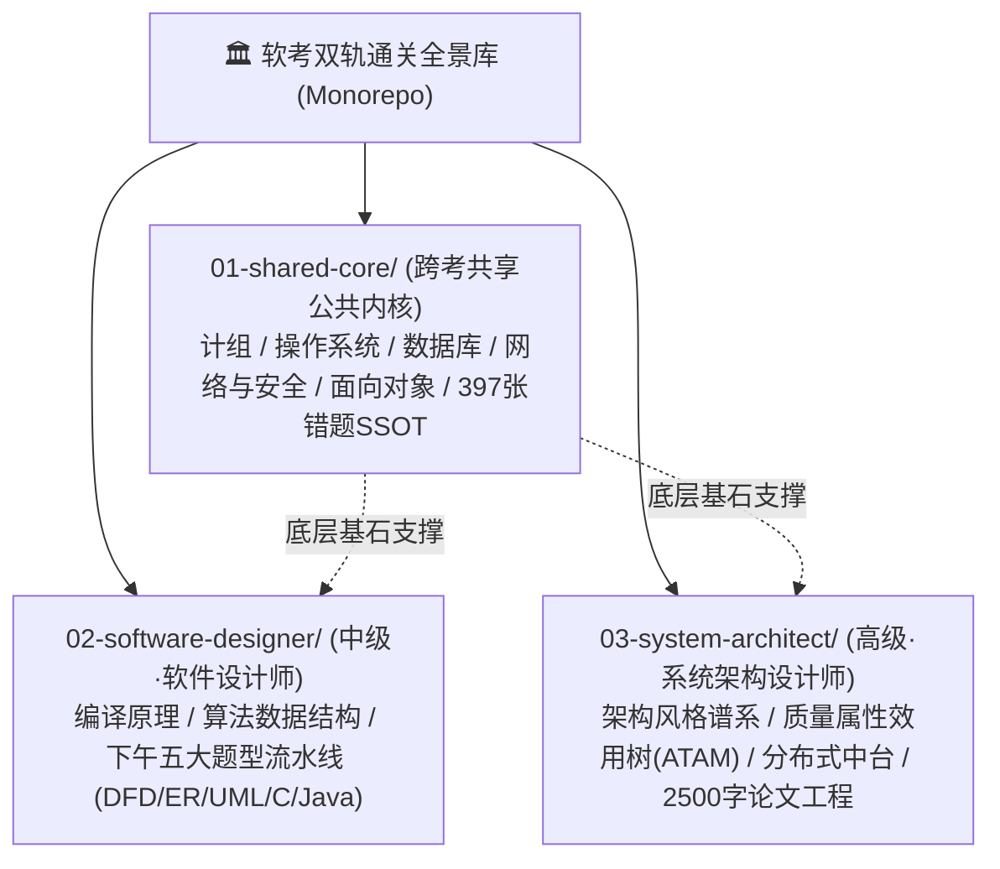

# ⚡ 软考通关速记指南与全景视觉知识库（软件设计师 × 系统架构设计师 双轨版）
> **Next-Gen Ruankao Preparation Engine: Software Designer × System Architect Dual-Track Monorepo Edition**

<p align="center">
  
  
  
  
  
  
  
</p>

> 🎯 **使命与定位**：本项目面向全国计算机技术与软件专业技术资格（水平）考试【中级·软件设计师】与【高级·系统架构设计师】。拒绝死记硬背与八股文堆砌！本项目基于软件工程思想构建，采用**分层共享内核架构（Shared Kernel Monorepo）**，以**“自顶向下、80/20 剪枝、底层原理穿透、空间矢量图解、错题闭环归因、论文工程攻坚”**为核心，为技术人员量身打造新一代工业级备考利器。

🗺️ **全局检索中央中枢**：[软考双轨全景知识检索地图 (Knowledge Navigation Map)](00-全局知识检索地图.md) —— *支持全库各模块考点一键跳转与秒级检索！*  
🎮 **纯前端离线刷题站**：[智能离线刷题站 (quiz.html)](quiz.html) —— *免部署、零依赖、单文件离线双击即开，397 道实体错题卡交互式真题实战！*

---

## 🚀 双轨通关分流总门户 (Choose Your Track)



| 考试科目 | 核心思维模型 | 专属通关全景作战地图 | 核心攻坚阵地与特色资源 |
| :---: | :--- | :---: | :--- |
| **中级 · 软件设计师** | **工匠实现思维**<br>*(How to implement?)* | [👉 进入中级全景作战地图](02-software-designer/00-中级软件设计师通关地图.md) | • [下午五大题型解题流水线](02-software-designer/case-pipeline/past-exams/00-下午案例分析通关总纲与五大题型破题绝杀流水线.md)<br>• [试题一 DFD 补流与平衡](02-software-designer/case-pipeline/02-案例分析/01-试题一-数据流图DFD.md)<br>• [试题四 C 语言动态规划算法填空](02-software-designer/case-pipeline/02-案例分析/04-试题四-C语言算法设计.md)<br>• [15 年真题全景冲刺绝杀双壁](02-software-designer/cheatsheets/01-2009~2023年软考上午真题15年全景考点精析与冲刺绝杀手册.md) |
| **高级 · 系统架构设计师** | **总指挥决策思维**<br>*(Why to choose & Trade-off?)* | [👉 进入高级全景作战地图](03-system-architect/00-高级系统架构设计师通关地图.md) | • [架构风格五大谱系全景决策图解](03-system-architect/01-architecture-styles/01-软件架构风格五大谱系全景决策图解与真题密码.md)<br>• [ATAM 质量属性效用树分析实战](03-system-architect/02-quality-attributes/02-ATAM架构权衡分析法与效用树实战全景心法.md) 🔥<br>• [高并发中台与分布式事务方案](03-system-architect/03-distributed-solutions/01-大型高并发电商中台微服务拆分与DDD实战方案.md)<br>• [2500 字论文万能项目母本与高分范文](03-system-architect/05-thesis-vault/01-万能项目母本-某大型新零售交易中台与智能风控平台.md) 🏆 |

---

## 🏛️ 全库工程资产总览表 (Asset Directory)

| 目录板块 | 模块定位 | 解决的核心痛点 | 包含核心内容与交付物 | 快速入口 |
| :--- | :--- | :--- | :--- | :---: |
| 🗺️ **中央索引** | **00-全局知识检索地图.md** | 全库中央索引与考点快速路由寻址 | 全量考点 Ctrl+F 秒级直达锚点大表 | [👉 进入索引](00-全局知识检索地图.md) |
| 📚 **共享基石** | **01-shared-core/01-fast-pass/** | 15 讲教材知识系统工程化提炼（两科通用） | 80/20 剪枝指南、宏观导图、防冷箭自测 | [👉 进入讲义](01-shared-core/01-fast-pass/README.md) |
| 🎨 **空间视觉** | **01-shared-core/02-visual-diagrams/** | 专治抽象逻辑“看字犯困”，建立空间心智 | 算法流、OMG UML 2.5 规范图、23 设计模式矩阵 | [👉 进入图解](01-shared-core/02-visual-diagrams/README.md) |
| 🔬 **底层机理** | **01-shared-core/07-topic-mastery/** | 24 篇底层机制长文专著攻坚难点 | 击穿主定理、银行家算法、Armstrong、DFD补流、全场景排序图解 | [👉 进入专著](01-shared-core/07-topic-mastery/README.md) |
| 🎯 **弱点歼灭** | **01-shared-core/05-error-vault/** | 闭环错题分析与命题人挖坑逻辑回溯 | 397 张实体错题卡母本、薄弱点画像、反向排雷 | [👉 进入错题](01-shared-core/05-error-vault/README.md) |
| 🎴 **碎片刷题** | **01-shared-core/06-study-notes/** | 记忆间隔复习与移动端随身自测 | 10 科标准 Anki 级高频考点闪卡合集 | [👉 进入闪卡](01-shared-core/06-study-notes/README.md) |
| ⚔️ **中级大题** | **02-software-designer/case-pipeline/**| 下午五大案例大题工程化破题流水线 | DFD/ER/UML/算法/Java流水线与真题复盘报告 | [👉 进入实战](02-software-designer/case-pipeline/past-exams/README.md) |
| ⚡ **中级冲刺** | **02-software-designer/cheatsheets/** | 考前决胜一站式高密度武器库 | 上下午 15 年真题全景绝杀双壁、50 口诀、70 闪卡 | [👉 进入冲刺](02-software-designer/cheatsheets/README.md) |
| 🏛️ **架构专区** | **03-system-architect/** | 软考高级系统架构师全套攻坚武器库 | 架构风格、ATAM 效用树、分布式双活方案、2500 字论文 | [👉 进入架构](03-system-architect/00-高级系统架构设计师通关地图.md) |

---

## 🌟 独家杀手级特色能力

### 1. 📊 15 年 2,100 题全景考频数字化天梯榜
拒绝凭感觉复习！对手册 2009～2023 年 28 场考试共 2,100 道真题进行数据穿透，全卷 75 题与考点强绑定规律一目了然：
* **上午送分铁三角（必拿满分）**：计组（题 1～6）、OS（题 10～15）、数据库（题 32～37）；
* **全卷大户（决胜核心）**：软工与架构（题 16～31，独占 16 分）、算法与数据结构（题 46～55，独占 10 分）、面向对象与设计模式（题 38～45，独占 8 分）；
* **考前速记防线**：网安（8分）、法规（3分，保表达不保思想）、运筹数学（4分，期望收益+特值代入）。

### 2. 🏛️ 系统架构师专属实战论文母本工程 (Thesis Vault)
高级软考挂科率最高的关卡是下午论文（120分钟内手打 2200~2500 字）。本项目沉淀了一套**融汇大型高并发电商交易中台（12万QPS/秒杀削峰/分布式事务）与企业级金融智能风控平台（微服务DDD/规则引擎/同城双活）的万能真实项目母本**，直接配套 4 大核心范文模板（微服务、ATAM架构评估、高可用容灾、云原生容器化），让考生上考场直接降维打击！

### 3. 🎯 错题反向排雷闭环系统 (Error Vault Pipeline)
* **397 道全真错题 100% 保留完整题干与选项**，严禁压行与折叠；
* 独创**四步秒杀排雷规范**（作答诊断 $\to$ 15秒秒杀与正解推导 $\to$ 选项避坑速记 $\to$ 考场避坑口诀）；
* 自动化脚本联动生成：[10-错题看板](01-shared-core/05-error-vault/10-错题看板.md)、[11-红名单（考前必扫）](01-shared-core/05-error-vault/11-红名单.md) 与 [13-星标错题精编速记册](01-shared-core/05-error-vault/13-星标错题精编速记册.md)。

---

## 🛠️ 工程化工具链与质量守卫

本项目所有文档受自动化质量门禁严密保护：
- **链接完整性卫士**：
  ```bash
  python3 scripts/check_markdown_links.py --root .
  ```
  保证全库上千个 Markdown 跨目录引用与局部标题锚点 **0 坏链**。
- **错题画像自动化生成**：
  ```bash
  python3 01-shared-core/05-error-vault/_tools/build_profile.py
  ```
  自动从 SSOT 错题母本解析生成最新的错题看板、红名单与星标待确认清单。
- **单元测试套件**：
  ```bash
  python3 -m unittest discover tests
  ```

---

## 📜 许可证 (License)

本项目采用 [MIT License](LICENSE) 开源协议，欢迎各位软考战友 Star 与共同演进！祝各位考生一次通关，顺利获证！
