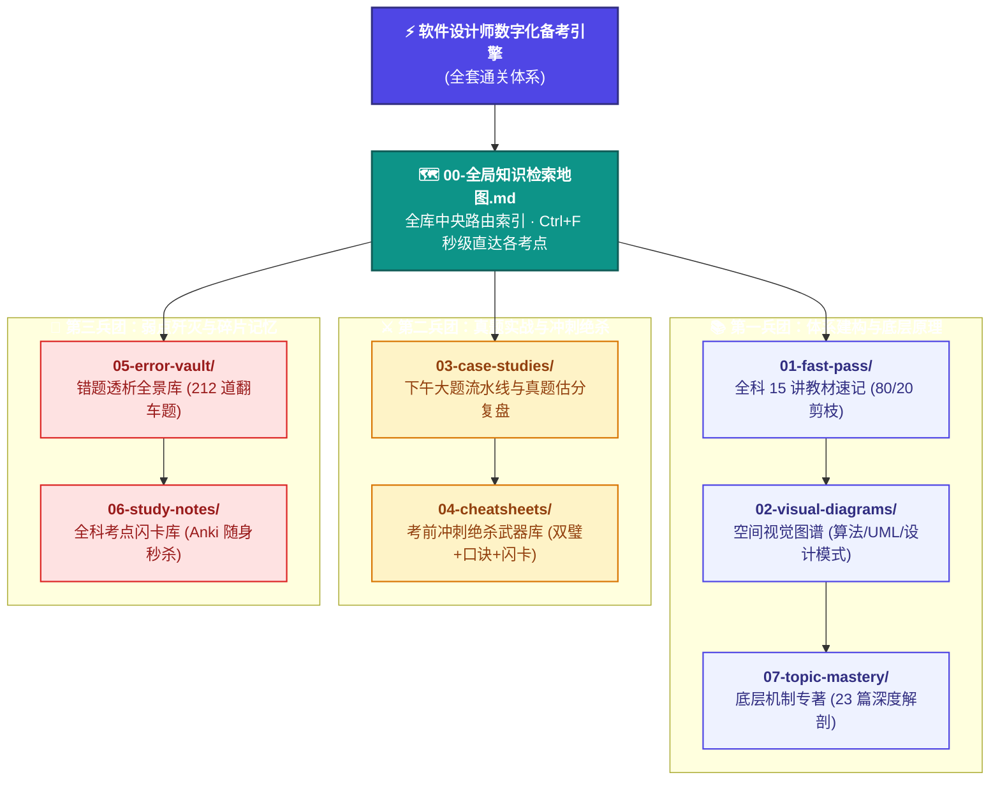

# ⚡ 软件设计师通关速记指南与全景视觉知识库
> **Next-Gen Software Designer Exam Preparation Engine (2026 机考实战版)**

  
  
  
  
  
  

> 🎯 **使命与定位**：面向计算机技术与软件专业技术资格（水平）考试【中级·软件设计师】。拒绝死记硬背、拒绝散文罗列与老旧陈题误导！本项目基于软件工程思想构建，以**“自顶向下、80/20 剪枝、真题真数穿透、空间矢量图解、错题闭环归因”**为核心，为程序员量身打造的新一代数字化备考利器。

🏛️ **官方备考权威指南**：[软件设计师官方权威备考材料与全景指南（国家部委/指定教材/真题分析红宝书/机考系统/以考代评/阅卷机制）](docs/软件设计师官方权威备考材料与全景指南.md)  
🗺️ **全局检索中央中枢**：[软考全景知识检索地图 (Knowledge Navigation Map)](00-全局知识检索地图.md) —— *支持全库各模块考点一键跳转与秒级检索！*

---

## 🥊 传统备考 4 大死穴 vs 本开源工具的“降维重构”

| 传统备考死穴 | 本开源备考工具的“降维重构” |
| :--- | :--- |
| ❌ **教材冗长，划重点靠猜**（800+ 页官方教材让人望而生畏） | ✅ **80/20 极致剪枝 + 15 年考频天梯榜**：2,100 道真题大数据提炼，只攻核心采分盘 |
| ❌ **抽象概念文字堆砌，越看越困**（进程变换、三级封锁读不懂） | ✅ **Mermaid + PlantUML 空间矢量图解**：双层时空拓扑，让抽象逻辑形成肌肉记忆 |
| ❌ **盲目刷老题，陷入“弃考毒题”**（做 2010 年引脚芯片题浪费生命） | ✅ **建立远 10 年弃考毒题排毒黑名单**：彻底封存已淘汰技术，备考提效 40% 以上 |
| ❌ **错题只看答案，换个马甲又错**（题海战术无复利） | ✅ **错题四步深度透析法 (Error Vault)**：完整保留题干，反向剖析命题陷阱与同构变式 |

---

## 📊 考卷分值构成与得分保底配额（双轨独立核算 · 两门皆 ≥ 45 铁律）

> [!IMPORTANT]
> **软考及格天条：单次考试两门科目必须同时 ≥ 45 分方可获证！成绩不滚动、不互补、不保留！**  
> 哪怕上午考 74 分，下午考 44 分也是全科判负重考。因此，备考策略必须严格执行**“上下午双轨独立攻防，各科目均以 60+ 分为高容错安全基准”**！

### 🛡️ 上午场【科目一：综合知识】（75 分单选 · 机考 150 分钟 · 目标 60～68 分）

| 知识模块序号与专题 | 对应题号区间 | 试卷分值 | 冲刺保底目标 | 核心作战纪律与秒杀心法 |
| :--- | :---: | :---: | :---: | :--- |
| **01. 计组体系与存储** | 1 ~ 6 | 6 分 | **5 ~ 6 分** | RISC大量通用寄存器；流水线周期取最大；海明不等式 `2ᵏ ≥ n + k + 1` |
| **02. 程序语言与编译** | 7 ~ 9 | 3 分 | **2 ~ 3 分** | 静态语义错误是类型不匹配；DFA 识别看双圈终态；传值不改实参 |
| **03. 操作系统知识** | 10 ~ 15 | 6 分 | **5 ~ 6 分** | 死锁极值公式 `m(w - 1) + 1`；状态/访问/修改位淘汰法；位示图商余陷阱 |
| **04～05. 软工/项目/架构** | 16 ~ 31 | 16 分 | **13 ~ 15 分** | 瀑布需求明确；McCabe环路复杂度 `m - n + 2`；完善性维护占50%；关键路径最长 |
| **06. 数据库系统技术** | 32 ~ 37 | 6 分 | **5 ~ 6 分** | 关系代数选择尽早下推；范式消消乐；候选码看左侧闭包 |
| **07. 面向对象与设计模式** | 38 ~ 45 | 8 分 | **7 ~ 8 分** | 23 种设计模式特征词精准匹配；UML 部署图看3D立方体、顺序图看时间轴 |
| **08. 数据结构与算法** | 46 ~ 55 | 10 分 | **8 ~ 9 分** | “快选堆希”不稳定；二叉树空指针 `n + 1`；度0等于度2加1；堆排空间 `O(1)` |
| **09. 计算机网络与安全** | 56 ~ 63 | 8 分 | **6 ~ 7 分** | 表示层加解密与压缩；CA公钥验证书；私钥签名公钥验；IDS旁路IPS串联 |
| **10. 知识产权与标准化** | 64 ~ 66 | 3 分 | **3 分** | 著作权保表达不保思想；职务作品归单位；商标期满前 12 个月续展 |
| **11～12. 运筹数学与专业英语** | 67 ~ 75 | 9 分 | **6 ~ 8 分** | 期望收益值公式；特值代入法；近 5 年 9 篇英语短文核心词与上下文指代 |
| **上午综合知识小计** | **全卷 75 题** | **75 分** | **60 ~ 68 分** | **稳超及格线 15～23 分，构筑高容错安全防线！** |

---

### ⚔️ 下午场【科目二：应用技术/案例分析】（75 分大题 · 机考 90 分钟 · 目标 60～71 分）

| 题型与考核板块 | 对应题号 | 试卷分值 | 冲刺保底目标 | 核心破局流水线与答题军令 |
| :--- | :---: | :---: | :---: | :--- |
| **试题一：结构化分析 (DFD)** | 试题一 | 15 分 | **13 ~ 15 分** | 题干材料“30秒消消乐比对法”，严守父子平衡与加工数据守恒，直取满分 |
| **试题二：数据库设计 (E-R)** | 试题二 | 15 分 | **13 ~ 15 分** | “两步找漏法”：1对多外键归多端，多对多必独立建表且联合主键，防漏主键 |
| **试题三：面向对象 (UML)** | 试题三 | 15 分 | **12 ~ 14 分** | BCE 三层类（边界/控制/实体）精准分流；看准泛化、包含与扩展箭头方向 |
| **试题四：算法设计与分析** | 试题四 | 15 分 | **9 ~ 12 分** | 外围包抄战术：策略名称(2分) + 复杂度(2分) + 特值手算推导(4分)，拿下 8～10分 |
| **试题六：Java 面向对象编程** | 试题六 | 15 分 | **13 ~ 15 分** | **100% 选 Java！** extends/implements 语法填空 + 模式多态方法回调，必拿全分 |
| **下午案例分析小计** | **共 5 道大题** | **75 分** | **60 ~ 71 分** | **稳超及格线 15～26 分，凭借标准化模板稳夺胜利！** |

---

## 🧭 知识库 8 大数字化模块架构拓扑

### 📋 8 大模块职能与导航对照大表

| 模块类别 | 目录路径与名称 | 核心职能与解决的备考痛点 | 包含核心交付物 | 快速直达 |
| :---: | :--- | :--- | :--- | :---: |
| 🗺️ **中央索引** | **00-全局知识检索地图.md** | 全库中央索引与考点快速路由寻址 | 全量考点 Ctrl+F 秒级直达锚点大表 | [👉 进入索引](00-全局知识检索地图.md) |
| 📚 **基础讲义** | **01-fast-pass/** | 15 讲教材知识系统工程化提炼 | 80/20 剪枝指南、宏观导图、防冷箭自测 | [👉 进入讲义](./01-fast-pass/) |
| 🎨 **空间视觉** | **02-visual-diagrams/** | 专治抽象逻辑“看字犯困”，建立空间心智 | 算法流、OMG UML 2.5 规范图、23 设计模式矩阵 | [👉 进入图解](./02-visual-diagrams/) |
| 🔬 **底层机理** | **07-topic-mastery/** | 23 篇底层机制长文专著攻坚难点 | 击穿主定理、银行家算法、Armstrong、DFD补流 | [👉 进入专著](./07-topic-mastery/) |
| ⚔️ **大题实战** | **03-case-studies/** | 下午五大案例大题工程化破题 | DFD/ER/UML/算法/Java流水线与真题复盘报告 | [👉 进入实战](./03-case-studies/) |
| ⚡ **冲刺绝杀** | **04-cheatsheets/** | 考前决胜一站式高密度武器库 | 上下午 15 年真题全景绝杀双壁、50 口诀、70 闪卡 | [👉 进入绝杀](./04-cheatsheets/) |
| 🎯 **弱点歼灭** | **05-error-vault/** | 闭环错题分析与命题人挖坑逻辑回溯 | 212 道真题四步透析、薄弱点画像、反向排雷 | [👉 进入错题](./05-error-vault/) |
| 🎴 **碎片刷题** | **06-study-notes/** | 记忆间隔复习与移动端随身自测 | 10 科标准 Anki 级高频考点闪卡合集 | [👉 进入闪卡](./06-study-notes/) |

---

## 🌟 独家杀手级特色能力

### 1. 📊 15 年 2,100 题全景考频数字化天梯榜
拒绝凭感觉复习！对手册 2009～2023 年 28 场考试共 2,100 道真题进行数据穿透，全卷 75 题与考点强绑定规律一目了然：
* **上午送分铁三角（必拿满分）**：计组（题 1～6）、OS（题 10～15）、数据库（题 32～37）；
* **全卷大户（决胜核心）**：软工与架构（题 16～31，独占 16 分）、算法与数据结构（题 46～55，独占 10 分）、面向对象与设计模式（题 38～45，独占 8 分）；
* **考前速记防线**：网安（8分）、法规（3分，保表达不保思想）、运筹数学（4分，期望收益+特值代入）。

### 2. 🔬 近 5 年 5 大核心计算母题横向穿透台
近 5 年的计算题数字在变，公式和挖坑套路完全 1:1 复制！手册将以下母题进行**真题真数横向对比**：
* **流水线执行时间**：`T = 一条指令总耗时 + (n - 1) × Δt`（2023上 / 2021下 / 2019下真数还原）；
* **海明码校验不等式**：`2ᵏ ≥ n + k + 1`（8位代4、16位代5、32位代6秒杀）；
* **位示图商余陷阱**：`字号 = ⌊块号 / 字长⌋`，注意从 0 开始还是从 1 编号的商余陷阱；
* **死锁极值资源公式**：`R_min = m × (w - 1) + 1`；
* **系统可靠度串并联**：串联相乘 `R = ∏ Rᵢ`，并联 `R = 1 - ∏ (1 - Rᵢ)`。

### 3. 🛡️ 远 10 年（2009～2018）弃考毒题排毒黑名单
刷老题最怕被淘汰知识误导！本库明确划定**直接封存黑名单**：
* ☠️ 早期微机芯片引脚（8259A、8255A 控制字）；
* ☠️ 老旧操作系统注册表绝对路径（Win98/2000）；
* ☠️ 淘汰网络协议（NetBEUI、IPX/SPX、X.25、窄带 ISDN）；
* ☠️ 过时 HTML4 纯排版标签与早期高校期末风格的主观名词解释。

### 4. 🎯 闭环错题四步透析法（Error Vault）
不同于传统题库“看个解析就过”，本库设立 `05-error-vault`：
1. **完整保留题干与全量选项**（还原考场真实压迫感）；
2. **复盘真实失分动因**（反向审题、主观臆断、概念混淆）；
3. **精准提炼命题人挖坑逻辑**（题眼特征词识别）；
4. **同构变式与防冷箭举一反三**。

### 5. 🎴 考前冲刺绝杀武器库与 Anki 闪卡全量支持
* **75 题题号矩阵速查表**；
* **考前 50 句押韵保命口诀**；
* **70 张考前高危避坑闪卡（上午40张 + 下午30张）**；
* 100% 支持导入移动端 Anki，利用通勤与碎片时间随时自测秒杀。

---

## 🚀 三阶通关作战路线图

| 作战路线 | 适合考生画像 | 核心作战行动 | 目标产出 |
| :--- | :--- | :--- | :---: |
| ⚡ **14 天极限冲刺流** | 考前突击、时间紧迫、需快速通关 | ① 直奔 [`04-cheatsheets/`](./04-cheatsheets/) 刷透上下午 15 年绝杀双壁，动手手算 5 大计算母题 ② 熟背 50 句保命口诀与 70 张高频闪卡 ③ 研读 [`05-error-vault/`](./05-error-vault/) 错题集靶向排雷 | 🎯 稳过 45 分及格线 |
| 📚 **30 天稳扎稳打流** | 零基础跨考、在校生、追求高分体系 | ① 依序通读 [`01-fast-pass/`](./01-fast-pass/) 15 讲教材速记指南 ② 研读 [`02-visual-diagrams/`](./02-visual-diagrams/) 空间图谱强化心智模型 ③ 结合 [`03-case-studies/`](./03-case-studies/) 完成下午真题单卷实战估分复盘 ④ 考前一周全量切换至 [`04-cheatsheets/`](./04-cheatsheets/) 绝杀武器库 | 🏆 双 60+ 分高分大捷 |
| 🎯 **下午案例大题突击流** | 上午已有把握、下午案例大题易翻车 | ① 研读 [`03-case-studies/`](./03-case-studies/) 掌握五大题型破题流水线总纲 ② 熟练运用“试题一消消乐”、“试题二两步法”与“试题六 Java 模板” ③ 严守 [`04-cheatsheets/03`](./04-cheatsheets/03-下午案例分析考场审题避坑与答题规范红线手册.md) 考场答题规范红线 | ⚔️ 案例分析 63+ 分破局 |

---

## 📂 模块快速导航目录

* 🗺️ **[00-全局知识检索地图.md](00-全局知识检索地图.md)**：全库索引检索中枢（Ctrl+F 一键直达）
* 📚 **[01-fast-pass/ 全科 15 讲通关速记指南](./01-fast-pass/)**：系统教材微观精析
* 🎨 **[02-visual-diagrams/ 核心概念与原理图解](./02-visual-diagrams/)**：矢量级时空心智模型
* 📝 **[03-case-studies/ 下午五大题型实战拆解](./03-case-studies/)**：下午案例流水线与真题复盘
* ⚡ **[04-cheatsheets/ 考前冲刺掌中宝与真题绝杀武器库](./04-cheatsheets/)**：
  * 🏆 [`01-2009~2023年软考上午真题15年全景考点精析与冲刺绝杀手册.md`](./04-cheatsheets/01-2009~2023年软考上午真题15年全景考点精析与冲刺绝杀手册.md)
  * 🏆 [`02-2009~2023年软考下午真题15年全景考点精析与冲刺绝杀手册.md`](./04-cheatsheets/02-2009~2023年软考下午真题15年全景考点精析与冲刺绝杀手册.md)
  * 📕 [`03-下午案例分析考场审题避坑与答题规范红线手册.md`](./04-cheatsheets/03-下午案例分析考场审题避坑与答题规范红线手册.md)
* 🎯 **[05-error-vault/ 错题透析与弱点歼灭全景库](./05-error-vault/)**：真实翻车错题与漏洞靶向排雷
* 🎴 **[06-study-notes/ 全科考点闪卡库](./06-study-notes/)**：Anki 格式高频复习卡片
* 🔬 **[07-topic-mastery/ 核心考点底层机制深度透析](./07-topic-mastery/)**：23 篇底层机制专著
* 🛠️ **[docs/specs/ 工程规约与技术架构](./docs/specs/)**：Markdown 绘图方案与国家权威备考标准

---

## 🤝 贡献与开源协议

* 欢迎提交 Issue 与 Pull Request 补充你的错题与考场避坑经验！
* 本项目采用 **[MIT License](LICENSE)** 开源，遵循 Docs-as-Code 知识共享精神。祝大家一次稳过！🎉
