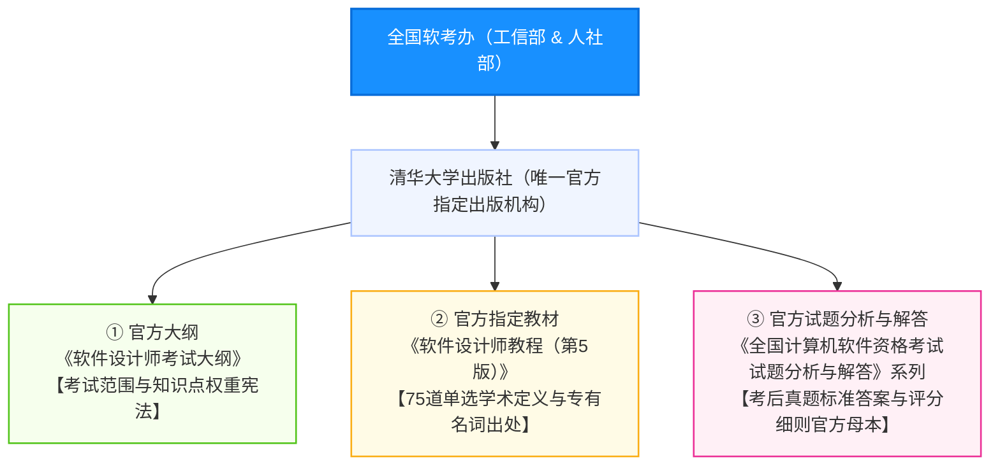
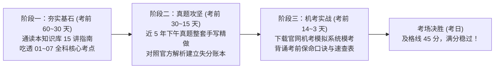

# 🏛️ 软件设计师备考官方权威材料与全景指南 (Official Authority & Standard Materials)

> 💡 **文档定位**：系统梳理“全国计算机技术与软件专业技术资格（水平）考试”（软考中级·软件设计师）的**官方机构、指定教材、官方真题题解母本、机考模拟系统、法律效力文件及考场阅卷机制**。  
> 帮助考生认准正规官方权威，彻底告别山寨杂牌教辅与网上二手传闻。

---

## 一、 官方组织机构与法律效力定级 (The Authority & Status)

### 1. 国家主管与命题评卷组织架构
全国计算机专业技术资格考试不是行业协会自嗨的培训认证，而是国家法定统一的国家级职业资格考试：
* **国家主管部委**：
  * 中华人民共和国人力资源和社会保障部（人社部）
  * 中华人民共和国工业和信息化部（工信部）
* **全国统一命题与执行机构**：
  * **全国计算机技术与软件专业技术资格（水平）考试办公室**（简称“全国软考办”，设在工信部教育与考试中心）
* **省级考务承办机构**：各省人社厅考评中心、各省工信厅软考办或工业和信息化行业事务中心。

### 2. 法定效力与政策红利（“以考代评”国家标准）
* **以考代评（核心价值）**：  
  依据《计算机技术与软件专业技术资格（水平）考试暂行规定》（国人部发〔2003〕39号）第十条：
  > “计算机软件资格考试实行**以考代评**。用人单位可根据《高等学校教师职务试行条例》、《工程技术人员职务试行条例》等有关规定和工作需要，**从获得证书的人员中择优聘任相应专业技术职务**。取得中级资格，可聘任**工程师**职务。”
  
  考生通过软件设计师考试取得证书后，**无需再写论文、无需走答辩申报评审，直接具备聘任中级工程师职称的法定资格**！
* **全国通用与永久有效**：  
  软考中级证书全国统考、全国通用，且根据人社部最新政策，**证书终身永久有效，取消了早期的强制定期登记与继续教育审核负担**。
* **一线城市政策红利**：
  * **落户加分**：在北京、上海、广州、深圳、杭州、成都等城市积分落户政策中，软考中级（中级职称）享受 **60 ~ 100 分** 的高额加分，或直接走人才引进落户通道；
  * **个税专项附加扣除**：当年取得证书可在“个人所得税 APP”中按【继续教育 - 职业资格继续教育】申报抵扣，享受 **3600 元/年** 的定额个税抵扣；
  * **企事业单位投标与资质**：高新技术企业认定、IT企业系统集成项目招投标的硬性加分项目。

---

## 二、 官方指定唯一出版物体系（三大红宝书体系）

整个软考教辅图书市场上，**只有以下由“清华大学出版社”出版、且署名“全国计算机专业技术资格考试办公室 组编”的书籍，才具有官方权威法定解释权**：



### 1. 《软件设计师考试大纲》（最新版）
* **编著**：全国计算机专业技术资格考试办公室 组编
* **出版社**：清华大学出版社
* **核心使命**：界定上午综合知识（75道单选）与下午案例分析（5道大题）的考试范围、分值比重与技能要求。所有命题专家出题均受到考纲条目的严格制约，严禁超纲出题。

### 2. 《软件设计师教程》（第 5 版）—— 官方指定教材（“大黑书”）
* **编著**：全国计算机专业技术资格考试办公室 组编 ｜ 主编：褚华、霍秋艳
* **出版社**：清华大学出版社 ｜ **ISBN**：9787302492146
* **核心地位**：
  * 全书近 700 页，是软考命题专家组拟定**上午 75 道单选题题干与选项的标准词源**；
  * 当市面上各家机构就某个学术概念（例如多态分类、设计模式归属、软件测试定义、三级模式两级独立性）发生争议时，**一切以《软件设计师教程（第5版）》的字面定义为最终仲裁标准**！
* **复习建议**：不建议从第 1 页逐字通读（信息量庞大容易丧失信心），应作为**遇到模糊概念时的查词“新华字典”**，结合本仓库的【01-fast-pass 通关速记指南】按 80/20 规律高效提炼。

### 3. 《全国计算机技术与软件专业技术资格（水平）考试 试题分析与解答》系列（“官方真题解析红宝书”）
* **编著**：全国计算机专业技术资格考试办公室 组编
* **出版社**：清华大学出版社
* **版本谱系**：按年按期出版，如：
  * 《2021年下半年试题分析与解答》
  * 《2022年上半年试题分析与解答》
  * 《2022年下半年试题分析与解答》
  * 《2023年上半年试题分析与解答》等
* **核心地位（真题最高司法解释权）**：
  * 这是全国软考办**唯一正式授权公开出版的官方真题与官方标准参考答案**；
  * 市面上所有教辅机构（希赛、51CTO、信管网等）的题库答案，源头均摘抄自这套官方丛书；
  * **命题人在此书中的答题解析，是判定考场争议采分点（例如：DFD数据流补充是加工直连还是存储回读？数据存储命名要不要写“文件/表”？Java抽象方法修饰符顺序怎么算分？）的最高法准！**

---

## 三、 官方唯一平台与机考全真模拟系统 (Official Digital Platforms)

### 1. 全国唯一官方报考与管理门户
* **官方网站名称**：**中国计算机技术职业资格网**
* **唯一官方网址**：`https://www.ruankao.org.cn/`
* **六大核心功能**：
  1. **全国统一报名入口**：每年 3 月（上半年考期）与 8 月（下半年考期）开放全国各省市考区报名通道；
  2. **考务通知与大纲变更**：官方发布最新开考科目、考试时间表与考务实施细则；
  3. **准考证打印系统**：考前 1 周开放打印准考证；
  4. **成绩查询与合格标准**：考后约 40 个工作日开放成绩查分，发布全国统一及格线（自2022年起固定为**试卷满分的 60%，即 45分 / 75分**）；
  5. **电子证书查验系统**：成绩公布后约 1 个月可在中国计算机技术职业资格网下载全国通用的电子证书（与纸质证书具有同等法律效力）；
  6. **纸质证书邮寄申领**：通过官方入口申领由人社部与工信部共同用印的纸质红本证书。

### 2. 官方机考模拟练习系统 (Official Computer-based Mock System)
* **系统发布背景**：
  自 2023 年下半年起，软考全面告别纸笔作答，**全科转为计算机化考试（机考）**。
* **官方下载入口**：
  每年考前 1~2 周，全国软考办会在 **中国计算机技术职业资格网** 首页显著位置发布【计算机软件资格考试机考模拟练习系统（中级）】官方安装包供考生免费下载。
* **核心考场实战体验（必练）**：
  * **双屏/左右分栏布局**：左侧滚动查阅案例题说明与大图，右侧文本框填空；
  * **特殊符号与公式面板**：熟悉如何在机考客户端中输入数学符号、上标下标；
  * **代码高亮与自动换行**：提前适应试题四 C 语言与试题六 Java 代码填空的敲击手感与快捷键（防止输入法全角半角符号混淆）；
  * **交卷防手滑机制**：答题卡颜色标记（已答为绿色，未答为白色，标记为黄色），体验考场倒计时提醒。

---

## 四、 官方阅卷机制与评分细则内幕 (Grading Mechanics & Scoring S.O.P)

了解阅卷老师是怎么给分的，才能在下午案例分析中“字字打在采分点上”：

```
【官方下午案例主观题网评流水线】
纸质作答时代 (已成历史) ──> 现代数字化网评 (全国统考集中网评)
                              │
               ┌──────────────┴──────────────┐
               ▼                             ▼
       评卷专家 1 (盲评)             评卷专家 2 (盲评)
               │                             │
               └──────────────┬──────────────┘
                              ▼
                      分差判定 (Threshold)
                     /                    \
              [ 分差 <= 阈值 ]       [ 分差 > 阈值 (分歧) ]
                     │                      │
             取两位专家平均分                 ▼
                                    评卷专家 3 (复评) / 阅卷组长终审仲裁
```

### 1. “背靠背双评 + 组长仲裁”保障公正
* **匿名网评切块**：考生的试卷在服务器中被系统自动切分成独立的图片题目块，阅卷专家在封闭的阅卷机房内只能看到答题区域的文本，完全看不到考生的姓名、考号与考场信息；
* **双评一致性**：每道大题由两位专家分别独立打分。若打分分差在预设容差范围内（例如 15 分大题分差 $\le 1.5$ 分），取平均分作为最终得分；若分差过大，触发系统强制流转至第三人复评甚至阅卷组长仲裁。

### 2. 官方内部《阅卷评分细则》的核心潜规则
* **原文名词第一性原则**：
  在试题一（DFD 数据存储与实体）、试题二（关系模式字段补全）中，评分细则明确优先以**题干说明原文出现的词汇**作为满分采分点。自己润色、私加“文件/表”后缀的，极易被判偏；
* **双轨多方案兼容原则**：
  对于题意存在多重工程理解的设计题（如 2021年11月试题一缺失流是写存储回读 `D3/D4 -> P5` 还是加工直连 `P3 -> P5`；试题二维修单多对多改造是“独立建表”还是“修改原表扩展主键”），阅卷组在制定详细《评分细则》时，**只要架构逻辑自洽、符合关系范式，均会将合理方案并列计入给分细则**；
* **代码填空“容小错、卡死大逻辑”**：
  * 修饰符顺序（如 `public abstract void draw()` vs `abstract public void draw()`）完全给满分；
  * 变量大小写或拼写（如将 `Piece` 写成 `Price`）属于语法致命错，机器或人工均会严格扣分；
  * 返回类型缺失（如漏写 `void`）直接扣该空全部分数。

---

## 五、 备考资料优先级矩阵与真伪甄别 (Material Tier Matrix)

备考时间宝贵，必须将精力聚焦在权威资料上，严防被杂牌垃圾题库误导：

| 梯队定级 | 资料名称 | 权威度 | 正确使用策略 | 避免误区 |
| :---: | :--- | :---: | :--- | :--- |
| **Tier 1<br>(必保核心)** | **近 5 年真题及官方《试题分析与解答》**<br>(清华大学出版社出版) | ★★★★★<br>(官方最高法准) | **必须一字一句亲手做 3 遍以上！**<br>彻底吃透官方命题人的挖空习惯、答题句式和采分点。 | 切忌只做选择题不写下午大题代码。 |
| **Tier 1<br>(必保核心)** | **中国计算机技术职业资格网官方机考模拟系统** | ★★★★★<br>(官方考场系统) | 考前 1 周必须完整进行 1~2 次整套机考全真模考，熟悉排版与打字。 | 切忌临考前一天才第一次打开机考系统。 |
| **Tier 1<br>(必保核心)** | **本知识库《软件设计师通关速记指南》**<br>(含 15 讲速记、错题集与底层透析) | ★★★★★<br>(第一性原理提炼) | 作为日常主力通关笔记本，利用 Anki 闪卡与专题透析快速消灭知识盲区。 | 切忌不看思维导图死记硬背。 |
| **Tier 2<br>(按需查阅)** | **《软件设计师教程（第5版）》**<br>(清华大学出版社，官方教材) | ★★★★☆<br>(官方权威词典) | 当遇到概念混淆（如多态分类、范式边界）时，作为权威词典查证原句。 | 严禁从头逐页苦读，极易陷入枝节而放弃。 |
| **Tier 2<br>(辅助理解)** | **头部网校讲义视频**<br>(希赛、51CTO、文老师等) | ★★★☆☆<br>(民间优质讲义) | 用于攻克抽象难点（如主定理推导、PV 操作前趋图、状态模式代码）。 | 各机构老师水平参差不齐，遇答案冲突以官方教材为准。 |
| **Tier 0<br>(严厉拉黑)** | 闲鱼/淘宝所谓“考前绝密押题卷/绝密小抄” | ☆☆☆☆☆<br>(纯粹收割智商税) | **坚决拉黑！** 绝大部分是东拼西凑的过期题、错题，甚至连答案都是错的。 | 切信“有内部考题”，软考为国家统考，泄题属于刑事犯罪！ |

---

## 六、 官方备考冲刺时间线建议 (Milestone Roadmap)



1. **考前 60 ~ 30 天**：结合 [01-fast-pass/ 通关速记指南](../01-fast-pass/)，每天突破 1 个模块，掌握上午场高频选择题核心概念；
2. **考前 30 ~ 15 天**：进入 [03-case-studies/ 下午大题实战拆解](../03-case-studies/)，精做 2019~2023 年下午案例分析真题，把错题及时录入 [05-error-vault/ 错题库](../05-error-vault/)；
3. **考前 14 ~ 3 天**：登录官方网站下载机考模拟软件，进行 240 分钟全真模考，演练试题四 C 语言与试题六 Java 代码填空手感；
4. **考前 3 天**：专攻 [07-topic-mastery/ 专题透析](../07-topic-mastery/) 与 考前必背口诀，保持信心，稳拿 55+ 分轻松跨越 45 分及格线！
